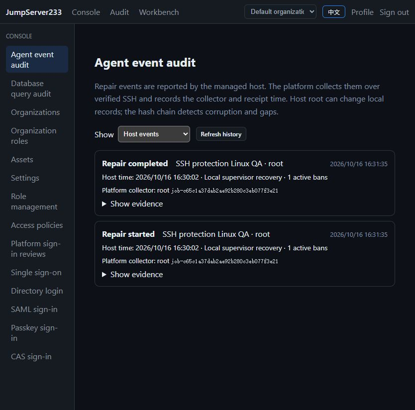

# JumpServer233

> [中文](./README.md) | English

See [isolated Docker environments](./docs/DOCKER-QA.en.md) for fast verification and parallel ports, and [performance baseline](./docs/PERFORMANCE.en.md) for sizes, incremental builds and enforced budgets.

SSH host tools and agents support pinned installation, upgrade/rollback, explicit checkpoint recovery, lifecycle, diagnostics, boot startup and data-preserving uninstall. Independent authorization enables BanHack SSH blocking policies. Native Go component v3 provides resident systemd supervision with ten-second checks and retains existing cron recovery every minute. Structured APIs/CLI, bilingual UI and encrypted audit are included. See [host tools and agents](./docs/HOST-PLUGINS.en.md) and [systemd service management](./docs/AGENT-SYSTEMD.en.md).

The native Go recovery companion builds with the server and needs no Go/Python/jq on targets. It detects and restores lost persisted bans, verified through isolated Linux cron, container reboot and bilingual browsers. See [native host recovery](./docs/HOST-AGENT.en.md).

RDP adds native Go desktops, Web mouse/keyboard and Unicode text, platform-identity CLI capture, independent review, method policies, encrypted graphical replay and explicit text clipboard. Actual Windows NLA and complete Enterprise high-definition parity remain unverified; see [RDP](./docs/RDP.en.md).

Telnet adds native Web/CLI terminals, configurable login prompts, verified TLS/pinned SSH gateways, independent login review, command/recording audit and single-active takeover. See [Telnet](./docs/TELNET.en.md) for plaintext transport and protocol boundaries.

Kubernetes assets support Pod/container selection, Web terminals and `jms k8s`, reusing authorization, reviews, encrypted recording and pinned SSH gateways. See [Kubernetes](./docs/KUBERNETES.en.md) for configuration, scope and acceptance evidence.

Native Redis/MongoDB JSON consoles, key/collection browsing, pinned SSH gateways and CLI are integrated with read-only defaults. See [NoSQL](./docs/NOSQL.en.md).

ClickHouse HTTPS SQL joins inventory, typed parameters, pinned SSH gateways and UI/CLI, with server-side read-only mode by default. Writes have no guaranteed rollback. See [ClickHouse](./docs/CLICKHOUSE.en.md).

Native SQL Server TDS access supports bound parameters, multiple result sets, SSH gateways and the unified UI/CLI. See [SQL Server](./docs/SQLSERVER.en.md) for read-only restrictions and write transaction semantics.

Native MySQL/MariaDB access shares the SQL console and CLI, with verified TLS/read-only defaults and explicit auto-commit write semantics. See [MySQL/MariaDB](./docs/MYSQL.en.md).

Native PostgreSQL SQL console, bound queries, separate login review, redacted audit, gateways and Agent CLI are available. [PostgreSQL](./docs/POSTGRESQL.en.md).

Organizations isolate resources, roles and operational audit through `X-JMS-ORG`, browser switching and Agent CLI selection. Standalone storage and PostgreSQL single-active HA are supported. See [Organizations](./docs/ORGANIZATIONS.en.md). Full Enterprise parity remains in progress.

Platform sign-in approval and console notifications use verified identities, original-source one-use completion, encrypted persistence and PostgreSQL single-active HA. See [Platform sign-in reviews](./docs/PLATFORM-LOGIN-REVIEWS.en.md). Full Enterprise parity remains in progress.

Source, weekly-hour and execution-channel restrictions support standalone and single-active HA. See [Access policies](./docs/ACCESS-POLICIES.en.md). Full Enterprise parity remains in progress.

SSH key installation, verified rotation, opt-in seven-day scheduling and persistent staged recovery are described in [SSH key rotation](./docs/SSH-KEY-ROTATION.en.md).

Targets and gateways support imported SSH private keys with write-only input, vault encryption, public fingerprints and verified history restore. Password rotation remains password-specific. See [SSH private keys](./docs/SSHKEYS.en.md).

SSH gateway routing supports up to three pinned hops across monitoring, Web SSH, CLI, SFTP, jobs and password rotation. Configuration and encrypted credentials support standalone and PostgreSQL single-active HA; see [SSH gateways](./docs/GATEWAYS.en.md). Full Enterprise parity remains in progress.

Passkey registration, device-verified sign-in, local MFA, revocation, and HA recovery: [Passkey](./docs/PASSKEY.en.md).

SAML signed assertions, browser binding, local MFA, encrypted SP identity, and configuration audits: [SAML](./docs/SAML.en.md). Remaining profiles and production IdP integration are open.

An open-source reimplementation of JumpServer built with **Go 1.27 + Vite 8 + React 19**. **Competitor = the features listed on the [JumpServer Enterprise page](https://www.jumpserver.org/enterprise.html)**; X-Pack and app-store parity is delivered in phases. Deployment prioritizes standalone mode; a PostgreSQL-coordinated single-active hot-standby mode is now implemented. See [cluster HA](./docs/CLUSTER-HA.en.md) for its limits.

## Status

The project is in Alpha. Delivered slices include local authentication, SSH inventory and host monitoring, Web SSH/agent CLI bastion and session recordings, seven-day SSH account password rotation, and basic PostgreSQL-coordinated single-active hot standby. See [docs/PLAN.en.md](./docs/PLAN.en.md) for feature boundaries and gaps, [docs/CLUSTER-HA.en.md](./docs/CLUSTER-HA.en.md) for cluster limits, and [docs/BASELINE.en.md](./docs/BASELINE.en.md) for the Enterprise feature baseline.

## Product preview

Local acceptance capture, 2026-10-16: the inventory combines isolated Telnet TLS, a Kubernetes cluster, PostgreSQL, MySQL, MariaDB, SQL Server, ClickHouse, Redis and MongoDB TLS instances, a synthetic SSH monitoring host and a real Linux OpenSSH host. All pictured data belongs to local QA.


Real local RDP acceptance, 2026-10-16, with target state confirming mouse, text and explicit two-way clipboard input:


See the [PostgreSQL guide](./docs/POSTGRESQL.en.md), [MySQL/MariaDB guide](./docs/MYSQL.en.md) and [NoSQL guide](./docs/NOSQL.en.md) for native database commands, read-only policies and auditing.

## Quick start

First-start administrator: **`root / root`**. Created only for an empty user store; existing accounts and passwords are preserved. Change it in Profile. Set `JMS_DEFAULT_ADMIN_ENABLED=false` for custom initialization; see [local authentication](./docs/AUTH.en.md).

Noninteractive Agent CLI and Workbench command jobs are available. See [SSH jobs](./docs/JOBS.en.md) for usage and audit boundaries.

Backend (listens on loopback at `127.0.0.1:8080` by default):

```bash
cd server
go generate ./internal/agentbundle
go run ./cmd/server
```

Frontend (defaults to `http://127.0.0.1:5173`, proxies `/api` and `/ws` to the backend):

```bash
cd web
pnpm install
pnpm dev
```

[LDAP/Active Directory sign-in](./docs/LDAP.en.md) supports verified LDAPS/StartTLS, controlled provisioning, and local MFA.

[CAS sign-in](./docs/CAS.en.md) includes service-ticket/browser binding and local MFA.

## Commands

Global [RBAC role management](./docs/RBAC.en.md) and [OIDC SSO](./docs/OIDC.en.md) are available. Production reverse proxies use `JMS_PUBLIC_URL=https://console.example.com` so browser origins, OIDC callbacks, and `Secure` cookies share the same public address. Local development allows HTTP origins with literal loopback IPs.

| Command | Purpose |
|---|---|
| `cd server && go test ./...` | Backend unit tests |
| `cd server && go vet ./...` | Backend static checks |
| `cd web && pnpm build` | Frontend type check + build |
| `cd web && pnpm lint` | Frontend oxlint (Vite+ toolchain) |
| `cd web && pnpm test:e2e` | Playwright browser end-to-end verification with an isolated backend and data directory |
| `make verify` | Run backend/browser tests, static checks, frontend lint, and production builds together |
| `cd web && pnpm format` | Frontend formatter |

## Layout

```
docs/      Planning and baseline docs (bilingual)
server/    Go backend (Core API + connector boundary layering)
web/       Vite 8 + React 19 frontend (reactbits / shaders / i18n)
AGENTS.md  Working agreement for AI agents / AGENTS.zh.md (Chinese)
```

## Internationalization

The frontend picks the browser language on first load (zh-CN preferred for Chinese environments, otherwise en); the header and login page expose a manual toggle that persists. Docs are bilingual with cross-links at the top.

## Releases and changelog

Conventional Commits; `CHANGELOG.md` is generated/updated **only at release time** by the release-please workflow, which also creates the GitHub Release. No changelog is maintained between releases.

[Agent events and centralized audit](./docs/AGENT-EVENTS.en.md)

Native agents support repair journals, offline backfill, scheduled collection and encrypted centralized audit. Host events are the default view, with collection receipts available separately.



[Native systemd supervision](./docs/AGENT-SYSTEMD.en.md)
