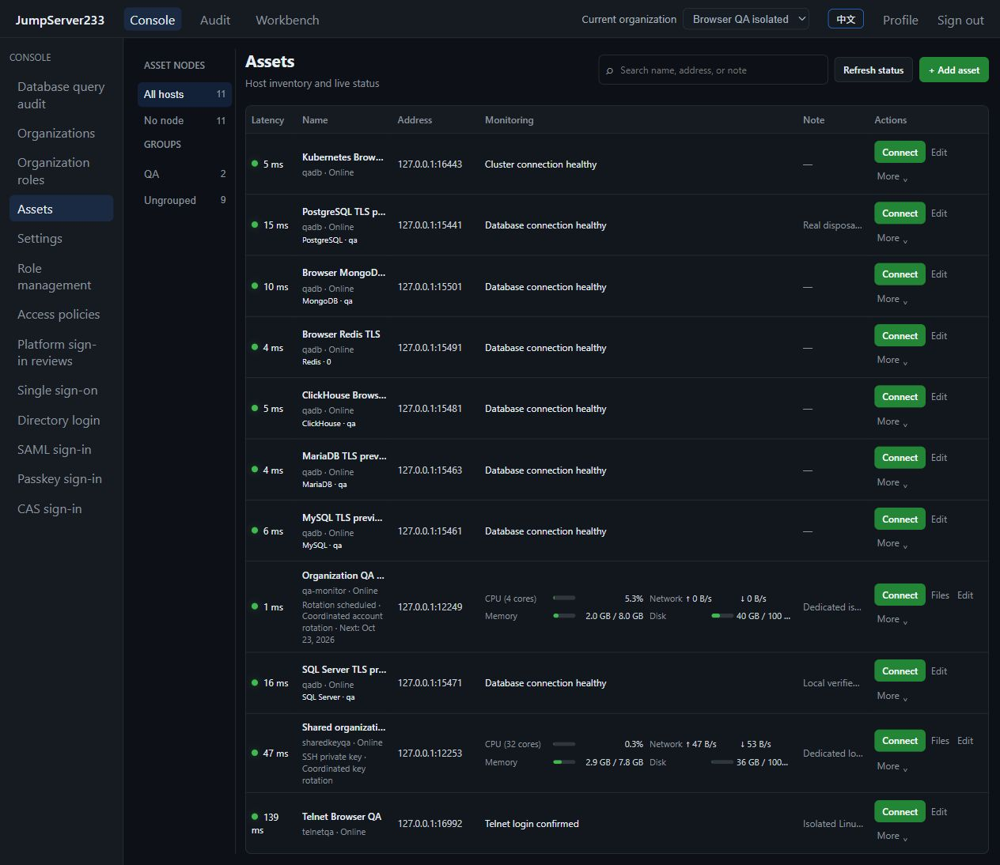

# jumpserver233

> [中文](./README.md) | English

An independent mini SSH bastion for small and medium businesses: **standalone, few dependencies, easy operation/maintenance, security and efficiency**. Built with Go + React. Default operation needs no external database, Redis, resident Node, Docker or cloud account.

[JumpServer Enterprise](https://www.jumpserver.org/enterprise.html) is a reference product. [Product scope](./docs/PRODUCT-SCOPE.en.md) defines delivery; full competitor parity is not the objective.

## Core capabilities

- **SSH operations:** host/multiple-account inventory, groups/search, Web SSH, native SSH/SFTP on 2222, platform-identity CLI/Agent CLI and pinned host keys. Operators need not obtain target passwords.
- **Security:** user/role/asset grants, live revocation, recordings and command/file audit, sensitive-argument redaction, command denial/review and controlled directory rules.
- **Host status:** CPU, memory, disk, network, availability, necessary history and alerts.
- **Account maintenance:** seven-day SSH password/key rotation, connection checks, per-item retry/recovery; native agents and remote tools installed when needed.
- **Updates/recovery:** update checks, controlled install/rollback, encrypted installation export/import and idempotent recovery, preserving assets, credentials, authority and audit.

Current stable **v0.3.1**: mini checklist **12/12**. Native SSH/SFTP and XTerminal monitoring repairs were upgraded once on the intranet; real SSH, file round trips and restart retention passed. The [new table workbench](./docs/NATIVE-SSH.en.md) follows the user's visual feedback and is not released yet. See [progress](./docs/PROGRESS.en.md) for evidence and supported boundaries.

## Standalone deployment

The Go service serves static pages, API and WebSocket on one port through `JMS_WEB_DIR`; `JMS_DATA_DIR` retains data and the Vault key. Embedded SQLite execution history adds no database service. See [installation](./docs/INSTALLATION.en.md) and [backup/recovery](./docs/BACKUP.en.md).

An empty user store creates the default administrator `root / root`; existing accounts are preserved. Change it in Profile. See [local authentication](./docs/AUTH.en.md) for custom initialization.

Existing PostgreSQL standby support, cloud sync, complex identity integrations, extra protocols and enterprise tools are optional extensions. They are not mini prerequisites and are not being expanded in this delivery. Their boundaries remain in the [documentation index](./docs/README.en.md).

## Local development

Backend defaults to `127.0.0.1:8080`:

```bash
cd server
go generate ./internal/agentbundle
go run ./cmd/server
```

Frontend defaults to `http://127.0.0.1:5173` and proxies API/WebSocket:

```bash
cd web
pnpm install
pnpm dev
```

Production uses static build assets and the Go service; Node/pnpm are development/build tools. See [AGENTS](./AGENTS.md) and [testing](./docs/TESTING.en.md) for unified entrypoints. Author necessary mini changes, then verify, repair and clean owned resources idempotently.

## Interface and maintenance

Chinese/English follows the browser language with a manual switch; docs remain bilingual. Primary navigation follows host access, monitoring, audit, permissions and maintenance; less frequent local controls live under “More features”. Project-local [oil-ui](./docs/UI-DESIGN.en.md) guides UI refinement without adding runtime dependencies.



Use Conventional Commits. release-please generates `CHANGELOG.md` **only for a formal release**. No intranet deployment now; publish once after the stable-release gate is met.

Layout: `server/` Go backend, `web/` React frontend, `docs/` bilingual guides, `scripts/` build and QA tools.

Verified mini checklist: [12/12 acceptance and limits](./docs/MINI-ACCEPTANCE.en.md). Default macOS single-node pipeline: [Jenkinsfile_mac_single](./Jenkinsfile_mac_single), [deployment guide](./docs/BUILDWORLD.en.md).
