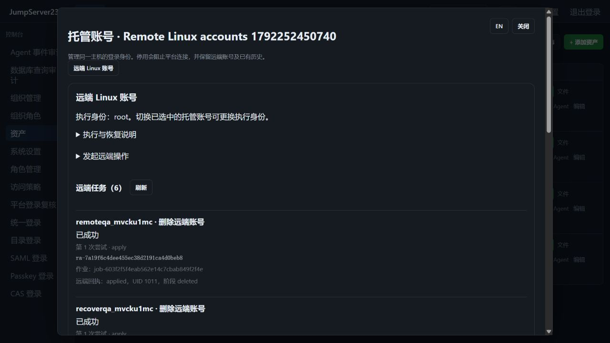
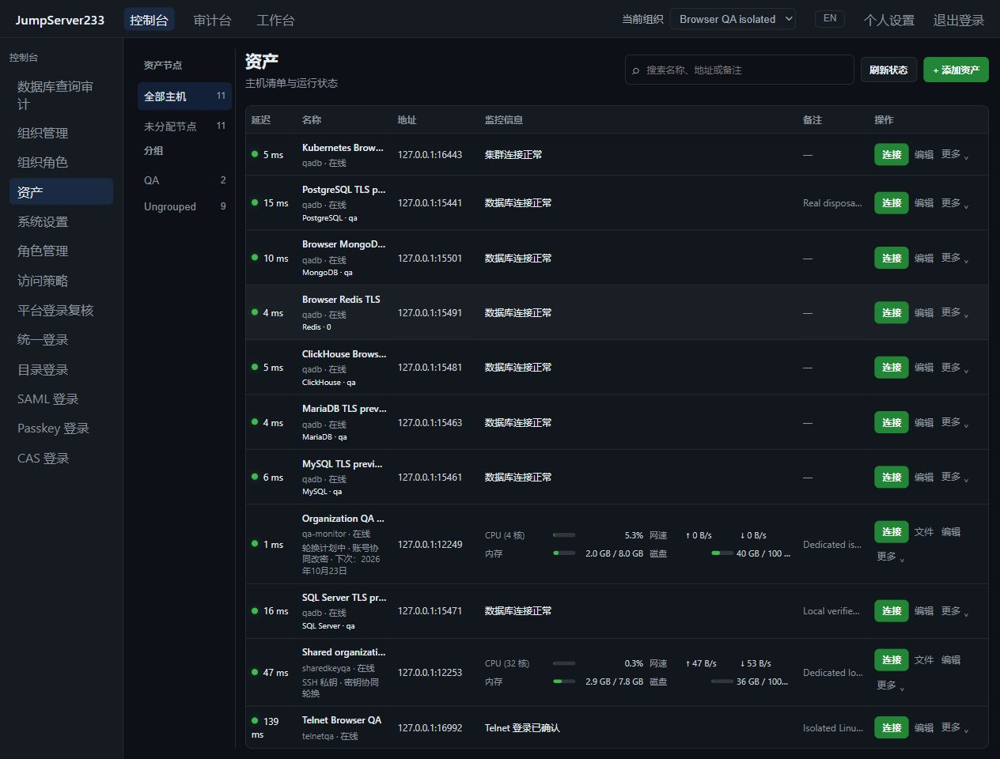
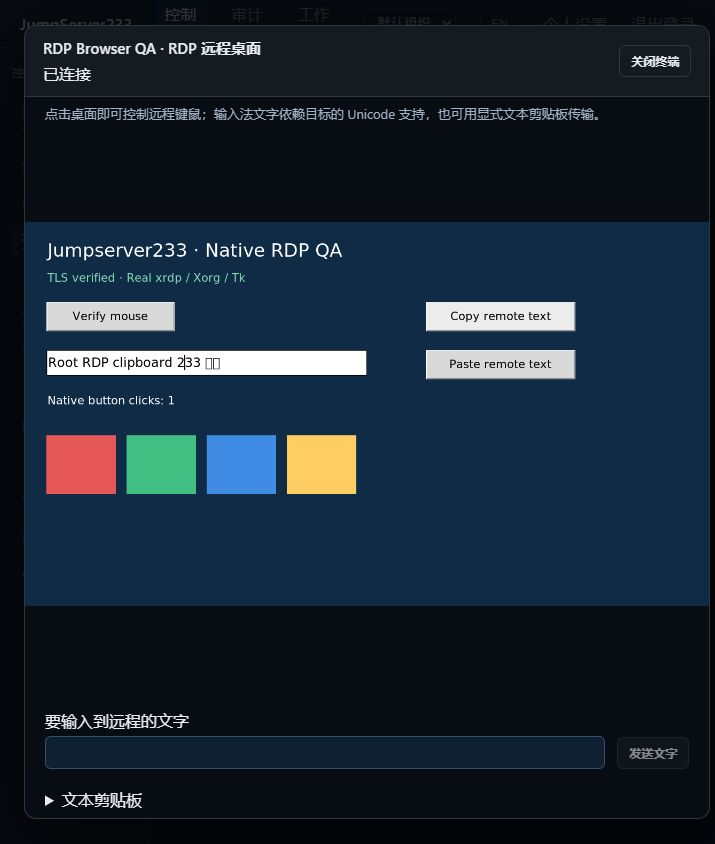
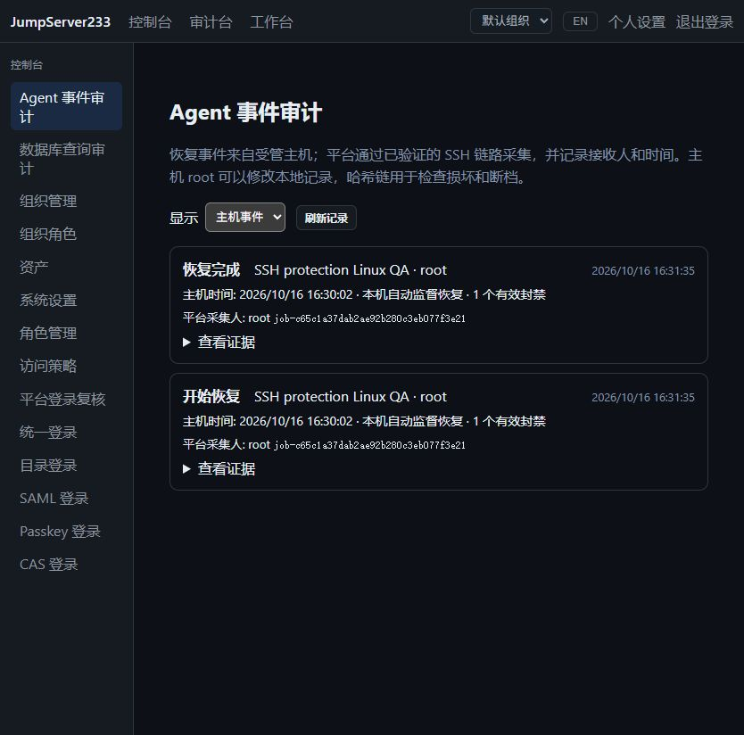

# JumpServer233

> 中文 | [English](./README.en.md)

SSH 账号风险支持七类检测、人工处置、周期计划、CSV 和 CLI；凭据留在服务端，结果按账号权限过滤，见[账号风险](./docs/ACCOUNT-RISKS.md)。

多主机 CSV/XLSX 凭据批量新增和更新已接入 Web、CLI 与组织权限，先预览再整批提交，保留幂等回执；见[账号凭据导入](./docs/ACCOUNT-IMPORT.md)。

Linux 普通账号现支持原生创建、停用、恢复、保留目录删除和显式恢复，Web/CLI 共用持续授权及审批。详见 [远端账号生命周期](./docs/REMOTE-ACCOUNTS.md)。

2026-10-17，独立 Docker 与真实 OpenSSH 的内置浏览器截图：



SSH 主机支持独立多账号凭据托管、发现记录关联、账号级授权与七天轮换；Web SSH、SFTP、工作台和平台 CLI 共用所选身份。见 [SSH 多账号托管](./docs/MANAGED-ACCOUNTS.md)。

Linux 账号收集支持原生 Go 组件、后台作业、审批、人工确认与加密记录，并提供间隔计划、逐轮审批隔离、暂停取消与运行归档。固定 SSH 网关、Web/CLI 和 PostgreSQL 单活状态存储均支持，见[计划账号收集](./docs/SCHEDULED-ACCOUNT-DISCOVERY.md)。

RDP 活动桌面支持独立权限的只读实时监看、观看者审计与 CLI 截图，关闭监看保留原连接。权限、资源限制和真实截图见 [RDP 实时监看](./docs/RDP-LIVE-MONITOR.md)。

活动终端支持指定平台用户的只读分享、输入接管、成员移除与协作审计，Web 和 CLI 共用持续授权；默认需显式启用，见 [终端会话协作](./docs/SESSION-SHARING.md)。

快速验证与独立端口调试见 [Docker 隔离环境](./docs/DOCKER-QA.md)；产物体积、增量构建与自动预算见 [性能基线](./docs/PERFORMANCE.md)。

SSH 主机工具与 Agent 支持固定版本安装、升级/回退、中断检查点恢复、启停、巡检、开机启动和保留数据卸载；独立授权可启用 BanHack SSH 封禁策略。原生 Go 组件 v3 支持 systemd 常驻监督与十秒检查，兼容已有 cron 每分钟恢复。提供结构化 API/CLI、中英 UI 与加密审计。见 [主机工具与 Agent](./docs/HOST-PLUGINS.md) 和 [systemd 服务管理](./docs/AGENT-SYSTEMD.md)。

原生 Go 恢复组件随服务端构建，目标主机无需 Go/Python/jq；检查并恢复丢失的持久封禁，隔离 Linux 的实际 cron、容器重启与中英浏览器验收通过。见 [原生主机恢复](./docs/HOST-AGENT.md)。

RDP 新增 Go 原生桌面连接、Web 键鼠与 Unicode 文字、平台身份 CLI 截图、独立复核、通道策略、加密图形回放和显式文本剪贴板。实际 Windows NLA 与完整企业高清桌面仍待验收，见 [RDP](./docs/RDP.md)。

Telnet 新增原生 Web/CLI 终端、可配置登录提示、校验 TLS/固定 SSH 网关、独立登录复核、命令/录像审计与单活接管。明文链路及协议边界见 [Telnet](./docs/TELNET.md)。

Kubernetes 集群支持 Pod/容器选择、Web 终端和 `jms k8s`，复用授权、复核、加密录像与固定 SSH 网关。配置、支持范围及验收证据见 [Kubernetes](./docs/KUBERNETES.md)。

Redis 与 MongoDB 原生 JSON 命令控制台、浏览键/集合、固定 SSH 网关和 CLI 已接入，默认只读。能力及边界见 [NoSQL](./docs/NOSQL.md)。

ClickHouse HTTPS SQL 现已接入统一资产、类型参数、固定 SSH 网关和 UI/CLI，默认服务端只读；写入不承诺回滚。见 [ClickHouse](./docs/CLICKHOUSE.md)。

SQL Server 原生 TDS 访问支持参数绑定、多结果集、SSH 网关和统一 UI/CLI；只读限制与写入事务边界见 [SQL Server](./docs/SQLSERVER.md)。

MySQL 与 MariaDB 原生访问已接入同一 SQL 控制台和 CLI，默认校验 TLS 与只读策略，写入采用明确的自动提交语义。详见 [MySQL/MariaDB](./docs/MYSQL.md)。

PostgreSQL 原生 SQL 控制台、参数查询、独立登录复核、脱敏审计、网关与 Agent CLI 已接入。 [PostgreSQL](./docs/POSTGRESQL.md).

组织通过 `X-JMS-ORG`、浏览器切换和 Agent CLI 选择隔离资源、角色与运维审计，支持单机存储和 PostgreSQL 单活 HA。详见 [组织隔离](./docs/ORGANIZATIONS.md)；完整企业版目标仍在进行。

平台登录审批与站内通知已接入：认证后等待、原来源一次性兑换、加密持久化及 PostgreSQL 单活 HA。详见 [平台登录复核](./docs/PLATFORM-LOGIN-REVIEWS.md)；完整企业版目标仍在进行。

来源、每周时段及执行通道限制支持单机和单活 HA，详见 [访问策略](./docs/ACCESS-POLICIES.md)；完整企业版对齐仍在推进。

SSH 密钥安装、验证后轮换、显式启用的七天计划及持久化阶段恢复见 [SSH 密钥轮换](./docs/SSH-KEY-ROTATION.md)。

目标资产与网关现支持导入 SSH 私钥：输入只写、保管库加密、公钥指纹及验证后恢复历史版本。密码轮换仍按密码凭据调度，详见 [SSH 私钥](./docs/SSHKEYS.md)。

SSH 网关现支持最多三跳，监控、Web SSH、CLI、SFTP、任务和改密共用逐跳指纹校验连接。配置与加密凭据支持单机及 PostgreSQL 单活 HA，详见 [SSH 网关](./docs/GATEWAYS.md)。完整企业版对齐仍在推进。

Passkey 注册、设备验证登录、本地 MFA、撤销与 HA 恢复见 [Passkey](./docs/PASSKEY.md)。

SAML 签名断言、浏览器绑定、本地 MFA、SP 身份加密和配置审计见 [SAML](./docs/SAML.md)；其余协议配置及生产 IdP 对接仍待完成。

用 **Go 1.27 + Vite 8 + React 19** 完全复刻 JumpServer 的开源项目。**竞品 = [JumpServer 企业版功能页](https://www.jumpserver.org/enterprise.html)**，按阶段对齐 X-Pack 与应用商店能力；部署优先单机，当前已实现 PostgreSQL 协调的单活热备基础模式，限制见 [集群高可用说明](./docs/CLUSTER-HA.md)。

## 当前状态

当前处于 Alpha 阶段：已交付本地认证、SSH 资产与主机监控、Web SSH/Agent CLI 跳板和会话录像、SSH 账号每 7 天自动轮换，以及 PostgreSQL 协调的单活热备基础模式。各功能边界与剩余差距见 [docs/PLAN.md](./docs/PLAN.md)，集群模式限制见 [docs/CLUSTER-HA.md](./docs/CLUSTER-HA.md)，企业版需求基线见 [docs/BASELINE.md](./docs/BASELINE.md)。

## 产品预览

2026-10-16 本机验收截图：资产页同时展示隔离的 Telnet TLS、Kubernetes 集群、PostgreSQL、MySQL、MariaDB、SQL Server、ClickHouse、Redis、MongoDB TLS 实例、合成 SSH 监控主机和真实 Linux OpenSSH 主机。截图中的数据用于本机 QA。



2026-10-16 本机真实 RDP 桌面验收，远端程序已确认鼠标、文字与双向显式剪贴板输入：



原生数据库命令、只读策略和审计示例见 [PostgreSQL 文档](./docs/POSTGRESQL.md)、[MySQL/MariaDB 文档](./docs/MYSQL.md) 与 [NoSQL 文档](./docs/NOSQL.md)。

## 快速开始

首次启动默认管理员：**`root / root`**。仅空用户库自动创建，已有账号和密码不会被覆盖；可在个人设置修改。自定义初始化设置 `JMS_DEFAULT_ADMIN_ENABLED=false`，详见 [本地认证](./docs/AUTH.md)。

非交互 Agent CLI 与工作台命令作业已提供，使用方式和审计边界见 [SSH 作业](./docs/JOBS.md)。

后端（默认仅监听本机 `127.0.0.1:8080`）：

```bash
cd server
go generate ./internal/agentbundle
go run ./cmd/server
```

前端（默认 `http://127.0.0.1:5173`，已代理 `/api` 与 `/ws` 到后端）：

```bash
cd web
pnpm install
pnpm dev
```

已提供 [LDAP/Active Directory 登录](./docs/LDAP.md)，使用校验证书的 LDAPS/StartTLS、受控建号和本地 MFA。

已提供 [CAS 单点登录](./docs/CAS.md)，包含服务票据/浏览器绑定和本地 MFA。

## 常用命令

已提供全局 [RBAC 角色管理](./docs/RBAC.md) 和 [OIDC 统一登录](./docs/OIDC.md)。生产反向代理设置 `JMS_PUBLIC_URL=https://console.example.com`，让浏览器源校验、OIDC 回调及 `Secure` Cookie 使用同一公共地址；本机开发允许字面 loopback IP 的 HTTP 源。

| 命令 | 作用 |
|---|---|
| `cd server && go test ./...` | 后端单元测试 |
| `cd server && go vet ./...` | 后端静态检查 |
| `cd web && pnpm build` | 前端类型检查 + 构建 |
| `cd web && pnpm lint` | 前端 oxlint（vite+ 工具链） |
| `cd web && pnpm test:e2e` | Playwright 浏览器端到端验证（临时后端和数据目录） |
| `make verify` | 一次性运行后端/浏览器测试、静态检查、前端 lint 与生产构建 |
| `cd web && pnpm format` | 前端格式化 |

## 目录结构

```
docs/      规划与基线文档（中英双语）
server/    Go 后端（Core API + 连接器边界分层）
web/       Vite 8 + React 19 前端（reactbits / shaders / i18n）
AGENTS.md  AI agent 工作约定（English）/ AGENTS.zh.md（中文）
```

## 国际化

前端默认按浏览器语言自动识别（中文优先环境 → zh-CN，否则 en），顶栏/登录页可手动切换并持久化。文档提供中英两版，顶部互相链接。

## 发布与 Changelog

采用 Conventional Commits；**仅在 release 时**由 release-please 工作流生成/更新 `CHANGELOG.md` 并创建 GitHub Release，平时不维护 changelog。

[Agent 事件与集中审计](./docs/AGENT-EVENTS.md)

原生 Agent 已支持恢复事件记录、离线补采、定时采集和加密集中审计；事件默认按主机展示，采集回执可独立查看。



[systemd 原生守护](./docs/AGENT-SYSTEMD.md)
