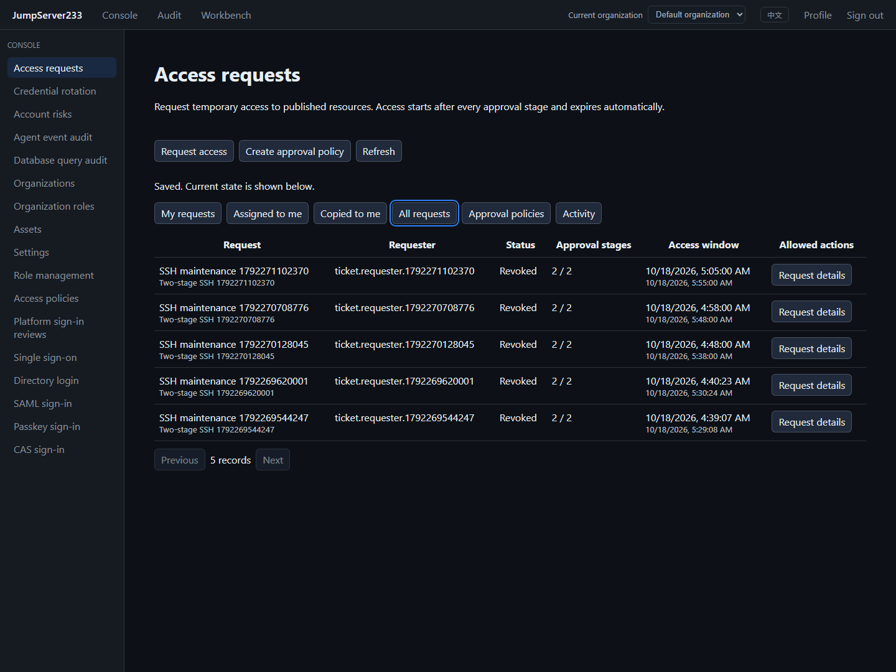

# Access request tickets

> [中文](./ACCESS-TICKETS.md) | English

Administrators publish asset/node, account and action scopes. Users request temporary access through one to five approval stages; completed approval creates native grants. Web, `jms ticket` and the Go SDK share the workflow, while target credentials remain server-side.

Competitor = [JumpServer Enterprise](https://www.jumpserver.org/enterprise.html). The flow follows its official [feature settings and multilevel workflows](https://docs.fit2cloud.com/jumpserver/manual/admin/system_settings/feature_settings/) and [user tickets](https://docs.fit2cloud.com/jumpserver/v4/manual/user/ticket/). Full Enterprise scope remains tracked by [PLAN](./PLAN.en.md).

## Use

1. Console → Access requests → Create approval policy. New policies are disabled. Set a name, maximum access duration and approval deadline.
2. Select requester users, groups or roles from the current organization, or allow all active members. Copied participants may read and comment; copying does not grant review permission.
3. Configure one to five ordered stages. Each stage may select multiple eligible users, groups or roles; one candidate completes it. Requesters cannot self-approve, and a person cannot approve multiple stages in the same approval round. Publishing and submission reject chains without enough distinct current reviewers.
4. Publish asset or node scopes with explicit account names and view, connect or file-transfer actions. Node scope includes descendants and future assets and follows node membership changes; review that scope before publishing.
5. Members choose Request access, select up to 50 published resources and enter their reason and end time. The catalog returns names, resource types, protocols and account metadata; addresses, host fingerprints and credentials are absent.
6. Assigned to me shows current decisions. Reviewers examine the request, earlier decisions and discussion, then approve or reject. The final approval enables access within the requested window.
7. Requesters and current-stage reviewers may adjust resources, actions and the window. This resets every stage and uses the current policy. Policy edits cause the worker to close old pending requests as stale; submit a new request after that happens.
8. Requesters may cancel or revoke their tickets; authorized administrators may revoke organization tickets. Expiry, revocation and policy disablement/deletion deny access from the ticket. Independently assigned grants continue under existing rules.

Maximum duration is 1–43,200 minutes; approval TTL is 1–10,080 minutes. Browser time inputs use the browser timezone and are stored as UTC. Grants deny access before the start and after the end.

2026-10-18: isolated Docker and real OpenSSH proof covering two stages, amendment reset, CLI/Web SSH and active-session revocation:



## Authority and organizations

| Permission | Purpose |
|---|---|
| `tickets.manage` + `grants.manage` + `assets.view_all` | Publish, edit and delete current-organization policies |
| `tickets.review` | Review the selected current stage; provides no inventory administration or connection authority |
| `tickets.view_all` | Read all current-organization tickets and audits |
| `tickets.revoke` | Read and revoke current-organization ticket grants |

Every authenticated active organization member can view eligible published policies and apply. Candidates must currently hold review permission. Every decision and final grant publication rechecks the requester, publisher, earlier reviewers and resource bindings. Group and role selectors resolve current memberships.

Approved access uses native user grants. Actual connections still enforce MFA, organization membership, enabled accounts, access policies, asset login reviews, command filters and session policies. Already approved grants do not automatically restart approval after description edits or publisher role changes. Disabling or deleting the policy immediately makes them ineffective.

## Storage, recovery and retention

- Standalone file storage is the default. Organization AES-GCM encrypts policies, tickets, decisions, discussions and audit in `access-tickets.json`. PostgreSQL uses the organization-scoped `access-tickets` document and the existing single-active lease/takeover lifecycle.
- The last decision is durably stored as `issuing`; the entire native grant batch and receipt commit atomically, followed by the workflow's `approved` state. Access becomes usable only after the latter succeeds. A failed final workflow write leaves existing grant rows ineffective.
- Restart/takeover reuses the original batch receipt after rechecking current principals and resources. Administrator-deleted grant rows are never recreated.
- Organization disablement or service shutdown cancels queued issuance and drains API-initiated operations before a new runtime opens the same grant document. Removing any issued grant row causes the whole ticket batch to enter revocation.
- Revocation first stores `revoking` and closes the workflow gate, then removes only the ticket's native grants and commits a tombstone. A grant-store write failure leaves access blocked while the worker retries cleanup.
- Resource bindings cover endpoint identity, address, protocol settings, node ancestry and pinned gateway routes. Target changes block pending approval. Credential revisions and password/key rotation do not invalidate otherwise unchanged requests.
- Native grant storage becomes format 2 when ticket receipts exist. Older binaries reject it rather than ignoring workflow gates or tombstones. Preserve state and use a compatible version for rollback.
- Per organization: 256 policies, 2,000 retained tickets, 20,000 rolling audit events. Each ticket supports 100 comments and 100 idempotent decision receipts. Terminal tickets retain 180 days; audit retains up to 365 days subject to its rolling count. Native grant receipts are capped at 5,000 batches. Revoked receipts are pruned hourly after both creation and expiry are older than 180 days. Capacity limits reject new work; they do not prevent revoking existing access.
- Historical names and published scope remain in tickets for audit. Responses omit private bindings and digests. Reasons and comments are participant-visible metadata; do not enter credentials.

File mode is single process. PostgreSQL uses the existing single-active coordinator. Evidence covers isolated state-store takeover, while production multi-active, cross-region fault drills and external notifications remain open. Console assignments and copied views are available; email/SMS delivery is not implemented by this feature.

## CLI / SDK

Use the existing platform identity through `JMS_SERVER_URL`, `JMS_TOKEN` or AccessKey and optional `JMS_ORG_ID`. The SDK lives in `server/internal/sessionclient/tickets.go` and exposes public metadata DTOs.

```sh
jms ticket policies
jms ticket catalog POLICY_ID --search maintenance
jms ticket create --file request.json
jms ticket list --view assigned
jms ticket show TICKET_ID
jms ticket approve TICKET_ID --revision 1 --request-id stable-decision-id
jms ticket amend TICKET_ID --file amendment.json
jms ticket reject TICKET_ID --revision 2 --comment "Outside maintenance window"
jms ticket comment TICKET_ID --text "Reviewed the requested account"
jms ticket wait TICKET_ID --timeout-seconds 300
jms ticket revoke TICKET_ID --revision 4
jms ticket audit
jms ticket policy-create --file policy.json
jms ticket policy-update POLICY_ID --file policy.json
jms ticket policy-delete POLICY_ID --revision 2
```

Request JSON example; replace public IDs and future absolute times:

```json
{
  "name": "Maintenance access",
  "policy_id": "POLICY_ID",
  "policy_revision": 1,
  "request_id": "stable-request-id",
  "reason": "Approved maintenance window",
  "targets": [
    {"kind": "asset", "id": "ASSET_ID", "account": "maintenance", "actions": ["connect"]}
  ],
  "ends_at": "2030-01-01T13:00:00Z"
}
```

End time must be within the next year and respect policy duration. `request_id` is idempotent per requester: identical input returns the existing ticket; changed input conflicts. The CLI generates an ID when omitted; automated retries should explicitly preserve IDs in their file or flags and inspect existing state first. Decisions have their own ID and revision. Replaying an earlier decision cannot approve amended scope. `wait` exits nonzero on a terminal result without approval or on timeout.

See [TESTING](./TESTING.en.md) for evidence and acceptance boundaries. Changelog is generated only at release.
