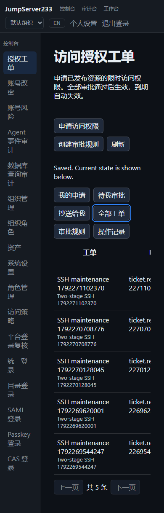

# 访问授权工单

> 中文 | [English](./ACCESS-TICKETS.en.md)

管理员发布可申请的资产、节点、账号和操作范围；用户申请限时权限，经 1–5 级审批后写入原有授权系统。Web、`jms ticket` 和 Go SDK 共用状态机，目标凭据始终留在服务端。

竞品 = [JumpServer 企业版](https://www.jumpserver.org/enterprise.html)。流程参考官方[功能设置与多级工作流](https://docs.fit2cloud.com/jumpserver/manual/admin/system_settings/feature_settings/)及[用户工单](https://docs.fit2cloud.com/jumpserver/v4/manual/user/ticket/)。完整企业版范围继续按 [PLAN](./PLAN.md) 推进。

## 使用

1. 控制台 →「授权工单」→「创建审批规则」。新规则默认停用，设置名称、最长授权时长及审批期限。
2. 选择允许的申请人；支持当前组织的用户、用户组或角色，也可开放给所有活跃成员。抄送参与人可查看和评论，不能因此获得审批权限。
3. 按顺序配置 1–5 级审批。每级可选择多个候选用户、用户组或角色；每级由其中一人处理。申请人不能自批，同一人在一次审批轮次内不能处理多级。系统拒绝没有足够不同审批人的发布或申请。
4. 发布资产或节点范围，明确列出账号名及查看、连接、文件传输操作。节点范围包括后代及后续新增资产，也随节点归属变更继承；发布前核对范围。
5. 启用规则后，成员点击「申请访问权限」，从已发布目录选择最多 50 个资源，填写业务原因与结束时间。目录只返回资源名称、类型、协议和账号等元数据，不返回地址、主机指纹或凭据。
6. 审批人在「待我审批」查看完整申请、既有决定和讨论，批准或拒绝。最后一级批准成功后按申请时段生效。
7. 申请人或当前级审批人可「调整申请」，修改范围、操作和时段；全部审批重置并按当前规则重新审批。规则变更后后台会将原待审批工单关闭为失效，此时需要新申请。
8. 申请人可取消或撤销自己的工单；被授权的管理员也可撤销。截止时间、撤销、规则停用或删除都会使该工单的授权拒绝访问。单独分配的其他授权继续按原有规则生效。

最长授权时长为 1–43,200 分钟，审批期限为 1–10,080 分钟。时间输入按浏览器本地时区解释，服务端保存 UTC；授权开始前和结束后均无效。

2026-10-18，独立 Docker + 真实 OpenSSH 的双级审批、调整重审、CLI/Web SSH 和活动会话撤销验证截图：



## 权限和组织

| 权限 | 用途 |
|---|---|
| `tickets.manage` + `grants.manage` + `assets.view_all` | 发布、修改和删除当前组织的审批规则 |
| `tickets.review` | 作为规则选定的审批人处理当前级；不授予资产管理或连接权限 |
| `tickets.view_all` | 查看当前组织全部工单与审计 |
| `tickets.revoke` | 查看和撤销当前组织工单授权 |

所有已认证的活跃组织成员均可查看自己符合条件的已发布规则并提交申请。规则候选人只有在当前具有审批权限时才能审批；每次决策及最终授权前再次检查申请人、发布人、既有审批人和资源绑定。用户组与角色选择器使用当前成员关系。

审批发放的是原有用户授权。实际连接继续执行 MFA、组织成员、账号启停、访问策略、资产登录复核、命令过滤和会话策略；审批不绕过这些检查。当前已批准工单不会因为规则修改描述或发布人角色变更而自动重审；停用或删除规则会使其权限立即失效。

## 持久化、恢复和保留

- 默认单机文件模式；工作流、审批、讨论和审计保存在当前组织 AES-GCM 加密的 `access-tickets.json`。PostgreSQL 模式使用同一组织范围内的 `access-tickets` 文档，复用现有单活租约及接管流程。
- 最终决定先持久化为 `issuing`，整批授权及回执在授权文档中原子写入，再持久化 `approved`。只有后者成功，工单授权才可使用；最终状态写入失败时，已存在的授权行仍拒绝访问。
- 重启或接管后复用已有批次回执，重新核对当前身份和资源，继续完成原批次；不会重新创建管理员已删除的授权行。
- 组织停用或服务关闭会取消排队中的授权写入，并等待 API 内正在发放的操作退出；新运行时打开相同授权文档前，旧操作已停止。删除任意已发放授权行会让整个工单批次进入撤销。
- 撤销先持久化 `revoking` 并关闭工作流授权门，再删除本工单的授权行、写入撤销回执。授权存储暂不可写时访问已被阻止，后台继续重试清理。
- 资源绑定覆盖端点身份、地址、协议设置、节点关系及固定网关。连接目标变化会阻止待审批申请继续；凭据修订、密码/密钥轮换不使正常申请失效。
- 原生授权文档有工单回执时升级为 format 2。旧二进制拒绝该格式，避免忽略工作流门或撤销回执；降级前需保留数据并使用兼容版本。
- 每组织最多 256 条规则、2,000 条保留工单、20,000 条滚动审计；每工单最多 100 条评论及 100 条幂等决策回执。终态工单保留 180 天，审计最长 365 天且受滚动条数限制。授权回执最多 5,000 批，撤销回执在创建与到期均超过 180 天后按小时清理。达到工单或授权回执上限时拒绝新增，不取消已有访问的撤销能力。
- 历史参与人姓名和已发布范围保留在工单中供追溯；请求返回不含内部资源绑定与摘要。评论与原因是参与人可见的元数据，请勿填写凭据。

现有文件存储是单进程模式；PostgreSQL 使用现有单活协调。这里验证的是隔离状态存储的接管恢复，生产多活、跨地域故障演练仍在后续范围。审批待办及外部渠道见[通知中心](./NOTIFICATIONS.md)。

## CLI / SDK

使用已有平台身份的 `JMS_SERVER_URL`、`JMS_TOKEN` 或 AccessKey，以及可选 `JMS_ORG_ID`。SDK 在 `server/internal/sessionclient/tickets.go`，DTO 只含公开工作流元数据。

```sh
jms ticket policies
jms ticket catalog POLICY_ID --search maintenance
jms ticket create --file request.json
jms ticket list --view assigned
jms ticket show TICKET_ID
jms ticket approve TICKET_ID --revision 1 --request-id stable-decision-id
jms ticket amend TICKET_ID --file amendment.json
jms ticket reject TICKET_ID --revision 2 --comment "Outside maintenance window"
jms ticket comment TICKET_ID --text "Reviewed the requested account"
jms ticket wait TICKET_ID --timeout-seconds 300
jms ticket revoke TICKET_ID --revision 4
jms ticket audit
jms ticket policy-create --file policy.json
jms ticket policy-update POLICY_ID --file policy.json
jms ticket policy-delete POLICY_ID --revision 2
```

申请 JSON 示例（仅元数据，替换公开 ID 与未来的绝对时间）：

```json
{
  "name": "Maintenance access",
  "policy_id": "POLICY_ID",
  "policy_revision": 1,
  "request_id": "stable-request-id",
  "reason": "Approved maintenance window",
  "targets": [
    {"kind": "asset", "id": "ASSET_ID", "account": "maintenance", "actions": ["connect"]}
  ],
  "ends_at": "2030-01-01T13:00:00Z"
}
```

服务端要求结束时间在未来一年内，并遵守规则时长。`request_id` 在同一申请人范围内幂等；相同 ID 与相同输入返回原工单，不同输入返回冲突。CLI 未提供 ID 时会生成随机值；自动化重试应在文件或参数中显式固定 ID，先查询原工单再决定后续操作。决策另有独立 ID 和修订号，旧决定重试不会批准调整后的范围。`wait` 对未获批准的终态及超时返回非零。

相关验证与接受边界见 [TESTING](./TESTING.md)。Changelog 仅在 release 时生成。
