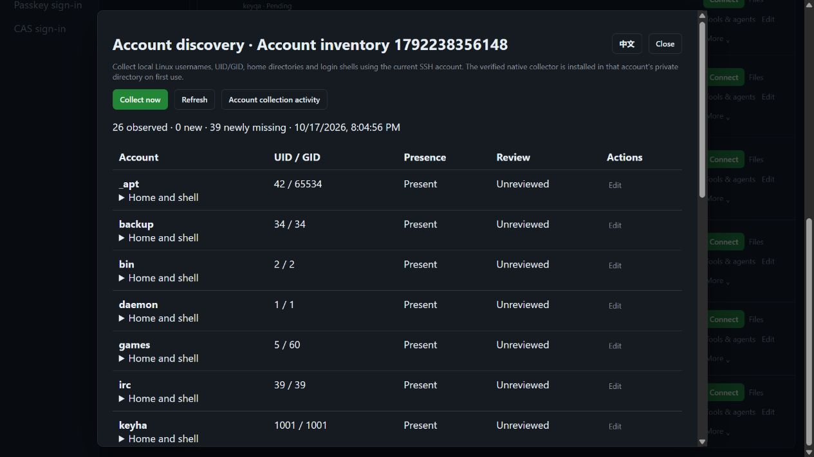

# Linux account discovery

> [中文](./ACCOUNT-DISCOVERY.md) | English

Managed SSH hosts can collect local Linux account metadata through the native Go component, preserving discovered/missing identities and human review. Standalone is the default; records support organization isolation and PostgreSQL active/standby state storage. The competitor is [JumpServer Enterprise](https://www.jumpserver.org/enterprise.html); its [official account-discovery documentation](https://docs.fit2cloud.com/jumpserver/v4/manual/admin/pam/automation/account_discovery/) supplies the feature reference. The full objective continues under [PLAN](./PLAN.en.md).

## Use

Asset inventory → SSH host “More” → “Collected accounts”:

1. Select “Collect now” and follow the background job. Existing login and command approval flows apply.
2. Rows show username, UID/GID, presence and review state. Expand “Home and shell” for paths and notes. UID 0 receives a separate marker.
3. Mark records unreviewed, acknowledged or ignored and add notes. These states record human assessment without granting remote account access.
4. Subsequent collections preserve decisions for the same identity and mark new/missing accounts. Reusing a username with a different UID creates a new record without inheriting ignore status.
5. “Account collection activity” pages through platform collectors, job results and review changes. UI language is detected automatically; switching language preserves the current job.

Platform CLI uses existing `JMS_SERVER_URL`, `JMS_TOKEN` / AccessKey and optional `JMS_ORG_ID`, without target passwords:

```powershell
cd server
go run ./cmd/jms accounts discover <asset-id> --request-id collection-unique-001
go run ./cmd/jms accounts list <asset-id> --offset 0 --limit 50
go run ./cmd/jms accounts review <asset-id> <finding-id> --state acknowledged --revision 2 --note "Verified"
go run ./cmd/jms accounts audit <asset-id>
go run ./cmd/jms accounts job <job-id>
go run ./cmd/jms accounts cancel <job-id>
```

`discover` waits for login/command approval and completion by default. `--no-wait` returns current state; `--timeout` accepts 1–300 execution seconds. Reuse the request ID after an uncertain submission; use a new ID to retry a known failed job. Leaving the CLI does not cancel an accepted background job; use explicit `cancel`. Review updates use the list's `revision`; stale versions return 409.

## Authority and execution

| Permission | Purpose |
|---|---|
| `accounts.view` plus current asset visibility | Read findings/activity for the current target |
| `accounts.discover` plus an asset `connect` grant | Collect accounts and initially install the verified collector |
| `accounts.review` plus the preceding read authority | Save review state and notes |

System administrators retain their built-in role. Ordinary view, terminal connection or plugin management does not acquire account-discovery authority; discovery does not grant independent connections. Jobs share login review, command rules/approval, cancellation, ownership, encrypted audit and idempotent requests.

Checks run before execution, after connection, before uploads/commands and before persistence. They cover current platform identity, membership, account permission, asset grants, source/time policies and up to three pinned SSH gateway hops. An operation binds all credential/gateway revisions; revocation cancels transport and prevents publishing unfinished results. Target identity separately binds host, port and host key, so seven-day password rotation or a different collector account preserves human decisions.

The current SSH account installs the native program at `$HOME/.jumpserver233/account-discovery/agent-recovery-<sha256>`. Architecture, embedded SHA-256, directory ownership, regular-file and no-symlink checks apply. Verified binaries are reused without external scripts or automatic elevation. Discovery shares the embedded Go component with recovery/supervision commands. The target needs no Go, Python or jq, and the component opens no listener.

## Data, integrity and limits

- Read `/etc/passwd` using the [Linux passwd format](https://man7.org/linux/man-pages/man5/passwd.5.html). Password/GECOS fields are discarded on the target. Only username, UID/GID, home and shell are transferred; `/etc/shadow` is not read. These fields do not establish SSH login eligibility or sudo authority.
- Source files are limited to 4 MiB and 4096 accounts. They must be regular, root-owned and not group/world-writable, and are opened without following symlinks. Changes during a read or malformed fields refuse that result.
- Pages contain 32 accounts and at most 60 KiB JSON through independent `jms233/linux-local-accounts/v1`. Every page must have the same metadata-only digest, total and contiguous order. Missing/truncated pages, duplicate fields or changing inventory never publish a partial snapshot.
- Each organization permits four concurrent collections, one per asset. Busy collection fails promptly while retaining existing records. Incomplete pages cannot become false missing-account findings.
- Findings, notes and activity use one AES-GCM document per asset with asset-bound authenticated data. Local files use mode 0600 and synced temporary-file replacement; PostgreSQL retains the same encrypted document. Failed writes publish no new revision.
- Current limits per asset are 16384 historical identities, 2000 activities and 16 MiB plaintext state. Exhaustion refuses new data while retaining history, without silently trimming audit. APIs page 1–100 rows; browsers use 20. Automatic archival and retention management remain open.

## Standalone, HA and remaining scope

Standalone comes first. PostgreSQL active/standby shares organization keys and state documents, keeping records and decisions readable after takeover. In-memory concurrency slots do not migrate. Active collections become interrupted jobs and remote commands never replay automatically; submit a new request ID. Organization disablement or lost node ownership stops new record publication.

Local acceptance on 2026-10-17 used real Linux OpenSSH, a pinned SSH gateway and production Docker. Web/CLI checked independent grants, both approvals, approval-time revocation, pagination, review notes, missing accounts after deletion and retained decisions across credential revisions. The in-app browser separately refreshed 26 current accounts and 39 newly missing QA accounts from temporary-account cleanup; these are not production risk statistics. See [Automated verification](./TESTING.en.md) for batch results.



This delivery covers local Linux metadata and human review. Account synchronization, independent multiple-account credential management, remote account creation/deletion, scheduled collection, Windows/directory/database discovery and weak-password/secret inspection remain part of the Enterprise objective. Existing managed-login seven-day rotation and encrypted credential history are described in [Password rotation](./PASSWORD-ROTATION.en.md).
