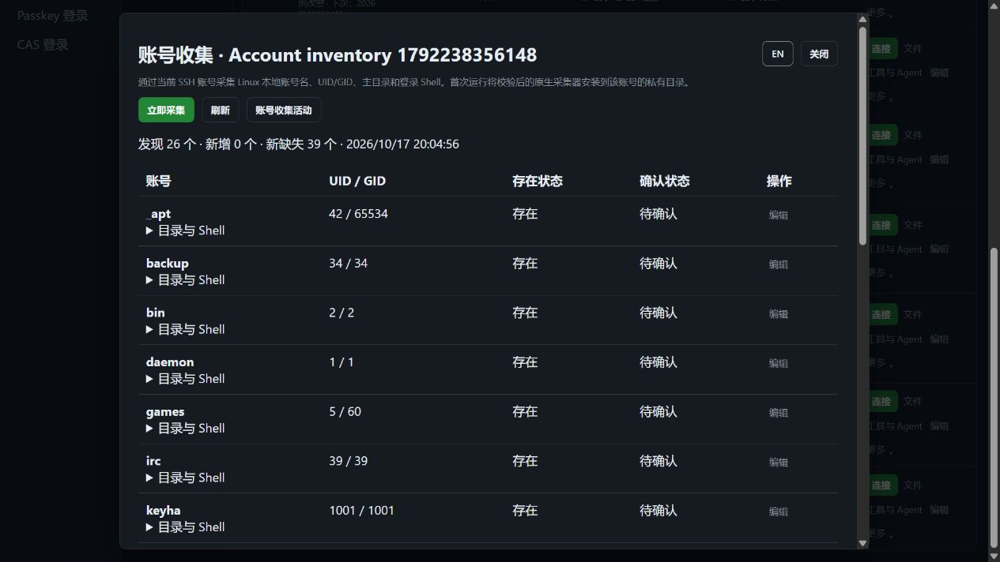

# Linux 账号收集

> 中文 | [English](./ACCOUNT-DISCOVERY.en.md)

纳管 SSH 主机可通过原生 Go 组件采集 Linux 本地账号元数据，保存发现、缺失与人工确认记录。默认单机；记录支持组织隔离和 PostgreSQL 单活状态存储。竞品为 [JumpServer 企业版](https://www.jumpserver.org/enterprise.html)，账号发现对齐来源见[官方文档](https://docs.fit2cloud.com/jumpserver/v4/manual/admin/pam/automation/account_discovery/)。完整企业版目标仍按 [PLAN](./PLAN.md) 推进。

## 使用

资产清单 → SSH 主机“更多” → “账号收集”：

1. 点击“立即采集”，查看后台作业状态；存在登录复核或命令审批时，沿用对应审批流程。
2. 记录显示账号名、UID/GID、存在状态及确认状态；展开“目录与 Shell”查看路径及备注。UID 0 单独标记。
3. 可以将记录标为待确认、已确认或已忽略，填写备注；这些状态只记录人工判断，不增加远端账号权限。
4. 再次采集保留相同身份的人工判断，并标记新发现和新缺失。相同用户名换成新 UID 时生成新记录，原忽略状态不继承。
5. “账号收集活动”显示平台采集人、作业结果及确认变更，支持分页。界面自动识别中英文，切换语言保留当前作业。

平台 CLI 使用既有 `JMS_SERVER_URL`、`JMS_TOKEN` / AccessKey 和可选 `JMS_ORG_ID`；无需目标密码：

```powershell
cd server
go run ./cmd/jms accounts discover <asset-id> --request-id collection-unique-001
go run ./cmd/jms accounts list <asset-id> --offset 0 --limit 50
go run ./cmd/jms accounts review <asset-id> <finding-id> --state acknowledged --revision 2 --note "已核对"
go run ./cmd/jms accounts audit <asset-id>
go run ./cmd/jms accounts job <job-id>
go run ./cmd/jms accounts cancel <job-id>
```

`discover` 默认等待登录/命令审批与执行结果；`--no-wait` 返回当前状态，`--timeout` 为执行超时 1–300 秒。提交结果不明确时复用相同请求 ID；确认失败后重新执行使用新 ID。退出 CLI 不自动取消已创建的后台作业，可以显式 `cancel`。确认更新使用列表返回的 `revision`，过期版本返回 409。

## 权限与执行边界

| 权限 | 用途 |
|---|---|
| `accounts.view` + 当前资产可见权限 | 查看当前目标的记录与活动 |
| `accounts.discover` + 当前资产 `connect` 授权 | 发起原生采集，首次安装校验后的采集器 |
| `accounts.review` + 上述查看权限 | 保存确认状态与备注 |

系统管理员沿用内置角色。普通 `view`、终端连接或插件管理权限不会自动授予账号收集权限；收集权限也不会自动开放资产连接。后台作业共用登录复核、命令过滤/审批、取消、归属校验、加密审计和幂等请求。

执行前、连接后、每次上传/执行及持久化前检查当前平台身份、组织成员、账号权限、资产授权、来源/时段、目标和最多三跳固定 SSH 网关策略。操作绑定完整凭据/网关修订；运行中撤权会取消传输，不能发布该次未完成结果。目标身份单独由主机地址、端口和主机指纹确定，七天改密或更换采集账号不会重置已有人工判断。

采集使用当前 SSH 账号和固定指纹连接。原生程序首次安装到 `$HOME/.jumpserver233/account-discovery/agent-recovery-<sha256>`；校验架构、嵌入式 SHA-256、目录所有权、普通文件和非符号链接条件。复用已校验程序，不下载外部脚本，不自动提权。该命令与既有恢复/监督命令共用嵌入式 Go 组件，目标无需 Go、Python 或 jq，组件不新增监听端口。

## 数据、完整性与容量

- 按 [Linux passwd 格式](https://man7.org/linux/man-pages/man5/passwd.5.html)读取 `/etc/passwd`。密码字段和 GECOS 在目标侧丢弃，只传账号名、UID/GID、主目录与 Shell，不读取 `/etc/shadow`。这些字段不能证明账号允许 SSH 登录或具有 sudo 权限。
- 原始文件最多 4 MiB、4096 个账号；要求普通、root 所有且不可组/全局写入的文件，打开时不跟随符号链接。读取时文件变化或字段损坏则拒绝本次结果。
- 每次传输 32 个账号、最多 60 KiB JSON，使用独立 `jms233/linux-local-accounts/v1` 格式。所有分页必须具有相同摘要、总数与连续顺序；摘要只覆盖所传元数据。缺页、截断、重复字段或清单变化时不发布部分结果。
- 每组织最多四个并发采集、每资产一个，忙碌时尽快失败并保留已有记录。采集完成前不把缺少的分页误记为账号缺失。
- 每资产的记录、备注和活动统一 AES-GCM 加密，认证数据绑定资产 ID；本地文件权限 0600，使用临时文件同步后原子替换。PostgreSQL 保存相同加密文档。写入失败不发布新版本。
- 当前每资产保留最多 16384 个历史身份、2000 条活动、16 MiB 明文状态；达到上限拒绝新增数据并保留原记录，不静默裁剪审计。查询每页 1–100 条，浏览器每页 20 条。自动归档与保留策略管理仍待实现。

## 单机、HA 与后续范围

默认单机。PostgreSQL 单活 HA 共用组织密钥和状态文档，记录及人工判断在接管后可读取；进程内并发占位不迁移。活动采集随作业标记为中断，不自动重放远程命令；重新执行使用新请求 ID。组织停用或节点失去所有权后停止提交新记录。

2026-10-17，本机真实 Linux OpenSSH、固定 SSH 网关与生产 Docker 已通过浏览器/CLI 验证：独立授权、两类审批、审批时撤权、分页、确认备注、账号删除后的缺失检测及凭据修订后的判断保留。内置浏览器另刷新到 26 个当前账号和 39 个新缺失 QA 账号；这些来自本轮临时账号清理，不是生产风险统计。整批结果见 [自动化验证](./TESTING.md)。



当前交付 Linux 本地元数据收集与人工记录。账号同步绑定、独立多账号凭据托管、远端账号增删、计划采集、Windows/目录/数据库账号发现、弱口令/密文检测仍待实现；这些继续属于企业版目标。已有纳管登录账号的七天改密与加密凭据历史见 [密码轮换](./PASSWORD-ROTATION.md)。
