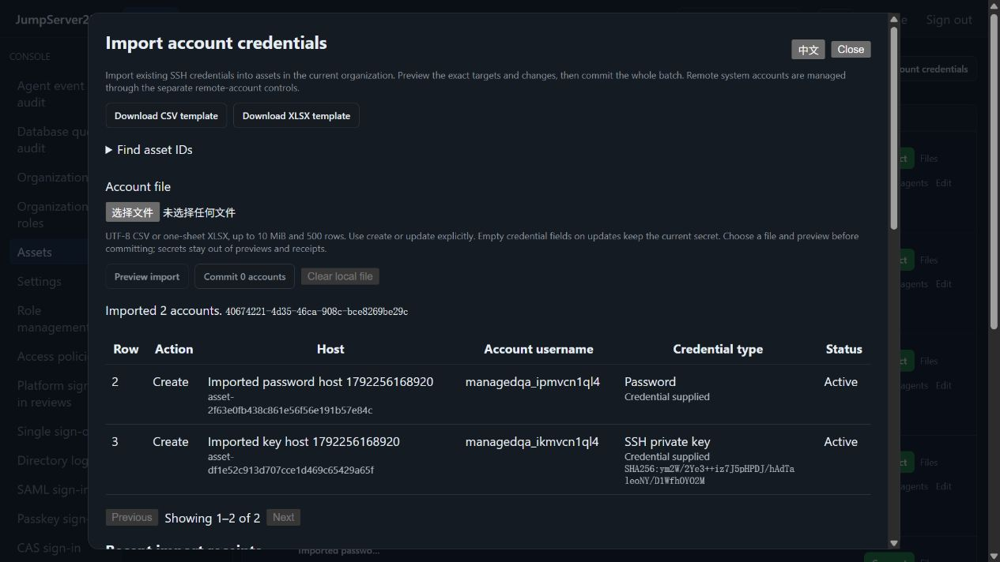

# Bulk SSH account credential import

> English | [中文](./ACCOUNT-IMPORT.md)

CSV and XLSX can import passwords or private keys for multiple existing SSH assets in one atomic batch, with explicit create and update actions. Web, platform CLI and SDK share organization, permission, version and receipt checks. Standalone comes first; PostgreSQL active/standby takeover uses the same Vault document.

The competitor is [JumpServer Enterprise](https://www.jumpserver.org/enterprise.html). On 2026-10-18, the [official account management manual](https://docs.fit2cloud.com/jumpserver/manual/admin/console/account_management/account_list/) provided the reference for CSV/XLSX, create/update and imports into existing assets. This slice does not complete Enterprise parity; see [PLAN](./PLAN.en.md).

## Web workflow

1. Console → Assets → Import account credentials. Download a blank CSV or XLSX template.
2. Expand Find asset IDs and copy existing SSH host IDs in the current organization. Set each action to `create` or `update`.
3. Choose the file and preview its targets, usernames, types, enablement and credential replacement. Any issue prevents the whole batch from committing.
4. Commit and inspect the receipt. Receipts reflect state at commit time; inspect managed account details and activity for later changes.

The UI detects Chinese or English and also offers manual switching. A native dialog contains keyboard focus, supports Escape and returns focus to its trigger when closed. File contents stay in the current page's memory and clear on close or successful commit. Previews, receipts and activity never return passwords, private keys or key passphrases. Templates contain fixed headers and placeholders; they do not export stored credentials.

2026-10-18, in-app browser capture from an isolated Docker instance using real OpenSSH:



## File fields

Use UTF-8 CSV (BOM, quotes and multiline keys supported) or one visible XLSX worksheet, up to 10 MiB and 500 data rows. Start from a template. XLSX rejects formulas, macros, external relationships, duplicate ZIP paths and traversal, with bounds on expanded size, XML depth and cells. Files are never extracted and spreadsheet content is never executed.

| Field | Meaning |
|---|---|
| `action` | Required: `create` or `update`; no implicit replacement of existing usernames |
| `asset_id` | Required: existing physical SSH asset ID in the current organization |
| `username` | Required: remote username; identifies the target together with the asset |
| `name` / `remark` | Display name and note; blank keeps existing values, with defaults on creation |
| `credential_type` | `password` or `ssh_key`; blank on update keeps the current type |
| `password` | Write-only password; blank on update keeps the existing credential |
| `private_key` / `private_key_passphrase` | Write-only key and optional decryption passphrase; cannot accompany a password |
| `active` | `true` / `false`; blank on update keeps the current value |
| `password_rotation_enabled` | `true` / `false`; new password accounts default to seven-day rotation |
| `key_rotation_enabled` | `true` / `false`; new key accounts default to disabled, with explicit seven-day rotation available |
| `version` | Optional current account version for updates or parent version for creation; preview still binds all target versions automatically |

An asset and username may appear only once per batch. Updating the default account is supported. Supplied credentials replace the current value and preserve it in encrypted history. Metadata, enablement and policy changes alone do not create backups. Pending remote-account recovery, password rotation or key operations block replacement.

Import stores existing remote credentials. It does not change a host password or create an operating-system account; see [Remote account lifecycle](./REMOTE-ACCOUNTS.en.md). It does not grant access or prove login works. Connections still validate the host key, current grants and required reviews.

## CLI and SDK

Use a platform token or AccessKey, with `JMS_ORG_ID` selecting the organization. Target credentials come from a protected local file rather than command arguments:

```sh
jms account import-template --format csv --out new-template.csv
jms account import-template --format xlsx --out new-template.xlsx
jms account import-preview --file accounts.csv --request-id import-001 > review.json
# Read review.json, then explicitly commit the same input.
jms account import-commit --file accounts.csv --preview-file review.json
jms account imports --limit 20
jms account import-show import-001
jms --account ops exec <asset-id> --json -- 'id -un'
```

Template output uses exclusive creation and cannot overwrite an existing file. Protect source key/password files and remove them according to local policy. `review.json` contains metadata and a signed preview proof, so restrict access; it is not a target credential backup. SDK methods `PreviewAccountImport`, `CommitAccountImport`, `AccountImportTemplate`, `AccountImportHistory` and `AccountImportReceipt` retain platform authentication and organization selection. Global SSH `--account` does not redirect a bulk file to one identity.

## Authority and consistency

API endpoints: `GET /api/v1/accounts/imports/template?format=csv|xlsx`, `POST /api/v1/accounts/imports/preview`, `POST /api/v1/accounts/imports`, `GET /api/v1/accounts/imports?offset=0&limit=20` and `GET /api/v1/accounts/imports/{request_id}`. Preview accepts `format`, base64 `content` and `request_id`; commit also requires `preview_token`. History pages allow 1–100 entries. Administrators can select a receipt owner with `actor_id`; other users can read only their own currently visible targets. All responses use `Cache-Control: no-store`.

- Independent `accounts.import` and `accounts.manage` permissions are required, plus current visibility of every target. Rotation policy changes also require `assets.rotate`. Authority is checked again at commit; revocation prevents writes.
- Preview proofs expire after 15 minutes and bind organization, actor, request ID, parsed input and target versions. Changed input, accounts, hosts or shared credential state cause an atomic conflict and require a fresh preview.
- One persistence operation stores every account and the successful receipt. Validation, encryption or persistence failure commits no partial accounts. Retrying the same request and input returns its original receipt without duplicate activity. An actor cannot reuse a request ID for different input in the same organization.
- After an uncertain response, inspect the receipt and retry with the original request ID, file and proof before creating a new request. A committed receipt can be acknowledged after proof expiry; an expired proof cannot start a new commit.
- Managed aliases of the same remote password identity must remain consistent, including references in other organizations. Updating all writable aliases together is supported; credentials in other organizations are never changed implicitly.
- Vault retains at most 256 recent batch receipts. A new commit prunes only receipts older than 24 hours; a full recent set blocks new batches. Per-account activity retains its import ID under existing audit limits.

## Storage and upgrades

Accounts, ciphertext, credential history and receipts share one asset document so a successful account write cannot lose its receipt. Adding receipts upgrades the outer format to `3`, using the same encoder for local files and PostgreSQL JSONB. Legacy arrays and format `2` remain readable. Older binaries reject format `3`; direct downgrade is unsupported. Back up state and its matching Vault key before following the existing rollback process.

PostgreSQL tests cover takeover by another node, reopening state, original-request acknowledgement and organization isolation. Live SSH state does not migrate. Active/active operation and production failover drills remain unverified; see [Cluster HA](./CLUSTER-HA.en.md).

## Verification and limits

Testify covers atomic create/update, both credential types, persistence rollback, concurrent retries, expired/altered/cross-user proofs, target revocation, rotation authority, shared aliases, PostgreSQL takeover, capacity and rejected formats. The production Docker browser scenario exercises two-host CSV creation, XLSX updates, actual password/key CLI login, Web SSH, no credential echo, version conflicts, both languages, focus and narrow screens. Full results are recorded in [Testing](./TESTING.en.md).

This supports existing SSH assets. Other protocols, directory accounts, automatic unknown-asset creation, credential reconciliation, bulk remote OS provisioning and complete Enterprise parity remain open. No dependencies were added; the import UI loads on demand. See [Performance](./PERFORMANCE.en.md) for artifact and timing measurements.
