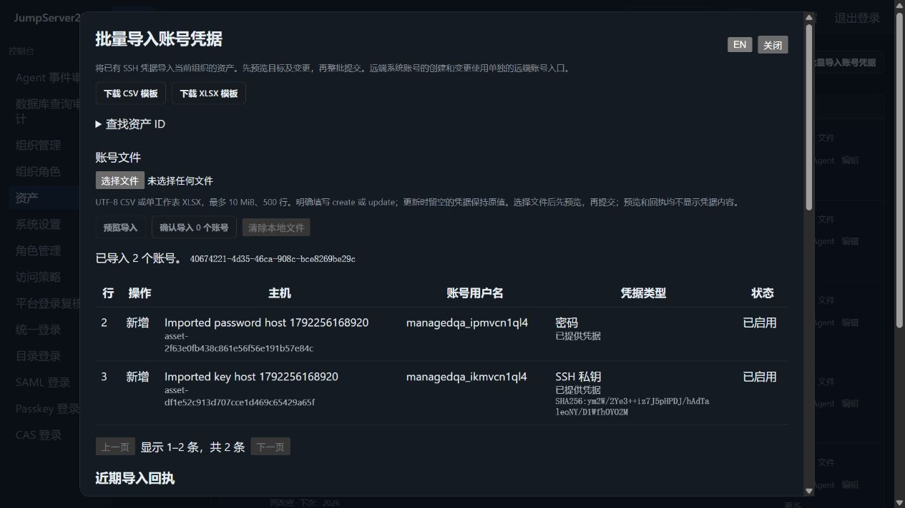

# 批量导入 SSH 账号凭据

> 中文 | [English](./ACCOUNT-IMPORT.en.md)

CSV 和 XLSX 可一次导入多台已有 SSH 资产的账号密码或私钥，支持明确新增、更新和整批原子提交。Web、平台 CLI 与 SDK 共用组织、权限、版本和回执。默认单机；PostgreSQL 单活接管使用同一份 Vault 文档。

竞品为 [JumpServer 企业版](https://www.jumpserver.org/enterprise.html)。2026-10-18 对照[官方账号管理手册](https://docs.fit2cloud.com/jumpserver/manual/admin/console/account_management/account_list/)中的 CSV/XLSX、新增/更新和已有资产导入流程。本切片不代表完整企业版验收；总体状态见 [PLAN](./PLAN.md)。

## Web 流程

1. 控制台 → 资产 → 批量导入账号凭据，下载 CSV 或 XLSX 空模板。
2. 展开“查找资产 ID”，复制当前组织已有 SSH 主机 ID；每行明确填写 `create` 或 `update`。
3. 选择文件并预览，检查目标、用户名、类型、启停和凭据替换状态。有错误时整批不能提交。
4. 确认导入后查看回执。回执反映提交时的状态；后续账号变化通过托管账号详情和活动核对。

界面自动采用中文或英文，也可手动切换。原生对话框支持键盘焦点约束、Escape 关闭和关闭后返回入口。文件只留在当前页面内存，关闭或提交成功即清除；预览、回执和活动均不返回密码、私钥或私钥口令。模板只包含固定表头及占位符，不导出已有凭据。

2026-10-18，独立 Docker 实例和真实 OpenSSH 的内置浏览器截图：



## 文件字段

UTF-8 CSV（支持 BOM、引号和多行私钥）或单张可见工作表 XLSX；最大 10 MiB、500 条数据行。建议用模板。XLSX 拒绝公式、宏、外部关系、重复 ZIP 路径和路径穿越，并限制展开体积、XML 深度及单元格数量；不提取文件或执行表格内容。

| 字段 | 含义 |
|---|---|
| `action` | 必填，`create` 或 `update`；不自动覆盖同名账号 |
| `asset_id` | 必填，当前组织已有物理 SSH 资产 ID |
| `username` | 必填，远程用户名；与资产组成唯一目标 |
| `name` / `remark` | 显示名及备注；空白保持原值，新增使用默认值 |
| `credential_type` | `password` 或 `ssh_key`；更新留空保持原类型 |
| `password` | 密码，只写；更新留空保留原凭据 |
| `private_key` / `private_key_passphrase` | 私钥及可选解密口令，只写；不能与密码同时提供 |
| `active` | `true` / `false`；更新留空保持原值 |
| `password_rotation_enabled` | `true` / `false`；新密码账号默认启用七天轮换 |
| `key_rotation_enabled` | `true` / `false`；新密钥账号默认不启用，可显式开启七天轮换 |
| `version` | 可选，更新使用当前账号版本，新增使用父资产版本；预览仍会自动绑定全部目标版本 |

同一批次不允许重复的资产与用户名。更新默认账号也受支持。输入凭据表示替换，旧凭据进入既有加密历史；单纯更新名称、启停或策略不会新建凭据备份。待恢复的远端账号、未结束的轮换及密钥操作不能被导入覆盖。

这里托管的是已有远程凭据，不在主机上修改密码或创建系统账号。实际远端账号管理见[远端账号生命周期](./REMOTE-ACCOUNTS.md)。导入不会自动增加授权，也不以导入成功证明凭据已能登录；实际连接继续核对主机指纹、当前授权及审批。

## CLI 与 SDK

使用平台 token 或 AccessKey，`JMS_ORG_ID` 选择组织。目标凭据从本地受保护文件读取，命令参数不包含目标密码：

```sh
jms account import-template --format csv --out new-template.csv
jms account import-template --format xlsx --out new-template.xlsx
jms account import-preview --file accounts.csv --request-id import-001 > review.json
# 阅读 review.json 后，显式提交同一份输入。
jms account import-commit --file accounts.csv --preview-file review.json
jms account imports --limit 20
jms account import-show import-001
jms --account ops exec <asset-id> --json -- 'id -un'
```

模板输出使用独占创建，已有文件不被覆盖。私钥、密码输入文件需由操作者妥善保护并按本地策略清理。`review.json` 只含元数据与签名预览证明，仍应限制访问；不要把它当作目标凭据备份。SDK 的 `PreviewAccountImport`、`CommitAccountImport`、`AccountImportTemplate`、`AccountImportHistory` 和 `AccountImportReceipt` 保留平台认证与组织选择；全局 SSH `--account` 不把批量输入重定向到某一个身份。

## 权限与一致性

API 入口：`GET /api/v1/accounts/imports/template?format=csv|xlsx`、`POST /api/v1/accounts/imports/preview`、`POST /api/v1/accounts/imports`、`GET /api/v1/accounts/imports?offset=0&limit=20` 和 `GET /api/v1/accounts/imports/{request_id}`。预览输入为 `format`、base64 `content`、`request_id`，提交另带 `preview_token`；历史按 1–100 条分页。管理员可用 `actor_id` 查询指定操作者的回执，其他用户只能查自己当前仍可见的目标。响应均采用 `Cache-Control: no-store`。

- 需要独立的 `accounts.import` 和 `accounts.manage`，每个目标还需当前资产可见权限；改变轮换策略另需 `assets.rotate`。提交前再次检查，撤权后不写入。
- 预览证明有效 15 分钟，绑定组织、操作者、请求 ID、解析后的输入和目标版本。文件内容、账号、主机或共享账号状态发生变化，整批返回冲突，需重新预览。
- 一次持久化同时保存全部账号和成功回执。任何校验、加密或写入失败都不提交部分账号；相同请求 ID 和输入重试返回原回执，不重复写审计。相同操作者和组织不能用原请求 ID 提交不同输入。
- 提交响应不明确时先查回执，再用原请求 ID、文件和预览证明重试；不要立即创建新请求。已有回执可在证明过期后确认；未提交的过期证明被拒绝。
- 同一远端密码账号的所有已托管别名必须保持一致，跨组织引用也参与检查；同批更新全部可写别名可以提交，不会自动改写其它组织的凭据。
- Vault 最多保留 256 个近期批次回执。新提交只清理超过 24 小时的旧回执；近期记录已满则拒绝新批次。逐账号活动继续保留批次 ID，沿用既有审计容量限制。

## 存储与升级

账号、密文、加密历史和批次回执共用资产文档，避免账号已写入而回执丢失。新增回执后外层格式为 `3`，单机文件与 PostgreSQL JSONB 使用同一编码；旧数组和格式 `2` 仍可读取。旧版本程序拒绝格式 `3`，不能直接降级；先备份匹配版本的状态与 Vault 密钥并遵循既有回滚流程。

PostgreSQL 测试覆盖另一节点接管、重新打开存储、原请求确认和组织隔离。在线 SSH 状态不迁移；多活与生产环境故障演练尚未验收，见[集群 HA](./CLUSTER-HA.md)。

## 验证及边界

Testify 覆盖原子创建/更新、两类凭据、持久化回滚、重复并发、过期/篡改/跨用户证明、目标撤权、轮换权限、共享别名、PostgreSQL 接管、容量与格式拒绝。生产 Docker 浏览器场景完成双主机 CSV 创建、XLSX 更新、实际密码/密钥 CLI 登录、Web SSH、无凭据回显、版本冲突、中英文、焦点与窄屏检查。全量结果见[自动化验证](./TESTING.md)。

当前适用于已有 SSH 资产；其它协议、目录账号、未知资产自动创建、自动凭据校准、批量远端系统账号开设、完整企业版对齐仍未完成。未新增依赖，导入界面按需加载；性能和体积见[性能基线](./PERFORMANCE.md)。
