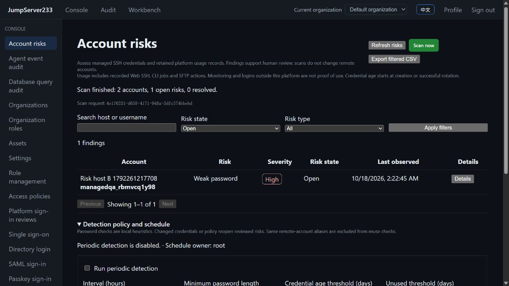

# SSH account risk detection

> [中文](./ACCOUNT-RISKS.md) | English

Console → Account risks provides scanning, confirmation, ignore/reopen actions, CSV export and periodic policies. Web, platform CLI and SDK share organization scope and live permissions. Scans leave remote credentials unchanged. Open the asset and selected account, use existing rotation/recovery/enablement controls, then rescan to verify resolution.

The competitor is [JumpServer Enterprise](https://www.jumpserver.org/enterprise.html). This slice follows weak/reused credentials, unused/expired account risk and human review workflows in the [official PAM introduction](https://docs.fit2cloud.com/jumpserver/manual/pam/introduction/) and [account management manual](https://docs.fit2cloud.com/jumpserver/manual/admin/console/account_management/account_list/), reviewed on 2026-10-18. The implemented definitions follow below. Overall Enterprise parity remains in progress; see [PLAN](./PLAN.en.md).

2026-10-18, isolated Docker production images, real OpenSSH and the in-app browser: two active accounts were assessed. Actual remote rotation cleared one account; the other retains a weak-password finding.



## Definitions

| Type | Current implementation |
|---|---|
| Weak password | Configurable length, common passwords, username patterns, low character variety and simple sequences using local heuristics |
| Reused password | The same password across different SSH remote identities, grouped with a keyed digest inside the server |
| Reused SSH key | The same public key across different remote identities; comparison does not read or expose private keys |
| Rotation overdue | Time since platform creation or the last successful rotation exceeds the threshold; default 7 days |
| No recent use | Retained Web SSH, actually executed CLI/background jobs and successful SFTP actions; default 90 days |
| Automatic rotation disabled | Seven-day password rotation or SSH key rotation is off |
| Credential recovery pending | An unfinished password, key or native remote-account operation |

Monitoring probes do not count as use. External logins and OS password expiry policy are outside this collection scope. Usage comes from retained account-record audit and cannot prove that the remote identity never logged in. Creation or successful rotation resets the age baseline. Disabled platform accounts are excluded by default and can be included.

Host address, port, pinned host key and username identify a remote account. Aliases for the same identity do not trigger reuse against each other. Different address aliases cannot automatically be proven to be the same machine. Password heuristics do not implement a leaked-password corpus or comprehensive strength proof.

## Review and versions

1. Expand “Detection policy and schedule”, choose checks and thresholds, save and scan.
2. Filter by host, username, type or state. Details show reasons and related visible accounts.
3. Confirm, ignore or reopen a risk and save a note. Escape closes details and restores trigger focus.
4. Open the asset/account and use existing remediation controls. A complete rescan resolves findings whose causes were removed.

Human review cannot directly mark a finding resolved. Credential/policy changes or recurrence reopen confirmed/ignored risks. Findings bind source and policy versions; stale records cannot be reviewed. Failed, cancelled, incomplete or unpersisted scans retain the last valid snapshot. Retrying the same actor/request ID/policy version returns the original receipt without rerunning. The newest 256 scan receipts are retained.

## Permissions and data

- Read: `accounts.risks.view`, filtered by current account-level `view` grants. `assets.view_all` / `assets.manage` can see the whole organization.
- Organization-wide scans: `accounts.risks.scan` and `assets.manage`. Policy changes also require `accounts.risks.manage`.
- Review: `accounts.risks.manage`, `accounts.risks.view` and target visibility. Review endpoints also hide unseen reuse relationships.
- CSV: `accounts.risks.export` plus read permission; filtered metadata only, with spreadsheet-formula protection.
- Organization-wide receipts and policy/review audit additionally require global asset viewing or management.

API, UI, CSV and CLI omit passwords, private keys, password digests and internal reuse groups. Reuse findings require another visible remote identity; details list at most 20 related records. Policy, findings, usage index, receipts and audit are encrypted with organization-scoped AES-GCM. Standalone files are the default; PostgreSQL single-active takeover uses scoped documents. Cluster audit sources still require shared read/write storage; see [HA](./CLUSTER-HA.en.md).

## Scheduling, recovery and capacity

Scheduling is off by default. Enabling makes it immediately due; the active node checks once per minute. Intervals are 1–720 hours, default 24. Every run resolves the owner's current permissions; revocation stops dispatch and pauses the policy. Both manual and periodic scans have a 60-second deadline. One scan runs per organization and active scans can be cancelled. Source read locks remain held through publication to prevent mismatched concurrent credential rotation.

Takeover marks unfinished scans `interrupted`, retains the valid snapshot and makes enabled policies due again. Resolved findings default to 90-day retention and audit to 365 days, both configurable. Limits are 10,000 SSH accounts, 70,000 findings, 10,000 audit records and 64 MiB plaintext state. Capacity failures preserve valid results. Full scans stream retained audit; long histories increase runtime and should use the existing retention controls.

## CLI / SDK

Use a platform identity; target credentials remain on the server:

```sh
jms account risks policy
jms account risks policy-update --revision 1 --enabled=true --interval-hours 24
jms account risks scan --revision 2 --request-id daily-review-001
jms account risks findings --state open --kind weak_password --limit 50
jms account risks review RISK_ID --revision 1 --action confirm --note "Needs rotation"
jms account risks scans --limit 50
jms account risks audit --limit 50
jms account risks cancel SCAN_ID
jms account risks export --state open --out new-risk-report.csv
```

Read revisions from current responses instead of copying example values. Policy updates accept `--min-length`, `--max-age-days`, `--unused-days`, `--checks`, `--include-disabled=true` and both retention periods. CSV output creates a new file exclusively and never overwrites a report. SDK account-risk methods support Bearer, signed Access Keys and `X-JMS-ORG`.

English/Chinese are detected automatically with manual switching. Page code and feature translations load on demand. See [TESTING](./TESTING.en.md) and [PERFORMANCE](./PERFORMANCE.en.md). Remote OS password expiry, OS login history, leaked-password corpora, risk notification delivery, automatic bulk remediation and cross-organization aggregation remain outside this slice.
