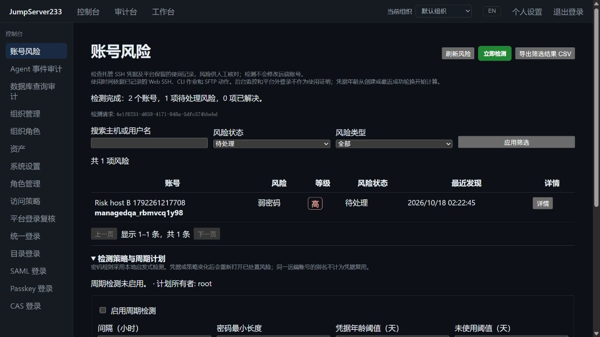

# SSH 账号风险检测

> 中文 | [English](./ACCOUNT-RISKS.en.md)

控制台 → 账号风险提供检测、确认、忽略、重新打开、CSV 导出和周期计划。Web、平台 CLI、SDK 共用组织与当前权限。检测不修改远端凭据；打开资产与账号后使用已有轮换、恢复或启停功能处理，再完整检测以确认解除。

竞品为 [JumpServer 企业版](https://www.jumpserver.org/enterprise.html)。2026-10-18 依据[官方 PAM 说明](https://docs.fit2cloud.com/jumpserver/manual/pam/introduction/)和[账号管理手册](https://docs.fit2cloud.com/jumpserver/manual/admin/console/account_management/account_list/)中的弱密码、重复凭据、长期未使用、过期风险及人工处置流程实施。本切片覆盖下表，企业版整体仍在进行中，见 [PLAN](./PLAN.md)。

2026-10-18，独立 Docker 生产镜像、真实 OpenSSH 和内置浏览器：2 个有效账号完成检测，实际改密后的账号已解除，另一账号保留弱密码风险。



## 检测口径

| 类型 | 当前实现 |
|---|---|
| 弱密码 | 可配置最短长度，常见密码、用户名模式、低字符种类及简单序列的本地启发式检查 |
| 密码复用 | 相同密码绑定不同 SSH 远端身份；服务端采用带密钥摘要分组 |
| SSH 密钥复用 | 相同公钥绑定不同远端身份；不读取或输出私钥用于比较 |
| 凭据轮换超期 | 距平台创建或最近成功轮换超过阈值，默认 7 天 |
| 近期没有使用记录 | 平台保留的 Web SSH、已实际执行的 CLI/后台作业和成功 SFTP 动作；默认 90 天 |
| 自动轮换已关闭 | 密码七天轮换或密钥轮换未启用 |
| 凭据等待恢复 | 未结束的改密、密钥变更或原生远端账号操作 |

后台监控探测不计为使用。平台外登录和操作系统密码过期规则不在当前采集范围；近期使用依据账号记录的保留审计，不能用来证明远端从未登录。新建或成功轮换会重置年龄基线。默认排除平台停用账号，可在策略中包含。

同一主机地址、端口、固定主机密钥与用户名构成远端身份；同一账号的别名不会互相误报。不同地址别名无法自动证明是同一台机器。弱密码检查不是泄漏密码库或完整密码强度证明。

## 处置与版本

1. 展开“检测策略与周期计划”，选择检测项与阈值，保存后立即检测。
2. 按主机、用户名、类型、状态筛选，打开详情查看原因与相关可见账号。
3. 可确认、忽略或重新打开，并保存处置备注。Escape 关闭详情且返回入口焦点。
4. 打开对应资产与所选账号，使用已有功能消除原因；再次完整检测自动标记为已解决。

检测不会靠人工点击标记已解决。更换凭据、修改策略或风险再次出现，会重新打开已确认/忽略风险。发现记录包含来源与策略版本；来源变化后的旧记录不能继续处置。失败、取消、存储错误和不完整采集均保留上一份有效结果。相同操作者、请求 ID 和策略版本重试返回原回执，不重新执行；回执窗口保留最近 256 次。

## 权限与数据

- 查看：`accounts.risks.view`；按当前账号级 `view` 授权过滤，`assets.view_all` / `assets.manage` 可看全组织。
- 全组织检测：`accounts.risks.scan` 与 `assets.manage`；配置策略还需 `accounts.risks.manage`。
- 风险处置：`accounts.risks.manage`、`accounts.risks.view` 和目标可见权限。处置接口同样隐藏不可见复用关系。
- CSV：`accounts.risks.export` 与查看权限，只导出当前筛选的元数据，防止电子表格公式执行。
- 全组织回执与配置/处置审计额外要求全局资产查看或资产管理。

API、页面、CSV 和 CLI 不返回密码、私钥、密码摘要或内部复用分组。复用风险只有同时存在其他可见远端身份时才返回，详情最多列出 20 条相关记录。检测配置、风险、用途索引、回执和审计采用组织密钥 AES-GCM 加密，默认单机文件；PostgreSQL 单活接管使用作用域文档。集群审计源仍需要共享读写存储，见 [HA](./CLUSTER-HA.md)。

## 周期、恢复与容量

周期默认关闭，开启后立即到期，由活动节点每分钟检查并执行；间隔 1–720 小时，默认 24 小时。每轮重新计算计划所有者的当前权限，撤权时停止派发并暂停计划。后台与手动扫描均限时 60 秒；组织内一次只允许一个扫描，可取消进行中的扫描。凭据读取锁一直保持到结果提交，避免发布与并发轮换不一致的快照。

接管时未完成扫描标记 `interrupted`，不会把部分结果当成成功；已启用计划重新到期。已解决记录默认保留 90 天，审计 365 天，可配置。最多 10,000 个 SSH 账号、70,000 项风险、10,000 条审计和 64 MiB 明文状态；超限拒绝本轮并保留有效结果。全量检测会读取保留审计；长审计源增加耗时，应结合已有保留策略管理。

## CLI / SDK

使用平台身份连接，账号秘密留在服务端：

```sh
jms account risks policy
jms account risks policy-update --revision 1 --enabled=true --interval-hours 24
jms account risks scan --revision 2 --request-id daily-review-001
jms account risks findings --state open --kind weak_password --limit 50
jms account risks review RISK_ID --revision 1 --action confirm --note "Needs rotation"
jms account risks scans --limit 50
jms account risks audit --limit 50
jms account risks cancel SCAN_ID
jms account risks export --state open --out new-risk-report.csv
```

版本从当前响应读取，不照抄示例。更新策略可传 `--min-length`、`--max-age-days`、`--unused-days`、`--checks`、`--include-disabled=true` 和两项保留天数。CSV 输出仅能创建新文件，不覆盖已有报告。SDK 提供同名账号风险方法，支持 Bearer、Access Key 签名及 `X-JMS-ORG`。

中英界面自动识别并支持手动切换；该页面及语言资源按需加载。验证证据见 [TESTING](./TESTING.md)，体积预算见 [PERFORMANCE](./PERFORMANCE.md)。当前不含远端系统密码有效期、OS 登录历史、泄漏密码库、风险通知投递、自动批量修复和跨组织汇总。
