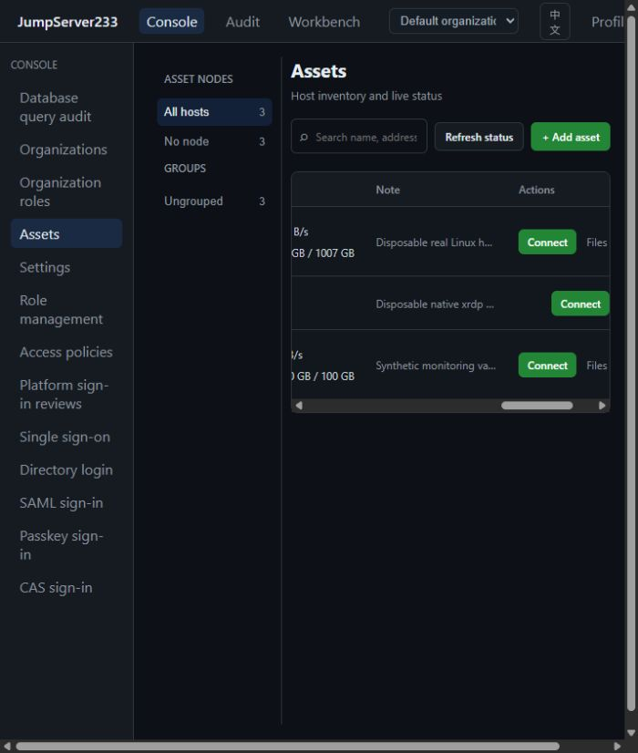

# Local User Authentication

> [中文](./AUTH.md) | English

On first startup with an empty user store, the server creates default administrator **`root / root`**. Sign-in uses normal local authentication and the password is stored as a scrypt hash. Restarts never reset the password or add this account to an existing user store. Change it in Profile. Set `JMS_DEFAULT_ADMIN_ENABLED=false` to initialize a custom administrator; ordinary account creation and password changes still require 12–256 bytes.

Organizations isolate resources, roles and operational audit through `X-JMS-ORG`, browser switching and Agent CLI selection. Standalone storage and PostgreSQL single-active HA are supported. See [Organizations](./ORGANIZATIONS.en.md). Full Enterprise parity remains in progress.

Platform sign-in approval and console notifications use verified identities, original-source one-use completion, encrypted persistence and PostgreSQL single-active HA. See [Platform sign-in reviews](./PLATFORM-LOGIN-REVIEWS.en.md). Full Enterprise parity remains in progress.

Source, weekly-hour and execution-channel restrictions support standalone and single-active HA. See [Access policies](./ACCESS-POLICIES.en.md). Full Enterprise parity remains in progress.

Passkey registration, device-verified sign-in, local MFA, revocation, and HA recovery: [Passkey](./PASSKEY.en.md).

SAML signed assertions, browser binding, local MFA, encrypted SP identity, and configuration audits: [SAML](./SAML.en.md). Remaining profiles and production IdP integration are open.

See [CAS.en.md](./CAS.en.md) for CAS sign-in with separate identities and local MFA.

LDAP/AD directory sign-in: [LDAP.en.md](./LDAP.en.md).

Management APIs accept the corresponding delegated permissions; see [RBAC.en.md](./RBAC.en.md). Existing `admin/operator` identities stay compatible, and `admins` MFA also covers system-role holders.

This document describes local-account authentication. Users can change their sign-in password and use TOTP MFA with one-time recovery codes; administrators can configure global MFA enforcement. See [RBAC.en.md](./RBAC.en.md) for system roles and [OIDC.en.md](./OIDC.en.md) for SSO. Organization isolation and the other connected protocols are described in the linked references above.

Production reverse proxies should use an explicit `JMS_PUBLIC_URL=https://console.example.com` so browser origin checks and `Secure` cookies use the same public address. OIDC accounts expose `source: "oidc"`; their primary password is managed by the provider, and local password login/change is rejected. MFA management requires a platform SSO session issued within five minutes plus a fresh second factor. Disabling the provider blocks short sessions, permanent tokens, and AccessKeys on their next authentication check.

## First startup

- Open `/login` and sign in with the default account. When default initialization is explicitly disabled, the page offers administrator setup. Custom usernames are 3–64 ASCII letters, digits, dots, underscores, or hyphens; passwords are 12–256 bytes.
- The standalone default listens on loopback and can be initialized locally. A remote listener requires `JMS_ADMIN_TOKEN` with at least 32 bytes; enter that token on the setup page to bootstrap the administrator.
- Bootstrap succeeds only once. Standalone mode stores the administrator in `JMS_DATA_DIR/users.json`; cluster mode stores it in the shared PostgreSQL user document. Passwords are scrypt-derived hashes with per-user salts, and raw access tokens are never written to disk or the database.

## Sign-in and tokens

- `POST /api/v1/authentication/auth/` signs in with a username and password, returns a 12-hour bearer access token, and sets an `HttpOnly`, `SameSite=Lax` `jms_sessionid` cookie. The browser sends `X-JMS-Browser-Session: cookie` and receives only the user profile and expiry, keeping the session token out of page scripts; Agent and REST clients omit this header to receive the bearer token. For an MFA-enabled account, a correct password first returns `401` with `mfa_required: true`; the client then repeats the request with `otp`, containing either the current TOTP or an unused recovery code. A token is issued only after both factors pass.
- `GET /api/v1/authentication/session/` restores the browser session. `POST /api/v1/authentication/expire-session/` revokes the current short-lived token and clears its cookie; the page calls this endpoint when signing out.
- Short-lived bearer/cookie sessions last 12 hours. Standalone mode keeps only their digests in process memory, so a restart invalidates them. Cluster mode stores SHA-256 digests in PostgreSQL, allowing unexpired sessions to continue after an active-node failover.
- Profile supports up to 10 permanent tokens. `POST /api/v1/users/me/tokens` returns a token only once; later list responses contain only ID and creation time, and `DELETE /api/v1/users/me/tokens/{tokenID}` revokes it. API clients use `Authorization: Token <token>`. The server stores only SHA-256 digests; password changes do not revoke permanent tokens.
- Each source IP is limited to 30 sign-in requests per minute and five failed attempts within 15 minutes. A successful sign-in clears that IP's failure count. Password derivation is capped at four concurrent operations to limit memory pressure.
- `POST /api/v1/users/me/password/change` requires the current password and a new password of 12–256 bytes. The server derives a new password hash with a fresh salt, keeps the current session, and revokes the account's other active sessions. The endpoint returns `204` with caching disabled.
- Profile supports up to 10 AccessKeys. `POST /api/v1/users/me/access-keys` returns `access_key_secret` only once; list responses expose only the ID and creation time, and `DELETE /api/v1/users/me/access-keys/{keyID}` revokes a key immediately. Secrets are encrypted at rest with the vault key using AES-GCM.
- REST API accepts JumpServer-compatible HTTP Message Signatures: `Authorization: Signature keyId="…",algorithm="hmac-sha256",headers="(request-target) date",signature="…"`. It also accepts signatures that include `accept`. The server validates the signature and allows five minutes of Date clock skew; use HTTPS in production.
- `GET /api/v1/users/me` returns the current identity and `mfa_enabled` state. Administrators can list accounts with `GET /api/v1/users` and create administrators or operators with `POST /api/v1/users`.
- Administrators can manage SSH assets and their node assignments from Assets, then create user groups, manage operator membership, and grant `view`, `connect`, or `sftp` access to one asset or asset node and an SSH account for an optional time window. Grants can target one user or a group and can be revoked on the same page. Node grants inherit to assets under that node and all descendants when the configured SSH account matches.

## TOTP MFA

- A user starts setup in Profile. `POST /api/v1/users/me/mfa/enrollment` returns a TOTP key and `otpauth://` URI; the pending key can be shown again until it expires after 10 minutes.
- Confirm setup with the current six-digit authenticator code at `POST /api/v1/users/me/mfa/confirm`. Once enabled, sign-in requires both the password and a TOTP code.
- Disable MFA with `POST /api/v1/users/me/mfa/disable`, providing the current password and a fresh code. Invalid codes count toward the source-IP login limit; accepted time steps cannot be replayed.
- TOTP keys are encrypted at rest with AES-GCM and the existing vault key. Standalone mode uses its local vault key. Cluster nodes must share `JMS_VAULT_KEY` and the encrypted user document in PostgreSQL. Enrollment responses use `Cache-Control: private, no-store`.
- `POST /api/v1/users/me/mfa/recovery-codes` requires the current password and a fresh TOTP or unused recovery code. It returns 10 one-time codes; plaintext is returned only once, while the server stores SHA-256 digests. A successful login consumes its recovery code. Regeneration replaces the full set, and disabling MFA removes remaining codes. The response uses `Cache-Control: private, no-store`.
- Administrators configure `disabled`, `admins`, or `all` through `GET/PUT /api/v1/settings/security/mfa`. A vault key is required before enabling enforcement. The policy lives in standalone `mfa-policy.json` or a shared PostgreSQL document.
- An unenrolled account in scope receives a single-use setup challenge after password verification, valid for 10 minutes. The challenge can only confirm MFA; successful confirmation issues the login session. Only its SHA-256 digest is stored, and responses containing the MFA secret are not cached. Enrolled accounts must submit TOTP or a recovery code.
- Users in the enforced scope cannot disable MFA. Turning enforcement off or narrowing its scope does not disable existing MFA or end active sessions.

## Current authorization boundary

- The first account is always an administrator. The user-creation endpoint cannot replace initial setup.
- Administrator accounts and `JMS_ADMIN_TOKEN` can access assets, grant management, and all sessions. Operator session listing, stopping, and replay are scoped to records owned by the authenticated user ID.
- Administrators can use `GET/POST /api/v1/grants` and `DELETE /api/v1/grants/{grantID}` to bind a user or group to one asset or node scope, an SSH account, actions, and an active time window. A create request must set exactly one of `user_id` or `group_id` and exactly one of `asset_id` or `node_id`. Asset grants must match the SSH username currently configured on the asset; node grants are matched by account name against descendant assets.
- Administrators use `GET/POST /api/v1/assets/nodes` and `PUT/DELETE /api/v1/assets/nodes/{nodeID}` to manage the node tree. Names must be unique among siblings, case-insensitively. A node cannot be deleted while child nodes, assigned assets, or grant rules reference it; moving a node changes its inherited grant scope accordingly.
- Administrators can list and create groups with `GET/POST /api/v1/user-groups`, add or remove operators with `PUT/DELETE /api/v1/user-groups/{groupID}/members/{userID}`, and delete a group only after its grants have been revoked.
- An operator's `GET /api/v1/assets` returns only assets with an active `view` or `connect` grant assigned directly or through a group; `connect` implies `view`. Only an active `connect` grant allows an operator to create a session through `POST /api/v1/sessions`.
- The asset-level `sftp` action lets an operator open the file manager; a `view` grant alone cannot transfer files. The file API supports directory listing, folder creation, upload, download, and delete. Operators are limited to granted assets.
- `GET /api/v1/file-transfers` returns transfer audit records. Administrators see all records; operators see only their own. The index is stored at `JMS_DATA_DIR/file-transfers/index.jsonl`, which must be shared by cluster nodes.
- Group grants are resolved from current membership for asset inventory, SSH sessions, and SFTP. Assets inherit grants from their assigned node and every ancestor. Operators see only nodes containing assets they can view or connect to, plus those nodes' ancestors. They cannot see unrelated nodes, read or stop another user's session, or replay another user's recording.
- Tokenless loopback access is only available before account initialization. After creating the administrator, management/asset APIs require authentication; clearing cookies or using a local address cannot obtain administrator access. Plans created under the earlier anonymous identity also lose authority after initialization. Non-loopback listeners still require `JMS_ADMIN_TOKEN`.

Global/organization RBAC, multiple organizations, single-provider OIDC, LDAP, CAS, SAML, Passkeys and SSH key management are connected. Each protocol reference states its acceptance limits; full Enterprise gaps remain in [PLAN.en.md](./PLAN.en.md).

2026-10-16: local QA console after signing in with the default account:

