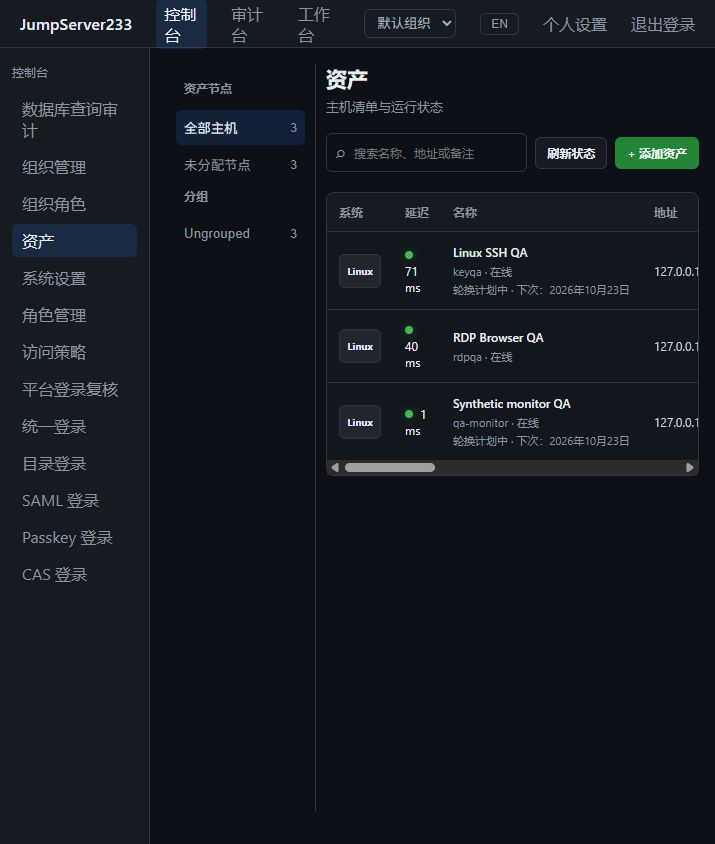

# 本地用户认证

> 中文 | [English](./AUTH.en.md)

认证步骤、会话签发前审计提交、全局权限与独立安全通知见[平台登录审计](./LOGIN-AUDIT.md)。

首次启动、用户库为空时，自动创建默认管理员 **`root / root`**。登录使用普通本地认证流程，密码以 scrypt 哈希保存。重复启动不重置密码，也不会向已有用户库补入该账号；可在个人设置修改密码。设置 `JMS_DEFAULT_ADMIN_ENABLED=false` 可使用自定义管理员初始化，正常新建账号和改密仍要求 12–256 字节。

组织通过 `X-JMS-ORG`、浏览器切换和 Agent CLI 选择隔离资源、角色与运维审计，支持单机存储和 PostgreSQL 单活 HA。详见 [组织隔离](./ORGANIZATIONS.md)；完整企业版目标仍在进行。

平台登录审批与站内通知已接入：认证后等待、原来源一次性兑换、加密持久化及 PostgreSQL 单活 HA。详见 [平台登录复核](./PLATFORM-LOGIN-REVIEWS.md)；完整企业版目标仍在进行。

来源、每周时段及执行通道限制支持单机和单活 HA，详见 [访问策略](./ACCESS-POLICIES.md)；完整企业版对齐仍在推进。

Passkey 注册、设备验证登录、本地 MFA、撤销与 HA 恢复见 [Passkey](./PASSKEY.md)。

SAML 签名断言、浏览器绑定、本地 MFA、SP 身份加密和配置审计见 [SAML](./SAML.md)；其余协议配置及生产 IdP 对接仍待完成。

CAS 单点登录见 [CAS.md](./CAS.md)，使用独立外部身份和本地 MFA。

LDAP/AD 目录登录见 [LDAP.md](./LDAP.md)。

系统管理接口支持对应的委派权限，详见 [RBAC.md](./RBAC.md)。`admin/operator` 保持兼容；全局 `admins` MFA 策略也覆盖拥有系统角色权限的账号。

本文说明本地账号认证流程。个人账号已支持自助修改登录密码、TOTP MFA 和一次性恢复码；管理员可配置全局 MFA 强制范围。系统角色管理见 [RBAC.md](./RBAC.md)，OIDC 统一登录见 [OIDC.md](./OIDC.md)；组织隔离及其它已接入协议见上方对应文档。

生产反向代理应设置显式 `JMS_PUBLIC_URL=https://console.example.com`，使浏览器源校验与 `Secure` Cookie 使用相同公共地址。OIDC 账号返回 `source: "oidc"`，主密码由身份提供方管理；本地密码登录和改密均拒绝。管理 MFA 时需要最近五分钟内的平台 SSO 会话及新第二因素。停用提供方后，短期会话、永久 Token 和 AccessKey 均在下一次身份校验时失效。

## 首次启动

- 打开 `/login`，用默认账号登录。若显式停用了默认账号初始化，页面提示创建管理员；自定义用户名为 3–64 位 ASCII 字母、数字、点、下划线或连字符，密码长度为 12–256 字节。
- 单机默认监听 loopback，可直接初始化。远程监听必须配置至少 32 字节的 `JMS_ADMIN_TOKEN`；初始化管理员时需要在页面填写该令牌。
- 初始化只能成功一次。单机模式把管理员账号写入 `JMS_DATA_DIR/users.json`；集群模式写入 PostgreSQL 的共享用户文档。密码以独立 salt 的 scrypt 派生哈希保存，访问令牌原文不会写入磁盘或数据库。

## 登录和令牌

- `POST /api/v1/authentication/auth/` 使用用户名和密码登录，返回 12 小时有效的 bearer 访问令牌，并设置 `HttpOnly`、`SameSite=Lax` 的 `jms_sessionid` Cookie。浏览器页面发送 `X-JMS-Browser-Session: cookie` 后，响应只返回用户资料与过期时间，不把会话令牌暴露给前端脚本；Agent/REST 客户端省略该头时仍取得 bearer 令牌。启用 MFA 的账号先以密码登录会收到 `401` 和 `mfa_required: true`，随后在 `otp` 字段提交当前 TOTP 或未使用过的恢复码；令牌只在密码和第二因素均有效后签发。
- `GET /api/v1/authentication/session/` 用于恢复浏览器会话；`POST /api/v1/authentication/expire-session/` 撤销当前短期令牌并清除 Cookie。页面退出登录时会调用此接口。
- 短期 bearer/Cookie 会话有效 12 小时。单机模式下摘要只保存在进程内存，服务重启后失效；集群模式将 SHA-256 摘要保存在 PostgreSQL，未过期的会话可在活动节点切换后继续使用。
- 个人设置支持最多 10 个长期 Token。创建接口 `POST /api/v1/users/me/tokens` 只返回一次原文；之后列表只包含 ID 和创建时间，`DELETE /api/v1/users/me/tokens/{tokenID}` 可撤销。API 请求使用 `Authorization: Token <token>`；服务器只保存 SHA-256 摘要，修改密码不会自动撤销长期 Token。
- 每个来源 IP 每分钟最多 30 次登录请求，15 分钟内最多 5 次失败登录；成功登录会清除该 IP 的失败计数。密码派生并发限制为 4，避免登录洪泛耗尽内存。
- `POST /api/v1/users/me/password/change` 需要当前密码和 12–256 字节的新密码。服务端用新 salt 重新派生密码哈希，保留当前会话并撤销同一账号的其他活动会话；响应为 `204` 且禁止缓存。
- 个人设置支持管理最多 10 个 AccessKey。`POST /api/v1/users/me/access-keys` 只在创建响应中返回一次 `access_key_secret`；列表仅返回 ID 和创建时间，`DELETE /api/v1/users/me/access-keys/{keyID}` 可立即撤销密钥。Secret 以 Vault key 的 AES-GCM 加密保存。
- REST API 接受 JumpServer 兼容的 HTTP Message Signature：`Authorization: Signature keyId="…",algorithm="hmac-sha256",headers="(request-target) date",signature="…"`。也接受额外签入 `accept` 的格式。服务端校验签名及 5 分钟 Date 时钟偏差；生产环境应通过 HTTPS 使用。
- `GET /api/v1/users/me` 返回当前身份和 `mfa_enabled` 状态；管理员可通过 `GET /api/v1/users` 查询账号，通过 `POST /api/v1/users` 创建管理员或操作员。
- 管理员可在“资产”页维护 SSH 主机及其节点归属，在“访问控制”页创建用户组、维护操作员成员，并向单用户或用户组授予单台资产或资产节点及其 SSH 账号的 `view`、`connect`、`sftp` 权限和有效时间；授权可在同页撤销。节点授权会继承到该节点及全部后代节点下、使用相同 SSH 账号的资产。

## TOTP MFA

- 用户在个人设置页开始绑定，`POST /api/v1/users/me/mfa/enrollment` 返回 TOTP 密钥和 `otpauth://` URI；未确认的密钥可在 10 分钟有效期内恢复显示，过期后作废。
- 使用身份验证器生成的 6 位验证码调用 `POST /api/v1/users/me/mfa/confirm` 完成绑定。启用后，登录必须同时提供密码和 TOTP 验证码。
- `POST /api/v1/users/me/mfa/recovery-codes` 需要当前密码和新的 TOTP 或未使用的恢复码，生成 10 个一次性恢复码。明文仅在生成响应中返回一次；服务端只保存 SHA-256 摘要，登录成功后立即删除已用摘要。重新生成会替换并作废全部旧码，响应禁止缓存。
- 登录页的 `otp` 输入框同时接受 6 位 TOTP 或恢复码；每个恢复码只能成功登录一次。停用 MFA 会删除剩余恢复码。
- 停用调用 `POST /api/v1/users/me/mfa/disable`，需要当前密码和新的验证码。错误验证码按登录失败计入来源 IP 限流；已消费的时间步不能重放。
- TOTP 密钥用 AES-GCM 和现有 Vault key 加密保存。单机由本地 Vault key 提供密钥；集群节点必须使用相同的 `JMS_VAULT_KEY`，并由 PostgreSQL 用户文档共享密文。绑定接口设置 `Cache-Control: private, no-store`。
- 管理员可通过 `GET/PUT /api/v1/settings/security/mfa` 设置 `disabled`、`admins` 或 `all`；启用策略前必须配置 Vault key。策略存储在单机 `mfa-policy.json` 或集群 PostgreSQL 文档中。
- 尚未绑定 MFA 的目标账号在下次密码登录后会收到 10 分钟有效的一次性设置挑战。挑战只允许确认 MFA，确认成功后直接签发登录会话；挑战 token 仅保存 SHA-256 摘要，返回包含 MFA 密钥的响应禁止缓存。已有 MFA 的目标账号必须提交 TOTP 或恢复码。
- 全局策略生效时，匹配范围内的用户不能停用 MFA。关闭或缩小策略不会撤销已启用的 MFA，也不会结束当前会话。

## 当前授权边界

- 首位用户固定为管理员。用户创建接口不能代替初始化流程。
- 管理员账号和 `JMS_ADMIN_TOKEN` 可访问当前资产、授权管理及全部会话。操作员的会话清单、结束和回放接口按已验证的用户 ID 限定为本人记录。
- 管理员可通过 `GET/POST /api/v1/grants` 和 `DELETE /api/v1/grants/{grantID}` 配置用户或用户组绑定到单台资产或节点范围的 SSH 账号、动作与有效时间。创建授权时必须且只能提供 `user_id` 或 `group_id` 之一，以及 `asset_id` 或 `node_id` 之一；资产授权的账号必须与资产当前配置的 SSH 用户名完全一致。节点授权会按账号名匹配后代资产。
- 管理员可通过 `GET/POST /api/v1/assets/nodes`、`PUT/DELETE /api/v1/assets/nodes/{nodeID}` 维护节点树；同一父节点下名称不区分大小写且必须唯一。不能删除仍有子节点、资产归属或授权规则引用的节点；移动节点会相应调整继承授权范围。
- 管理员可通过 `GET/POST /api/v1/user-groups` 查看与创建用户组，通过 `PUT/DELETE /api/v1/user-groups/{groupID}/members/{userID}` 添加或移除操作员。`DELETE /api/v1/user-groups/{groupID}` 仅允许删除未被授权规则引用的用户组。
- 操作员的 `GET /api/v1/assets` 只返回其本人或所属用户组有有效 `view` 或 `connect` 授权的资产；`connect` 会隐含 `view`。操作员只有有效 `connect` 授权才能通过 `POST /api/v1/sessions` 新建会话。
- 资产级 `sftp` 动作可授权操作员打开文件管理器，单独的 `view` 授权不能传输文件。文件 API 包含目录列表、创建文件夹、上传、下载与删除；操作员只能访问授权资产。
- `GET /api/v1/file-transfers` 返回文件传输审计，管理员可查看全部，操作员只能查看自己的记录。索引写入 `JMS_DATA_DIR/file-transfers/index.jsonl`，集群节点必须共享此目录。
- 授权支持用户组成员继承组级授权，以及资产继承其所属节点与祖先节点的授权。操作员只会看到自己有有效 `view`/`connect` 权限的资产节点及其祖先，不会看到无关节点。操作员不能读取或结束其他用户的会话，也不能回放其他用户的录像。
- 单机 loopback 的无令牌入口仅在尚未初始化账号时用于初始化；创建管理员后，所有管理/资产接口均要求认证，不能通过清空 Cookie 或请求本机地址获得管理员。初始化前匿名身份创建的计划也不会在初始化后继续取得权限。监听非 loopback 时仍要求 `JMS_ADMIN_TOKEN`。

已接入全局/组织 RBAC、多组织、单 provider OIDC、LDAP、CAS、SAML、Passkey 及 SSH 密钥管理；各协议的验收边界见对应文档，完整企业版差距见 [PLAN.md](./PLAN.md)。

2026-10-16：实际使用默认账号登录的本机 QA 控制台：

