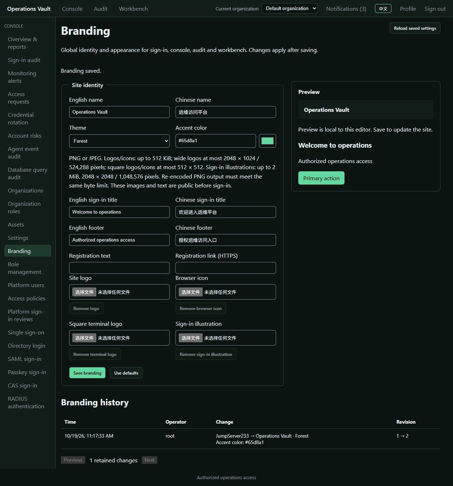
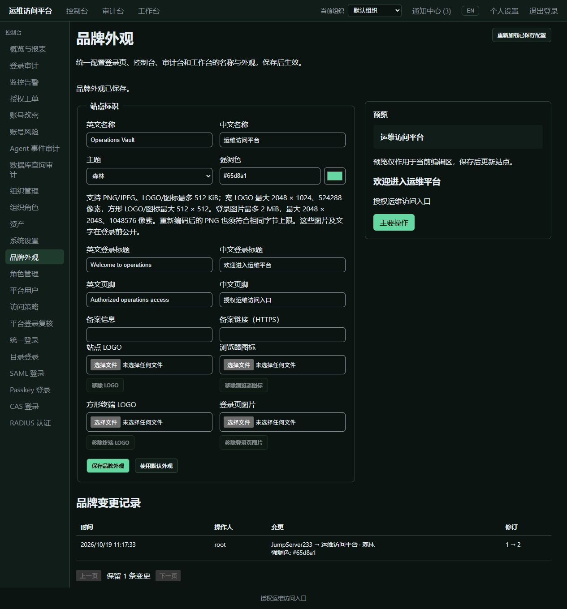

# Branding

> English | [中文](./BRANDING.md)

Configure site names, independent sign-in titles, five themes and accent colors, wide logos, square terminal logos, browser icons, sign-in illustrations and registration footers in Branding. English and Chinese content follows the interface language across sign-in, console, audit and workbench. Scope follows the [competitor's appearance settings](https://docs.fit2cloud.com/jumpserver/manual/admin/system_settings/appearance/); overall Enterprise parity continues in the [plan](./PLAN.en.md).

## Use

Global `branding.manage` permission is required. System administrators have it by default; organization roles cannot grant it. Open Branding in the console, review the editor preview and save. Previews and image preparation do not modify the site or append audit entries. Rejected saves preserve the previous configuration; uncertain database acknowledgements are reconciled before the next read or retry. Use defaults changes the draft first and requires saving.

Names and independent sign-in titles allow 64 Unicode characters each; empty sign-in titles use the site name. Footers allow 160 characters and registration labels 80. Optional registration links require HTTPS without URL user credentials. Content renders as plain text without HTML/CSS. Images and text are public before sign-in; management audit remains protected.

Controlled themes are Graphite, Midnight, Forest, Plum and Crimson, with custom accents. The server requires at least 4.5:1 accent contrast against both theme backgrounds and selects readable button text. Themes affect application framing, core controls and the login shader. Remote desktop pixels, terminal colors and security watermarks retain their session-specific settings.

## Images

- PNG/JPEG only. The server checks compressed size and dimensions before decoding, strips original metadata and re-encodes PNG.
- Wide logos allow 512 KiB, 2048 × 1024 and 524288 pixels. Square terminal logos and browser icons allow 512 KiB and 512 × 512, with equal dimensions.
- Sign-in illustrations allow 2 MiB, 2048 × 2048 and 1048576 pixels. They appear beside the form and stack on narrow screens. Re-encoded PNG must meet the corresponding byte limit.
- SVG, remote image URLs and arbitrary CSS are rejected. The square mark appears in Web resource terminals; the browser icon is independent.
- Public image URLs use content digests, fixed PNG content type, MIME sniffing protection and immutable caching. Removing an image stops serving its previous digest through current endpoints. Previously cached or downloaded public copies remain outside any recall guarantee.

## Persistence, audit and HA

Standalone mode stores a version 1 `branding.json` document in the data directory, using a temporary file, synchronized write and atomic replacement. Unix permissions are 0600 for files and 0700 for directories. Memory updates only after acknowledged durable saving. A database error can leave the commit outcome uncertain: reads and retries reload shared state first, preserving the original actor and preventing duplicate audit entries. Public branding contains no platform/SSH credentials. The document contains public images and private management audit, without SSH Vault-key encryption.

PostgreSQL single-active mode uses global shared document `branding`, containing all four image slots and the latest 200 audit entries. Takeover reads shared state without copying a local image directory. This does not establish production multi-active/distributed acceptance. Loading checks version, capacity, image digests and raster bounds; documents are limited to 16 MiB. Corruption fails startup.

Saving uses the current revision. An identical retry with an older revision returns current settings without another write or audit entry; stale different content returns 409. Text fields are replaced in full, so omitted optional text is cleared. Omitted image fields preserve images; explicit empty strings remove them. Cross-tab notifications and visible-page minute checks refresh open interfaces without overlapping requests. Saving actively reloads the current tab's public settings.

## API and CLI

- `GET /api/v1/branding`: public settings and controlled colors, with ETag.
- `GET /api/v1/branding/images/{digest}`: current public PNG.
- `GET /api/v1/settings/branding`: management settings and theme choices.
- `PUT /api/v1/settings/branding`: save with strict fields and body bounds.
- `POST /api/v1/settings/branding/prepare-image`: validate `kind` (`logo`, `icon`, `mark`, `login_image`) and base64 `data`; return normalized PNG base64.
- `GET /api/v1/settings/branding/audit?offset=0&limit=25`: private history, at most 100 records per page.

Management rechecks current identity and global permission on every request, with the four platform authentication methods. `X-JMS-ORG` does not change branding scope. Failures return explicit codes; management responses prohibit caching.

```sh
jms branding show
jms branding audit --offset 0 --limit 25
jms branding save --file branding.json --logo logo.png --mark mark.png --icon icon.png --login-image login.jpg
jms branding save --file branding.json --clear-logo --clear-icon --clear-mark --clear-login-image
```

`branding.json` uses API input fields: current `revision`, `name_en`, `name_zh`, `theme`, `accent` and optional text to retain. `show` returns a management wrapper containing `settings` and `themes`; that entire response is not save input. CLI image arguments receive the same normalization before transmission. Use `--file -` for standard input. The Go client provides `Branding`, `SaveBranding` and `BrandingAudit`; `branding.AsInput` constructs text input from current settings.

## Browser evidence

Actual in-app browser screenshots from the isolated Docker production instance on 2026-10-19, using synthetic names and footers. Configuration was saved through the page; switching languages changed the site title, editor, preview and audit text. Public sign-in titles and footers were also checked after signing out. Automated coverage additionally uploads all four image types, opens real Web SSH and checks anonymous/public versus management permissions. Detailed results and limitations are in [automated verification](./TESTING.en.md).




