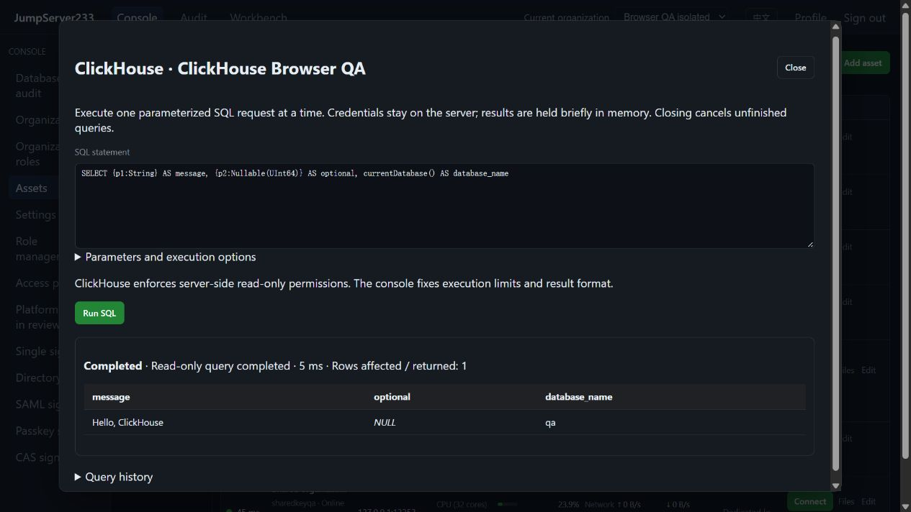

# ClickHouse HTTPS SQL access

> English | [中文](./CLICKHOUSE.md)

ClickHouse uses the official HTTPS SQL interface within inventory, the browser console, `jms db`, organization/node grants, SQL reviews and encrypted audit. Standalone deployment is the default; configuration and query indexes use the existing PostgreSQL active/standby HA store. The competitor baseline is [JumpServer Enterprise](https://www.jumpserver.org/enterprise.html). This feature provides HTTPS queries; native TCP client proxying remains open.

Local verified-TLS capture, 2026-10-16, using isolated QA data. It shows typed parameters, SQL NULL and completed read-only execution:



## Configuration and parameters

Select ClickHouse, default HTTPS port 8443, and provide a database name. The `clickhouse` object contains `database`, `tls_mode`, `server_name`, `root_ca_pem` and `read_only`. Certificate/hostname verification is enabled by default, with TLS 1.2 or later. Disabling TLS requires explicit configuration. Database passwords remain in the encrypted server vault; browser and CLI use platform identity. Up to three SSH gateways use pinned host fingerprints at every hop. Environment HTTP proxies, redirects and automatic query retries are disabled.

Typed parameters such as `{p1:String}` and `{p2:Nullable(UInt64)}` map to a JSON array. Strings, numbers, booleans and NULL are transmitted separately. Array and Tuple use JSON arrays; Map uses JSON objects. Large integers can use JSON numbers or strings to preserve precision. Parameters cannot replace SQL identifiers; Identifier parameters are rejected. SQL and parameters use the multipart POST body. Passwords use HTTP Basic authentication headers. None of these values are placed in the URL.

```bash
printf 'SELECT {p1:String}, {p2:Nullable(UInt64)}' | jms db ASSET_ID --params '["hello",null]'
jms db ASSET_ID --write < change.sql
```

## Read-only mode, writes and cancellation

Assets default to read-only; requests can only tighten that policy. Read-only execution uses ClickHouse server settings `readonly=1` and `allow_ddl=0`, plus statement-class checks. The console fixes response format, execution timeout and server result limits. SQL SETTINGS, FORMAT output overrides, OUTFILE and session/transaction controls are rejected. Quote identifiers for columns with those names. The `format()` function is supported; WITH TOTALS is not supported yet.

Successful reads report `read_only`. Writes require asset permission and explicit removal of request read-only mode. Successful writes report `server_managed`; failure or cancellation after dispatch reports `unknown`. ClickHouse writes have no guaranteed rollback. Reconcile uncertain outcomes before retrying. Affected rows come from the server summary when available, otherwise they are explicitly unknown.

Each query receives an unpredictable query_id. Cancellation or a result limit triggers a best-effort KILL QUERY for that ID using the same account, with a two-second cleanup deadline. This cannot undo completed writes or guarantee termination during network failure or insufficient permissions. The independent server execution deadline still applies. Give the database account only the permissions it needs.

## Results and audit

Defaults are 500 rows and 30 seconds. Limits are 10000 rows, 50000 cells, 1 MiB of displayed text and 8192 bytes per cell; the response body is separately limited to 4 MiB. The complete response is parsed to detect late errors after HTTP 200. NULL is distinct, invalid UTF-8 or NUL-containing strings use hexadecimal display, and exact numbers retain their text. Native error codes are validated as numbers; database error bodies are excluded from results/logs.

Platform grants, organization and asset bindings are rechecked on requests and before results are returned. Audit persists redacted SQL, protocol, operator, parameter count, review and execution state. Parameter values, result rows, column names/types and additional result sets are excluded. Every SQL engine shares this boundary. Full results remain in the current process for at most 15 minutes/16 queries, with deep copies. Restart or HA takeover requires a new connection and does not replay unfinished queries.

## Automated fixture

`node server/testsupport/clickhouse/run.mjs` starts isolated ClickHouse 25.8 on HTTPS `15481` / health `15482`, publishing loopback only. Set `JMS_TEST_CLICKHOUSE_FIXTURE_URL`; Linux containers also set `JMS_TEST_CLICKHOUSE_NETWORK_ADDR`. E2E uses independent `15483` / `15484` and cleans owned resources. Unified Go/Testify, race and Playwright CI include this fixture. See [verification records](./TESTING.en.md) for actual acceptance status.

Protocol sources: [official HTTP interface](https://clickhouse.com/docs/interfaces/http), [read-only settings](https://clickhouse.com/docs/operations/settings/permissions-for-queries). Remaining Enterprise gaps are tracked in the [plan](./PLAN.en.md).
