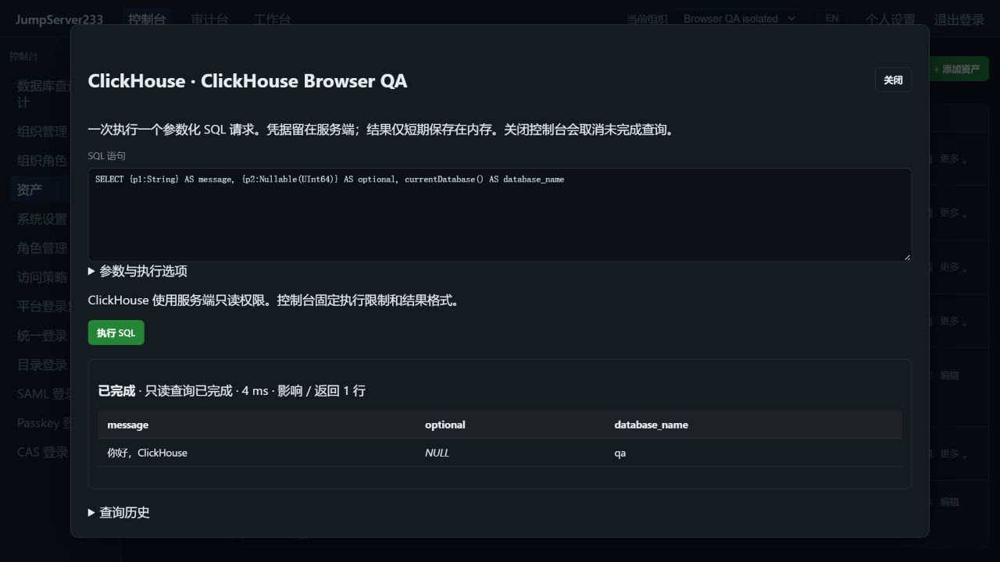

# ClickHouse HTTPS SQL 访问

> 中文 | [English](./CLICKHOUSE.en.md)

ClickHouse 通过官方 HTTPS SQL 接口接入统一资产、浏览器控制台、`jms db`、组织/节点授权、SQL 复核及加密审计。默认单机；配置和查询索引使用现有 PostgreSQL 单活 HA。竞品基准为 [JumpServer 企业版](https://www.jumpserver.org/enterprise.html)。本功能提供 HTTPS 查询入口，原生 TCP 客户端代理仍待实现。

2026-10-16 本机真实 TLS 验收截图，使用隔离 QA 数据，展示类型参数、SQL NULL 和只读完成状态：



## 配置和参数

协议选择 ClickHouse，默认 HTTPS 端口 8443，数据库名必填。`clickhouse` 对象包含 `database`、`tls_mode`、`server_name`、`root_ca_pem`、`read_only`；默认校验证书及主机名，TLS 1.2 起步。禁用 TLS 必须显式配置。账号密码只保留在服务端加密保管库，浏览器与 CLI 使用平台身份。支持最多三跳、逐跳固定主机指纹的 SSH 网关；不读取环境 HTTP 代理，不跟随重定向，不自动重试查询。

使用 `{p1:String}`、`{p2:Nullable(UInt64)}` 等类型参数，对应 JSON 数组。String、数字、布尔和 NULL 使用独立参数传输；Array、Tuple 使用 JSON 数组，Map 使用 JSON 对象。大整数可用 JSON 数字或字符串保留精度。参数不能替换 SQL 标识符；不接受 Identifier 参数。SQL 和参数放在 multipart POST 正文中，密码通过 HTTP Basic 身份头传输，均不放 URL。

```bash
printf 'SELECT {p1:String}, {p2:Nullable(UInt64)}' | jms db ASSET_ID --params '["hello",null]'
jms db ASSET_ID --write < change.sql
```

## 只读、写入和取消

资产默认只读，查询只能进一步收紧。只读请求使用 ClickHouse 服务端 `readonly=1` 与 `allow_ddl=0`，并限制入口语句种类。控制台固定结果格式、执行期限及服务端结果上限；拒绝 SQL 中的 SETTINGS、FORMAT 输出覆盖、OUTFILE 和会话/事务控制。需要同名列时可使用带引号的标识符。`format()` 函数可用；WITH TOTALS 暂不支持。

只读成功状态为 `read_only`。写入须资产允许且本次显式关闭只读，成功状态为 `server_managed`；请求发出后报错或取消为 `unknown`。ClickHouse 写入无法保证回滚，不确定结果需要核对后再重试。影响行数可用时取服务端摘要，否则明确标记未知。

每次查询生成不可预测的 query_id。取消或超限时尝试用同一账号对该 ID 执行 KILL QUERY，清理最多等待两秒；这不能撤销已经完成的写入，也不能保证在网络故障或权限不足时终止服务端查询。独立服务端执行期限继续生效。数据库账号应另配置最小权限。

## 结果和审计

默认 500 行、30 秒；最多 10000 行、50000 单元格、1 MiB 显示文本、单格 8192 字节，响应正文另限 4 MiB。完整解析响应以识别 HTTP 200 后的尾部错误。NULL 单独显示，无效 UTF-8 或含零字节字符串显示为十六进制，精确数字保持文本。原生错误码经过数字校验返回，数据库错误正文不进入结果/日志。

每次请求和返回结果前复查平台授权、组织及资产绑定。审计仅保留脱敏 SQL、协议、操作人、参数个数、复核与执行状态；参数值、结果行、列名/类型及后续结果集均不持久化。所有 SQL 引擎共享该审计边界。完整结果仅存当前进程、最多 15 分钟/16 次查询并深复制；重启或 HA 接管后重新连接，未完成查询不重放。

## 自动化夹具

`node server/testsupport/clickhouse/run.mjs` 启动独立 ClickHouse 25.8，HTTPS `15481` / health `15482`，只发布回环端口。设置 `JMS_TEST_CLICKHOUSE_FIXTURE_URL`；Linux 容器另设置 `JMS_TEST_CLICKHOUSE_NETWORK_ADDR`。E2E 自动使用独立 `15483` / `15484` 并清理自有资源。CI 的统一 Go/Testify、race 和 Playwright 包含此夹具。实际验收状态见 [验证记录](./TESTING.md)。

协议依据：[官方 HTTP 接口](https://clickhouse.com/docs/interfaces/http)、[只读权限设置](https://clickhouse.com/docs/operations/settings/permissions-for-queries)。完整企业版差距见 [规划](./PLAN.md)。
