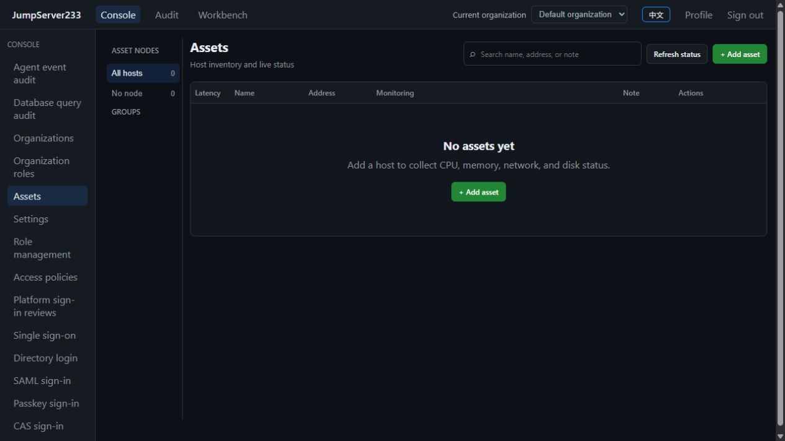

# Docker isolation and parallel debugging

[中文](./DOCKER-QA.md) | [Documentation](./README.en.md)

Buildx metadata reads retry RPC Unavailable/EOF at most three times. Permission and deterministic failures are not retried; cleanup failures retain a nonzero exit and a phase-specific receipt. GitHub Docker QA uses an isolated, automatically removed `docker-container` builder instead of relying on the runner's default Docker driver/BuildKit combination. Successful cleanup removes raw logs; failure diagnostics retain at most 16,000 characters. Cleanup remains restricted to demonstrably owned repository resources.

Docker builds the production API and web application from source, with separate networks, named data volumes and localhost ports. Builds do not read host Go, Node, `node_modules` or generated native helpers. Runtime images contain only executables and web output. The API and Nginx run as ordinary users with read-only root filesystems.

`node scripts/check-content.mjs` also rejects unreferenced `docs/images/` assets to prevent product screenshot accumulation. The automatic cleaner never deletes product screenshots.

## Fast verification

Browser and Docker runners apply file retention on completion: each keeps the latest three completed, successfully cleaned disposable runs, with at most two PNGs per run, preferring one English and one Chinese image. Failed results retain compact summaries; Docker failures keep the existing 16,000-character diagnostic log. Active PIDs, incomplete fixture cleanup and intentionally retained debug environments are skipped. Expired disposable run directories are deleted; named feature JSON reports remain.

Preview and clean historical files manually:

```sh
node scripts/qa-retention.mjs --legacy
node scripts/qa-retention.mjs --apply --legacy
node scripts/qa-retention.mjs --apply --legacy
```

`--legacy` also reduces screenshots/logs in successful named reports and removes known branding/discovery/migration/monitor-history ad hoc helpers directly under `.cache/`, older than one hour and without a recorded active QA run. Unknown tools are preserved. Default automatic retention only handles demonstrably completed browser/Docker report directories. Every candidate checks workspace boundaries, ancestors, links and file identity since preview; changes refuse deletion. The fixed `.cache/qa-reports/retention.json` receipt does not accumulate copies. Repeated cleanup should remove zero files.

`.gitignore` and `.dockerignore` exclude backups/keys, browser output, profiles, temporary builds and QA evidence. Images are not globally ignored. Referenced product screenshots remain in `docs/images/`, outside the cleaner's scope. Commit reusable tools under `scripts/` and keep temporary work in ignored directories. File retention and resource cleanup are separate; the Docker resource commands below still check container/volume ownership.

After testing, retain compact summaries and PNG evidence only: browser reports under `.cache/qa-reports/browser-*/`, Docker smoke reports under `.cache/docker-qa/<project>/`. Authentication request traces are disabled. Cleanup removes this run's temporary data, protocol containers/anonymous volumes, certificates, plugin test cache and unused QA images. Development dependencies, shared base images and unscoped shared BuildKit caches are excluded from global pruning.

Preview historical resources, apply cleanup, then repeat:

```sh
node scripts/qa-cleanup.mjs --include-legacy-fixtures --test-caches
node scripts/qa-cleanup.mjs --apply --include-legacy-fixtures --test-caches
node scripts/qa-cleanup.mjs --apply --include-legacy-fixtures --test-caches
```

Cleanup checks the workspace path, `compose.qa.yml`, labels and immutable container IDs; the second invocation should remove zero resources. Permission/connection errors are not missing resources. Partial-cleanup reports retain ownership evidence for retries. New fixtures carry workspace labels; legacy fixtures require the explicit flag and known name/image combinations. Saving identical password settings has no side effects; stale reset revisions conflict, and one-time password-change capabilities must reject replay.

Run `cd web && pnpm test:e2e:production` for complete protocol regression: build the frontend once, serve static output, and start fresh temporary data with the existing real protocol fixtures. Owned resources are checked and cleaned afterward. This is timed separately from fast Docker smoke and avoids development module transforms without reducing test scope.

Requires Docker Compose and Node 24:

```sh
node scripts/docker-qa.mjs verify
```

Each run creates a random project, empty data volume and two free localhost ports. It checks health, unauthenticated rejection, default login, session identity, production JavaScript, gzip and caching, then removes its containers/network/volume. Named debug environments are never reused or deleted. Logs stay in ignored `.cache/docker-qa/` without login credentials or session tokens.

With existing `web` dependencies and Playwright Chromium, add real browser checks:

```sh
node scripts/docker-qa.mjs verify --browser
```

Browser checks cover English/Chinese inventory and account-risk pages, lazy scripts and page errors. Only the random clean volume runs an empty-account scan and verifies its successful receipt. Retained `up` environments only read risk pages, avoiding interference with existing periodic policies. Real SSH rotation and periodic risk checks run in the full `pnpm test:e2e` suite.

The browser checks production login, Chinese/English switching, page exceptions and that an authenticated console does not load login animation code. Local warm-cache measurements on 2026-10-16: build 3.14 seconds, isolated startup 12.05 seconds, HTTP/parallel-browser checks 3.42 seconds, approximately 18.6 seconds total. Initial image/dependency downloads take additional time. Full SSH/database/real-systemd regression is recorded in [verification records](./TESTING.en.md).

## Retained debug environments

```sh
node scripts/docker-qa.mjs up --project jms233-debug-a --web-port 15173 --api-port 18080 --browser
node scripts/docker-qa.mjs up --project jms233-debug-b --host 127.0.0.3 --web-port 15174 --api-port 18081
```

Web URLs are `http://127.0.0.2:15173` and `http://127.0.0.3:15174`; APIs use `http://127.0.0.2:18080` and `http://127.0.0.3:18081`. Empty stores use the project default administrator; existing data and passwords are preserved. Each project has separate networks, image names and volumes. Published ports bind only to a dedicated loopback address (`127.0.0.2` by default), preserving existing development instances such as 5173.

```sh
node scripts/docker-qa.mjs down --project jms233-debug-a
```

`down` retains the data volume. Docker-only startup is `docker compose -f compose.qa.yml -p jms233-debug up --build --detach --wait`. Default web/API ports are 15173/18080; override with `JMS_QA_WEB_PORT`, `JMS_QA_API_PORT` and `JMS_QA_HOST`. Use different loopback addresses to isolate cookies.

After starting both environments, verify that login does not overwrite the other session in a shared browser context: `node scripts/docker-qa.mjs up --project jms233-debug-a --browser --peer-url http://127.0.0.3:15174`. This passed on 2026-10-16; checking existing environments took approximately 6.5 seconds.

## Caching and scope

BuildKit caches Go modules, compiled Go packages, the pnpm store and incremental TypeScript state. Lockfiles/dependency manifests are copied first, so source edits do not download all dependencies again. `.dockerignore` excludes dependencies, generated programs, runtime data, documentation images and local tool configuration. Cache organization follows [Docker documentation](https://docs.docker.com/build/cache/optimize/).

Acceptance covers Linux amd64 standalone production images and localhost forwarding. Use service names or `host.docker.internal` to reach debug targets; container `127.0.0.1` refers to that container. This entry does not create protocol fixtures or prove cluster HA/production deployment. The default proxy declares no trusted source; configure actual proxies for production source-IP rules as described in [access policies](./ACCESS-POLICIES.en.md).

Actual in-app browser screenshot from the separate Docker port on 2026-10-16. The empty inventory belongs to a fresh data volume:



Test cleanup also prunes reclaimable jms233 compilation/dependency cache records by their descriptions and immutable IDs. Unattributed shared layers remain. Repeating cleanup checks for zero additional removals. The next cold build may download dependencies again; report cold and warm durations separately.

Browser runs place `GOTMPDIR` inside their owned temporary root, so cleanup also removes Go run executables. Shared Go compilation and dependency caches remain reusable.
