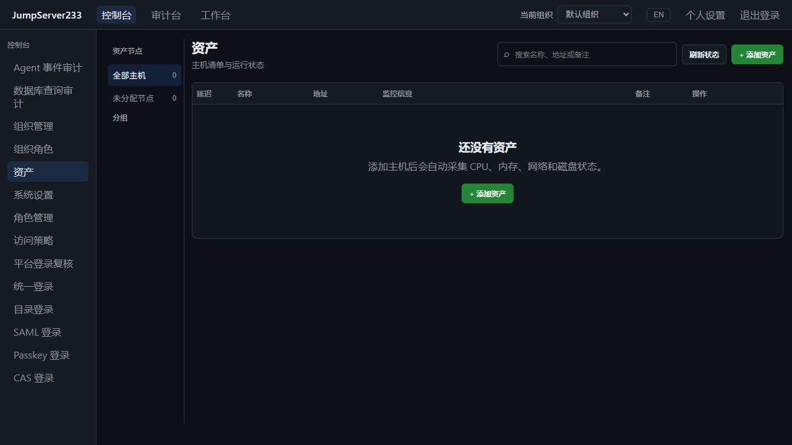

# Docker 隔离验证与并行调试

[English](./DOCKER-QA.en.md) | [文档索引](./README.md)

Buildx 元数据只读查询遇到 RPC Unavailable/EOF 时最多尝试 3 次；权限和确定性失败不重试，清理失败保持非零退出及明确阶段回执。GitHub Docker QA 使用独立 `docker-container` builder 并自动回收，避免依赖 runner 默认 Docker driver 的 BuildKit 组合。成功清理后删除原始日志，失败诊断最多保留 16,000 字符；只清理本仓库可证明归属的资源。

生产 API 和网页都在 Docker 中从源码构建，运行时使用独立网络、命名数据卷和本机端口。构建不读取宿主 Go、Node、`node_modules` 或已有原生组件。镜像仅保留运行程序和网页产物；API、Nginx 以普通账号运行，根文件系统只读。

幂等 QA 镜像准备对 Windows Docker context `meta.json` 的共享占用错误最多尝试三次；普通文件占用、权限错误不重试，不重放容器创建或远端命令。

清理身份包含流式 SHA-256，64 KiB 缓冲区不会随归档体积增长；同长度、同修改时间的内容变更也会拒绝删除。每次删除前重查 runner 时只扫描 PID 文件及必要回执，避免重复读取其他大型产物。

文档内容检查 `node scripts/check-content.mjs` 同时拒绝无引用的 `docs/images/` 资源，避免正式截图持续堆积；自动清理器不会擅自删除正式截图。

## 快速验证

CI 前后端 runner 固定为 `ubuntu-22.04` 并记录 `uname -r`，继续运行真实 MongoDB 8.0 夹具。前端修正后，后端 `verify` 也确认遇到相同的 MongoDB 内核保护拒绝，现同步修复。上一轮 `ubuntu-latest` 的 MongoDB 被其内核保护检查拒绝启动；MongoDB 官方说明特定内核与 TCMalloc 不兼容，Docker 也共享宿主内核。选择依据为 [MongoDB 生产说明](https://www.mongodb.com/docs/manual/administration/production-notes/)和 [GitHub Ubuntu 22.04 runner 清单](https://github.com/actions/runner-images/blob/main/images/ubuntu/Ubuntu2204-Readme.md)中的 6.8 内核；未关闭数据库保护或跳过 MongoDB 用例。新的远端 CI 结果需按具体提交核对。

生产浏览器构建使用本轮受控临时根下的 `web-dist/`，预览与体积检查读取同一目录，结束后随本轮数据一起回收。独立 `pnpm build` 继续输出到 `web/dist/`，可并行验证。

CI 前端复用 `pnpm test:e2e:production` 的一次构建，继续执行完整套件，移除之前重复的独立构建步骤。后端状态机检查明确选择 Python 3.11，满足 `hashlib.file_digest` 的依赖；Linux 只读容器内 10 项状态机用例已通过。此处状态机使用假运行时，没有部署内网服务。

浏览器与 Docker runner 在结束时自动执行文件保留策略：各保留最近三次已完成并清理成功的独立验证，每次最多两张截图（PNG/JPEG/WebP），优先各一张中英文截图。原生包与 Linux race 的当前及历史批次，有有效 runner 回执且结果与清理均成功时也自动精简；检查 runner 和子进程 PID，避免并行运行时误删。成功专题和 Docker 批次还删除原始 trace/ZIP/TAR、视频、HTML/HAR、性能分析和临时测试程序，继续保留 JSON 报告及其他未识别文件。失败结果仍保留精简摘要；Docker 失败日志保留既有 16,000 字符诊断。活动 PID、清理未完成的夹具与刻意保留的调试环境会跳过。被淘汰的独立验证目录会删除；具名专题的 JSON 报告继续保留。

手动预览和清理历史文件：

```sh
node scripts/qa-retention.mjs --legacy
node scripts/qa-retention.mjs --apply --legacy
node scripts/qa-retention.mjs --apply --legacy
```

`--legacy` 额外精简没有 runner 回执的已有成功专题，并清理 `.cache/` 根目录中 branding/discovery/migration/monitor-history 前缀、超过一小时且无已记录活动验证的临时脚本；不碰未知工具。默认自动策略只处理已证明结束的浏览器/Docker 验证目录，以及有有效原生/race 回执的成功批次。每个候选文件检查仓库边界、所有父目录、链接与预览后的文件身份。删除前统一复核所有候选文件和 runner 回执，每次删除前再次检查所属 runner；预览后新增/修改回执或进程恢复活动时拒绝删除。回执固定写入 `.cache/qa-reports/retention.json`，不会自我累积。重复执行应删除零项。

最近三次的限额仅统计成功批次；失败浏览器/Docker 批次的摘要和必要诊断不会因后续成功运行而过期。`--legacy` 也清理 `web/.cache/` 内固定白名单中的历史 QA 配置及 `run-security-production-full.mjs`，同样要求超过一小时且无已记录活动验证；未知配置与历史结果目录保留。任意层级的 `screenshots/`、协议夹具嵌套 `artifacts/`、编辑器交换/备份文件均被 Git 忽略；Docker 另外排除自动更新/窗口安装的本地状态。

成功批次的临时 JS/TS、Shell/PowerShell/Python、CMD/BAT 脚本、已知无扩展名的 jms 程序和浏览器 `error-context.md` / `.last-run.json` 也自动回收。可复用脚本必须放在 `scripts/`。PID 文件仅在内容为有效进程号且进程已退出时清理；活动或无法读取的 PID 文件保护整个批次。删除前再次核对 PID 文件集合与内容身份，防止预览后新任务启动。其他 Markdown、TXT 和 JSON 证据继续保留。

文件入口也可用 `make qa-preview` / `make qa-clean`，或在 `web/` 下执行 `pnpm qa:preview` / `pnpm qa:clean`。Docker 资源预览不再写入文件；旧的成功只读快照最多保留三份。成功且无资源候选、无变更的执行回执也单独最多保留三份。实际删除、归属信息、剩余资源、失败、未完成或未知字段的回执继续保留，供恢复与核对。缺少原生/race 回执的历史专题仍需显式 `--legacy`。

Git 和 Docker 上下文还排除脚本/协议夹具目录中的测试截图与 artifacts、任意层级的 coverage、PID 与 PID lock 文件。不会全局忽略图片或归档；正式图片仍需通过文档引用检查。

`.gitignore` 与 `.dockerignore` 同步排除备份/密钥、浏览器输出、性能分析、临时构建和 QA 证据，以及 Node/Go/Vite 本地缓存；任意层级的 `test-results/`、`playwright-report/`、`blob-report/` 都被忽略，不全局忽略图片或归档。忽略规则不会自动删除文件。正式产品截图保存在被文档引用的 `docs/images/`，文件清理器不会访问该目录。复用工具提交到 `scripts/`；临时内容集中放在忽略目录。资源清理与文件保留分开，下面的 Docker 资源清理命令仍按归属检查容器与卷。

测试结束只保留必要摘要和 PNG 证据：浏览器在 `.cache/qa-reports/browser-*/`，Docker 冒烟在 `.cache/docker-qa/<project>/`。不保留含认证请求正文的 trace。自动清理本轮临时数据、协议容器/匿名卷、证书、插件测试缓存和未被其他容器使用的 QA 镜像。开发依赖、共用基础镜像及无法证明归属的共享 BuildKit 缓存不做全局 prune。

历史资源先预览，再清理并重复执行：

```sh
node scripts/qa-cleanup.mjs --include-legacy-fixtures --test-caches
node scripts/qa-cleanup.mjs --apply --include-legacy-fixtures --test-caches
node scripts/qa-cleanup.mjs --apply --include-legacy-fixtures --test-caches
```

清理核对仓库路径、`compose.qa.yml`、标签和不可变容器 ID；第二次应删除零项。权限/连接错误不能当成不存在。部分清理报告保留归属证据供重试。新夹具带仓库标签；旧夹具需显式 legacy 选项和预设名称/镜像组合。相同密码策略保存无副作用；旧修订重复重置返回冲突，一次性改密票据重放必须拒绝。

完整协议回归可用 `cd web && pnpm test:e2e:production`：一次生产构建后复用静态资源，启动全新临时数据和原有真实协议夹具，结束后校验归属并清理。本命令与快速 Docker 冒烟分别计时，避免每个页面触发开发模块转换；不减少测试范围。

需要 Docker Compose 和 Node 24：

```sh
node scripts/docker-qa.mjs verify
```

每次创建随机项目、空数据卷和两个空闲本机端口；验证健康、未登录拒绝、默认登录、会话身份、生产 JS、gzip 与缓存策略，结束后清理本次容器/网络/数据卷。不会复用或删除已命名的调试环境。日志保存在被忽略的 `.cache/docker-qa/`，不记录登录凭据或票据。

已有 `web` 依赖和 Playwright Chromium 时可追加真实浏览器检查：

```sh
node scripts/docker-qa.mjs verify --browser
```

浏览器同时检查中英资产页与账号风险页、按需脚本加载及页面错误；只有随机纯净卷执行一次空账号检测，核对成功回执。`up` 保留环境只读取风险页，不派发检测，避免干扰已有周期计划。风险功能的真实 SSH 改密与周期验证由完整 `pnpm test:e2e` 覆盖。

浏览器验证生产包登录、中英文切换、页面异常，以及已认证控制台不加载登录动画代码。2026-10-16 本机热缓存实测：构建 3.14 秒、独立启动 12.05 秒、HTTP/双环境浏览器检查 3.42 秒，总计约 18.6 秒。首次下载镜像和依赖另需时间。完整 SSH/数据库/真实 systemd 回归见 [测试记录](./TESTING.md)。

## 保留调试环境

```sh
node scripts/docker-qa.mjs up --project jms233-debug-a --web-port 15173 --api-port 18080 --browser
node scripts/docker-qa.mjs up --project jms233-debug-b --host 127.0.0.3 --web-port 15174 --api-port 18081
```

网页分别为 `http://127.0.0.2:15173`、`http://127.0.0.3:15174`；API 分别为 `http://127.0.0.2:18080`、`http://127.0.0.3:18081`。空用户库使用项目默认管理员；已有数据和密码不重置。每个项目的网络、镜像名和数据卷独立。端口只绑定专用回环地址（默认 `127.0.0.2`），不影响 5173 等已有开发实例。

```sh
node scripts/docker-qa.mjs down --project jms233-debug-a
```

`down` 默认删除该 QA 项目的数据卷；需要保留后续调试数据时显式添加 `--keep-data`。纯 Docker 入口为 `docker compose -f compose.qa.yml -p jms233-debug up --build --detach --wait`，默认网页/API 端口为 15173/18080，可用 `JMS_QA_WEB_PORT`、`JMS_QA_API_PORT` 和 `JMS_QA_HOST` 调整；不同环境使用不同回环地址以隔离 Cookie。

两套环境启动后，可在同一浏览器上下文验证登录互不覆盖：`node scripts/docker-qa.mjs up --project jms233-debug-a --browser --peer-url http://127.0.0.3:15174`。2026-10-16 已实际通过，已有环境复查约 6.5 秒。

## 缓存与边界

Go modules、Go 编译缓存、pnpm store 与 TypeScript 增量缓存由 BuildKit 管理。先复制锁文件/依赖清单，修改业务源码不会重新下载全部依赖；`.dockerignore` 排除依赖目录、生成程序、运行数据、图片文档及本地工具配置。缓存组织参考 [Docker 官方说明](https://docs.docker.com/build/cache/optimize/)。

当前验收为 Linux amd64 单机生产镜像及本机端口转发。Docker 网络中需要使用服务名或 `host.docker.internal` 访问调试目标；容器的 `127.0.0.1` 指向自身。此入口不创建协议测试主机、不代表集群 HA 或生产部署验收。默认反向代理未声明受信任来源，生产来源 IP 策略需按 [访问策略](./ACCESS-POLICIES.md) 配置实际代理。

2026-10-16 内置浏览器访问独立 Docker 端口的实际截图，空清单来自新数据卷：



测试收尾还按 BuildKit 记录描述和不可变 ID 清理可回收的 jms233 编译/依赖缓存；无归属标记的共享层保留。第二次执行核对零新增删除。下次冷构建可能重新下载依赖，耗时与热缓存记录分别报告。

浏览器验证将 `GOTMPDIR` 放在本轮自有临时目录，清理时同时移除 Go run 可执行文件；共享 Go 编译和依赖缓存继续复用。
