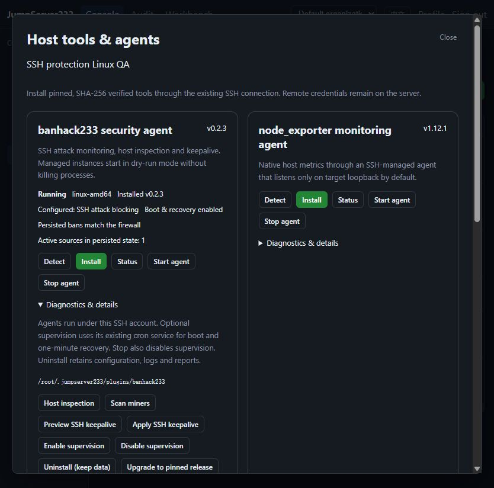

# Native host recovery component

> [中文](./HOST-AGENT.md) | English

2026-10-16 preceding native-recovery acceptance baseline: Windows Go/Testify passed 53 packages/701 cases; Linux race passed 53 packages/704 cases, with no failed/skipped cases or data races. Full browser acceptance passed 55/55 (6.4 minutes), helpers 6/6 and vet/lint/build. Linux adds three file-lock/atomic-snapshot cases. Native Go `jms-agent` reconciles persisted BanHack bans with kernel state. The platform-identity CLI remains `jms plugin`; see [host tools](./HOST-PLUGINS.en.md).

## Build and installation

```bash
cd server
go generate ./internal/agentbundle
go build ./cmd/server
```

The generator builds static Linux amd64/arm64 executables with the current Go toolchain and creates a SHA-256 manifest. The server then embeds these artifacts. Generated files are not committed; regenerate after source changes. `make build-server`, `make run-server`, `make test-server`, CI and the browser-test entry point do this automatically. Generate once before directly running `go run ./cmd/server`. A missing bundle explicitly prevents new enforcement.

Explicit start, supervision enablement, policy application and release transitions install the verified component through existing SSH/SFTP. Hash paths are immutable and verified again before execution. Status requests never upload or reconfigure it. The component has no listener, platform token, SSH credential or arbitrary-command facility. Targets need no Go, Python or jq installation.

## Recovery flow

1. Verify the pinned manifest/configuration hash and read a bounded atomic state snapshot. Duplicate JSON keys, unknown rules/backends, invalid IPs, abnormal durations and oversized state fail.
2. Inspect owned-table identity, IPv4/IPv6 sets, SSH-port rules and unexpired bans. Health includes kernel state outside the process.
3. When repair is needed, stop the exact managed process, acquire BanHack's `state.json.lock` file lock and reread state to avoid overwriting concurrent scans.
4. Rebuild the owned table in one nftables transaction. Delete an existing table by its inspected handle and create the replacement exclusively, preventing takeover of a concurrently created foreign table. Never flush the host ruleset.
5. Restore bans with their remaining timeout rather than a fresh full duration. Allowlisted/management/loopback sources are not restored as bans. Restart the native agent afterward.

With existing-cron supervision enabled, `@reboot` and one-minute checks run independently of the platform. A lost table or ban while the daemon remains alive causes a controlled stop, restoration and restart. nftables behavior follows its [official manual](https://netfilter.org/projects/nftables/manpage.html); the state format and lock follow [pinned v0.2.3 source](https://github.com/neko233-com/banhack233/tree/v0.2.3).

Transient kernel-inspection errors leave an existing monitor running; a foreign same-name table stops the managed process to avoid modifying it. Snapshot reads use a file descriptor without following symlinks while the daemon can atomically replace state. `recovery.json` retains the latest local restoration summary. Version 2 adds bounded event journals, offline backfill and centralized audit; see [AGENT-EVENTS.en.md](./AGENT-EVENTS.en.md).

## Status and limits

2026-10-16: actual native-agent status in an isolated Linux QA environment. The ban source comes from explicitly injected synthetic logs, not production attack data. A separate actual TCP connection verifies SSH blocking.



API/platform CLI return `recovery_state`, `recovery_version` and `active_bans`. `ready` means the persisted active sources have matching SSH-port bans at inspection time; `required` needs restoration and `unavailable` means the build/host lacks the component. Counts are meaningful only after ready/required checks and are not cumulative attack counts.

Earlier launchers are recognized by exact known hashes and migrate only during explicit operations. If a later component release changes the launcher, explicitly stop, autostart_disable, start and autostart_enable. Unknown tampering is not overwritten automatically. Corrupt state/components, abandoned operation locks and foreign same-name tables require administrator inspection; unknown files are preserved.

Ban recovery requires Linux root, nftables, authentication logs and existing cron or systemd. ARM64 compilation does not prove a real ARM64 host works. Native systemd supervision and service management are covered in [AGENT-SYSTEMD.en.md](./AGENT-SYSTEMD.en.md); other operating systems, notification configuration and production HA exercises remain open. See [verification records](./TESTING.en.md).

[Agent events and centralized audit](./AGENT-EVENTS.en.md)
