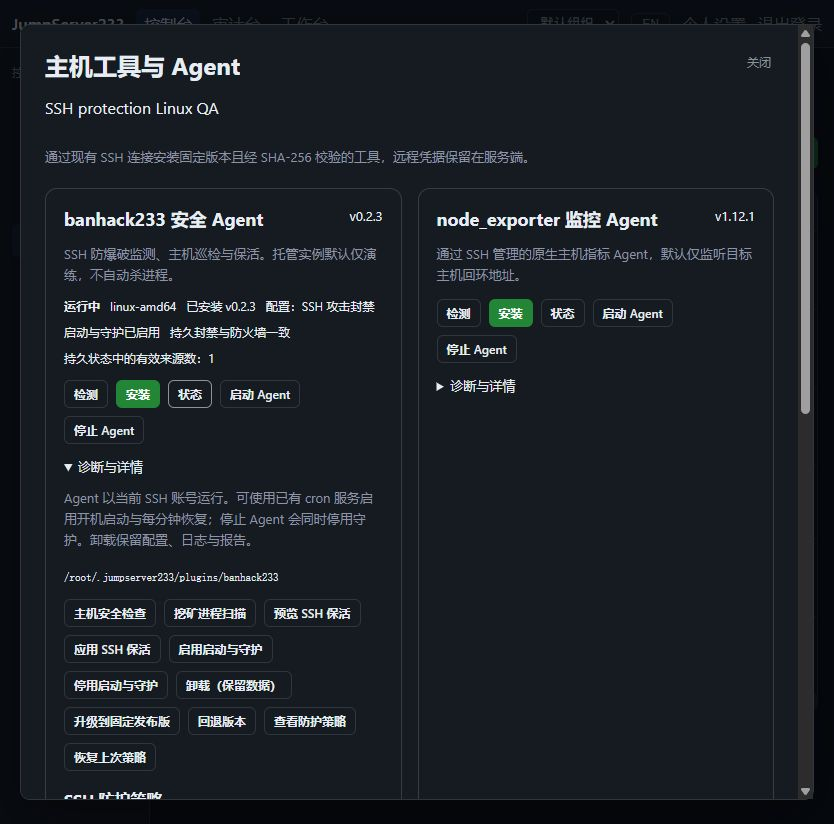

# 原生主机恢复组件

> 中文 | [English](./HOST-AGENT.en.md)

嵌入式 Go 组件另提供固定 `accounts --offset N` 命令，分页采集 Linux 本地账号元数据并在目标侧丢弃密码/GECOS，平台身份、复核和持久记录见 [账号收集](./ACCOUNT-DISCOVERY.md)。采集组件使用独立私有目录，不启动恢复守护。

2026-10-16 原生恢复组件首批验收基线：Windows Go/Testify 53 包、701 项，Linux race 53 包、704 项，零失败、零用例跳过、无数据竞争；完整浏览器 55/55（6.4 分钟）、辅助用例 6/6，vet/lint/build 通过。Linux 多出 3 项文件锁及原子快照用例。原生 Go `jms-agent` 恢复 BanHack 的持久封禁与内核状态；平台身份 CLI 仍是 `jms plugin`，见 [主机工具](./HOST-PLUGINS.md)。

## 构建与安装

```bash
cd server
go generate ./internal/agentbundle
go build ./cmd/server
```

生成器使用当前 Go 工具链构建 Linux amd64/arm64 静态程序，生成 SHA-256 清单，随后由服务端嵌入。生成物不提交；源文件变化后重新生成。`make build-server`、`make run-server`、`make test-server`、CI 和浏览器测试入口自动执行该步骤。直接使用 `go run ./cmd/server` 前先生成一次；缺失组件时明确拒绝启用新防护。

平台在显式启动、启用守护、应用防护及版本切换时通过已有 SSH/SFTP 安装校验后的组件。哈希路径不可变，执行前再次校验。状态查询不上传程序或修改配置。恢复/守护入口只执行固定操作；独立的[执行工作区](./SSH-WORKSPACES.md)入口在内核限制后提供 shell 与 SFTP。组件不监听端口，不保存平台令牌或 SSH 凭据，也不需要目标主机安装 Go、Python 或 jq。

## 恢复流程

1. 校验固定清单和配置哈希，读取有界的原子状态快照。重复 JSON 键、未知规则/后端、非法 IP、异常时长和超限状态均拒绝。
2. 检查受管表所有权、IPv4/IPv6 集合、SSH 端口规则和未到期封禁。完整性判断同时覆盖进程外的内核状态。
3. 若需要恢复，先停止精确匹配的受管进程，再取得与 BanHack 相同的 `state.json.lock` 文件锁；重新读取状态，避免覆盖并发扫描。
4. 一笔 nftables 事务重建受管表。已有表按已核对的 handle 删除，新表使用 create 防止并发出现的外部表被接管；不清空宿主规则集。
5. 使用剩余封禁时长写入内核 timeout，不重新开始完整封禁周期。白名单、管理来源和回环地址不会重新封禁。恢复后再启动原生 Agent。

启用已有 cron 守护后，`@reboot` 和每分钟检查独立于平台运行。若表或封禁丢失但 Agent 仍存活，守护会停止该进程、恢复并重新启动。nftables 操作依据 [官方手册](https://netfilter.org/projects/nftables/manpage.html)，固定 BanHack 的状态锁及持久格式按 [v0.2.3 源码](https://github.com/neko233-com/banhack233/tree/v0.2.3) 核对。

短暂内核自检失败时保留仍在运行的监控进程；外部同名表冲突则停止受管进程以避免误写。状态读取使用不跟随符号链接的文件描述符，允许守护进程同时原子替换状态。`recovery.json` 保留最后一次本机恢复摘要。版本 2 另有有界事件日志、离线补采与集中审计，见 [AGENT-EVENTS.md](./AGENT-EVENTS.md)。

## 状态与边界

2026-10-16：隔离 Linux QA 的真实原生 Agent 状态。封禁来源为明确注入的合成日志，计数不是生产攻击数据；已另用实际 TCP 连接验证 SSH 阻断。



API/平台 CLI 返回 `recovery_state`、`recovery_version` 和 `active_bans`；`ready` 表示本次检查时持久状态中的有效来源具有匹配的 SSH 端口封禁，`required` 表示需要恢复，`unavailable` 表示当前构建或主机尚未安装组件。计数仅在已检查的 ready/required 状态有意义，不是累计攻击次数。

旧版启动器只按已知原始哈希识别，显式操作才迁移。后续组件版本变化导致启动器不匹配时，可显式 stop、autostart_disable、start、autostart_enable；未知篡改不自动覆盖。损坏的状态、组件、遗留操作锁或外部同名表需要管理员检查；保留现场，不自动删除未知文件。

实际封禁恢复需要 Linux root、nftables、认证日志，以及已有 cron 或 systemd。ARM64 构建不等于真实 ARM64 主机验收；systemd 常驻 Go 监督与服务管理见 [AGENT-SYSTEMD.md](./AGENT-SYSTEMD.md)；其他操作系统、通知配置及生产 HA 演练仍在后续范围。集中验证结果见 [测试记录](./TESTING.md)。

[Agent 事件与集中审计](./AGENT-EVENTS.md)
