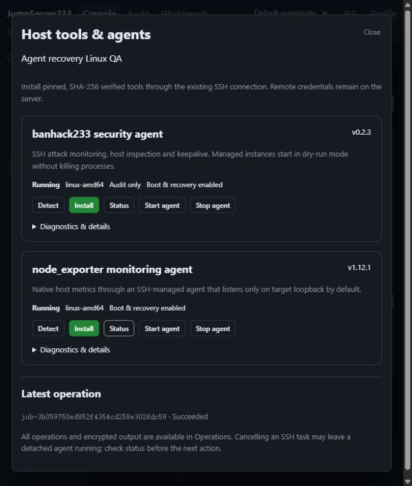
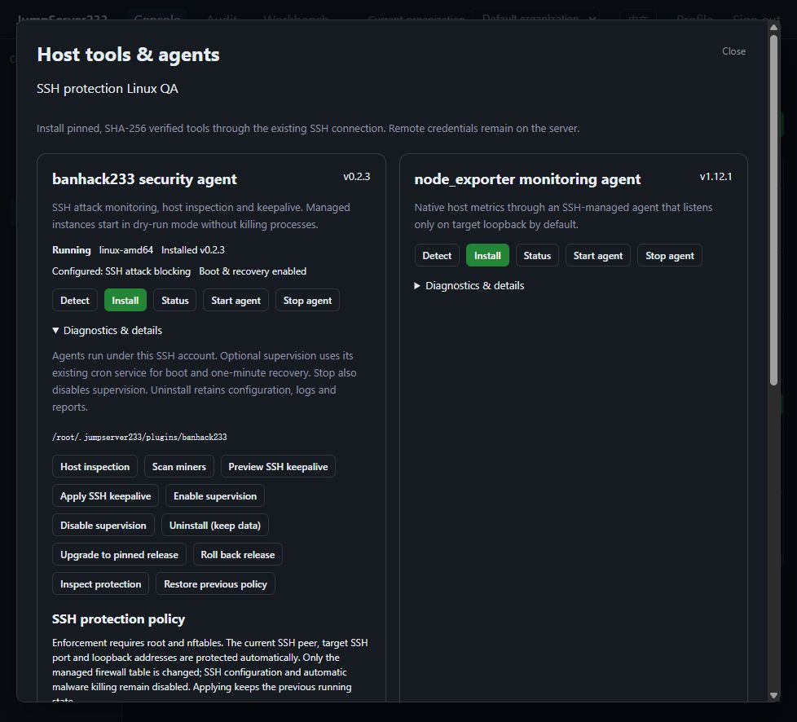

# SSH host tools and agent operations

> [中文](./HOST-PLUGINS.md) | English

The goal is platform-identity detection, installation and management of useful SSH host tools, with structured APIs and CLI for agents. Remote credentials stay on the server. Operations share current identity, organization, asset grants, policies, review, idempotent jobs and encrypted audit.

## Current progress

The native Go ban-recovery component passed consolidated acceptance: Windows Go/Testify 53 packages/701 cases, Linux race 53 packages/704 cases and full browser 55/55. It provides offline cron recovery, kernel-state checks and remaining-expiry restoration. See [native host recovery](./HOST-AGENT.en.md).

### Previous release/policy acceptance baseline

2026-10-16 release-transition/SSH-protection acceptance passed: full Windows Go/Testify and Linux race each passed 50 packages/673 tests and subtests, with no failed/skipped cases or data races. Full Playwright passed 54/54 (7.5 minutes), helpers 6/6, plus vet/build/lint and content checks. The first race run stopped on an official-artifact download EOF; the second full run passed and failure evidence remains. Pinned BanHack 0.2.2 → 0.2.3 and node_exporter 1.12.0 → 1.12.1 artifacts, upgrade/rollback checkpoints and independently authorized SSH protection policies are implemented.

## Release and protection operations

`install --version VERSION` selects only pinned catalog releases. `upgrade` moves to the current pinned release; `rollback` verifies the previous checkpoint and executable. Ordinary lifecycle, diagnostics and policy operations default to the installed catalog-supported version, explicitly audited as `version=installed catalog=VERSION`. An explicit `--version` requires an exact match. Previously stored operations retain exact-version semantics. Unknown versions and implicit downgrades are rejected.

Upgrades retain the previous executable and running/supervision state, verify before stopping and atomically select the manifest. Interrupted detection returns `transition_pending`; a new explicit request must resume or roll back. Takeover never replays mutations. Explicit recovery restores the checkpoint's earlier running/supervision state; concurrent snapshot changes cause failure rather than overwrite. Policy changes also use checkpoints and immutable configuration profiles selected by one atomic manifest.

`protection_apply` requires separate `plugins.protect`, target connect grants and the existing login/command review rules. `plugins.manage` does not imply this permission. Only bounded modes, IP/CIDR allowlists, SSH ports and thresholds are accepted, without shell, arbitrary rules, log paths or download URLs. `protection_status` inspects policy/owned nftables state and `protection_rollback` restores the prior policy.

Enforcement requires Linux root, working nftables and readable `/var/log/auth.log` or `/var/log/secure`. The platform includes the actual SSH peer, loopback addresses and target SSH port. A kernel table comment establishes ownership; an existing foreign `inet banhack233` table is rejected. Blocking applies only to declared SSH ports. Stop/uninstall remove only the owned table and preserve other firewalls. Automatic SSH configuration changes and malware process killing stay disabled; state/logs/reports remain. An enforce configuration does not prove an agent is running; inspect running and protection state. nftables syntax and bounded terse inspection follow its [official manual](https://netfilter.org/projects/nftables/manpage.html); BanHack behavior follows [pinned release source](https://github.com/neko233-com/banhack233/tree/v0.2.3).

```bash
go run ./cmd/jms plugin ASSET_ID node_exporter install --version 1.12.0
go run ./cmd/jms plugin ASSET_ID node_exporter upgrade
go run ./cmd/jms plugin ASSET_ID node_exporter rollback
go run ./cmd/jms plugin ASSET_ID banhack233 protection_apply --policy-file policy.json
go run ./cmd/jms plugin ASSET_ID banhack233 protection_status
go run ./cmd/jms plugin ASSET_ID banhack233 protection_rollback
```

Example: `{"mode":"enforce","ignore_ips":["192.0.2.0/24"],"ssh_ports":[22],"max_attempts":5,"find_seconds":600,"ban_seconds":3600,"success_grace_seconds":600,"interval_seconds":10}`. Submit `{"mode":"audit"}` to return to audit mode. Explicit changes retain previous running state. Policy files are limited to 8 KiB; unknown fields and invalid IPs, ports or durations fail. Default installation remains audit-only; production blocking needs explicit configuration.

## Existing lifecycle acceptance baseline

2026-10-16 lifecycle extension passed acceptance: `autostart_enable`, `autostart_disable` and `uninstall` use the remote account's existing cron service for boot and one-minute process recovery. The launcher rechecks the pinned executable and configuration hashes; stopping also disables supervision. Windows Go/Testify and Linux race each passed 50 packages/664 tests and subtests, full Playwright 52/52, helpers 6/6, plus vet/lint/build. Both native Linux agents passed host reboot, process-crash recovery, integrity-drift rejection, data-preserving uninstall and reinstall. The in-app browser verified bilingual supervision states and no horizontal overflow.

### Initial tool integration acceptance (before the lifecycle extension)

2026-10-16: this Linux SSH/SFTP installation, managed-process lifecycle, bilingual UI, structured API/CLI, authorization/review and running-revocation batch passed joint acceptance. Windows Go/Testify and Linux race each passed 50 packages/655 tests and subtests; full Playwright passed 51/51, helpers 6/6, and vet/lint/build passed. Native Linux amd64 checks cover both pinned versions, repeated installations, lifecycle, diagnostics, metrics and lost-start acknowledgment recovery. Other platforms and remaining capabilities are listed under runtime limits.

| Tool | Pinned version | Purpose | Official release |
|---|---|---|---|
| banhack233 | 0.2.3 | SSH attack blocking, security audit, malware investigation, keepalive and a resident agent | [v0.2.3](https://github.com/neko233-com/banhack233/releases/tag/v0.2.3) |
| node_exporter | 1.12.1 | Host monitoring agent managed and queried through SSH | [v1.12.1](https://github.com/prometheus/node_exporter/releases/tag/v1.12.1) |

Catalog hashes come from official GitHub release asset digests checked on 2026-10-16. Execution never resolves latest again or runs a mutable installation script. Only catalog plugins and platforms are accepted; clients cannot supply download URLs or arbitrary shell.

## Acceptance requirements for this batch

- Detect OS, architecture, account privileges, existing tools and managed instances, returning structured agent-readable state. Unknown platforms are rejected rather than assumed to be amd64.
- Verify artifacts, install through host-pinned SSH/SFTP, check the installed version and deduplicate requests. Preserve existing system installations and configuration.
- Managed instances support status, start, stop, diagnostics and recovery. Interrupted writes with uncertain outcomes are never automatically replayed.
- banhack233 defaults to dry_run=true and direct_kill=false. Explicit SSH blocking requires independent `plugins.protect` permission. Security inspection and malware reports never automatically kill processes. SSH keepalive writes are explicit and TCP settings are not changed.
- node_exporter binds target loopback by default and metrics travel through SSH. Monitoring ports are not exposed automatically.
- UI has Chinese/English introductions and operation state. CLI returns JSON, stable error codes, job IDs and actual exit status without remote passwords.
- Server checks identity, organization, permissions, source, target and gateway revisions at submission, approval, execution, after connection/download and during long tasks. View-only accounts cannot install or execute tools.
- Standalone first. Job/operation metadata uses existing organization storage and single-active HA. After takeover, query state and explicitly recover instead of repeating installation or replaying uncertain work.
- Use an isolated real Linux OpenSSH host to validate installation, agents, version/hash, detection, revocation, isolation, CLI and browser interactions. Explicitly identify platforms without real acceptance.

The published banhack233 version is v0.2.3. The adjacent local checkout is older, so command capabilities follow the matching release source and actual binary. This task does not modify that neighboring repository.

2026-10-16: native Linux agent status and audited operations in the local browser:



2026-10-16: actual SSH blocking configuration and running state on the isolated Linux QA host:



## Usage

Asset inventory → “Tools & agents” on an SSH host. Detect first, then install or start as needed. “Diagnostics & details” exposes host inspection, miner scans, SSH keepalive and exporter metrics. Each operation has a persistent job ID; inspect encrypted output and command reviews in Workbench.

```bash
# Authenticate with a platform Token or AccessKey; optionally set JMS_ORG_ID.
go run ./cmd/jms plugin catalog
go run ./cmd/jms plugin ASSET_ID banhack233 detect
go run ./cmd/jms plugin ASSET_ID banhack233 install --request-id UNIQUE_ID
go run ./cmd/jms plugin ASSET_ID banhack233 start
go run ./cmd/jms plugin ASSET_ID banhack233 doctor
go run ./cmd/jms plugin ASSET_ID node_exporter install
go run ./cmd/jms plugin ASSET_ID node_exporter start
go run ./cmd/jms plugin ASSET_ID node_exporter metrics
go run ./cmd/jms plugin ASSET_ID node_exporter autostart_enable
go run ./cmd/jms plugin ASSET_ID node_exporter autostart_disable
go run ./cmd/jms plugin ASSET_ID node_exporter uninstall
go run ./cmd/jms plugin job JOB_ID
go run ./cmd/jms plugin cancel JOB_ID
```

The CLI waits for review and completion by default and emits a JSON job with plugin, request_id, state, error_code and stdout. Failed remote operations exit nonzero. `--no-wait` returns a job or login review ID. Automated callers should always supply a stable `--request-id`. Network failures never automatically retry mutations; a recorded request ID returns its original result. `--timeout` supports 1..300 seconds.

## API and authorization

- `GET /api/v1/host-plugins`: pinned catalog; requires `plugins.inspect`, `plugins.manage` or `plugins.protect`.
- `POST /api/v1/assets/{assetID}/host-plugins/{pluginID}/jobs`: JSON `action, request_id, timeout_seconds, review_id?, version?, protection?`; returns a 201 job or 202 login review.
- Detection, status, inspection, scanning, keepalive preview and metrics require `plugins.inspect` (or manage/protect). Installation, upgrade/rollback, start/stop, supervision, uninstall and keepalive application require `plugins.manage`. Applying/restoring protection policies requires independent `plugins.protect`. The target account still requires connect grants, access policies and command policies in the current organization.
- Command policies match the immutable logical command `host-plugin PLUGIN ACTION version=VERSION binding=ROUTE_DIGEST`. Default installed-version operations use `version=installed catalog=VERSION`; policy changes also bind the normalized policy hash. The server generates scripts from its fixed catalog. Ordinary `/ops/jobs` rejects internal plugin metadata; clients cannot supply the internal version-selection marker.
- Read/cancel reuse `/api/v1/ops/jobs/{jobID}`, owner/global audit permissions and encrypted job output.

`stdout` contains a JSON plugin result. Its `detail` uses stable categories such as `unsupported_platform`, `integrity_failed`, `invalid_operation`, `state_conflict`, `protection_unavailable`, `transport_or_artifact_failed` and `output_truncated`. Job `state/error_code` describe scheduling/execution outcomes. `protection_mode` describes configuration, `running` describes the process, and `protection_status.firewall_state=owned` confirms table ownership; none alone proves a specific source is blocked. Transport interruptions and server errors leave the result unknown: inspect and explicitly recover rather than assume no write occurred. `dry_run=false` on detect or stop does not indicate blocking is enabled.

## Runtime limits and recovery

Managed lifecycle currently supports Linux amd64/arm64; native execution was verified on Linux amd64. Darwin artifacts are pinned but lifecycle is unsupported; Windows is not connected. Targets need a POSIX shell, uname, id, stat, sha256sum, nohup and `/proc`. Targets need no GitHub access: the platform verifies artifacts and uploads through SFTP.

Installations live under the SSH account home at `.jumpserver233/plugins/PLUGIN/VERSION` and preserve existing PATH commands. Binary/configuration drift blocks starting and diagnostics; stopping can still terminate a managed process matching its path and start time. A remote lock directory serializes changes and the manifest is published atomically. Detection finds an exact executable whose start acknowledgment was lost; explicit start adopts its PID and stop terminates the matching process. Node restart or HA takeover never replays running jobs.

Agents are detached processes under the SSH account and remain running after Web/CLI closes. Explicit supervision requires an existing running cron service and a readable/writable user `crontab`; the platform does not install services or elevate privileges. It registers `@reboot` and a one-minute recovery check, independent of platform availability. The pinned launcher rechecks binary/configuration hashes under the shared operation lock. As described in the [Debian cron manual](https://manpages.debian.org/bookworm/cron/crontab.5.en.html), `@reboot` runs at cron startup. `autostart_state` distinguishes enabled, disabled, unavailable and conflict; registration does not prove daemon health.

Interactive lifecycle operations and account-wide cron changes wait for short lock contention (at most 50 retries, 100 ms apart). Recovery launchers still skip busy locks immediately. Waiting never removes another holder's directory; timeout, unexpected files and symlinks fail closed. External crontab change checks remain active.

Disabling supervision leaves the current process running. Stop removes the enable marker, stops the matching process and removes this tool's entries, preventing recovery from restarting it. An account-wide lock serializes crontab updates across plugins and detects external edits. Other entries are preserved and unknown entries with the same marker cause a conflict. Crontab has no atomic compare-and-swap API, so avoid simultaneous external edits. Home paths containing percent or backslash cannot register supervision. Launcher/configuration drift blocks execution; stop and disable remain available. Disable then enable can rebuild the launcher.

Uninstall disables supervision, stops the matching process and removes the current managed executable and manifest. Earlier release caches, checkpoints, configuration, logs, state, reports and unknown files remain. It performs no recursive deletion and preserves system PATH installations. Uninstall and repeated uninstall are explicit operations; reinstall still validates retained configuration. Catalog upgrades/rollback and explicit SSH protection policies are supported; native systemd service management is covered in [AGENT-SYSTEMD.en.md](./AGENT-SYSTEMD.en.md). Automatic malware process killing remains disabled.

After changing SSH gateways or management sources, explicitly reapply the policy to include the new peer. The preceding batch proves actual SSH blocking, unrelated-port reachability, management/allowlist preservation and rejection of foreign firewall tables. Pinned BanHack does not restore lost kernel bans itself; the native companion now addresses this, verified through actual reboot and table loss with a live daemon. Process autostart or an `enforce` configuration alone does not prove protection health. Centralized automatic-repair history is available through [Agent event audit](./AGENT-EVENTS.en.md). Production HA exercises remain open.

`keepalive_apply` explicitly writes SSH configuration, requires remote privileges and never enables TCP sysctl. Cancellation/revocation closes SSH and does not guarantee termination of detached processes or supervision; explicitly disable/stop them separately. If power loss leaves `operation.lock` or account-wide `cron.lock`, an administrator must establish that no operation remains before recovery; the platform does not delete unknown locks.

node_exporter listens on `127.0.0.1:19100`. Metrics are fetched through the same pinned SSH transport without exposing a public port. Output previews are bounded and mark truncation. Existing agentless SSH monitoring remains available.
