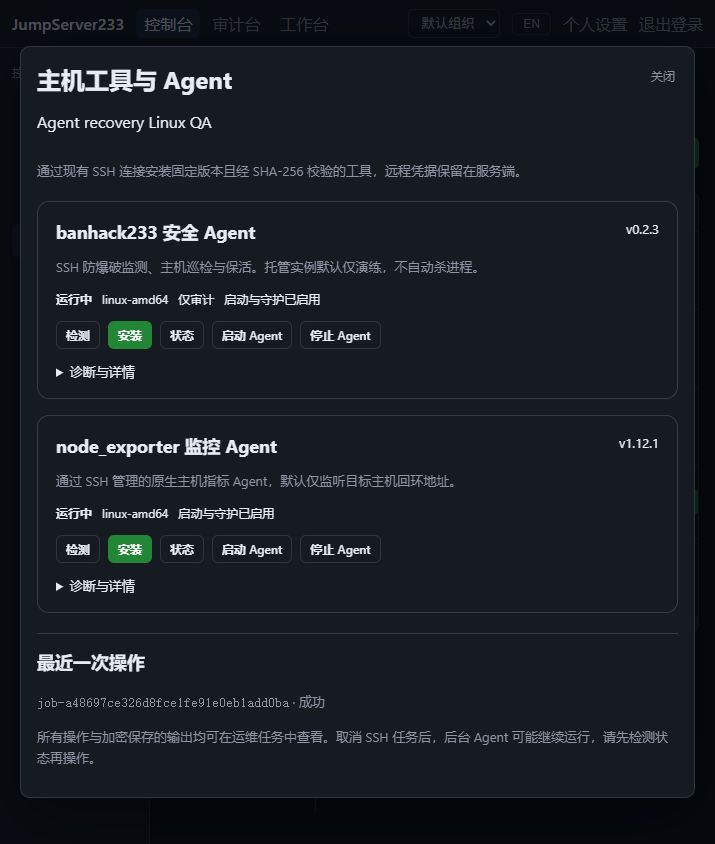
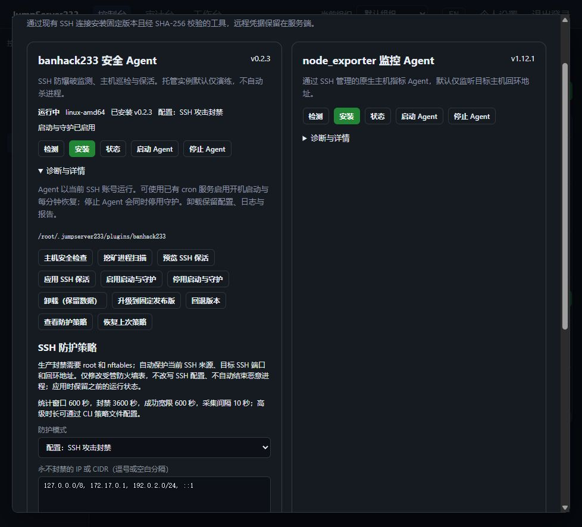

# SSH 远程工具与 Agent 运维

> 中文 | [English](./HOST-PLUGINS.en.md)

目标是通过平台身份检测、安装和管理 SSH 主机上的实用工具，并提供面向 Agent 的结构化 API/CLI。远端凭据保留在服务端，操作复用当前身份、组织、资产授权、访问策略、复核、幂等任务和加密审计。

## 当前进度

原生 Go 封禁恢复组件已通过集中验收：Windows Go/Testify 53 包/701 项、Linux race 53 包/704 项、完整浏览器 55/55。支持平台离线时的 cron 恢复、内核状态自检与剩余有效期恢复，见 [原生主机恢复](./HOST-AGENT.md)。

### 既有版本与策略验收基线

2026-10-16 版本升级与 SSH 防护批次验收通过：Windows Go/Testify 与 Linux race 各完整 50 包、673 项测试及子用例，零失败、零用例跳过、无数据竞争；Playwright 完整 54/54（7.5 分钟），辅助用例 6/6、vet/build/lint 与内容检查通过。Linux race 首轮因官方制品下载 EOF 中断，第二轮完整通过，失败记录保留。已加入 BanHack 0.2.2 → 0.2.3、node_exporter 1.12.0 → 1.12.1 的固定制品、升级/回退检查点及独立授权的 SSH 防护策略。

## 版本与防护操作

`install --version VERSION` 只能选择目录中的固定版本；`upgrade` 升到当前固定发布版，`rollback` 使用经过哈希复核的上次版本检查点。普通启停、诊断和策略操作默认选择已安装的、仍受目录支持的版本，逻辑审计命令明确记录 `version=installed catalog=VERSION`；显式传 `--version` 则要求精确匹配。已有旧格式任务继续按精确版本处理。未知版本和隐式降级均拒绝。

升级保留旧二进制和此前运行/守护状态，先校验再停机与切换清单；中断时检测返回 `transition_pending`，需要新请求显式继续升级或回退。平台任务接管不会重放写入。中断后恢复会按检查点恢复此前运行/守护状态；若并行操作改变了快照，提交会失败以避免覆盖。配置变更同样使用检查点，配置档案不可变，清单是原子选择点。

生产防护使用 `protection_apply`，需要独立的 `plugins.protect`、目标 connect 授权，并沿用现有登录/命令复核规则。它不由 `plugins.manage` 隐式授予。只接受有界的模式、IP/CIDR、SSH 端口与阈值；不会接受 shell、任意规则、日志路径或下载 URL。`protection_status` 查询当前策略及受管 nftables 状态，`protection_rollback` 恢复上次策略。

防护要求 Linux root、可用的 nftables 和可读的 `/var/log/auth.log` 或 `/var/log/secure`。平台加入当前 SSH peer、回环地址和实际 SSH 服务端口，使用 nftables 表注释核对所有权；已有非受管 `inet banhack233` 表会拒绝接管。只在声明的 SSH 端口封禁，停止或卸载清理自己拥有的表，保留其它防火墙。关闭 SSH 配置自动改写和恶意进程自动结束，保留状态、日志和报告。注册或配置为 enforce 不代表 Agent 正在运行；需结合 running 和状态查询判断。nftables 语法与有界的 terse 查询依据 [官方手册](https://netfilter.org/projects/nftables/manpage.html)，BanHack 行为按 [固定发布源码](https://github.com/neko233-com/banhack233/tree/v0.2.3) 核对。

```bash
go run ./cmd/jms plugin ASSET_ID node_exporter install --version 1.12.0
go run ./cmd/jms plugin ASSET_ID node_exporter upgrade
go run ./cmd/jms plugin ASSET_ID node_exporter rollback
go run ./cmd/jms plugin ASSET_ID banhack233 protection_apply --policy-file policy.json
go run ./cmd/jms plugin ASSET_ID banhack233 protection_status
go run ./cmd/jms plugin ASSET_ID banhack233 protection_rollback
```

策略示例：`{"mode":"enforce","ignore_ips":["192.0.2.0/24"],"ssh_ports":[22],"max_attempts":5,"find_seconds":600,"ban_seconds":3600,"success_grace_seconds":600,"interval_seconds":10}`。仅切回审计可提交 `{"mode":"audit"}`；每次明确更改会保留先前运行状态。`policy-file` 上限 8 KiB，未知字段和无效 IP/端口/时长均拒绝。默认安装保持仅审计，生产封禁需显式配置。

## 既有生命周期验收基线

2026-10-16 生命周期补全验收通过：新增 `autostart_enable`、`autostart_disable` 和 `uninstall`。使用远端账号已有 cron 服务在启动时及每分钟检查受管进程，拉起前重新校验固定程序及配置哈希；停止同时停用守护。Windows Go/Testify 与 Linux race 各 50 包、664 项测试及子用例，完整浏览器 52/52、辅助用例 6/6，vet/lint/build 均通过。真实 Linux 验证两种 Agent 的主机重启、进程崩溃恢复、完整性漂移拒绝、保留数据卸载与重新安装；内置浏览器验证中英守护状态及无横向溢出。

### 初次工具接入验收（生命周期补全前）

2026-10-16：本批 Linux SSH/SFTP 安装、托管进程生命周期、双语 UI、结构化 API/CLI、授权复核及运行中撤权已完成联合验收。Windows Go/Testify 与 Linux race 各 50 个包、655 项测试及子用例，完整 Playwright 51/51、辅助用例 6/6，vet/lint/build 均通过。真实 Linux amd64 验证两种固定版本的原生安装、重复安装、启停、诊断、指标与启动回执丢失恢复；其余平台及后续能力见运行边界。

| 工具 | 固定版本 | 用途 | 官方发布 |
|---|---|---|---|
| banhack233 | 0.2.3 | SSH 防爆破、主机安全巡检、恶意程序排查、保活与常驻 Agent | [v0.2.3](https://github.com/neko233-com/banhack233/releases/tag/v0.2.3) |
| node_exporter | 1.12.1 | 通过 SSH 管理和读取的主机监控 Agent | [v1.12.1](https://github.com/prometheus/node_exporter/releases/tag/v1.12.1) |

目录中的哈希来自 2026-10-16 官方 GitHub 发布资源的 digest。执行时不重新解析 latest，不执行可变 URL 中的一键安装脚本。安装器只接受目录中的插件及平台，不允许客户端提交下载 URL 或任意 shell。

## 本批完成条件

- 检测操作系统、架构、账号权限、已有工具及托管实例，返回可供 Agent 判断的结构化状态。未知平台明确拒绝，不能默认当作 amd64。
- 支持校验发布包、通过固定主机密钥的 SSH/SFTP 安装、安装后运行校验及重复请求去重；保留已有系统安装和配置。
- 托管实例支持状态、启动、停止、诊断与恢复；中断后结果不明确的写操作不自动重放。
- banhack233 默认 dry_run=true、direct_kill=false；具备独立 `plugins.protect` 权限后可显式启用 SSH 封禁。安全巡检和恶意程序报告不自动杀进程；写入 SSH 保活属于显式操作，当前不修改 TCP 系统参数。
- node_exporter 默认只监听目标主机的回环地址，通过 SSH 读取指标；不自动公开监控端口。
- UI 提供中英介绍及操作状态；CLI 输出 JSON、稳定错误码、任务 ID 和真实退出状态，无需远端密码。
- 服务端在提交、复核通过、实际执行、连接/下载完成后及长任务运行中重检身份、组织、权限、来源、资产与网关修订；普通 view-only 账号不能安装或执行工具。
- 单机优先；任务与操作元数据使用现有组织存储和单活 HA，接管后查询状态并显式恢复，不重复安装或重放未知操作。
- 使用独立真实 Linux OpenSSH 主机验证安装、Agent、版本/哈希、检测、撤权、隔离、CLI 和浏览器交互；未实际验证的平台单独列出边界。

banhack233 的实际发布版为 v0.2.3，本地相邻仓库快照较旧，命令能力以对应发布源代码和实际二进制为准。本任务不修改相邻 banhack233 仓库。

2026-10-16 本机真实 Linux Agent 的中文运行状态与审计任务截图：



2026-10-16：隔离 Linux QA 主机的真实 SSH 封禁配置与运行状态：



## 使用

资产清单 → SSH 主机的“工具与 Agent”。先检测，再按需要安装或启动；“诊断与详情”提供安全巡检、挖矿进程扫描、SSH 保活和 Exporter 指标。状态和每次操作关联持久化任务 ID，可在运维工作台读取审计输出及处理命令复核。

```bash
# 使用平台 Token 或 AccessKey；组织可用 JMS_ORG_ID 选择。
go run ./cmd/jms plugin catalog
go run ./cmd/jms plugin ASSET_ID banhack233 detect
go run ./cmd/jms plugin ASSET_ID banhack233 install --request-id UNIQUE_ID
go run ./cmd/jms plugin ASSET_ID banhack233 start
go run ./cmd/jms plugin ASSET_ID banhack233 doctor
go run ./cmd/jms plugin ASSET_ID node_exporter install
go run ./cmd/jms plugin ASSET_ID node_exporter start
go run ./cmd/jms plugin ASSET_ID node_exporter metrics
go run ./cmd/jms plugin ASSET_ID node_exporter autostart_enable
go run ./cmd/jms plugin ASSET_ID node_exporter autostart_disable
go run ./cmd/jms plugin ASSET_ID node_exporter uninstall
go run ./cmd/jms plugin job JOB_ID
go run ./cmd/jms plugin cancel JOB_ID
```

CLI 默认等待复核和完成，输出 JSON 任务（包括 plugin、request_id、state、error_code、stdout）；远端操作失败返回非零退出码。`--no-wait` 返回任务或登录复核 ID；建议自动化始终提供稳定的 `--request-id`。写请求遇到网络错误不会自动重试，同 ID 的已记录任务会返回原结果。任务超时支持 `--timeout 1..300`。

## API 与权限

- `GET /api/v1/host-plugins`：固定版本目录，需要 `plugins.inspect`、`plugins.manage` 或 `plugins.protect`。
- `POST /api/v1/assets/{assetID}/host-plugins/{pluginID}/jobs`：JSON `action, request_id, timeout_seconds, review_id?, version?, protection?`；返回 201 任务或 202 登录复核。
- 检测、状态、巡检、扫描、保活预览和指标读取需要 `plugins.inspect`（或 manage/protect）；安装、升级/回退、启停、守护、卸载及应用保活需要 `plugins.manage`。应用/恢复防护策略需要独立 `plugins.protect`。同时必须满足目标账号的 connect 授权、访问策略与命令策略。权限作用于当前组织。
- 命令策略匹配固定逻辑命令 `host-plugin PLUGIN ACTION version=VERSION binding=ROUTE_DIGEST`。默认已安装版本操作使用 `version=installed catalog=VERSION`；策略变更还绑定规范化策略哈希。实际脚本由服务端固定目录生成。普通 `/ops/jobs` 不接受插件内部元数据，客户端不能指定内部版本选择标记。
- 查询和取消复用 `/api/v1/ops/jobs/{jobID}`，沿用任务所有者与全局审计权限；任务输出继续加密保存。

`stdout` 为 JSON 插件结果；`detail` 提供 `unsupported_platform`、`integrity_failed`、`invalid_operation`、`state_conflict`、`protection_unavailable`、`transport_or_artifact_failed` 或 `output_truncated` 等稳定分类。任务的 `state/error_code` 描述调度和执行结果。`protection_mode` 是配置模式，`running` 是进程状态，`protection_status` 的 `firewall_state=owned` 表示已核对表所有权；均不能单独证明某个来源实际被封禁。连接中断或服务端错误时结果保持未知，需检测后显式恢复，不能推断失败且未写入。detect 或 stop 中的 `dry_run=false` 不表示已启用封禁。

## 运行边界与恢复

当前托管生命周期支持 Linux amd64/arm64，实际执行验证为 Linux amd64。Darwin 发布制品有固定哈希，但进程生命周期尚不支持；Windows 未接入。需要 POSIX shell、uname、id、stat、sha256sum、nohup 和 `/proc`；不依赖目标机器能访问 GitHub，制品由平台校验后经 SFTP 上传。

安装目录为远程账号 home 下 `.jumpserver233/plugins/PLUGIN/VERSION`，不会覆盖系统 PATH 中的已有命令。二进制与受管配置校验失败时，启动和诊断会拒绝；停止仍可作用于匹配路径及启动时间的受管进程。每次变更用远端互斥目录串行化，原子发布清单。启动回执丢失时检测会查找同一精确可执行路径；显式 start 重新记录 PID，stop 终止匹配进程。节点重启或 HA 接管不重放运行中的任务。

Agent 为当前 SSH 账号下的后台进程，关闭 Web/CLI 后继续运行。可显式启用启动与守护：需要已运行的 cron 服务，以及账号可读写的 `crontab`；平台不自动安装服务或提权。注册 `@reboot` 和每分钟检查，重启/恢复时不依赖平台在线；启动器固定路径及哈希，并共用远端操作锁。该机制依据 [Debian cron 文档](https://manpages.debian.org/bookworm/cron/crontab.5.en.html)，`@reboot` 在 cron 启动时触发。状态 `autostart_state` 区分 enabled、disabled、unavailable、conflict；注册成功不表示 cron 服务健康。

停用守护保留当前进程；停止 Agent 会先禁用启动标记并停止匹配进程，再移除本工具的 cron 条目，避免再次拉起。不同工具修改 crontab 使用账号级锁，并检查外部变更；保留其他 cron 任务，发现未知同名标记拒绝覆盖。crontab 无原子比较交换接口，仍应避免同时从外部编辑。home 路径含 `%` 或反斜线时不支持注册守护。启动器或配置漂移时拒绝执行，仍可停止和停用守护；停用守护后重新启用可重建启动器。

卸载会禁用守护、停止匹配进程，移除当前受管版本的程序与安装清单，保留旧版缓存、检查点、配置、日志、状态、报告及未知文件。没有递归删除，也不修改系统 PATH 中的同名程序。卸载和重复卸载均可显式调用；重新安装仍校验已有受管配置。已支持目录内版本升级/回退和显式 SSH 防护策略；systemd 服务管理见 [AGENT-SYSTEMD.md](./AGENT-SYSTEMD.md)。BanHack 的恶意进程自动结束始终关闭。

SSH 网关或管理来源改变后，需显式重新应用策略以加入新的管理 peer。前一批验收证明实际 SSH 封禁、非 SSH 端口可达、管理来源与白名单保留以及外部防火墙表不被接管。固定 BanHack 自身不会恢复丢失的内核封禁；本批通过配套原生组件补齐，并验证实际重启及存活进程丢失表后的恢复。不能单独将进程自启或 `enforce` 配置视为防护健康，集中自动修复事件历史已接入 [Agent 事件审计](./AGENT-EVENTS.md)，生产 HA 演练仍待完成。

`keepalive_apply` 为明确写操作，需要远端账号有对应权限，且不启用 TCP sysctl。取消或撤权关闭 SSH，但不保证停止已分离的后台进程或已启用的守护；需另行显式停用和停止。断电若留下 `operation.lock` 或账号级 `cron.lock`，需要管理员确认没有远端操作后再恢复，平台不会擅自清理未知锁。

node_exporter 监听 `127.0.0.1:19100`，指标通过同一固定主机密钥 SSH 连接转发读取，不公开端口。输出有显示上限，截断会明确标记；原有资产页无 Agent 的 SSH 监控仍可使用。
