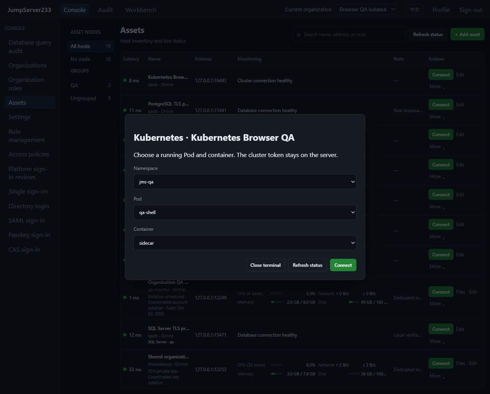
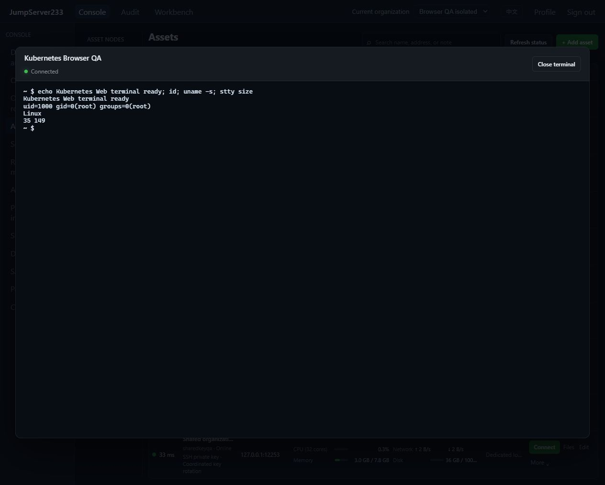

# Kubernetes container terminals

> English | [中文](./KUBERNETES.md)

Kubernetes cluster assets join Web terminals and `jms k8s`, reusing organizations, node/account grants, login/command reviews, access policies, encrypted command audit and asciinema recordings. The competitor remains [JumpServer Enterprise](https://www.jumpserver.org/enterprise.html). Standalone deployment is preferred; configuration/audit indexes support the existing PostgreSQL single-active standby store.

## Assets and cluster identity

Select protocol `kubernetes`, then configure API host, port (default 6443), account label and write-only bearer token. The encrypted server vault retains the token; browser, CLI, audit and recording APIs do not return it. The connector never loads local kubeconfig, environment proxies, credential plugins or cloud CLIs.

The `kubernetes` object contains `namespaces`, `shell`, `server_name` and `root_ca_pem`. Namespaces default to `["default"]`, with at most 64 unique entries. Shell defaults to `["/bin/sh"]`; the API accepts up to 8 executable/argument entries. The page edits the executable and preserves existing arguments. Certificate/hostname verification is mandatory, with TLS 1.2 or later and system trust or a supplied CA. Configuration cannot disable verification. API requests reject redirects and remain pinned to the managed host/port.

Give the cluster identity only `get/list` on `pods` and `get/create` on `pods/exec` in allowed namespaces. Platform `connect` grants are enforced separately; `view` alone cannot enumerate Pods or open terminals. The picker shows ordinary containers that are actually running in Running Pods within configured namespaces, excluding init/ephemeral containers. Listing is bounded to 1000 Pods, 10 pages and 4 MiB per API reply.

## Web and Agent CLI

Choose namespace, Pod and container after clicking Connect. The server re-reads Pod state and validates container/scope before opening a PTY. Missing shells or native denial return generic failures without cluster error bodies. Session audit retains protocol, namespace, Pod, container and the Pod UID read for that connection.

```bash
jms k8s ASSET_ID --namespace default --pod example-pod --container app
printf 'echo hello; exit\n' | jms k8s ASSET_ID --namespace default --pod example-pod
```

CLI uses `JMS_SERVER_URL`, `JMS_TOKEN` or existing platform AccessKey/Secret authentication; `JMS_ORG_ID` selects the organization. It requires neither kubeconfig nor cluster credentials. Piped input still enters an interactive PTY and should explicitly exit the shell; this is not a batch-job API returning structured exit codes.

Browser/CLI to platform keeps `jms233-terminal-v1`. Platform to cluster prefers Kubernetes WebSocket `v5.channel.k8s.io`, including input/output, resizing and native exit status. Only explicit pre-upgrade incompatibility triggers official client-go SPDY fallback, with redirects rejected. Both paths support up to three SSH gateways with every host fingerprint pinned, without local forwarding listeners. WebSocket messages are capped at 1 MiB, with separate input/status limits.

## Authorization, audit and takeover

Kubernetes has a separate login-review action and cannot consume SSH/SFTP/database permits. Current permits bind user, asset and account and cover that asset's allowed container scope. Commands reuse PTY recognition, filtering, reviews and redaction; complete shell semantics retain existing terminal-audit limits. `kubernetes` is available in connection-method ACLs, alongside source, time and gateway restrictions.

Current organization, identity, grants and asset/gateway binding are checked before/after opening, at WebSocket attach, before input and in the existing periodic guard. Revoked grants or changed tokens/configuration invalidate old sessions. Recordings/commands are encrypted at rest, with owner/auditor rules for listing, termination and replay. Disconnect closes transport; it cannot undo completed operations or guarantee immediate termination of remote background processes.

Single-active takeover retains configuration, reviews and audit indexes. Live terminals and one-use tickets do not migrate; reconnect explicitly, without command replay. Kubernetes tokens currently require manual renewal/replacement and do not use SSH seven-day rotation. File transfer, noninteractive container jobs, resource management, namespace discovery and cloud IAM token refresh remain open. See the [roadmap](./PLAN.en.md) for full Enterprise gaps.

## Actual interface

In-app browser verification, 2026-10-16: isolated local K3s, namespace `jms-qa`, Pod `qa-shell`, with real connections to main and sidecar containers running `id`, `uname -s` and `stty size`. No cluster token appears in the interface or documentation. Chinese captures are in the [Chinese document](./KUBERNETES.md#实际界面).





## Automation and protocol sources

`node server/testsupport/kubernetes/run.mjs` starts official K3s `v1.37.1-k3s1`, default TLS 16443 / health 16444. Set `JMS_TEST_KUBERNETES_FIXTURE_URL` and optionally `JMS_TEST_KUBERNETES_NETWORK_ADDR` for containers. E2E uses independent 16445 / 16446 instances; CI starts and cleans owned resources. The fixture uses privileged K3s inside Docker; test Pod hostNetwork remains inside that independent container network, without host directory mounts. The synthetic identity only accesses `jms-qa`; another namespace verifies native RBAC denial. Tokens stay in the fixture process/loopback health interface and must not enter source or reports.

Sources: [Kubernetes WebSocket transition](https://kubernetes.io/blog/2024/08/20/websockets-transition/), [official remotecommand](https://pkg.go.dev/k8s.io/client-go/tools/remotecommand), [K3s container example](https://github.com/k3s-io/k3s/blob/main/docker-compose.yml). Actual acceptance evidence is in [verification records](./TESTING.en.md).
