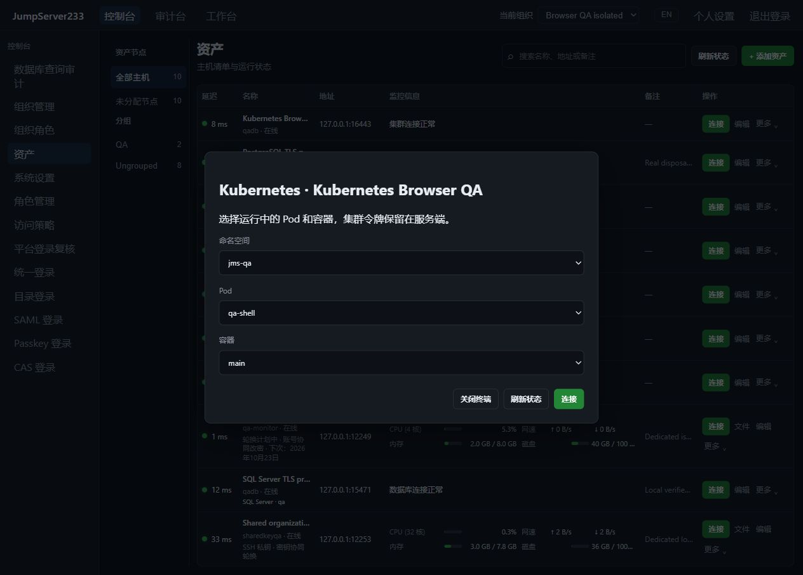
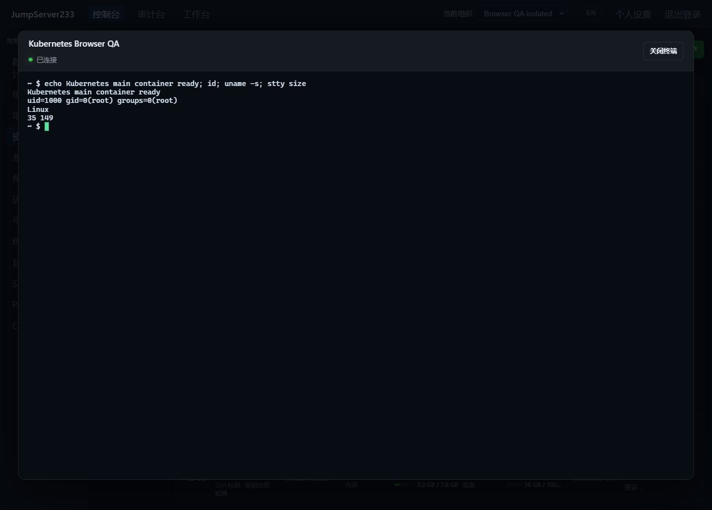

# Kubernetes 容器终端

> 中文 | [English](./KUBERNETES.en.md)

Kubernetes 集群作为独立资产接入 Web 终端和 `jms k8s`，复用组织、节点/账号授权、登录及命令复核、访问策略、加密命令审计和 asciinema 录像。竞品仍为 [JumpServer 企业版](https://www.jumpserver.org/enterprise.html)，部署优先单机，配置和审计索引支持现有 PostgreSQL 单活热备。

## 资产与集群账号

资产协议为 `kubernetes`，填写 API 主机、端口（默认 6443）、账号标识和只写 Bearer 令牌。令牌进入服务端加密保管库，浏览器、CLI、审计 API 和录像接口不返回该凭据。配置不读取本机 kubeconfig、环境代理、凭据插件或云 CLI。

`kubernetes` 配置对象包含 `namespaces`、`shell`、`server_name`、`root_ca_pem`。命名空间默认为 `["default"]`，最多 64 个，不能重复；Shell 默认为 `["/bin/sh"]`，API 可设置最多 8 个程序及参数。页面支持修改 Shell 程序并保留现有参数。必须校验 TLS 证书及主机名，最低 TLS 1.2；可使用系统信任或提供 CA，不能通过配置关闭校验。API 不跟随重定向，目标固定在纳管的主机及端口。

集群账号应仅拥有允许命名空间中 `pods` 的 `get/list` 和 `pods/exec` 的 `get/create`。平台 `connect` 授权仍在服务端单独检查；仅 `view` 不能枚举 Pod 或开启容器终端。页面列出配置范围内、处于 Running 且具体容器已运行的普通容器，不进入 init/ephemeral 容器。每个命名空间最多列出 1000 个 Pod，分页最多 10 次，单次 API 回复最多 4 MiB。

## Web 与 Agent CLI

资产点击连接后选择命名空间、Pod、容器；服务端重新读取 Pod 状态、核对容器和范围后打开 PTY。Shell 不存在或集群拒绝访问时显示通用失败，不返回集群错误正文。会话审计保留协议、命名空间、Pod、容器和当次读取的 Pod UID。

```bash
jms k8s ASSET_ID --namespace default --pod example-pod --container app
printf 'echo hello; exit\n' | jms k8s ASSET_ID --namespace default --pod example-pod
```

CLI 使用 `JMS_SERVER_URL`、`JMS_TOKEN` 或现有 AccessKey/Secret 平台身份，组织由 `JMS_ORG_ID` 选择；不需要 kubeconfig 或远端令牌。管道输入仍进入交互 PTY，应显式结束 Shell；它不是返回结构化退出码的批量作业 API。

浏览器与 CLI 到平台仍使用 `jms233-terminal-v1`。平台到集群优先使用 Kubernetes WebSocket `v5.channel.k8s.io`，支持输入/输出、终端尺寸和原生退出状态；仅在连接升级前明确不支持该方式时回退官方 client-go SPDY，并拒绝重定向。两种通道都支持最多三跳、逐跳固定主机指纹的 SSH 网关，不开启本地转发监听端口。WebSocket 单帧最多 1 MiB，输入及状态消息另有限制。

## 授权、审计与切换

Kubernetes 使用独立的登录复核动作，不消费 SSH/SFTP/数据库许可；当前许可按用户、资产、账号签发，覆盖该资产允许的容器范围。命令沿用共享 PTY 识别、过滤、复核和脱敏规则，完整 Shell 语义仍受现有终端审计边界限制。`kubernetes` 可作为连接方式 ACL；来源、时段和网关策略一并执行。

会话建立前后、WebSocket 连接、每次输入和现有周期检查均重新检查当前组织、身份、授权及资产/网关绑定。撤销授权、修改令牌或连接配置后，旧会话不能继续使用。录像与命令记录加密落盘，查询/终止/回放沿用所属操作员和审计角色权限。断连会关闭传输；不保证撤销已完成操作或立即结束所有远端后台进程。

单活接管保留配置、登录复核和审计索引；旧在线终端和一次性票据不迁移，需重新连接，不自动重放命令。Kubernetes 令牌目前手动续期/替换，不使用 SSH 七天改密调度；文件传输、非交互容器作业、资源管理、自动发现命名空间及云 IAM 令牌刷新仍待实现。完整企业版差距见 [规划](./PLAN.md)。

## 实际界面

2026-10-16 内置浏览器实测：本机隔离 K3s，命名空间 `jms-qa`、Pod `qa-shell`，分别连接 main 与 sidecar 容器，实际执行 `id`、`uname -s` 和 `stty size`。界面与文档中不含集群令牌。英文截图见 [English](./KUBERNETES.en.md#actual-interface)。





## 自动化与依据

`node server/testsupport/kubernetes/run.mjs` 启动独立官方 K3s `v1.37.1-k3s1`，默认 TLS 16443 / health 16444。设置 `JMS_TEST_KUBERNETES_FIXTURE_URL`；跨容器可设置 `JMS_TEST_KUBERNETES_NETWORK_ADDR`。E2E 使用独立 16445 / 16446，CI 自动启动和按归属清理。夹具在 Docker 中使用 privileged K3s，测试 Pod 的 hostNetwork 仅位于该独立容器网络中；不挂载宿主机目录。测试账号只授权 `jms-qa`，另一个命名空间用于原生 RBAC 拒绝验证。合成令牌只在夹具进程和回环健康接口内使用，不能写入仓库或报告。

协议依据：[Kubernetes WebSocket 迁移](https://kubernetes.io/blog/2024/08/20/websockets-transition/)、[官方 remotecommand](https://pkg.go.dev/k8s.io/client-go/tools/remotecommand)、[K3s 容器部署示例](https://github.com/k3s-io/k3s/blob/main/docker-compose.yml)。实际验收证据见 [验证记录](./TESTING.md)。
