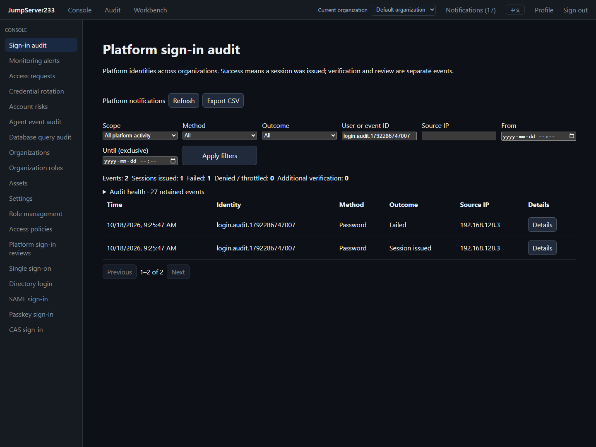

# Platform sign-in audit

> English | [中文](./LOGIN-AUDIT.md)

Platform sign-in audit records authentication steps, session grants and native sign-in reviews for global identities. Open **Sign-in audit** in the console. Authenticated users can read verified activity belonging to their own identity. Global auditors can filter all events, inspect storage health and export CSV. Switching organizations does not change this identity scope.

2026-10-18, isolated Docker, synthetic identities and a real browser, English desktop view:



## Events and sessions

- Bounded metadata covers local passwords, LDAP, OIDC, SAML, CAS, Passkey, MFA enrollment/challenges, sign-out and CSV exports.
- `succeeded` means a session was actually issued. External identity verification, MFA challenges, pending reviews and approval are separate outcomes and do not count as successful sign-ins.
- Successful audit commits before the session cookie/token is returned. A write failure revokes the new session and returns `503 login_audit_unavailable`; existing valid sessions are not automatically revoked.
- Native pending, approved, denied, cancelled, expired, consumed, invalidated and policy notification events import in batches with a durable cursor. Index and cursor commit before publication; restart replay deduplicates events. A gap beyond the native source's seven-day/10,000-event retention is reported in health, with retained history backfilled.
- Lists use reverse ingestion order. Time filters use occurrence time with an exclusive upper bound. Totals count events; one sign-in can contain several steps.

An unverified attempted username is not assigned to the matching user and is visible only to global auditors. Source IP uses the explicit trusted proxy policy. No location or risk inference is made. A new source means an IP change from the latest retained successful event. Five failures from one source within five minutes trigger an alert, with a 15-minute cooldown. Aggregation tracks at most 8,192 sources; individual audit writes continue beyond that bound and health reports the limit.

## Permissions and notifications

| Operation | Required authority |
| --- | --- |
| Read/export own verified identity activity | Current active platform account |
| Read all events and health | Global `audit.logins.view_all` |
| Export all events | The above plus global `audit.logins.export` |
| Handle an assigned pending review | Global `reviews.platform_login.manage` and native reviewer scope; no self approval |
| Platform notification settings, audit, retry | Global `notifications.manage` / `notifications.audit` / `notifications.retry` |

Organization roles cannot grant global platform authority. Reads, exports, notification reads/sends/retries and review decisions check current identity and permissions. Handled or cancelled requests cannot remain actionable.

**Platform notifications** have independent preferences, verified contacts, channel settings, delivery history, audit and encrypted storage from **Organization notifications**. The header unread count combines both scopes. Owners and global login auditors receive security messages; currently eligible reviewers receive pending work. External messages contain fixed bilingual state, time, internal event identifiers and a related link. They exclude login usernames, attempted input and source IP. Transport and recovery boundaries for SMTP, Webhook and custom SMS are in [Notifications](./NOTIFICATIONS.en.md).

## API, CLI and storage

The `/api/v1/audits/logins` root provides a list, `capabilities`, `summary`, `health`, `{eventID}` and `export.csv`. Default scope is `mine`; global access explicitly requests `scope=all`. Filters include method/outcome/q/source_ip/user_id/from/to; list pages allow up to 200 records. CSV exports create their own audit event and neutralize formula prefixes in text cells. `/api/v1/platform-notifications` provides the corresponding organization notification operations in a separate scope.

```sh
jms login-audit list --all --outcome failed
jms login-audit event login-ID
jms login-audit summary --from 2026-10-18T00:00:00Z
jms login-audit export --all > platform-login-audit.csv
jms login-audit approve login-review-ID
jms platform-notifications inbox
```

CLI uses existing platform identities and the four REST authentication methods. SDK has typed methods and an independent client copy from `WithPlatformNotifications()`. No SSH credential is needed.

AES-GCM encrypted segments hold 256 events each, with a commit index. Whole-segment eviction keeps retained events at or below 100,000. Queries hide events older than 365 days. Full expired segments are reclaimed; encrypted old events in partial/mixed-age segments may remain until segment eviction. Audit excludes passwords, OTPs, recovery codes, SSO responses, authentication tickets, tokens, cookies and request bodies. Platform data uses a separately derived key. PostgreSQL uses a dedicated `platform-identity` namespace so its notifications cannot alias the default organization store.

Supports standalone and existing PostgreSQL **single-active takeover**. Multi-active writes, unlimited history, WORM compliance archiving, real carrier SMS, native enterprise IM and complete JumpServer Enterprise parity remain outside this delivery. Application metadata follows outcome, source and sensitive-data boundaries in the [OWASP Logging Cheat Sheet](https://cheatsheetseries.owasp.org/cheatsheets/Logging_Cheat_Sheet.html).
