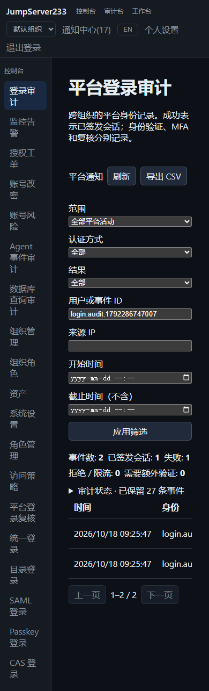

# 平台登录审计

> 中文 | [English](./LOGIN-AUDIT.en.md)

平台登录审计记录全局身份的认证步骤、会话签发和原生登录复核。控制台进入“登录审计”，个人默认可看本人已验证身份的记录；全局审计者可筛选全部记录、查看存储健康及导出 CSV。组织切换不会改变平台审计的身份范围。

2026-10-18，隔离 Docker、合成身份与真实浏览器，中文 390 px 页面（表格在容器内横向滚动）：



## 事件与会话

- 本地密码、LDAP、OIDC、SAML、CAS、Passkey，以及 MFA 注册/挑战、退出和 CSV 导出均记录有限元数据。
- `succeeded` 只表示真正签发会话。外部身份验证、需要 MFA、等待复核和复核批准分别记录，均不等同登录成功。
- 成功审计在会话 cookie/token 返回前提交。审计写入失败时撤销新会话并返回 `503 login_audit_unavailable`；已生效会话不因此自动失效。
- 原生复核的待办、批准、拒绝、取消、过期、消费、失效及通知事件通过持久游标批量导入，提交索引与游标后才发布；重启回放去重。原生源超出七天/一万条保留范围导致缺口时，健康页明确提示，回填仍保留的记录。
- 列表按入库顺序倒序，时间筛选使用事件发生时间，截止时间不含。统计是事件数，同一登录可以有多个步骤。

未验证的用户名尝试不会绑定到同名用户，因此仅全局审计者可读。来源 IP 沿用显式可信代理规则；不根据 IP 推断地理位置或风险等级。来源变化指相对于仍保留的最近成功记录发生 IP 变化。失败来源在五分钟内累计五次触发通知，同源十五分钟冷却；最多跟踪 8,192 个来源，超出时继续保存单条事件并显示聚合上限提示。

## 权限与通知

| 操作 | 权限 |
| --- | --- |
| 查看、导出本人已验证身份记录 | 当前有效平台账号 |
| 查看全部及健康状态 | 全局 `audit.logins.view_all` |
| 导出全部 | 上述权限与全局 `audit.logins.export` |
| 处理当前指定复核待办 | 全局 `reviews.platform_login.manage` 及原生复核人范围；不可自批 |
| 平台通知通道、审计、重试 | 全局 `notifications.manage` / `notifications.audit` / `notifications.retry` |

组织角色不会授予平台全局权限。查询、导出、通知读取/发送/重试、复核提交均重新检查当前身份和权限。取消或处理后的旧待办不再可操作。

“平台通知”独立于“组织通知”，有独立订阅、验证联系方式、通道配置、送达记录、审计和加密存储。顶部未读数合计两个范围。本人及有全局登录审计权限者接收安全消息，当前合资格复核人接收待办。外发只含固定双语状态、时间、内部事件标识和关联链接，不含登录用户名、尝试输入或来源 IP。SMTP/Webhook/自定义短信的传输与恢复边界见[通知中心](./NOTIFICATIONS.md)。

## API、CLI 与存储

API 根路径 `/api/v1/audits/logins`：列表、`capabilities`、`summary`、`health`、`{eventID}`、`export.csv`。默认 `scope=mine`，全局范围显式 `scope=all`；支持 method/outcome/q/source_ip/user_id/from/to，列表每页最多 200。CSV 导出有独立审计，文本单元格处理公式前缀。平台通知 API 为 `/api/v1/platform-notifications`，功能与组织通知 API 对应。

```sh
jms login-audit list --all --outcome failed
jms login-audit event login-ID
jms login-audit summary --from 2026-10-18T00:00:00Z
jms login-audit export --all > platform-login-audit.csv
jms login-audit approve login-review-ID
jms platform-notifications inbox
```

CLI 复用现有平台身份及四种 REST 认证方式；SDK 提供对应类型方法和独立 `WithPlatformNotifications()` 客户端副本。无需 SSH 凭据。

审计采用 AES-GCM 加密分段（每段 256 条）及提交索引，最多保留 100,000 条，按整段淘汰；查询隐藏 365 天前事件。磁盘按完整过期段回收，未满/混合时间段中的加密旧记录可留至该段被淘汰。审计不保存密码、OTP、恢复码、SSO 响应、认证 ticket、token、cookie 或请求体。平台数据使用独立派生密钥；PostgreSQL 使用独立 `platform-identity` namespace，避免与默认组织通知别名。

支持单机和现有 PostgreSQL **单活接管**。不承诺多活写入、无限历史、WORM 合规存档、真实运营商短信、原生企业 IM 或完整 JumpServer Enterprise 对齐。应用事件字段遵循 [OWASP Logging Cheat Sheet](https://cheatsheetseries.owasp.org/cheatsheets/Logging_Cheat_Sheet.html) 的结果、来源及敏感数据边界。
