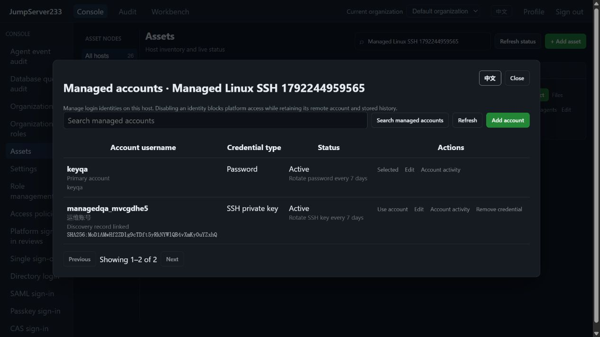

# Managed SSH accounts

> English | [中文](./MANAGED-ACCOUNTS.md)

Native creation, disabling, restoration, retained home deletion and explicit recovery for regular Linux users are covered in [Remote account lifecycle](./REMOTE-ACCOUNTS.en.md).

One SSH asset can hold several named accounts, with independently encrypted passwords or keys, enabled state, credential history and seven-day rotation policies. Host address, fingerprint, node, gateway and login review settings have one physical source. Inventory still shows one host. The competitor is [JumpServer Enterprise](https://www.jumpserver.org/enterprise.html); the overall objective remains in [PLAN](./PLAN.en.md).

## Web workflow

1. SSH asset → More → Managed accounts. Import an existing remote account's password or key. This does not create a remote operating-system account.
2. Set a display name and note, disable or re-enable the account. Usernames are immutable after creation; create another managed account for a different identity.
3. Choose “Use account” to use that identity for Web SSH, SFTP, tools/agents and account discovery. Ordinary users only see accounts allowed by current grants.
4. Settings → Asset grants selects the physical asset and username separately. Node grants also support named accounts. Command filters, source/time and channel policies match the physical asset and selected username.
5. Collected accounts → a present record → Manage account prefills the username. Save an edited existing account or a new credential to associate that exact finding. The server validates the current host address/port/fingerprint and the username/UID finding ID. Missing records and old targets are rejected. Human review and credential management remain separate; association grants no connection access.

Password, private key and passphrase fields are write-only. Empty credential fields on edit retain the existing secret. Lists, CLI output and activity never return them. Credential changes retain encrypted history and the existing pinned-host recovery workflow: [Password rotation](./PASSWORD-ROTATION.en.md), [SSH key rotation](./SSH-KEY-ROTATION.en.md).



## CLI

Use an existing platform token or AccessKey; `JMS_ORG_ID` selects the organization. Put global `--account` before the subcommand, or set `JMS_ACCOUNT`. Connection commands do not receive target passwords:

```sh
jms account list <asset-id> --limit 50
jms account show <asset-id> <username-or-account-id>
jms account create <asset-id> --username ops --password-stdin
jms account create <asset-id> --username deploy --private-key-file /secure/deploy.key
jms account update <asset-id> ops --active=false
jms account update <asset-id> ops --discovery-id <current-finding-id>
jms account activity <asset-id> <account-id>
jms account delete <asset-id> <account-id> --version <version-from-show>
jms --account ops ssh <asset-id>
jms --account ops exec <asset-id> --json -- 'id -un'
jms --account ops plugin <asset-id> node_exporter detect --request-id detect-001
jms --account ops accounts discover <asset-id> --request-id discover-001
```

Singular `account` manages credentials; plural `accounts` collects or queries remote identity metadata. Create/update reads passwords from stdin and private keys from local files, optionally using `--key-passphrase-stdin`. Delete requires an explicit version. Create/update reads a fresh version by default or accepts `--version`. Conflicting writes require a fresh read and decision. Commands/protocols that cannot use account selection reject it explicitly.

## Authorization, storage and runtime

- Independent `accounts.manage` authorizes changes on an already-visible physical asset. It grants no SSH/SFTP access and cannot alone change rotation policies, which require `assets.rotate`. `accounts.view` can inspect account metadata/activity on a visible host.
- `view`/`connect`/`sftp` grants match physical asset or node, selected username, current user/groups and validity period. Sessions recheck at creation and input, and approximately every ten seconds while idle. Disable, removal or revoked authority closes the session. Running jobs and gateway routes also recheck identity and policies.
- The primary account preserves its original asset ID/API. Named accounts use independent endpoint IDs bound to the parent. Connections, jobs and recordings retain the selected endpoint and username; grants use the physical asset ID. Existing encrypted named credentials cannot be rebound to another parent.
- Additional accounts persist only their own identity, policies, ciphertext and history. They inherit target settings from the parent. Parent edits invalidate old edit versions; pending rotation blocks target migration or credential deletion. A physical asset cannot be deleted while it owns additional accounts.
- Credentials use existing AES-GCM storage with endpoint-bound authentication data. Standalone files remain the default. PostgreSQL active/standby takeover reloads the same credentials, state and activity. Organizations use isolated stores and different keys. Live SSH connections do not migrate.
- Create/update/delete activity records actor, time, account and before/after version hashes, without credentials or note copies. Each endpoint allows 2,000 activity records, then refuses additional writes. Deleting an additional account atomically archives its activity and deletion event into primary-account activity. Credential history retains the existing latest-ten policy.
- Passwords use the default seven-day schedule; SSH key scheduling requires explicit enablement. Disabled accounts never initiate remote connections, while shared credentials are still synchronized to disabled copies. A selected named gateway credential works when that gateway's primary platform account is disabled.

## Verification and remaining scope

See [Testing](./TESTING.en.md) for the 2026-10-17 Testify, real OpenSSH, pinned gateway, Web SSH, SFTP, CLI, rotation and live-disable checks. Production Docker QA has separate data and dedicated loopback ports.

Named multi-account support currently applies to SSH. Other protocols keep their original single-account model. Discovery interval plans support the selected named identity; see [Scheduled account discovery](./SCHEDULED-ACCOUNT-DISCOVERY.en.md). Linux system account lifecycle is covered in the linked guide above. Bulk credential import, automatic credential reconciliation, multi-protocol account management, active/active clustering and full Enterprise parity remain open. A linked finding ID records provenance at save time; remote deletion, UID or target changes require a fresh collection and human check. It does not prove that a credential works or that remote login is allowed.
