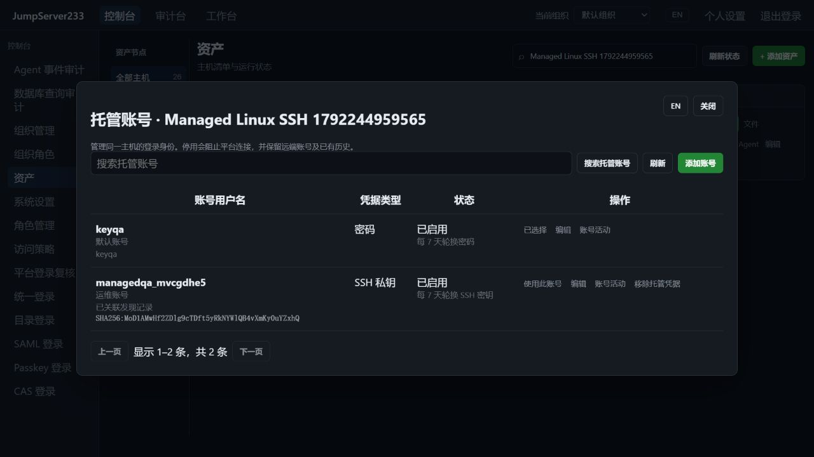

# SSH 多账号托管

> 中文 | [English](./MANAGED-ACCOUNTS.en.md)

远端 Linux 普通账号的原生创建、停用、恢复、保留目录删除及显式恢复见 [远端账号生命周期](./REMOTE-ACCOUNTS.md)。

一台 SSH 资产可托管多个具名账号，每个账号独立加密保存密码或私钥、启停、凭据历史和七天轮换策略。主机地址、指纹、节点、网关和登录复核配置只有一份，资产清单仍显示一台主机。竞品为 [JumpServer 企业版](https://www.jumpserver.org/enterprise.html)，总体目标见 [PLAN](./PLAN.md)。

## Web 操作

1. SSH 资产 → 更多 → 托管账号。添加已有远程账号的密码或私钥；此操作不会在远程主机创建系统账号。
2. 可填写显示名称和备注，停用或重新启用账号。账号名创建后不可修改；更换身份应创建新托管账号。
3. 点击账号行的“使用账号”，随后 Web SSH、SFTP、工具/Agent、账号收集使用所选身份。普通用户只看到当前授权允许查看的账号。
4. 系统设置 → 资产授权，分别选择物理资产和账号名；节点授权也支持具名账号。命令过滤、来源/时段和通道策略沿用物理资产及所选账号进行匹配。
5. 账号收集 → 当前存在的记录 → 托管账号，可预填账号名；编辑已有账号或添加凭据后保存，关联具体发现记录。服务端校验当前主机地址/端口/指纹、用户名及 UID 对应的发现 ID，不接受缺失或旧目标的记录。人工确认状态与凭据托管分别保存，关联不会增加连接权限。

密码、私钥和私钥口令输入只写，编辑时为空表示保留原凭据。列表、CLI 输出和活动不返回这些内容。修改凭据沿用加密历史及固定主机指纹验证后的恢复流程，见 [密码轮换](./PASSWORD-ROTATION.md)、[私钥轮换](./SSH-KEY-ROTATION.md)。



## CLI

使用既有平台 token 或 AccessKey；`JMS_ORG_ID` 选择组织。全局 `--account` 必须位于子命令前，或使用 `JMS_ACCOUNT`。目标密码不作为连接命令参数：

```sh
jms account list <asset-id> --limit 50
jms account show <asset-id> <username-or-account-id>
jms account create <asset-id> --username ops --password-stdin
jms account create <asset-id> --username deploy --private-key-file /secure/deploy.key
jms account update <asset-id> ops --active=false
jms account update <asset-id> ops --discovery-id <current-finding-id>
jms account activity <asset-id> <account-id>
jms account delete <asset-id> <account-id> --version <version-from-show>
jms --account ops ssh <asset-id>
jms --account ops exec <asset-id> --json -- 'id -un'
jms --account ops plugin <asset-id> node_exporter detect --request-id detect-001
jms --account ops accounts discover <asset-id> --request-id discover-001
```

`account` 管理托管凭据，`accounts` 查询/采集远程账号元数据。创建/更新的密码从 stdin 读取，私钥来自本地文件，可附 `--key-passphrase-stdin`。删除必须提交明确版本；创建/更新默认先读取当前版本，也可传入 `--version`。并发变更返回冲突，需重新读取后决定。账号选择不支持的协议/命令会直接拒绝，不默默切回默认身份。

## 授权、存储和运行

- 新增独立 `accounts.manage`。写入还要求物理资产可见；它不授予 SSH/SFTP 连接权限，也不能单独改变轮换策略。轮换策略改变另需 `assets.rotate`。`accounts.view` 可在已可见主机上查看账号元数据及活动。
- `view`/`connect`/`sftp` 授权按物理资产或节点、所选账号、当前用户/组与有效期计算。会话创建及输入时复查，空闲连接最多约 10 秒周期复查；停用、移除或撤权后关闭。当前作业和网关也持续检查身份与策略。
- 默认账号保留原资产 ID/API；具名账号使用绑定父资产的独立 endpoint ID。连接、任务和录像保留所选 endpoint 与用户名，授权匹配使用父资产 ID。不能将已有具名凭据记录重绑到另一主机。
- 子账号仅持久化自己的身份、策略、密文和历史，目标配置由父资产继承。更新父资产会使旧编辑版本失效；轮换未决时阻止目标迁移或凭据删除。存在子账号时禁止删除物理资产。
- 凭据沿用 AES-GCM，认证数据绑定 endpoint ID。默认单机文件；PostgreSQL 单活接管读取相同凭据、状态和活动。组织存储隔离，使用不同密钥。在线 SSH 不迁移，接管后重新连接。
- 新增/更新/删除活动保存操作者、时间、账号及变更前后版本摘要，不保存凭据或备注副本。每 endpoint 最多 2000 条活动，达到上限拒绝新增写入；删除子账号时把其活动及删除事件原子归档到默认账号活动。凭据历史沿用最近 10 版策略。
- 密码默认按七天周期调度，SSH 私钥轮换需要显式启用。停用账号不发起远端连接；同一真实账号的共享凭据仍同步到停用副本，避免重新启用后使用旧密码/密钥。通过具名网关账号连接不依赖网关默认账号处于启用状态。

## 验证与剩余范围

2026-10-17 的 Testify、真实 OpenSSH、固定网关、Web SSH、SFTP、CLI、轮换和停用检查见 [自动化验证](./TESTING.md)。生产 Docker 与开发实例独立，端口仅暴露到专用回环地址。

当前具名多账号适用于 SSH；其他协议仍使用原来的单账号模型。发现间隔计划已接入当前具名身份，见[计划账号收集](./SCHEDULED-ACCOUNT-DISCOVERY.md)。Linux 系统账号生命周期见本文开头链接；CSV/XLSX 批量凭据新增/更新见[账号导入](./ACCOUNT-IMPORT.md)；凭据自动校准、多协议账号管理、多活集群与完整企业版仍待完成。关联发现 ID 是保存时的来源记录，远程删除、UID 或目标变化后需重新采集并人工核对；它不能证明当前凭据有效或远端账号允许登录。
