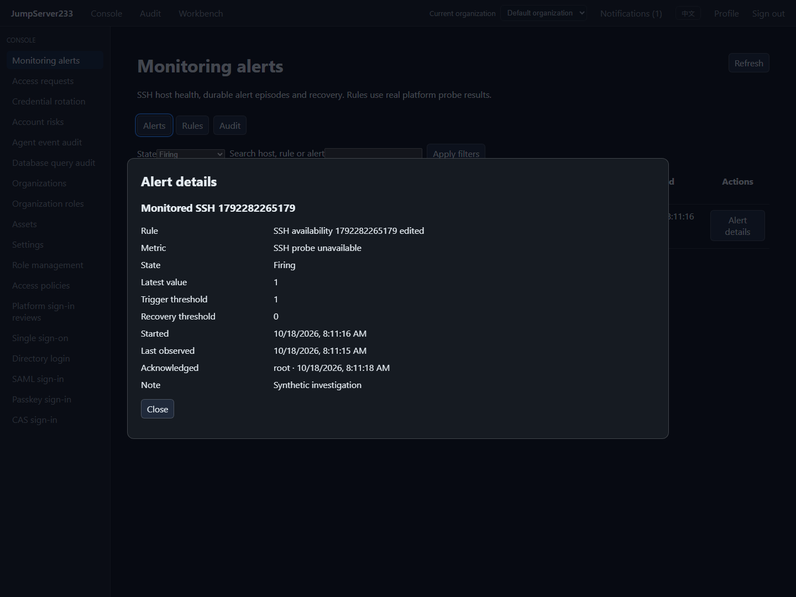

# SSH monitoring alerts

> [中文](./MONITOR-ALERTS.md) | English

Rules, real SSH observations, durable episodes, acknowledgement, recovery, notifications and Web/CLI/SDK are connected. The competitor baseline is [JumpServer Enterprise](https://www.jumpserver.org/enterprise.html), whose site lists Zabbix as companion monitoring. This implements this project's native SSH monitoring requirement. Overall Enterprise parity remains in progress.

## Use

Open Monitoring alerts → Rules → Create rule. Select all SSH hosts, specific hosts, or nodes including descendants. Conditions cover CPU, memory, root disk, SSH latency, network receive/send rates, unavailable SSH probes and missing recent probe data.

Both consecutive sample count and duration must be met for triggering and recovery. Recovery must be lower than the trigger threshold. Maximum sample age should exceed the probe interval, which defaults to 60 seconds. The engine reads cached platform observations every five seconds without opening extra SSH connections. Reading the same sample again never increases its count. Initial/reset network counters and missing capacity measurements remain unknown instead of fabricating zero values to recover.

Missing-data rules wait one maximum sample age from the latest service start, rule update or target entering scope, then apply their duration. They detect interrupted observations. Unavailable-probe rules detect a recent SSH failure result; configure these independently.

Acknowledge an episode with a note to stop repeated notifications. Only fresh samples meeting recovery conditions resolve it. Web rules provide a 30-minute maintenance mute and early unmute; API/CLI accept a reason and any future time up to 30 days. State still records during a mute. After it ends, an unacknowledged firing episode sends again only while its observation is valid. Mutations use revision checks; stale edits return 409.

2026-10-18: synthetic host alert from pausing/resuming real OpenSSH in isolated Docker:



## Permissions and delivery

- `monitoring.view` plus a current asset `view` grant is required to read an alert. `assets.view_all` or `assets.manage` allows organization-wide host visibility. Accounts, groups, node ancestors and validity are checked on every request.
- `monitoring.manage` plus organization-wide inventory visibility is required for rules, health and management audit. Each evaluation checks the current rule owner's permissions.
- `monitoring.ack` also requires `monitoring.view` and current host visibility. Notification audit permission alone does not grant access to measurements.
- Events use existing `security` subscriptions and configured channels. External content contains only the host display name, state, time and platform link. Values, thresholds, addresses, credentials and investigation notes are excluded.
- Queued firing delivery and inbox reads recheck permission, mute, acknowledgement and current state. Old firing notifications stop appearing/sending after acknowledgement, recovery, rule changes or permission withdrawal. Episode history remains on the monitoring page. Recovery has a separate notification; previously generated recovery messages use historical state and current host visibility.

Rule changes/deletion, target endpoint/account/key/gateway changes, leaving scope and owner permission loss record tracking stopped with a reason. They never produce a false recovery. Display renames and password/key rotation preserve target identity. Late observations from an old connection cannot be used for the replacement.

## API and CLI

The API prefix is `/api/v1/monitoring` with existing platform authentication and `X-JMS-ORG`:

| Method/path | Purpose |
|---|---|
| GET/POST `/rules` | List/create rules |
| PUT/DELETE `/rules/{id}` | Update/delete; delete requires `?revision=N` |
| POST `/rules/{id}/mute` | `revision`, `until`, `reason`; zero time ends maintenance |
| GET `/alerts` | `offset`, `limit` (1–200), `state`, `q` |
| GET `/alerts/{id}` | Currently authorized details |
| POST `/alerts/{id}/acknowledge` | `revision`, `comment` |
| GET `/health`, `/audit` | Evaluation health and paginated management audit |

`jms monitor rules|alerts|audit|health` emits JSON and accepts `--offset`, `--limit`, `--state` and `--query`. Other operations:

```sh
jms monitor alert ALERT_ID
jms monitor rule-save --file rule.json
jms monitor rule-save RULE_ID --file update.json
jms monitor mute RULE_ID --revision 1 --until 2026-10-19T02:00:00Z --comment maintenance
jms monitor unmute RULE_ID --revision 2
jms monitor acknowledge ALERT_ID --revision 1 --comment investigating
jms monitor rule-delete RULE_ID --revision 3
```

Use `--file -` for stdin. Unknown input fields are rejected. Update JSON must include the current rule `revision`. Go SDK exposes corresponding `Monitor*` methods.

A minimal complete `rule.json` for unavailable SSH probes:

```json
{
  "revision": 0, "name": "SSH availability", "enabled": true,
  "metric": "offline", "scope": { "all": true },
  "threshold": 1, "recovery_threshold": 0,
  "for_samples": 2, "for_seconds": 0,
  "recovery_samples": 2, "recovery_seconds": 0,
  "max_age_seconds": 180, "repeat_seconds": 0
}
```

## Standalone, HA and capacity

Standalone is the default. `monitor-alerts.json` uses the organization's Vault key with AES-GCM and atomic commits. PostgreSQL uses organization-scoped documents under the existing single-active leader and access locks. Episodes, event cursors and audit commit before notification consumption. Failed persistence consumes no samples and publishes no alert.

Restart/takeover preserves firing episodes and consumed sample times, resetting unproven pending/recovery streaks. Monitoring snapshots are recollected; offline/recovery requires new probes and missing-data rules wait again. Single-active takeover tests do not establish production multi-active readiness or live SSH migration.

Per organization: 100 rules, 50,000 matching rule/host pairs, 20,000 episodes, 20,000 events, 20,000 audit rows and 64 MiB plaintext state. Finished history lasts at most 30 days; capacity pressure removes the oldest finished rows first. Active episodes are never evicted. At active capacity, new episodes are deferred while existing recovery still progresses; rule/health reports capacity. Exceeding pair/document limits stops that evaluation with a capacity error. Audit lasts at most 365 days and remains count bounded.

Raw measurements remain latest in-memory snapshots; alert snapshots and actions are durable. Historical time-series charts, cross-organization aggregation, escalation policies and production HA drills remain open. See [verification](./TESTING.en.md) and [performance](./PERFORMANCE.en.md).
