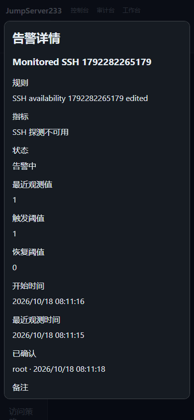

# SSH 监控告警

> 中文 | [English](./MONITOR-ALERTS.en.md)

主机告警已贯通规则、真实 SSH 探测、持久化告警、确认、恢复、通知中心和 Web/CLI/SDK。竞品基线是 [JumpServer 企业版](https://www.jumpserver.org/enterprise.html)；其官网把 Zabbix 列为配套监控。本功能落实本项目的原生 SSH 监控需求，企业版整体对齐仍在进行。

## 使用

控制台进入“监控告警”→“规则”→“创建规则”。可选择全部 SSH 主机、指定主机或节点及后代。支持 CPU、内存、根磁盘、SSH 延迟、网络接收/发送速率、探测不可用、缺少近期数据八类条件。

触发和恢复分别要求连续样本数及持续时间同时满足。恢复阈值必须低于触发阈值。最大样本年龄应大于采集间隔，默认探测间隔 60 秒；规则引擎每 5 秒读取已有快照，不会额外连接主机。重复读取同一快照不增加计数。初次网络样本、计数器回退、缺少容量指标都按缺少测量处理，不会伪造零值满足恢复条件。

“缺少近期数据”从服务启动、规则更新或目标进入范围的较晚时刻等待一个最大样本年龄，再计算持续时间。它检测探测数据中断；“探测不可用”检测有近期探测结果的 SSH 失败，两者可单独设置。

告警详情可写备注并确认；确认停止本次重复通知，后续仍由真实样本判断恢复。规则提供 30 分钟维护静默和结束静默；API/CLI 支持带原因的任意未来时间，最长 30 天。静默期间仍记录状态，恢复静默后仅在观测仍有效且告警未确认时补发。全部处置使用版本校验，过期修改返回 409。

2026-10-18：隔离 Docker、真实 OpenSSH 暂停/恢复得到的合成主机告警：



## 权限与通知

- `monitoring.view` 加当前资产的有效 `view` 授权才能读取告警。`assets.view_all` 或 `assets.manage` 可查看全组织主机。账号、用户组、节点祖先和有效期每次重新判断。
- `monitoring.manage` 加全组织资产读取权限才能配置规则、读取健康和管理审计；规则每轮按当前负责人的权限判断。
- `monitoring.ack` 加 `monitoring.view` 和当前主机可见性才能确认。通知审计权限本身不会授予指标访问。
- 通知使用已有 `security` 订阅，进入站内信及已配置的渠道。只发送主机展示名、状态、时间和平台链接；阈值、指标数值、地址、凭据和处置备注不进入外发内容。
- 触发消息的排队发送及站内读取会重新检查权限、静默、确认和当前状态。已确认、已恢复、规则变更或权限撤销后，旧触发通知不再展示/发送；历史仍在监控页保留。恢复有独立通知，已生成的恢复消息按历史状态和当前主机可见性判断。

规则变更/删除、目标改址/改账号/换指纹/网关变化、目标移出范围或负责人失去权限会记录“停止跟踪”及原因，不会冒充“恢复”。普通显示名变更和密码/密钥轮换保持同一目标身份。旧连接的延迟探测结果不用于新目标。

## API 与 CLI

API 前缀 `/api/v1/monitoring`，保持原生平台认证和 `X-JMS-ORG`：

| 方法/路径 | 用途 |
|---|---|
| GET/POST `/rules` | 查询/创建规则 |
| PUT/DELETE `/rules/{id}` | 修改/删除；删除带 `?revision=N` |
| POST `/rules/{id}/mute` | `revision`、`until`、`reason`；零时间结束静默 |
| GET `/alerts` | `offset`、`limit`（1–200）、`state`、`q` |
| GET `/alerts/{id}` | 当前授权内的详情 |
| POST `/alerts/{id}/acknowledge` | `revision`、`comment` |
| GET `/health`、`/audit` | 评估健康、分页管理审计 |

`jms monitor rules|alerts|audit|health` 输出 JSON；支持 `--offset`、`--limit`、`--state`、`--query`。其余操作：

```sh
jms monitor alert ALERT_ID
jms monitor rule-save --file rule.json
jms monitor rule-save RULE_ID --file update.json
jms monitor mute RULE_ID --revision 1 --until 2026-10-19T02:00:00Z --comment maintenance
jms monitor unmute RULE_ID --revision 2
jms monitor acknowledge ALERT_ID --revision 1 --comment investigating
jms monitor rule-delete RULE_ID --revision 3
```

输入支持 `--file -` 从 stdin 读取，严格拒绝未知字段。更新 JSON 的 `revision` 使用当前规则版本。Go SDK 提供同名 `Monitor*` 方法。

创建离线规则的最小完整 `rule.json`：

```json
{
  "revision": 0, "name": "SSH availability", "enabled": true,
  "metric": "offline", "scope": { "all": true },
  "threshold": 1, "recovery_threshold": 0,
  "for_samples": 2, "for_seconds": 0,
  "recovery_samples": 2, "recovery_seconds": 0,
  "max_age_seconds": 180, "repeat_seconds": 0
}
```

## 单机、HA 与容量

默认单机，`monitor-alerts.json` 使用组织 Vault key 的 AES-GCM 加密并原子提交。PostgreSQL 模式使用组织隔离文档，沿用单活选主和访问锁。触发记录、事件游标与审计先持久化，再提供给通知中心；写盘失败不会消费样本或发布告警。

重启/接管保留正在触发的事件及已消费样本时间；待触发和待恢复的连续计数重置。内存监控快照重新采集，离线/恢复必须有新探测，无数据规则重新等待。单活接管测试不等于生产多活或在线 SSH 会话迁移验收。

每组织最多 100 条规则、50,000 个匹配规则/主机组合，告警历史 20,000 条、事件 20,000 条、审计 20,000 条，加密前状态上限 64 MiB。已结束历史最长保留 30 天，容量紧张时先裁剪最旧已结束记录；活动告警不被驱逐。活动告警满额时新事件暂缓，已有恢复仍处理，健康/规则显示容量错误。超过组合或文档上限会停止该轮并返回容量错误。审计最长 365 天且受条数限制。

原始指标仍是内存最新快照；告警快照和处置已持久化。历史时序曲线、跨组织聚合、通知升级策略和生产 HA 演练仍待完成。验证记录见 [TESTING](./TESTING.md)，性能见 [PERFORMANCE](./PERFORMANCE.md)。
