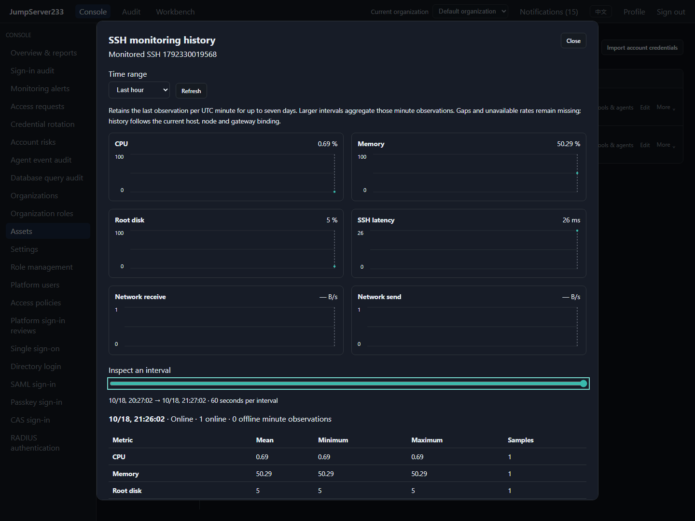
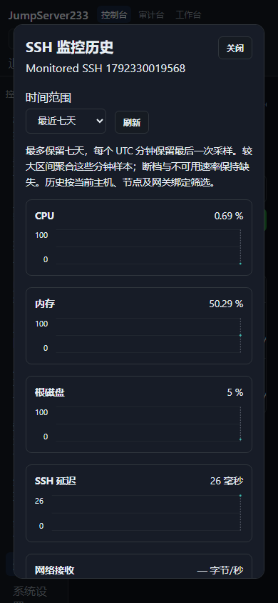

# SSH monitoring history

> English | [中文](./MONITOR-HISTORY.md)

The asset list's History action displays actual CPU, memory, root-disk, SSH latency and network receive/send observations. Select the last hour, six hours, day or seven days. Native SVG charts add no charting dependency. Move the interval slider with the mouse or keyboard to inspect mean, minimum, maximum and valid sample counts.

Browser evidence captured on 2026-10-18: real collection from an isolated local Docker OpenSSH fixture, containing observations from this short QA session. English desktop and Chinese 390px mobile views follow.





## Meaning of the data

Each UTC minute retains its final observation, rather than every raw sample. Sixty-second intervals show minute records; larger intervals aggregate those records. This is neither per-second monitoring nor an exactly weighted mean of all raw samples. Queries cover at most seven days and 1440 intervals, with whole-minute steps from 60 through 3600 seconds.

Online and offline observations are recorded. Missing metrics, gaps and offline intervals never become fabricated zeroes. Initial network observations, counter resets and binding changes leave rates missing; a genuine zero rate remains valid. Mixed intervals identify online/offline minute counts. Metric statistics include only valid online minutes. Failed probes persist stable states without SSH output or stack traces.

The current host, account name, node and complete pinned gateway route form the binding. Changing an address, node, account name or route displays only the current binding. Display-name changes and password rotation for the same target preserve continuity. Disabling credentials does not cancel granted view access; history does not require connect permission.

## Storage and lifecycle

Standalone storage uses organization `monitor-history/` directories and asset-digest/UTC-hour segments, each containing at most sixty minute records. AES-GCM encrypts records and metadata with the organization Vault key and segment-name binding. Local writes use private directories, 0600 temporary files and atomic replacement. Identical timestamp/content retries do not write. Conflicting content at the same timestamp is rejected, and an older observation cannot overwrite a newer observation in the same minute.

The hot cache holds at most eight segments and queries read only their requested range. Each organization is limited to 100000 hourly segments. Capacity pressure refuses new segments and reports `history_capacity`, without silently overwriting another host. Failed writes retain prior durable/in-memory state and expose `history_unavailable`. SSH probe status continues to reflect the actual connection.

Queries filter records older than seven days. Collection rounds check retention and physically remove completely expired hourly segments at most once per hour; repeated cleanup is safe. Deleted assets are no longer queryable and their segments expire normally. Stopped organizations do not erase data in the background; cleanup resumes with their runtime. This does not promise scheduled erasure during downtime.

Cluster mode uses the existing PostgreSQL active/standby and organization document scopes. Encrypted hourly segments are shared documents; a successor enumerates its organization's segments and restores queries without the predecessor's cache. Existing standalone files can migrate through `LoadOrImport`; expiry removes attributable legacy files too, preventing reimport. Latest snapshots, network-counter differences and live connections are collected again on the new node.

## Permissions and interface

`GET /api/v1/assets/{assetID}/monitor-history?from=RFC3339&to=RFC3339&step=60` uses current platform identity and `X-JMS-ORG`. Each request rechecks identity, organization, groups, nodes and account-level `view` grants. Global view, connect and file permissions follow inventory visibility. Unauthorized, deleted and non-SSH hosts return 404. Responses are non-cacheable and omit credentials, endpoints, gateways and internal bindings. Segment counts cover only the requested asset.

Duplicate parameters, invalid dates/steps, excessive ranges or interval counts return 400. Storage/integrity failures return 503 instead of successful empty data. Queries have a ten-second processing budget plus existing storage-call timeouts; cancellation stops subsequent segment reads. History is read-only and never issues SSH sessions.

Go SDK: `Client.MonitorHistory(ctx, assetID, from, to, stepSeconds)`.

```sh
jms monitor history ASSET_ID
jms monitor history ASSET_ID --from 2026-10-18T00:00:00Z --to 2026-10-18T06:00:00Z --step 300
```

The CLI defaults to the last hour and emits structured JSON, using existing platform Bearer or AccessKey identity and organization selection. Operators never receive the remote SSH password. See the [plan](./PLAN.en.md) for the full objective and remaining enterprise capabilities.
