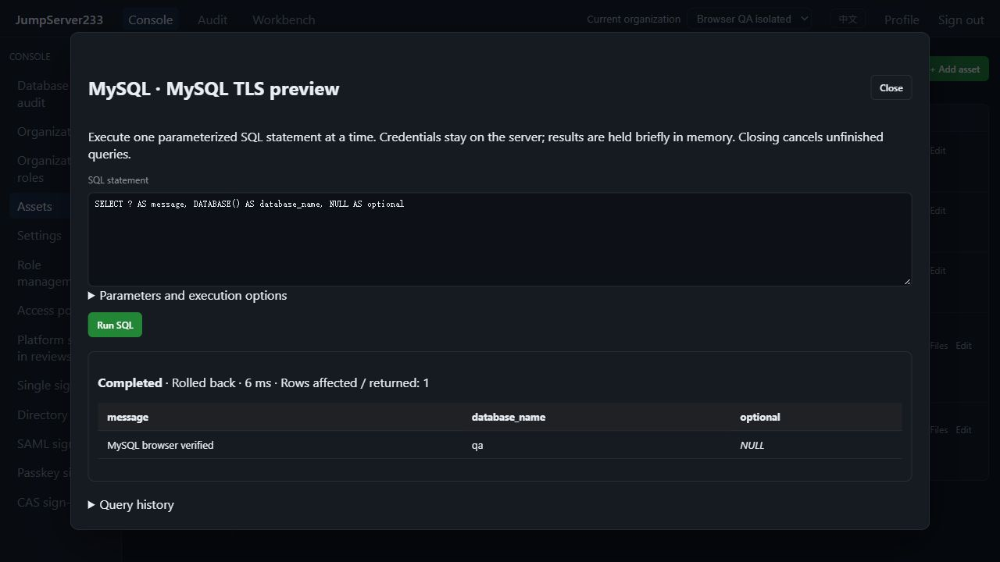
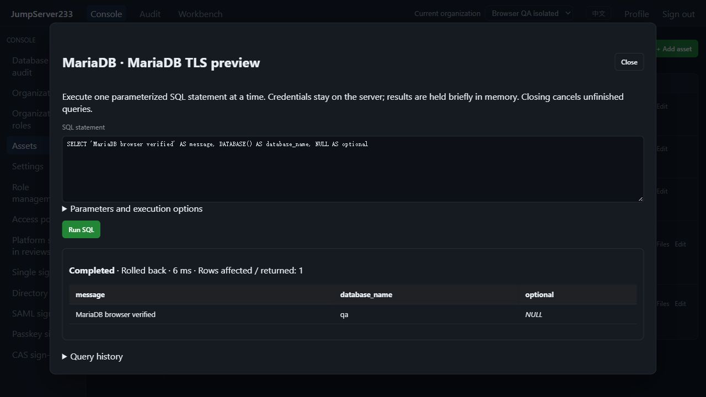

# MySQL and MariaDB database access

> English | [中文](./MYSQL.md)

Real Go drivers connect MySQL/MariaDB to the inventory, browser SQL console, `jms db`, organization authorization, login/SQL review and encrypted auditing. Single-node deployment is preferred; configuration and query audit also support the existing PostgreSQL active/standby store.

Local verified-TLS acceptance captures from 2026-10-16, using isolated QA queries and accounts:





## Configuration

Choose MySQL or MariaDB when adding an asset. Port defaults to 3306. Supply database, account and a write-only password. Both protocols use the `mysql` configuration object: `database`, `tls_mode`, `server_name`, `root_ca_pem`, `read_only`. Defaults are certificate/hostname verification with `verify-full` and read-only policy. Disabling TLS requires an explicit choice. Client DSNs, ambient passwords and local MySQL configuration files are not read.

An optional SSH route supports up to three individually pinned gateways. Database TLS verification remains active. Database assets do not expose SSH terminals, SFTP or SSH rotation operations.

Use `?` placeholders and a JSON parameter array. Results distinguish SQL NULL from text; non-UTF-8 binary values are shown as hexadecimal. Parameters are never interpolated into SQL, multiple statements are disabled, and every query gets a separate connection.

```bash
export JMS_SERVER_URL=https://console.example.com
# Existing platform JMS_TOKEN or AccessKey; optional JMS_ORG_ID, no database password.
printf 'SELECT ? AS message' | jms db ASSET_ID --params '["hello"]'
jms db ASSET_ID --write < change.sql
```

## Read-only and write semantics

- Read-only is the default. A server read-only transaction and statement-class checks restrict execution; entry points such as `CALL` that can change transactions are excluded. Browser, CLI and request fields cannot override the asset's read-only policy.
- Writes require a write-enabled asset and clearing the per-query read-only option (`--write` in CLI). MySQL/MariaDB writes use auto-commit, explicitly described in both interfaces.
- DDL implicitly commits; nontransactional engines such as MyISAM can retain partial changes before reporting an error. **Cancellation, timeout, revocation and result limits cannot undo completed changes.** See [MySQL implicit commits](https://dev.mysql.com/doc/refman/8.4/en/implicit-commit.html).
- Outcomes distinguish `not_started`, `rolled_back`, `committed` and `unknown`. Procedures are available in write mode with `server_managed` status; reconcile according to the procedure's transaction logic. Preparation failures have not dispatched execution. Errors or disconnections after dispatch never imply write rollback or trigger automatic retry.
- Persistent transactions across queries are unavailable. Transaction/session controls (`SET`, `USE`, `XA`, `PREPARE`), `LOAD DATA` and executable version comments are rejected. Bound parameters always use server preparation. Only statements explicitly rejected by preparation and containing zero parameters use direct execution, with multiple statements disabled, enabling procedure-definition DDL. A controlled string-escaping mode keeps parsing consistent. Identifier backticks follow [database quoting rules](https://dev.mysql.com/doc/refman/8.0/en/identifiers.html).

## Authorization, limits and audit

The `database` channel, asset/node connect grants, organization membership and separate database login review apply. SQL filters match original statements without expanding parameters. Current authorization is checked before dispatch, during execution and before exposing results. Denial before execution dispatches no SQL; dispatched writes may require manual reconciliation.

Defaults are 500 rows/30 seconds, configurable to 1–10000 rows and 1–300 seconds. Results permit 50000 cells, 1 MiB displayed text and 8192 bytes per field. Each physical connection also has a 4 MiB receive quota including TLS overhead and large truncated fields. Limits terminate reading. An unverifiable affected-row count is shown as unavailable instead of zero.

Long-term audit keeps redacted SQL, protocol, operator, parameter count, review and transaction outcome. Parameter values, result rows, column names/types and database error messages are excluded. Original unfinished requests are encrypted and cleared on completion/recovery. Rows stay in memory for at most 15 minutes/the latest 16 queries, readable only by the currently authorized owner. Deep copies prevent consumers from mutating cached results. Shared behavior is described in [PostgreSQL access](./POSTGRESQL.en.md).

Takeover restores configuration/audit, without migrating logical sessions or rows. Reconnect before querying. Unfinished or uncertain writes are never replayed automatically. Database-account rotation, native TCP client proxying and persistent transactions remain open; see the full [roadmap](./PLAN.en.md).

See [TESTING](./TESTING.en.md) for consolidated acceptance of real TLS MySQL 8.4/MariaDB 11.4, gateways, browser, CLI, takeover and failure semantics.
