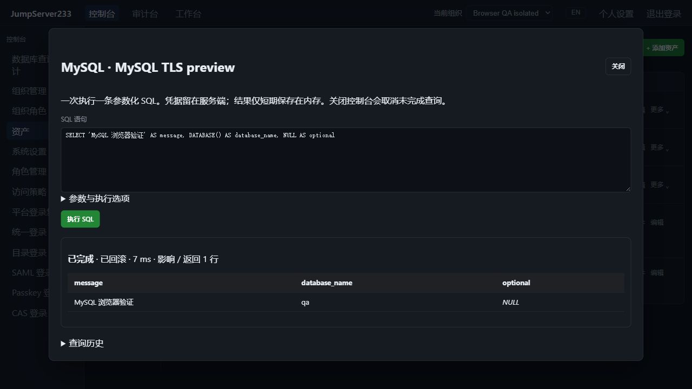
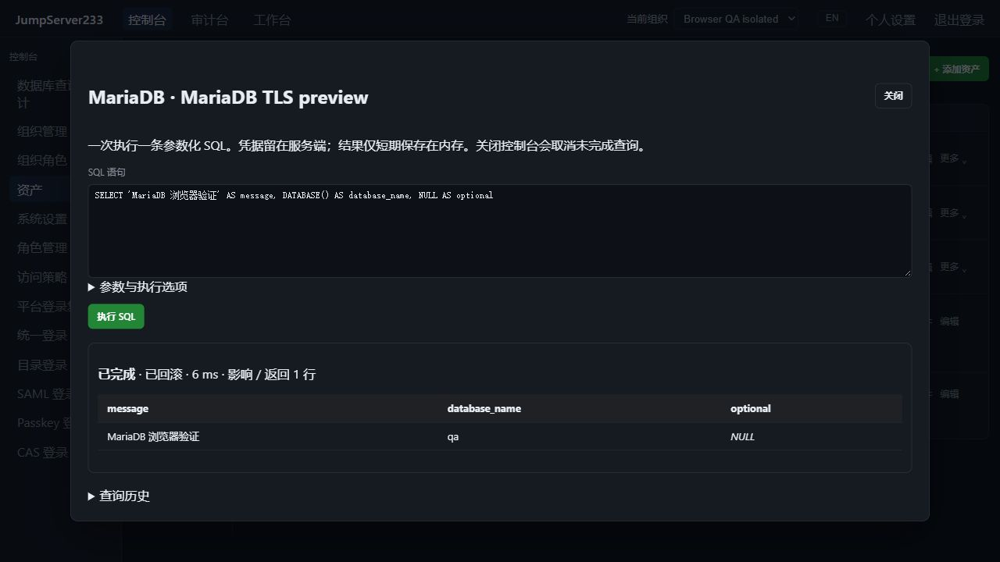

# MySQL 与 MariaDB 数据库访问

> 中文 | [English](./MYSQL.en.md)

MySQL 与 MariaDB 使用真实 Go 驱动，接入资产清单、浏览器 SQL 控制台、`jms db`、组织授权、登录/SQL 复核和加密审计。部署默认单机；配置与查询审计支持现有 PostgreSQL 单活热备存储。

2026-10-16 本机真实 TLS 实例验收截图，查询与账号均用于隔离 QA：





## 配置

添加资产，协议选择 MySQL 或 MariaDB。默认端口 3306，填写数据库、账号和只写密码。两种协议都使用 `mysql` 配置对象：`database`、`tls_mode`、`server_name`、`root_ca_pem`、`read_only`。默认为校验证书和主机名的 `verify-full`、只读策略；禁用 TLS 必须显式选择。不会读取客户端 DSN、环境密码或本机 MySQL 配置文件。

可选最多三跳的 SSH 网关。逐跳校验主机指纹，最终数据库仍校验 TLS 证书。数据库资产不提供 SSH 终端、SFTP 或 SSH 自动改密操作。

SQL 使用 `?` 绑定参数，通过 JSON 数组提交。SQL NULL 与文本分别显示；二进制非 UTF-8 数据用十六进制显示。参数不会插入 SQL 文本，不启用多语句执行。每次查询使用独立连接。

```bash
export JMS_SERVER_URL=https://console.example.com
# 使用已有平台 JMS_TOKEN 或 AccessKey；可选 JMS_ORG_ID，无需远端数据库密码
printf 'SELECT ? AS message' | jms db ASSET_ID --params '["hello"]'
jms db ASSET_ID --write < change.sql
```

## 只读与写入语义

- 默认只读。服务端只读事务配合语句类别限制；`CALL` 等可能切换事务的入口不允许用于只读查询。资产只读策略不能被浏览器、CLI 或请求体关闭。
- 写入需要资产允许写入，且本次查询取消只读（CLI `--write`）。MySQL/MariaDB 写入使用自动提交，浏览器和 CLI 在该模式下明确提示。
- DDL 会隐式提交；MyISAM 等非事务引擎可能在报错前保留部分写入。**取消、超时、授权撤销和结果超限不能撤销已经完成的变更**。[MySQL 隐式提交说明](https://dev.mysql.com/doc/refman/8.4/en/implicit-commit.html)。
- 事务状态区分 `not_started`、`rolled_back`、`committed`、`unknown`。存储过程在写入模式下可以执行，状态为 `server_managed`，需要按过程自身的事务逻辑核对结果。驱动准备语句失败时尚未派发执行；执行后发生错误或连接中断时不会把写入报成已回滚，也不会自动重试。
- 不提供跨查询持久事务。事务/会话控制（包括 `SET`、`USE`、`XA`、`PREPARE`）、`LOAD DATA` 和可执行版本注释被拒绝。绑定参数始终使用服务端预备语句协议；仅在服务器明确拒绝预备且没有参数时，语句通过关闭多语句能力的直接执行路径运行，支持过程定义等 DDL。SQL 会话使用固定的字符串转义模式；标识符中的反引号按数据库规则处理。[标识符规则](https://dev.mysql.com/doc/refman/8.0/en/identifiers.html)。

## 授权、限制与审计

沿用 `database` 访问通道、资产/节点 connect 授权、组织成员检查和独立数据库登录复核。SQL 命令过滤器匹配原始语句，参数不展开；执行前、执行期间和返回结果前复查当前权限。写入开始前拒绝不会派发 SQL；已经派发的写入可能需要人工核对。

默认 500 行/30 秒，可设 1–10000 行、1–300 秒。最多 50000 单元格、1 MiB 显示文本，单字段显示 8192 字节；每条物理连接另限制为 4 MiB 接收流量，涵盖 TLS 开销和被截断的大字段。超过限制会终止读取。影响行数无法核对时显示不可用，不使用 0 冒充。

长期审计保存脱敏 SQL、协议、操作人、参数个数、复核和事务结果；不保存参数值、结果行、列名/类型或数据库错误正文。未结束请求的原始 SQL 与参数加密保存，结束/恢复后清除。结果仅在进程内存保留最多 15 分钟、最近 16 次，仅所属操作人且仍获授权时可读。查询返回值深复制，调用方不能修改缓存内容。共享行为见 [PostgreSQL 访问](./POSTGRESQL.md)。

接管后配置与审计恢复，逻辑会话和结果行不迁移。重新连接后才能查询，未结束和结果不明的写入禁止自动重放。数据库账号自动轮换、原生 TCP 客户端代理和持久事务仍未实现；完整企业版目标见 [PLAN](./PLAN.md)。

真实 TLS MySQL 8.4 与 MariaDB 11.4、网关、浏览器、CLI、单活接管及故障语义的统一验收见 [TESTING](./TESTING.md)。
