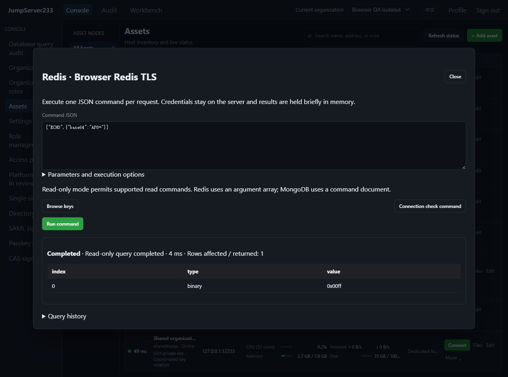
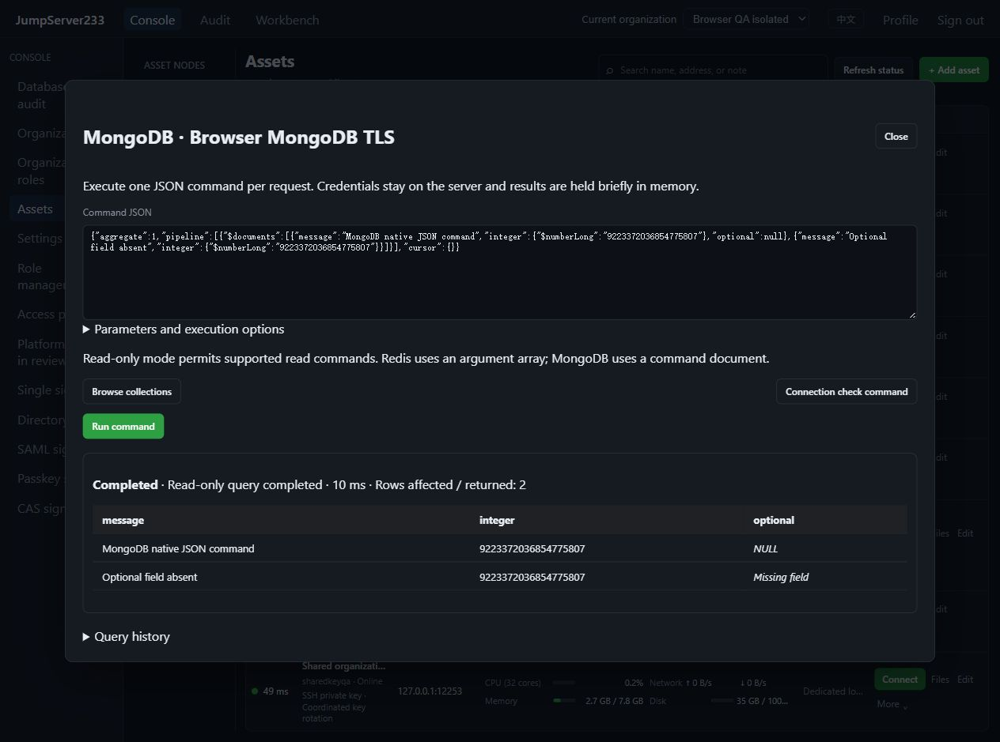

# Native Redis and MongoDB access

> English | [中文](./NOSQL.md)

Redis and MongoDB join inventory, the browser JSON command console, `jms db`, organization/node grants, login/command reviews, encrypted audit and active/standby HA. Standalone deployment is preferred. The competitor remains [JumpServer Enterprise](https://www.jumpserver.org/enterprise.html). Native data protocols are supported; native-client TCP proxying, automatic Redis Cluster/Sentinel routing and MongoDB multi-node discovery remain open.

## Connection configuration

Choose Redis or MongoDB, with default ports 6379 and 27017. TLS certificate/hostname verification is enabled by default, using TLS 1.2 or later. Redis databases use non-negative numeric indexes and Redis 6+ ACL username/password authentication; the default username is default. MongoDB uses the official Go v2 driver and SCRAM-SHA-256. `auth_database` selects the authentication database, defaulting to the current database when blank. Credentials remain in the encrypted server vault. Browser and CLI use platform identity.

The `redis` / `mongodb` objects share `database`, `tls_mode`, `server_name`, `root_ca_pem` and `read_only`; MongoDB also supports `auth_database`. Editing preserves existing configuration. Exactly one configuration matching the asset protocol is accepted. Up to three SSH gateways pin every hop’s host fingerprint. MongoDB connects only to the configured destination, with discovery, compression and automatic read/write retries disabled. An explicit silent driver log sink prevents environment logging settings from recording commands.

## Commands and results

Redis accepts one JSON argument array. Ordinary arguments are strings; binary arguments use `{ "base64": "AP8=" }`. Arguments are encoded directly as RESP bulk strings, so newlines cannot inject a second command.

```bash
printf '["GET","example"]' | jms db REDIS_ASSET_ID
printf '["SET","example","hello"]' | jms db REDIS_ASSET_ID --write
```

MongoDB accepts one ordered command JSON document, with the command name first. Use MongoDB Extended JSON for ObjectId, dates, binary, Decimal128 and exact Int64 values. Ordinary JSON numbers follow official driver decoding rules. Cursors fetch batches within one driver session and are closed on a best-effort basis at exit. Duplicate keys, extra top-level values and nesting deeper than 32 levels are rejected. NoSQL commands do not accept the SQL `--params` array.

```bash
printf '{"find":"items","filter":{"enabled":true}}' | jms db MONGODB_ASSET_ID
printf '{"insert":"items","documents":[{"message":"hello","optional":null}]}' | jms db MONGODB_ASSET_ID --write
```

The browser provides read templates for browsing keys/collections. Run the populated request to view results. Redis shows reply types and values, distinguishing NULL, empty strings and binary data. Integers retain precision and nested arrays use JSON. MongoDB displays document fields, distinguishes NULL from missing fields, and preserves textual Extended BSON types.

## Read-only policy, scope and write outcomes

Assets default to read-only; individual requests cannot relax that policy. The backend read-command allowlist rejects writes. MongoDB also rejects nested `$out` / `$merge`, server-side JavaScript and wrapped write explains in read-only mode. Successful reads report `read_only`. Give database accounts minimal permissions as well; read preferences and protocol commands are not database permission management.

Each request uses the asset account and configured initial database. Connection-control commands cannot switch authentication identity, database, driver session or create a persistent transaction. A Redis database index is not a permission boundary: native write commands and scripts follow the database account permissions and may affect other databases. Restrict available commands and keys with Redis ACL. Redis subscription/monitoring/replication and connection-configuration controls are excluded from this one-command channel. MongoDB account, role, topology, cross-database bulk writes and session controls belong to database administration outside this managed command boundary. Cross-database aggregation targets are rejected.

Writes require asset permission and explicit removal of request read-only mode. Success reports `server_managed`, without guaranteed rollback. Failure, cancellation or a limit after dispatch reports `unknown`. MongoDB batches can partially succeed; reconcile data before retrying. Affected counts come from native replies when available and are explicitly unknown otherwise. Writes are not automatically retried. Cancellation closes the connection; the official MongoDB driver sets initial-command maxTimeMS from the request deadline. Ordinary getMore does not accept that field and retains client cancellation instead. Exit attempts known-cursor cleanup. Disconnect cannot undo completed writes or guarantee immediate termination of every server script.

## Bounded results, audit and HA

Defaults remain 500 rows/30 seconds, with maxima of 10000 rows, 50000 cells, 1 MiB displayed text and 8192 bytes per cell. Response traffic is limited to 4 MiB per request. Redis checks bulk lengths, array counts and nesting before allocation. MongoDB validates complete message headers before the driver reads the declared length and allocates the body, rejecting oversized or compressed replies. Large cells are explicitly marked as truncated.

Current organization, grants and asset bindings are checked on requests, between batches and before result delivery; existing periodic guards can revoke running work. Durable audit excludes key/collection names, argument values, field names, results and database error bodies. Redis retains command names/placeholders; MongoDB retains command names/redaction markers. Only allowed Redis error prefixes or numeric MongoDB codes are returned. Results live in the current process for at most 15 minutes/16 queries, with deep copies including missing-field coordinates.

Configuration and audit indexes support the existing PostgreSQL active/standby store. Takeover invalidates old database sessions and requires reconnection. Results do not migrate; unfinished or uncertain writes are not replayed. See the [roadmap](./PLAN.en.md) for full Enterprise gaps and [verification records](./TESTING.en.md) for actual acceptance status.

## Product captures

2026-10-16 local real TLS QA: Redis native binary replies; MongoDB exact Int64, NULL and missing fields. Synthetic data only.





## Automated fixtures and protocol sources

Set `JMS_QA_NOSQL_ENGINE=redis` or `mongodb` and run `node server/testsupport/nosql/run.mjs` for isolated official-image TLS instances. Redis defaults to 15491 / health 15492; MongoDB uses 15501 / health 15502. Set `JMS_TEST_REDIS_FIXTURE_URL` and `JMS_TEST_MONGODB_FIXTURE_URL`; containers also use the corresponding NETWORK_ADDR variable. E2E starts independent Redis 15493 / 15494 and MongoDB 15503 / 15504 instances. CI cleans resources through owner records.

Sources: [Redis RESP](https://redis.io/docs/latest/develop/reference/protocol-spec/), [Redis command metadata](https://redis.io/docs/latest/commands/command/), [official MongoDB Go command interface](https://www.mongodb.com/docs/drivers/go/current/run-command/), [MongoDB context cancellation](https://www.mongodb.com/docs/drivers/go/current/context/).
