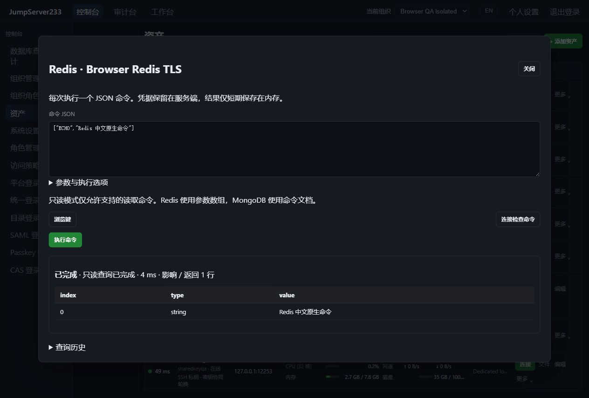
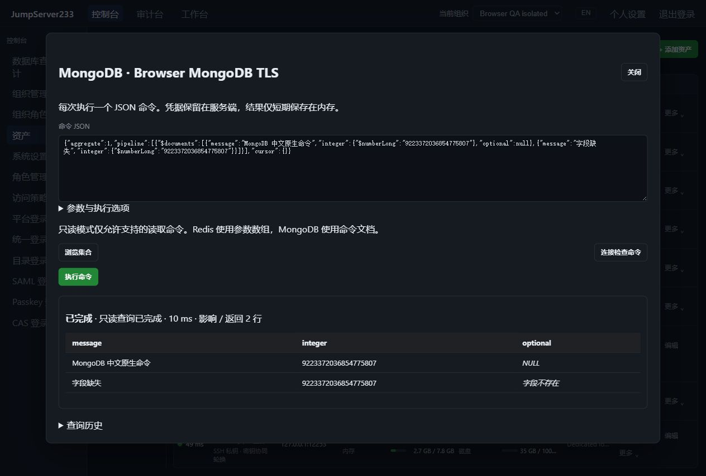

# Redis 与 MongoDB 原生访问

> 中文 | [English](./NOSQL.en.md)

Redis 和 MongoDB 接入统一资产、浏览器 JSON 命令控制台、`jms db`、组织/节点授权、登录及命令复核、加密审计和单活 HA。单机优先；竞品仍为 [JumpServer 企业版](https://www.jumpserver.org/enterprise.html)。支持原生数据协议，原生客户端 TCP 代理、Redis Cluster/Sentinel 自动路由和 MongoDB 多节点发现仍待实现。

## 连接配置

协议选择 Redis 或 MongoDB，默认端口分别为 6379、27017；默认验证 TLS 证书和主机名，TLS 1.2 起步。Redis 数据库是非负数字序号，账号为 Redis ACL 用户（默认用户名称为 default），支持 Redis 6+ 的账号密码认证。MongoDB 使用官方 Go 驱动 v2、SCRAM-SHA-256；`auth_database` 可指定认证数据库，留空时使用当前数据库。账号、密码保留在服务端加密保管库，浏览器和 CLI 使用平台身份。

配置分别放在 `redis` / `mongodb` 对象中，字段共用 `database`、`tls_mode`、`server_name`、`root_ca_pem`、`read_only`，MongoDB 另支持 `auth_database`。资产编辑保留现有配置；一次只能提供与协议对应的一份配置。支持最多三跳、逐跳固定主机指纹的 SSH 网关。MongoDB 固定连接已配置目标，不自动发现节点、不启用压缩、不自动重试读写，驱动日志由显式静默接收器处理，避免环境日志配置记录命令数据。

## 命令输入和结果

Redis 每次发送一个 JSON 参数数组，所有普通参数使用字符串；二进制参数可写为 `{ "base64": "AP8=" }`。参数直接编码为 RESP bulk string，包含换行的内容也不会变成第二条命令。

```bash
printf '["GET","example"]' | jms db REDIS_ASSET_ID
printf '["SET","example","hello"]' | jms db REDIS_ASSET_ID --write
```

MongoDB 使用一个保持字段顺序的命令 JSON 文档，命令名称必须是第一个字段。使用 MongoDB Extended JSON 表达 ObjectId、日期、二进制、Decimal128 和精确 Int64；普通 JSON 数字遵循官方驱动的数值解码规则。查询游标按批获取，在同一驱动会话中继续，并在退出时尝试关闭。重复 JSON 字段、额外顶层值和超过 32 层的嵌套会被拒绝。NoSQL 命令不接受 SQL 的 `--params` 数组。

```bash
printf '{"find":"items","filter":{"enabled":true}}' | jms db MONGODB_ASSET_ID
printf '{"insert":"items","documents":[{"message":"hello","optional":null}]}' | jms db MONGODB_ASSET_ID --write
```

浏览器提供浏览键 / 浏览集合的读取模板，点击后执行即可查看结果。Redis 显示返回值类型和值，NULL、空字符串和二进制分开处理；整数保持精度，嵌套数组使用 JSON。MongoDB 按字段展示文档，区分 NULL 与字段不存在，并保留扩展 BSON 类型的文本表示。

## 只读、范围与写入结果

默认只读，资产策略不能被单次请求放宽。后端只读命令白名单拒绝写入；MongoDB 还拒绝只读请求中的嵌套 `$out` / `$merge`、服务端 JavaScript 和包装的写入 explain。只读成功报告 `read_only`。数据库账号本身也应设置最小权限，本功能不把读取偏好或客户端协议命令当作数据库权限管理。

每次请求使用资产账号和配置的初始数据库，连接控制命令不能切换认证身份、数据库、驱动会话或建立跨请求事务。Redis 数据库序号不构成权限隔离：写模式中的原生命令和脚本仍按数据库账号权限执行，可能影响其它数据库；应通过 Redis ACL 限制可用命令和键。Redis 的订阅/监控/复制及连接配置控制命令不进入该单次命令通道；MongoDB 的账号、角色、拓扑、跨库批写和会话控制由保管库/平台边界之外的数据库管理流程处理。MongoDB 聚合中的跨数据库目标会被拒绝。

写入需资产允许且本次显式关闭只读。成功报告 `server_managed`，不能保证回滚；派发后报错、取消或超限报告 `unknown`。MongoDB 批次可能部分成功，先核对数据再重试。影响行数可用时取原生回复，不可用时明确标记；不自动重试写入。取消会关闭当前连接；MongoDB 初始命令由官方驱动按请求截止时间设置服务端 maxTimeMS；不支持该字段的普通 getMore 仅保留客户端取消，退出时尝试清理已知游标。断连不保证撤销已完成写入或立刻停止所有服务端脚本。

## 有界结果、审计与 HA

沿用默认 500 行/30 秒，最多 10000 行、50000 单元格、1 MiB 显示文本、单格 8192 字节。单次请求的响应字节预算为 4 MiB。Redis 对 bulk 长度、数组元素数和嵌套层数先检查再分配；MongoDB 在驱动读取消息长度并分配正文前检查完整报文头，拒绝超过上限或压缩的消息。大型单元格截断会明确标记。

每次请求、分批读取和返回结果前重新检查当前组织、授权和资产绑定，现有周期检查可撤销正在执行的请求。长期审计排除键/集合名、命令值、字段名、结果和数据库错误正文：Redis 保留命令名称与参数占位符，MongoDB 保留命令名称与脱敏标记；仅返回允许的 Redis 错误前缀或 MongoDB 数字代码。结果只在当前进程保存最多 15 分钟/16 次查询，并深复制，包括 MongoDB 缺失字段坐标。

配置和审计索引支持现有 PostgreSQL 单活热备。接管后旧数据库会话失效，重新连接；结果不迁移，未完成或结果不明的写入不重放。完整企业版差距见 [规划](./PLAN.md)，实际验收状态见 [验证记录](./TESTING.md)。

## 产品截图

2026-10-16 本机真实 TLS 验证：Redis 中英文原生命令与二进制返回，MongoDB 精确 Int64、NULL 和缺失字段。数据仅用于合成 QA。





## 自动化夹具与协议依据

`JMS_QA_NOSQL_ENGINE=redis` 或 `mongodb` 配合 `node server/testsupport/nosql/run.mjs` 启动独立官方镜像 TLS 实例。默认 Redis 为 15491 / health 15492，MongoDB 为 15501 / health 15502。设置 `JMS_TEST_REDIS_FIXTURE_URL`、`JMS_TEST_MONGODB_FIXTURE_URL`；跨容器另设置对应 NETWORK_ADDR。E2E 自动使用独立 Redis 15493 / 15494、MongoDB 15503 / 15504，CI 按归属记录清理。

协议依据：[Redis RESP](https://redis.io/docs/latest/develop/reference/protocol-spec/)、[Redis 命令元数据](https://redis.io/docs/latest/commands/command/)、[MongoDB 官方 Go 命令接口](https://www.mongodb.com/docs/drivers/go/current/run-command/)、[MongoDB 上下文取消](https://www.mongodb.com/docs/drivers/go/current/context/)。
