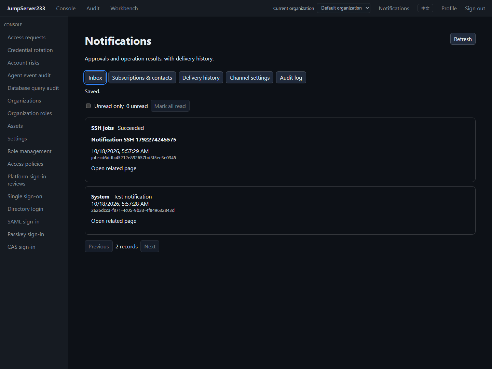
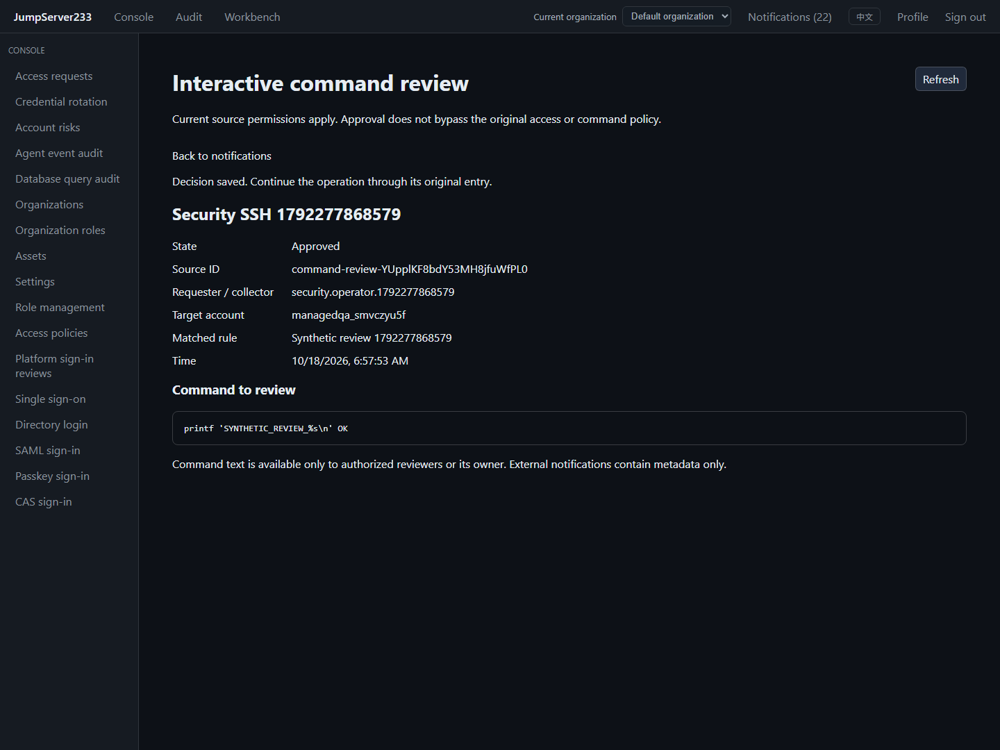

# Notification center

> English | [中文](./NOTIFICATIONS.md)

Platform identities use independent [platform notifications and sign-in audit](./LOGIN-AUDIT.en.md). Preferences, contacts, channels, deliveries and audit are isolated from organizations and use global authority. External messages also exclude login usernames and source IP. Header unread counts combine both scopes.

The console header opens notifications with unread filtering, mark all read and related details. System events generate messages; tests send fixed messages only to the caller's subscriptions. Preferences are per user and organization, default to in-app, and support Chinese, English or automatic delivery language (last interface language).

2026-10-18, isolated Docker, synthetic contacts and a real OpenSSH job:



## Delivered sources

| Event | Recipients and current access |
| --- | --- |
| Ticket submission, amendments and stages | Requester and current CC subjects; eligible current reviewers also receive tasks; stale revisions/completed stages disappear |
| Ticket comments, rejection, cancellation and revocation | Requester and current CC subjects who can still read the ticket |
| Terminal SSH jobs | Owner who can still read the job |
| Terminal rotation plans | Run owner retaining rotation and all-assets view permissions |
| Asset access reviews | Requesters receive security messages; current reviews.login.manage holders receive tasks for SSH/SFTP/database/Kubernetes/Telnet/RDP/account collection/remote account access |
| SSH job command denial and review results | Owner and jobs.view_all auditors receive security messages; jobs.review receives current tasks |
| Interactive Web SSH commands | Current reviewers receive tasks; session owner, input participant and audit.commands.view_all receive denial, input blocking, review outcomes and cancellation metadata |
| Host Agent events | Collector and audit.agents.view_all, subject to original event access; repair completed/failed/interrupted, history gaps, stream changes and missing journals |
| Terminal account risk scans | accounts.risks.view plus assets.view_all or assets.manage; scan summaries only |
| SSH host alerts and recovery | monitoring.view plus current host visibility; firing messages recheck rule authority, mute, acknowledgement and state, linking directly to [monitoring details](./MONITOR-ALERTS.en.md) |
| System test | Caller with active account and organization |

Messages contain only type, resource name, state, time, ID and detail link, excluding commands, stdout/stderr, comment text, target credentials and rotation secrets. Platform sign-in reviews retain their separate global entry. Native cloud SMS/CMPP, instant messaging adapters and overall Enterprise parity remain pending.

## Security messages and native reviews

Details use the selected organization and current source permissions. Asset access, SSH jobs and interactive commands support inline approval/denial through native APIs, preserving live authorization, one-use permits, expiry and command policy. Review permissions expose only current task commands and do not grant another user's terminal job history. Notification management/audit alone grants no host event access. External messages always contain metadata only.

Task snapshots revisit retained records. Completion, role withdrawal or expiry hides tasks; later role assignment can receive still-valid tasks created after the deployment boundary. Stable IDs deduplicate enqueue and idle passes do not rewrite notification state. Pending details refresh every 5 seconds, pause while hidden and abort on navigation. Decisions cancel older reads so a delayed response cannot restore stale approval controls.

After full command audit fsync, interactive commands persist metadata in organization AES-GCM encrypted command-alerts.json (an organization document in PostgreSQL) before forwarding. Ordinary allowed commands add no alert write. Alert persistence failure stops forwarding. Metadata retains at most 20,000 entries/30 days, with a 32 MiB decrypted document limit; health shows cursor gaps after pruning. Session shutdown completes cancellation audit before closing this store. An approval record proves a decision, not successful remote execution.

Agent alert metadata commits with collection cursors in the encrypted index; polling avoids bulky raw collection output. Legacy archives establish an upgrade boundary without sending older alerts; original audit remains readable. Retention is 20,000 entries/30 days. The encrypted document is bounded to 16 MiB for restart readability; its byte budget can prune older alert metadata earlier with a retained gap boundary. An oversized source document fails without advancing the collection cursor. Timestamps use platform observation time. Details explicitly identify these as host reports within the remote-host trust boundary.

2026-10-18, real OpenSSH command review in isolated Docker:



## Configuration and subscriptions

Organization administrators configure external channels with `notifications.manage`; channels default to disabled. Settings/preferences use revisions; stale writes return 409. Organization AES-GCM encrypts SMTP/gateway secrets. Reads never return secrets: omitted/null retains them, empty strings clear them, and the UI offers explicit clear checkboxes.

- **Email**: direct TLS or mandatory STARTTLS, TLS 1.2 minimum, hostname/certificate validation. Additional PEM CAs are supported; private keys/unrelated text are rejected. No plaintext fallback or certificate bypass. SMTP PLAIN happens only after TLS, with UTF-8 MIME and stable Message-ID.
- **Webhooks**: one fixed organization HTTPS endpoint; URL credentials, query strings, fragments and redirects are rejected. JSON includes id, organization_id, user_id, topic, title, text and source (kind/id/event_id/action). Bearer and HMAC-SHA256 are supported.
- **Custom SMS gateway**: HTTPS/Bearer/HMAC also apply. JSON adds to, and verification adds code. A 2xx response with `{"accepted":true}` is required for provider acceptance. The receiver adapts real providers.

Headers: `X-JMS-Notification-ID` (stable delivery ID), `X-JMS-Timestamp` (Unix seconds), `X-JMS-Signature` (hexadecimal HMAC-SHA256). Receivers should enforce timestamp tolerance and deduplicate by organization_id and delivery ID together. Signed bytes:

```text
timestamp + "\n" + delivery_id + "\n" + exact_request_body
```

Email uses ASCII addresses; phones use E.164 (synthetic example `+15555550123`). Save contacts, request verification, then subscribe. UI contact edits clear verification and channel subscriptions; the API rejects unverified subscriptions. Codes expire in 10 minutes and work once: 6 requests/user/hour, 60 seconds between requests for one contact, 8 attempts/code. APIs, CLI and audit never return codes. Tests are limited to 10/user/hour and idempotent by request_id. Disabling in-app affects future events only.

## Persistence, recovery and authorization

- Standalone uses `notifications.json`; cluster mode uses an organization-scoped PostgreSQL document, existing single-active election and organization keys. Notifications stop/drain before event sources. Node clocks must be synchronized.
- New stores persist their event start boundary and skip pre-deployment history. Cursor and messages/outbox commit atomically; stable event IDs deduplicate enqueue. Health retains source history gaps and shows currently unavailable sources.
- Dispatch runs every second with 4 concurrent senders. Organization, account, subscriptions, contacts, settings and source access are checked before sends. Configuration revisions fail old queued records, requiring explicit retry.
- Pre-send connection failures, explicit SMTP 4xx and HTTP 429 use bounded backoff, at most 5 attempts. Post-send disconnection, HTTP 5xx, missing SMS acceptance, receipt persistence failure and takeover of sending records yield uncertain outcomes without automatic replay.
- Manual retries require revisions/current access; uncertain outcomes require duplicate-risk acknowledgement. The original destination remains fixed. Verification codes require a fresh request.
- Provider acceptance proves an SMTP/gateway acknowledgement, not inbox or handset delivery. Revoking permissions cannot recall already accepted messages.
- Messages/deliveries retain 30 days; audit is bounded to 20,000 entries and 365 days. Limits: 20,000 messages, 40,000 deliveries, 64 MiB decrypted state, hourly cleanup. Capacity exhaustion returns errors instead of silently evicting retained messages. Preferences/configuration remain until changed.
- `notifications.audit` reads organization masked deliveries, health and audit; `notifications.retry` retries other users' records. Regular users see only their currently authorized messages and masked delivery history. Audit excludes secrets, codes and bodies.

## API / CLI / SDK

Base `/api/v1/notifications` supports the existing four authentication methods and `X-JMS-ORG`:

| Path | Method |
| --- | --- |
| /inbox?unread=true&offset=0&limit=25 | GET results/total/unread |
| /read | POST id or all=true |
| /preferences | GET / PUT caller preferences |
| /locale | POST language |
| /verification/request, /verification/confirm | POST channel / code |
| /settings | GET / PUT administrator settings |
| /test | POST request_id |
| /deliveries, /audit, /health | GET paged deliveries, audit, health |
| /deliveries/{id}/retry | POST revision / acknowledge_uncertain |
| /sources/{kind}/{id} | GET currently authorized compact details; kinds: access-reviews / job-security / command-reviews / command-alerts / agent-events / account-risks |

```sh
jms notifications list --unread --limit 25
jms notifications source command-alerts command-event-ID
jms notifications preferences
jms notifications preferences-save --file preferences.json
jms notifications request-code email
jms notifications verify email --code-stdin
jms notifications test --request-id synthetic-test-1
jms notifications deliveries
jms notifications retry delivery-ID --revision 3 --acknowledge-uncertain
jms notifications settings-save --file -
jms notifications health
```

SDK: `internal/sessionclient/notifications.go`. Read codes from stdin instead of process arguments; `--file -` also reads stdin. Operators must protect secret-bearing configuration files and exclude them from Git.

## Verification and evidence

Testify covers atomic cursors, deduplication, reads, permission withdrawal, verification limits, encryption, CAS, receipt failures, shutdown and PostgreSQL takeover. Synthetic capture fixtures exercise TLS/STARTTLS, certificate rejection, MIME, HMAC and gateway outcomes. Playwright covers all three channels, email/phone verification, real SSH jobs, approvals, details, both languages and narrow screens. Acceptance records: [TESTING.en.md](./TESTING.en.md).

The competitor is [JumpServer Enterprise](https://www.jumpserver.org/enterprise.html). Research uses official [in-app messages](https://docs.fit2cloud.com/jumpserver/manual/common/system_message/), [notification settings](https://docs.fit2cloud.com/jumpserver/v3/guide/system/message/) and [personal settings](https://docs.fit2cloud.com/jumpserver/manual/common/profile/) (queried 2026-10-18). This page describes actual implementation scope.
