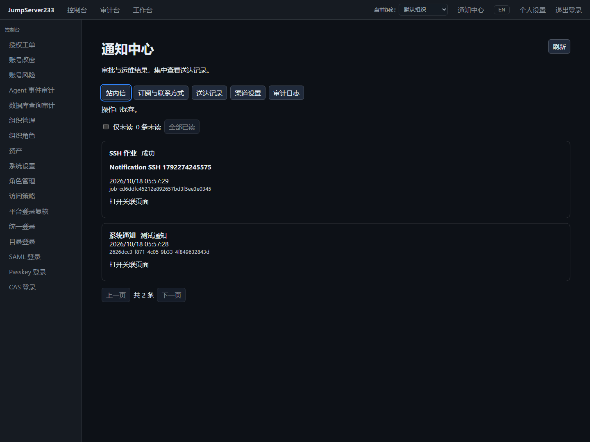

# 通知中心

> 中文 | [English](./NOTIFICATIONS.en.md)

控制台顶部进入通知中心，可看未读、全部已读和关联详情。消息由系统事件生成；测试按钮只向本人订阅发送固定测试消息。设置按本人和组织保存，默认仅站内信，支持中文、英文和自动（最近界面语言）。

2026-10-18，隔离 Docker、合成联系方式与真实 OpenSSH 作业：



## 已交付

| 事件 | 接收人及权限 |
| --- | --- |
| 工单提交、调整重审、审批阶段 | 申请人和当前抄送对象；当前阶段合资格审批人另收待办，旧修订和已完成阶段隐藏 |
| 工单评论、拒绝、取消、撤销等 | 仍可读工单的申请人及当前抄送对象 |
| SSH 作业终态 | 仍可读作业的发起人 |
| 改密计划终态 | 仍有改密及全资产查看权限的运行发起人 |
| 系统测试 | 本人，账号与组织保持有效 |

消息仅含类型、资源名称、状态、时间、ID 和详情链接。不含命令、stdout/stderr、评论正文、目标登录凭据或改密秘密。安全告警、平台/资产登录复核、数据库和其他协议事件尚未接入本中心；现有复核页面仍可用。原生云短信/CMPP、即时通信适配器和完整企业版目标仍在进行。

## 配置与订阅

组织管理员使用 `notifications.manage` 配置外部渠道，默认关闭。配置、订阅都有修订号，过期写入返回 409。SMTP 和网关密钥使用组织 AES-GCM 加密，不回显；省略或 null 保留密钥，空字符串清除，界面提供清除选项。

- **邮件**：直接 TLS / 强制 STARTTLS，最低 TLS 1.2，校验主机名及证书；可附加 PEM CA，拒绝私钥和杂项文本。无明文回退或跳过校验。SMTP PLAIN 仅在 TLS 建立后发送，支持 UTF-8 MIME 和固定 Message-ID。
- **Webhook**：固定组织 HTTPS 地址，拒绝 URL 用户信息、查询参数、片段和重定向。POST JSON 包含 id、organization_id、user_id、topic、title、text、source（kind/id/event_id/action）。支持 Bearer 与 HMAC-SHA256。
- **自定义短信网关**：同样使用 HTTPS/Bearer/HMAC。JSON 另有 to，验证消息还有 code；2xx 且返回 `{"accepted":true}` 才记为服务商接收。接收方负责对接真实短信商。

签名请求头为 `X-JMS-Notification-ID`（固定送达 ID）、`X-JMS-Timestamp`（Unix 秒）、`X-JMS-Signature`。签名为下列字节的 HMAC-SHA256 十六进制值；接收端应验证时间偏差并按 organization_id 与送达 ID 组合去重：

```text
timestamp + "\n" + delivery_id + "\n" + exact_request_body
```

邮箱使用 ASCII 地址；手机号采用 E.164（合成示例 `+15555550123`）。先保存联系方式、申请验证、再订阅。界面改联系方式会清除验证和对应渠道订阅；API 不接受未验证订阅。验证码 10 分钟、一次有效；每用户每小时最多申请 6 次，同一联系方式至少间隔 60 秒，每码最多尝试 8 次。API/CLI/审计不返回验证码。测试每小时最多 10 次，相同 request_id 幂等。关闭站内信只影响后续事件。

## 持久化、恢复与权限

- 单机 `notifications.json`；集群使用组织隔离 PostgreSQL 文档、现有单活选主及组织密钥。通知服务先于事件源停止并等待发送退出。跨节点时钟须同步。
- 新实例先持久化事件起点，不追发部署前历史。游标与消息/outbox 一次提交，固定事件 ID 去重。源历史裁剪的缺口保留在健康页，暂不可用的源也会显示。
- 每秒派发，最多 4 并发；发送前复查组织、用户、订阅、联系方式、配置与事件权限。配置修订变化使旧队列失败，须按需手动重试。
- 连接前失败、明确 SMTP 4xx 和 HTTP 429 可退避重试，最多 5 次。发送后断线、HTTP 5xx、短信回执缺失、发送结果落盘失败或接管时遗留发送中记录，均保留“结果不明确”，不自动重放。
- 手动重试检查修订和当前权限；结果不明确须确认重复风险。保留原目标，不能把旧消息转发给新联系方式。验证码须重新申请。
- “服务商已接收”证明 SMTP/网关接收，不证明邮箱或手机终端送达；已接收消息不能在权限撤回后收回。
- 消息和送达保留 30 天，审计最多 20,000 条且不超过 365 天；上限 20,000 消息、40,000 送达、64 MiB 解密状态，每小时清理。满额明确报错，不静默淘汰保留期消息。偏好/配置保留到再次修改。
- `notifications.audit` 查看组织脱敏送达、健康及审计；`notifications.retry` 重试他人记录。普通用户只能读本人当前可见消息和脱敏送达。审计不含密钥、验证码或正文。

## API / CLI / SDK

基路径 `/api/v1/notifications`，支持现有四种认证与 `X-JMS-ORG`：

| 路径 | 方法 |
| --- | --- |
| /inbox?unread=true&offset=0&limit=25 | GET results/total/unread |
| /read | POST id，或 all=true |
| /preferences | GET / PUT 本人偏好 |
| /locale | POST language |
| /verification/request、/verification/confirm | POST channel / code |
| /settings | GET / PUT 管理员配置 |
| /test | POST request_id |
| /deliveries、/audit、/health | GET 分页送达、审计、健康 |
| /deliveries/{id}/retry | POST revision / acknowledge_uncertain |

```sh
jms notifications list --unread --limit 25
jms notifications preferences
jms notifications preferences-save --file preferences.json
jms notifications request-code email
jms notifications verify email --code-stdin
jms notifications test --request-id synthetic-test-1
jms notifications deliveries
jms notifications retry delivery-ID --revision 3 --acknowledge-uncertain
jms notifications settings-save --file -
jms notifications health
```

SDK 在 `internal/sessionclient/notifications.go`。验证码读标准输入，不放进程参数；`--file -` 接受标准输入。操作者应保护含密钥的配置文件，不提交到仓库。

## 验证与依据

Testify 覆盖原子游标、去重、读状态、撤权、验证限流、加密、CAS、回执故障、关闭和 PostgreSQL 接管。合成捕获夹具实测 TLS/STARTTLS、证书拒绝、MIME、HMAC 及网关响应分类；Playwright 覆盖三渠道、邮箱/手机验证、真实 SSH 作业、审批、详情、中英文与窄屏。验收记录见 [TESTING.md](./TESTING.md)。

竞品为 [JumpServer 企业版](https://www.jumpserver.org/enterprise.html)。研究依据官方[站内消息](https://docs.fit2cloud.com/jumpserver/manual/common/system_message/)、[通知配置](https://docs.fit2cloud.com/jumpserver/v3/guide/system/message/)和[个人设置](https://docs.fit2cloud.com/jumpserver/manual/common/profile/)（2026-10-18 查询）；本页描述实际实现范围。
