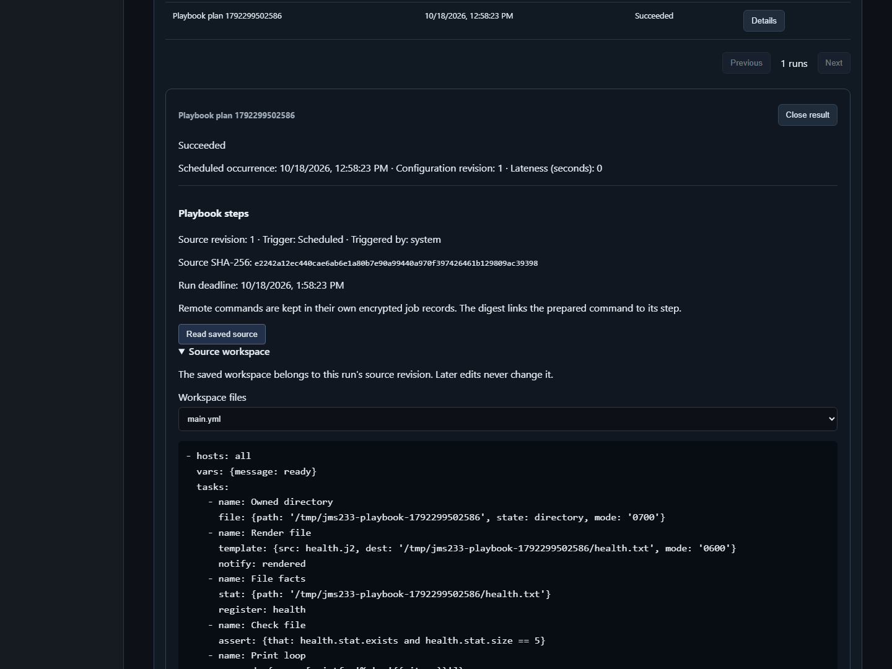

# Go native Playbooks

> [中文](./PLAYBOOKS.md) | English

Workbench `/workbench`, Ops CLI and SDK share revisioned YAML workspaces, immutable plan source snapshots and per-host step audit. The format is `jms233-native-v1`: a Go controller uses existing SSH connections to run Linux tools. Standalone comes first; state uses organization encryption and PostgreSQL single-active takeover.

2026-10-18: saved run source in isolated Docker with a real OpenSSH target, from the English 1440px acceptance flow.



The same flow also verifies the Chinese 390px editor and a repeated run with unchanged file modules; the Chinese execution screenshot is preserved in the [paired document](./PLAYBOOKS.md).

On the same date, restarting the production API during a persisted pause retained its original child job ID. The remote append marker remained a single `x`; all five steps succeeded and removed the owned marker file. The [paired document](./PLAYBOOKS.md) contains the actual recovery screenshot.

The competitor remains [JumpServer Enterprise](https://www.jumpserver.org/enterprise.html). Its [job management](https://docs.fit2cloud.com/jumpserver/manual/user/workbench/job_center/jobs_management/) and [template management](https://docs.fit2cloud.com/jumpserver/v4/manual/admin/workbench/job_center/templates_management/) are feature references. This module provides a bounded native orchestrator. Full Ansible, full Enterprise parity and production multi-active remain open.

## Workflow

1. Open Playbook workspaces, create a workspace and edit `main.yml`. Add relative task/template files as needed. Validation parses source without execution.
2. Save, choose it as a plan source, select targets, JSON variables, step timeout and overall deadline. Immediate, once, interval and cron use [calendar scheduling](./SCHEDULING.en.md).
3. Run details show host tasks, loop indices, attempts, changes, reviews and errors. Read saved source and separately authorized step output.
4. Run now creates an independent run without shifting the next schedule. Request IDs deduplicate triggers; active runs prevent overlap. Editing or deleting a workspace never changes existing plans/runs.

```yaml
- hosts: all
  vars:
    message: ready
  tasks:
    - name: Print
      command:
        argv: [printf, '%s', '{{ message }}']
      register: health
    - name: Check
      assert:
        that: health.stdout == message
```

## Supported contract

| Area | Native contract |
| --- | --- |
| Files | 32 files, 16 KiB each, 64 KiB total, UTF-8; main.yml required; no uploaded archive extraction |
| Plays | Up to 8; hosts all or * uses plan targets; pre_tasks/tasks/post_tasks/handlers |
| Modules | shell/command/copy/template/file/service/systemd_service/package/user/stat/assert/debug/set_fact/pause/setup/fail; corresponding ansible.builtin prefixes and systemd alias |
| Remote tools | /bin/sh or /bin/bash; common GNU/BusyBox file tools; systemctl; apt/apk/dnf/yum; useradd/usermod/userdel/getent for users |
| Includes | Workspace-relative include_tasks/import_tasks, depth 8, no cycles; inherit vars, when, become, timeout and ignore_errors |
| Variables | Play/task vars, plan extra vars, inventory_hostname, jms_asset_id, item, register, set_fact and setup facts; extra vars take precedence |
| Interpolation | Variable paths, array indices; quote/default/upper/lower/trim/string/int/bool/length/join/from_json/to_json/basename/dirname; whole-value expressions retain JSON types |
| Conditions | and/or/not, comparisons, in/not in, is defined/undefined/failed/succeeded/skipped/changed; condition lists use AND |
| Loops | Up to 50 values; empty loops skip; register collects results; sequential tasks per host with independent host progress |
| Retry | until, retries 1–5 additional attempts (default 3), delay 1–60 seconds; only known results can retry |
| Errors | changed_when/failed_when/ignore_errors; transport errors, denied reviews, timeout and ambiguous dispatch cannot become success through retries/ignore |
| Handlers | Changed tasks notify named handlers in the same play; unnotified handlers skip |
| Privilege | Explicit become/become_user via sudo -n; no sudo or SSH password retrieval |
| Capacity | 64 tasks, 128 expanded attempts per host, 2000 reserved steps per run, 20000 total retained reservations; existing 8 global/2 per-user jobs |

Controller file/environment lookups, arbitrary Jinja execution, third-party collections/roles, delegate_to, dynamic inventory, Windows modules, check_mode:true, full Ansible compatibility and cross-host linear barriers are unsupported. Unsupported YAML fields/modules reject saves. Module arguments and required remote tools are checked again during preparation/execution. File modes must be strings such as `'0644'`. Package latest, cache refresh, service restart/reload and file touch are explicit changed actions.

## Authorization and recovery

- Workspaces default to private. Organization publication requires playbooks.publish. Members can read published source; only its creator can edit, delete or read its change audit. Publication grants no host access. Keep secrets out of shared source and variables.
- Plans/runs use ownership and plans.view_all/plans.manage_all. Output additionally requires ownership or jobs.view_all. Ordinary run JSON omits controller loop values, pending commands and local output. Remote commands and stdout/stderr remain in encrypted child jobs; registered stdout/stderr use at most 4096 bytes each with truncation flags.
- Each step checks current identity, organization, target grants and access policy. Remote dispatch shares login review, command filtering and command review. Generated composite scripts can be conservatively denied under strict command allowlists; there is no filter bypass.
- Claims persist before idempotent child submission. Recovery links an existing job; an unknown claimed outcome becomes interrupted and never automatically replays. Deadline, cancellation and revocation stop future steps and cancel the current child. Already applied remote changes cannot be rolled back.
- Existing encrypted child-job hot history shares a 1000-record limit. General jobs and Playbook children do not yet archive automatically. Full capacity queues the step while its run deadline still applies. The 20000-step reservation limit does not guarantee that many executable remote jobs; long-term history management remains open.
- Operations writes v4 and reads v1–v3. Jobs containing native step metadata use v4; ordinary jobs keep existing formats. Older servers cannot read new formats; downgrade needs a compatible snapshot. Capacity: 200 workspaces, 512 compiled snapshots/8 MiB. Sources deduplicate by digest and unreferenced revisions are collected; sources referenced by plans/runs remain. Change audit retains up to 4000 events/one year.

## API and CLI

`/api/v1/ops/playbooks` provides paged listing, create/read, revisioned update/delete; `/capabilities` lists limits; `/validate` accepts `{files:{...}}`; `/{id}/events` returns creator audit. Safe validation issues contain code/file/line/column/field without source echoes.

Plan creation accepts playbook_id, variables, playbook_timeout_seconds and existing timeout_seconds, excluding command/template_id. POST `/ops/plans/{id}/runs` accepts request_id. GET `/ops/runs/{id}/program` reads snapshots; GET `/ops/runs/{id}/steps/{asset}/{step}` reads results. All paths start with `/api/v1`.

```powershell
# Existing platform identity environment; JSON contains no SSH credentials.
go run ./cmd/jms ops validate --file workspace.json
go run ./cmd/jms ops playbook-create --file workspace-with-name.json
go run ./cmd/jms ops playbooks --offset 0 --limit 25
go run ./cmd/jms ops playbook <id>
go run ./cmd/jms ops playbook-update <id> --file workspace-with-revision.json
go run ./cmd/jms ops playbook-events <id>
go run ./cmd/jms ops create --file plan.json
go run ./cmd/jms ops trigger <plan-id> --request-id <unique-id>
go run ./cmd/jms ops program <run-id>
go run ./cmd/jms ops step <run-id> <asset-id> <step-id>
go run ./cmd/jms ops playbook-delete <id> --revision <n>
```

Verification follows completion of implementation, test code and bilingual documentation. Actual batch results are recorded in [automated verification](./TESTING.en.md); source presence alone is not acceptance.
