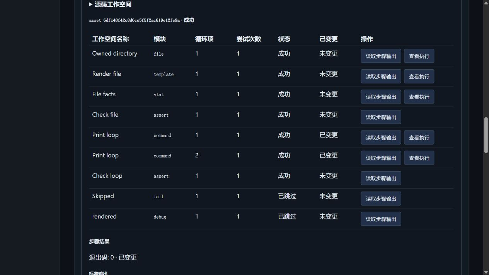
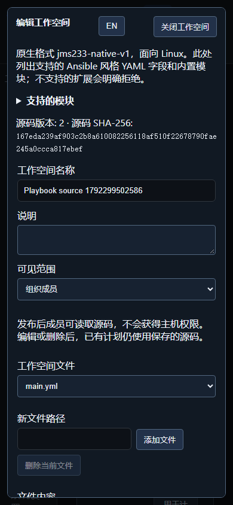
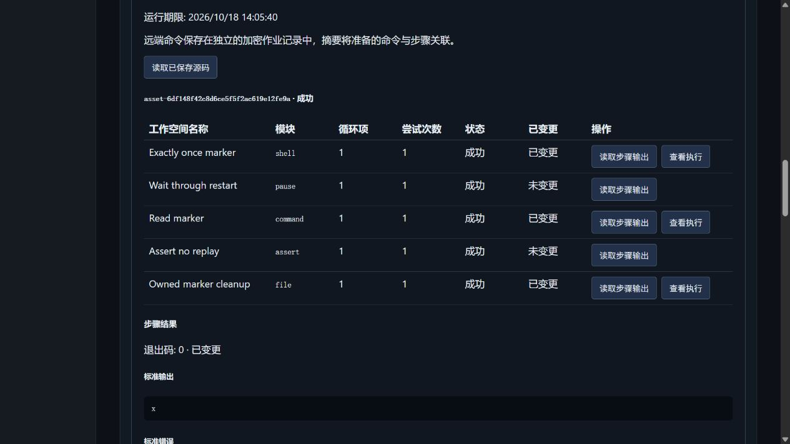

# Go 原生 Playbook

> 中文 | [English](./PLAYBOOKS.en.md)

工作台 `/workbench`、Ops CLI 和 SDK 共用带版本的 YAML 工作空间、计划源文件快照及逐主机步骤审计。格式为 `jms233-native-v1`，控制器使用 Go，远端通过现有 SSH 连接执行 Linux 工具。单机优先，状态沿用组织加密存储及 PostgreSQL 单活接管。

2026-10-18，隔离 Docker 中真实 OpenSSH 手动重跑：文件模块幂等、循环、跳过及步骤输出。



同次验证的中文 390px 工作空间编辑器：



同日实际重启生产 API 容器后的运行：原步骤作业 ID 保留，远端标记只追加一次，五步成功并清理自有文件。



竞品始终是 [JumpServer 企业版](https://www.jumpserver.org/enterprise.html)。其[作业管理](https://docs.fit2cloud.com/jumpserver/manual/user/workbench/job_center/jobs_management/)和[模板管理](https://docs.fit2cloud.com/jumpserver/v4/manual/admin/workbench/job_center/templates_management/)用于功能参考。本模块实现有明确边界的原生编排；完整 Ansible、企业版整体和生产多活仍在进行。

## 工作流

1. 打开“Playbook 工作空间”，新建工作空间并编辑 `main.yml`；可增加相对路径文件、任务文件和模板。验证只解析源码，不执行命令。
2. 保存工作空间，选择为计划来源，指定目标、JSON 变量、步骤超时和整次运行截止秒数。立即、一次性、间隔、cron 共用[日历调度](./SCHEDULING.md)。
3. 运行详情显示每台主机的任务、循环序号、尝试次数、变化状态、复核及失败原因；可读取已保存源码和单独授权的步骤输出。
4. 手动“立即运行”创建独立运行，原计划的下次时间不变；请求 ID 去重，同计划存在活动运行时拒绝重叠。后续编辑或删除工作空间不改变旧计划和运行。

```yaml
- hosts: all
  vars:
    message: ready
  tasks:
    - name: Print
      command:
        argv: [printf, '%s', '{{ message }}']
      register: health
    - name: Check
      assert:
        that: health.stdout == message
```

## 支持范围

| 项目 | 原生约定 |
| --- | --- |
| 文件 | 最多 32 个、单文件 16 KiB、总计 64 KiB，UTF-8，必须含 `main.yml`；不解压远端文件包 |
| Plays | 最多 8 个，`hosts: all` 或 `*`，目标来自计划；`pre_tasks/tasks/post_tasks/handlers` |
| 模块 | `shell/command/copy/template/file/service/systemd_service/package/user/stat/assert/debug/set_fact/pause/setup/fail`；支持相应 `ansible.builtin.` 前缀和 `systemd` 别名 |
| 模块工具 | shell 使用 `/bin/sh` 或 `/bin/bash`；文件使用常见 GNU/BusyBox 工具；service 使用 systemctl；package 选择 apt/apk/dnf/yum；user 需要 useradd/usermod/userdel/getent |
| 导入 | `include_tasks/import_tasks` 限工作空间相对路径，递归最多 8 层，无循环；继承变量、when、become、timeout、ignore_errors |
| 变量 | play/task vars、计划额外变量、inventory_hostname、jms_asset_id、item、register、set_fact 和 setup facts；额外变量优先 |
| 插值 | `{{ variable.path }}`、数组下标、quote/default/upper/lower/trim/string/int/bool/length/join/from_json/to_json/basename/dirname；整值插值保留 JSON 类型 |
| 条件 | and/or/not、比较、in/not in、is defined/undefined/failed/succeeded/skipped/changed；条件列表按且组合 |
| 循环 | 最多 50 项；空循环跳过；register 收集 results；每台主机顺序推进，主机之间独立推进 |
| 重试 | until；retries 1–5，为初次之外的尝试次数，省略时 3；delay 1–60 秒；只重试结果明确的任务 |
| 错误 | changed_when/failed_when、ignore_errors；传输失败、审批拒绝、超时及未知领取结果不能被忽略或重试为成功 |
| handlers | changed 任务通过 notify 触发同 play 的具名 handler；未通知的 handler 跳过 |
| 提权 | 显式 become、become_user，使用 sudo -n；不收集或返回 sudo/SSH 密码 |
| 上限 | 最多 64 个任务、每主机 128 次展开尝试、每运行预留 2000 步、保留运行总预留 20000 步；现有 8 全局/2 用户作业并发限制不变 |

不支持控制器文件/环境 lookup、任意 Jinja 执行、第三方 collection/role、delegate_to、动态 inventory、Windows 模块、check_mode:true、完整 Ansible 兼容或跨主机线性屏障。不支持的 YAML 字段或模块拒绝保存。模块参数和依赖的远端工具在实际准备/执行时再次校验。文件模式必须写字符串，例如 `'0644'`。package latest、缓存刷新、服务 restart/reload 和 file touch 作为明确动作记为 changed。

## 权限与恢复

- 默认工作空间仅创建者可读写；组织发布需要 `playbooks.publish`。组织成员可读取发布源码，修改、删除和变更审计仍仅创建者可操作。发布不授予主机权限；不要把秘密写入共享源码或变量。
- 计划和运行依照所有者、`plans.view_all`、`plans.manage_all`；步骤输出另检查所有者或 `jobs.view_all`。普通运行 JSON 不返回控制器变量、待发命令和本地输出。远端命令及完整 stdout/stderr 保存在加密子作业中，注册变量最多使用各 4096 字节，并带截断标记。
- 每一步检查当前用户、组织、资产授权和访问策略；远端派发继续执行登录复核、命令规则及命令复核。生成的复合脚本在严格命令白名单下会被保守拒绝，不绕过过滤器。
- 先持久化领取，再以稳定请求 ID 提交子作业。重启发现已有作业时关联；找不到的未知领取标为 interrupted，不自动重放。运行截止、取消或撤权停止后续步骤并取消当前子作业，无法回滚已经发生的远端变化。
- 原有加密子作业热历史共享 1000 条上限，普通作业和 Playbook 子作业尚不自动归档；达到上限时步骤等待容量，运行截止仍生效。20000 步预留不是可执行远端作业数量的承诺；长期历史管理仍待完善。
- Operations 状态格式为 v4，可读 v1–v3；包含原生步骤的 Jobs 使用 v4，普通作业保持已有格式。旧服务不能读取新格式，降级需恢复兼容数据快照。工作空间最多 200，编译源快照最多 512/8 MiB，源码按摘要去重，未引用版本回收；变更审计最多 4000 条/一年。旧计划和运行引用的源码保留。

## API / CLI

工作空间 API 为 `/api/v1/ops/playbooks`，支持分页列表、创建、读取、带 revision 更新及删除；`/capabilities` 返回能力；`/validate` 接收 `{files:{...}}`；`/{id}/events` 返回创建者变更审计。验证错误提供安全的 issue code、file、line、column、field，不回显源码。

计划创建增加 `playbook_id`、`variables`、`playbook_timeout_seconds` 和现有 `timeout_seconds`，不能同时传 command/template_id。`POST /ops/plans/{id}/runs` 接收 `{request_id}`；`GET /ops/runs/{id}/program` 读取快照；`GET /ops/runs/{id}/steps/{asset}/{step}` 读取步骤结果。所有路径均在 `/api/v1` 下。

```powershell
# 使用已有平台身份环境；JSON 文件不包含 SSH 凭据。
go run ./cmd/jms ops validate --file workspace.json
go run ./cmd/jms ops playbook-create --file workspace-with-name.json
go run ./cmd/jms ops playbooks --offset 0 --limit 25
go run ./cmd/jms ops playbook <id>
go run ./cmd/jms ops playbook-update <id> --file workspace-with-revision.json
go run ./cmd/jms ops playbook-events <id>
go run ./cmd/jms ops create --file plan.json
go run ./cmd/jms ops trigger <plan-id> --request-id <unique-id>
go run ./cmd/jms ops program <run-id>
go run ./cmd/jms ops step <run-id> <asset-id> <step-id>
go run ./cmd/jms ops playbook-delete <id> --revision <n>
```

实现、测试代码与文档统一完成后运行验证；当前批次实际结果见[自动化验证](./TESTING.md)，不将源码存在视为验收通过。
