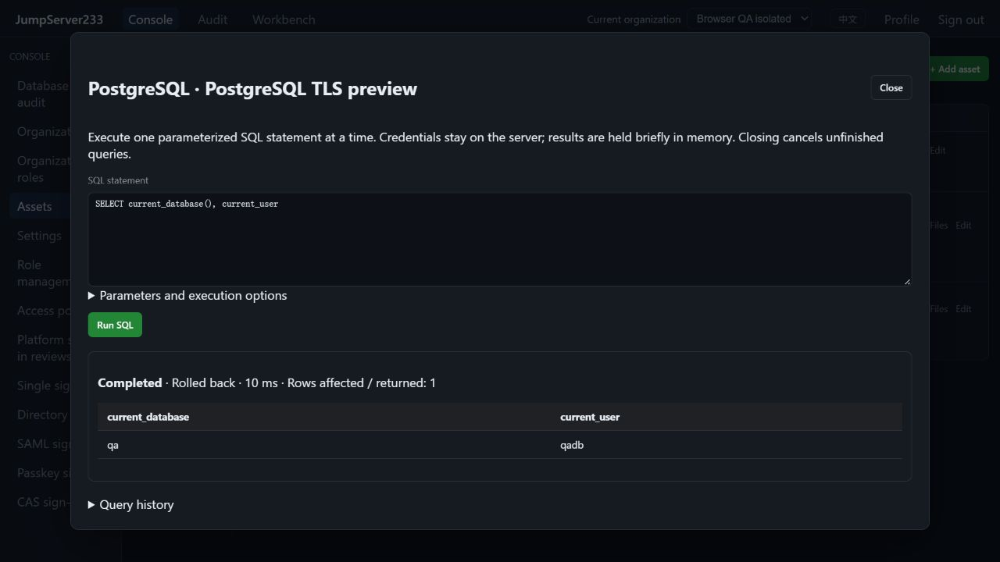

# PostgreSQL database access

> English | [中文](./POSTGRESQL.md)

The shared SQL console and authorization/audit layer also support [MySQL/MariaDB](./MYSQL.en.md), selecting parameters and transaction semantics from the server-owned asset protocol.

The inventory supports native PostgreSQL. The browser SQL console and `jms db` share server authorization, the credential vault and query auditing. Single-node deployment is preferred; configuration and audit indexes also support the existing PostgreSQL active/standby storage.

Real local PostgreSQL TLS query acceptance, 2026-10-16: database identity and read-only rollback.



## Configuration and use

1. Add an asset with protocol PostgreSQL, host, port (5432 by default), database, account and a write-only password.
2. TLS defaults to `verify-full`, checking the certificate and hostname. An optional certificate hostname and public CA PEM are supported. Disabling TLS is an explicit choice. Ambient PostgreSQL service, password files, client certificates and connection options are ignored.
3. Assets default to read-only transactions. Write-enabled assets still default to a read-only query; each write requires clearing the per-query read-only option.
4. An optional SSH route supports up to three gateways with individually pinned host keys. PostgreSQL certificate validation remains active over the tunnel.
5. Connect, enter one SQL statement, and bind `$1`, `$2`, etc. with a JSON array. The result table distinguishes SQL NULL. Closing the console closes the logical session and cancels unfinished work.

```bash
export JMS_SERVER_URL=https://console.example.com
# Use an existing platform JMS_TOKEN or JMS_ACCESS_KEY_ID/JMS_ACCESS_KEY_SECRET.
# Optional JMS_ORG_ID selects an organization; no database password is needed.
printf 'SELECT $1::text AS message' | jms db ASSET_ID --params '["hello"]'
jms db ASSET_ID --write --timeout 30 --rows 500 < migration.sql
```

CLI output is JSON. `--write` remains constrained by the asset's read-only policy. Waiting for login or SQL approval never bypasses authorization.

## Authorization, transactions and limits

- An asset/node `connect` grant or `assets.connect_all` is required. Current user, organization membership, source/time/`database` channel, asset and gateway policies are checked at submission, dispatch, during execution and before commit.
- Login review uses the separate `database` action. Its one-time approval cannot open SSH/SFTP. SQL uses command-filter allow/deny/review rules against the original statement, without expanding bound parameters. These rules are not a complete SQL semantic analyzer.
- Logical sessions last 30 minutes and stay in memory. Limits are 4 concurrent executions, 20 unfinished jobs and 1000 history entries. Reviews expire after 5 minutes. Defaults are 500 rows/30 seconds, configurable to 1–10000 rows and 1–300 seconds.
- Each query uses a separate connection and a server-managed transaction. Read-only queries roll back before returning; successful writes commit. Transaction control, session settings, prepared statements and COPY are rejected. The driver's extended query protocol accepts one statement. See [PostgreSQL parameter execution](https://www.postgresql.org/docs/current/libpq-exec.html) and [read-only transactions](https://www.postgresql.org/docs/current/sql-set-transaction.html).
- Exceeding row, cell-count or total result limits cancels the connection and rolls back: at most 50000 cells and 1 MiB of text values. Individual fields show at most 8192 bytes and are marked truncated. Protocol messages are capped at 1 MiB. Timeouts, cancellation and authorization revocation also terminate the transaction.
- Outcomes distinguish not started, rolled back, committed and unknown. Disconnects during commit can leave the outcome unknown; reconcile manually and never retry writes automatically. Use minimally privileged database accounts. SQL filters and read-only transactions do not replace database privileges.

## Audit and HA

Long-term audit retains operator, asset/database, parameter count, keyed fingerprint, redacted SQL, reviewer, timing, SQLSTATE and transaction outcome. Literals and comments are omitted. Parameter values, database error messages, result rows and column names/types are excluded. Original pending SQL and parameters are encrypted only while queued/under review and removed on completion/recovery. Audit storage uses a separate AEAD envelope.

Result rows stay in process memory for at most 15 minutes and the latest 16 queries. Only the owning operator with current authorization can retrieve them. `database.audit.view_all` reads other operators' metadata; `database.cancel_all` cancels other operators' queries. SQL review uses `reviews.command.manage`.

Reconnect after process takeover. Completed metadata survives, but result rows disappear. Unfinished queries are cancelled or marked interrupted. Uncertain writes are never replayed automatically. Current HA is active/standby; query sessions do not migrate between simultaneously active nodes.

Oracle/DB2/DM, automatic database password rotation, native SQL terminals, persistent transactions across queries, result export and full Enterprise database parity remain open. See [verification](./TESTING.en.md) and the [roadmap](./PLAN.en.md).
