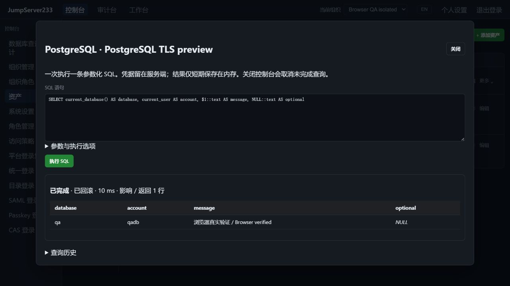

# PostgreSQL 数据库访问

> 中文 | [English](./POSTGRESQL.en.md)

SQL 控制台与授权审计层也支持 [MySQL/MariaDB](./MYSQL.md)，按服务端资产协议选择参数与事务语义。

资产清单支持原生 PostgreSQL。浏览器 SQL 控制台和 `jms db` 共用服务端授权、凭据保管库与查询审计。单机优先；配置和审计索引可以使用现有 PostgreSQL 单活热备存储。

2026-10-16 本机真实 PostgreSQL TLS 查询验收：绑定参数、SQL NULL 和只读回滚。



## 配置和操作

1. 添加资产，协议选择 PostgreSQL，填写主机、端口（默认 5432）、数据库、账号和只写密码。
2. 默认 TLS `verify-full`，校验证书及主机名。可填写证书主机名和公有 CA PEM；禁用 TLS 需要显式选择。服务端不使用环境中的 PostgreSQL service、密码文件、客户端证书或连接选项。
3. 默认启用“仅允许只读事务”。允许写入的资产仍默认以只读方式查询；每次写入需要取消本次只读选项。
4. 可选择最多三跳的 SSH 网关，逐跳固定校验主机密钥，最终 PostgreSQL TLS 仍校验证书。
5. 连接后输入一条 SQL，通过 JSON 数组绑定 `$1`、`$2` 等参数。结果表支持 SQL NULL。关闭控制台会关闭逻辑会话，并取消未完成工作。

```bash
export JMS_SERVER_URL=https://console.example.com
# 使用已有平台身份 JMS_TOKEN 或 JMS_ACCESS_KEY_ID/JMS_ACCESS_KEY_SECRET
# JMS_ORG_ID 可选，选择组织；无需数据库密码
printf 'SELECT $1::text AS message' | jms db ASSET_ID --params '["hello"]'
jms db ASSET_ID --write --timeout 30 --rows 500 < migration.sql
```

CLI 输出 JSON。`--write` 仍受资产只读策略约束；等待登录复核和 SQL 复核期间不绕过授权。

## 权限、事务与限制

- `connect` 资产/节点授权或 `assets.connect_all` 才能连接和执行。当前用户、组织成员、来源/时段/`database` 通道、资产及网关访问策略在提交、派发、执行中和提交事务前重新检查。
- 登录复核使用独立 `database` 动作，一次性许可不能用于 SSH/SFTP。SQL 复用命令过滤器的 allow/deny/review；规则匹配原始 SQL，不展开绑定参数，不是完整 SQL 语义分析器。
- 逻辑会话 30 分钟，仅存内存。查询最多 4 个同时执行、20 个未结束任务和 1000 条历史；复核 5 分钟过期。默认 500 行/30 秒，可设 1–10000 行和 1–300 秒。
- 每次查询使用独立连接和服务端管理的事务。只读查询在返回前回滚；写查询成功才提交。禁止自行控制事务、会话设置、预备语句和 COPY；驱动的扩展查询协议只接受一条语句。[PostgreSQL 参数接口](https://www.postgresql.org/docs/current/libpq-exec.html)、[事务只读语义](https://www.postgresql.org/docs/current/sql-set-transaction.html)。
- 行/单元格总数或总结果超过限制会取消连接并回滚：最多 50000 个单元格、1 MiB 文本值；单个字段只显示前 8192 字节并标注截断。协议消息最大 1 MiB。服务端超时、客户端取消、授权撤销也会终止事务。
- 事务状态明确区分未开始、回滚、已提交和未知。提交期间断连可能产生未知结果，必须人工核对，禁止自动重试写入。使用最小权限数据库账号；SQL 过滤和只读事务不替代数据库自身权限。

## 审计和 HA

长期审计保存操作人、资产/数据库、参数个数、键控指纹、脱敏语句、复核人、时间、SQLSTATE 和事务结果。字面量及注释被省略；不保存参数值、数据库报错正文、结果行及列名/类型。完整待执行 SQL 与参数仅在排队/复核期间加密持久化，结束或恢复时清除。审计文件采用独立 AEAD 加密。

结果行仅在当前进程内存保存最多 15 分钟及最近 16 次查询，只有所属操作人且当前仍获授权才能读取。`database.audit.view_all` 允许跨操作人读取元数据；`database.cancel_all` 允许取消其他操作人的查询。SQL 复核权限沿用 `reviews.command.manage`。

切换进程后需要重新连接。已完成审计保留，结果行消失。未结束查询被取消或标记中断，提交结果不明确时不自动重放。当前为单活热备，不支持多活查询会话迁移。

尚未提供 Oracle/DB2/达梦、数据库密码自动轮换、原生 SQL 终端、跨查询持久事务、结果导出和完整企业版数据库功能。验收结果见 [自动化验证](./TESTING.md)，总体差距见 [PLAN](./PLAN.md)。
