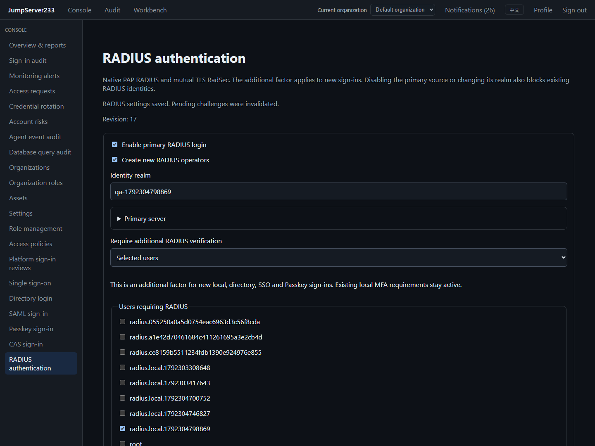
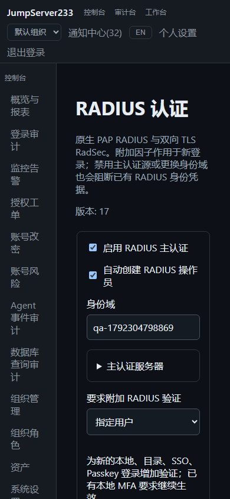

# RADIUS sign-in and additional verification

> English | [中文](./RADIUS.md)

Native Go PAP RADIUS supports primary identity sign-in, multiple Access-Challenge rounds and an additional RADIUS factor. Global `security.manage` controls `/console/radius`. The competitor is [JumpServer Enterprise](https://www.jumpserver.org/enterprise.html); overall parity remains in progress. This document describes the implemented authentication boundary.

## Configuration

1. Prefer RadSec: host, port (2083 by default), verified server name, CA, client certificate and private key. TLS 1.2+ requires mutual authentication; certificate verification cannot be disabled. The RadSec protocol shared value is fixed by RFC 6614.
2. Legacy UDP (1812 by default) requires explicit opt-in and a 16–256 byte shared secret. PAP password hiding does not replace transport encryption. Requests and replies require Message-Authenticator; Response Authenticator is verified too. Older servers without these protections cannot authenticate.
3. Primary sign-in can be enabled independently, using administrator prepared identities or automatic operator provisioning. Realm + subject define the exact identity. Matching local administrator names never link or promote accounts.
4. The additional factor can target nobody, everyone, administrators/delegated system roles or selected users. A separate endpoint is supported. Local names are the default remote names; other identity sources need explicit mappings. Verified primary RADIUS identities map automatically.

   The additional endpoint must validate an independent OTP, push approval or other factor in RADIUS. Checking the same primary password twice is not an independent factor.
5. Saves require the current revision and invalidate pending authentication. Secrets are write only; blank retains them and explicit clear removes them. A probe returns only an authenticated response code, without completing challenges or signing in.

## Sign-in order and recovery

New local, LDAP, OIDC, SAML, CAS, Passkey and RADIUS logins share source policy, additional RADIUS, platform sign-in approval and audit commit before receiving a session. Existing TOTP/enrollment rules remain enforced before the additional factor. For password plus RADIUS alone, leave the local TOTP policy disabled. The additional-factor policy does not revoke standing sessions. Disabling primary RADIUS or changing its realm blocks credentials belonging to existing RADIUS identities.

If the server supports it, an empty response can request a challenge before submitting the code. Switching the interface to UDP clears public TLS certificate fields. Supply certificates again when returning to TLS; saved private keys follow their retain/clear settings.

Browser challenges use HttpOnly, SameSite=Lax cookies scoped to authentication paths. Responses do not expose the final token. Other clients receive one-use capabilities that cannot access assets. Capabilities bind the source IP, expire within five minutes and allow at most four challenge rounds and five verifications. The encrypted store holds at most 4096 flows, five active flows per identity and eight concurrent remote requests.

The service persists `verifying` before each remote request and persists consumption before resuming a session. Network errors, crashes and failed writes with uncertain outcomes require a fresh sign-in; codes are never automatically replayed. Pending challenges survive standalone restart and PostgreSQL single-active takeover. In-memory primary completion tickets and local MFA setup tickets expire on restart. Completion rechecks configuration, source, credentials, user state and reviewer permissions. Production HA failure drills still require deployment-specific acceptance.

## API, SDK and CLI

- Administration: `GET/PUT /api/v1/settings/security/radius`; `GET .../audit?offset=0&limit=25`; `POST .../check`; `GET .../users` returns only mapping IDs/names; `POST .../users` (subject, optional username, operator only).
- Primary: `POST /api/v1/authentication/radius/login` → repeat `/challenge` when required → `/complete`. Browser mode sends `X-JMS-Browser-Session: cookie`; other clients submit the returned `challenge_token` or `pending_token`.
- Additional factor: after a 202 `radius_factor_required`, submit `response` and the nonbrowser `factor_token` to `POST /api/v1/authentication/factor/complete`. Further challenges use the same path. `/cancel` cancels the flow.
- Go SDK: `Client.Authentication`, `RadiusSettings`, `SaveRadiusSettings`, `RadiusAudit`, `ProbeRadius`.
- CLI: `jms auth login|radius-login --state-file PATH --file -`, with JSON on stdin. Continue using `jms auth continue --state-file PATH --file -` and the requested response/otp fields. Retry later while approval is pending. `jms auth status --state-file PATH` reports the next step. Once authenticated, set `JMS_TOKEN_FILE=PATH` for existing SSH and job commands.
- Administration CLI: `jms auth radius-settings|radius-save|radius-audit|radius-check`, using existing platform tokens, token files or AccessKeys.

CLI state contains required capabilities, MFA enrollment material and the final platform session. Input passwords/codes are never retained and capabilities never print to stdout. State binds the exact server URL, uses atomic replacement and POSIX mode 0600. On Windows, use a directory ACL readable only by the current user. Treat it as sensitive authentication data and remove it when no longer needed; never commit it. Enrollment secrets are not printed in status output; a trusted local client reads the protected file when enrollment is needed.

## Validation and protocol boundaries

Automation includes Testify protocol/core/API/SDK/CLI cases, actual FreeRADIUS UDP and mutual TLS, browser challenge reload, additional factors, permissions, English desktop/Chinese mobile views and authenticated real SSH CLI. The full Playwright environment starts an owned FreeRADIUS container for `web/e2e/radius.spec.ts`, exposing only loopback ports. Identities are synthetic and private keys are excluded from reports. Execution results are recorded in [Testing](./TESTING.en.md).

The implementation follows [RFC 2865](https://www.rfc-editor.org/rfc/rfc2865.html), [RFC 3579](https://www.rfc-editor.org/rfc/rfc3579.html) and [RFC 6614](https://www.rfc-editor.org/rfc/rfc6614.html). EAP, MS-CHAP, RADIUS 1.1, accounting, complete remote role mapping and active/active challenge consumption remain outside the implemented boundary.

## Actual interface (2026-10-18)

English desktop and Chinese 390px mobile screenshots come from isolated Docker verification with actual mutual TLS FreeRADIUS.

