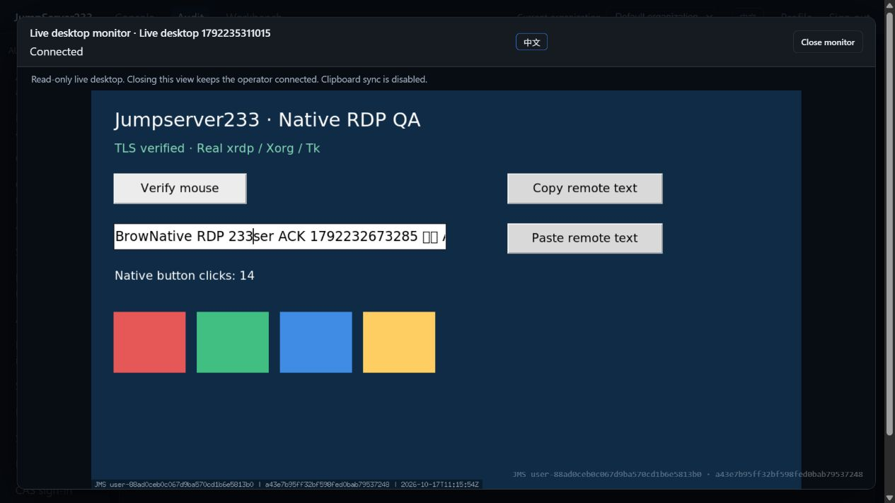

# Read-only live RDP monitoring

> [中文](./RDP-LIVE-MONITOR.md) | English

The RDP audit section can display an operator's real live desktop without input controls. Closing the view preserves the source connection. Web and Agent CLI use platform identity without target SSH/RDP credentials. The competitor is [JumpServer Enterprise](https://www.jumpserver.org/enterprise.html); its [official whitepaper](https://fit2cloud.com/whitepaper/jumpserver-whitepaper_202307.pdf) lists live RDP session auditing. This slice delivers viewing and viewer activity; see [PLAN](./PLAN.en.md) for the full Enterprise objective.

## Use

1. An operator opens an RDP desktop from the asset inventory or CLI.
2. Refresh “Audit → RDP desktop audit” and select “Monitor live” on an active row. The viewer provides only the screen, connection status, language switch and close button.
3. “Desktop viewing activity” shows viewer identities and start/end times with refresh and pagination. Closing a viewer keeps the operator connected; ending the source disconnects all viewers.

CLI uses existing `JMS_SERVER_URL`, `JMS_TOKEN` or AccessKey and optional `JMS_ORG_ID`:

```powershell
cd server
go run ./cmd/jms rdp monitor <session-id> --capture C:\Temp\monitor-new.png --wait 2
```

`--capture` is required and exclusively creates a new file. `--wait` accepts 1–15 seconds. The command closes only its own viewer, never the operator's desktop. Monitoring rejects `--input` and never retries writes automatically.

## Authority and ongoing checks

- Operators can monitor their own live desktops. Viewing another user's desktop requires independent `audit.desktops.monitor_all`. Existing system administrators receive it through their administrator role; terminal-monitor, session-metadata and historical-replay roles do not acquire it automatically.
- Monitoring grants no independent asset connection, remote input, clipboard, historical replay or termination authority. Screen images themselves may contain sensitive information.
- Creation and attachment check current platform identity, organization membership, the RDP method, platform/organization access policies and policies on up to three gateway hops. Source must be known and match ticket creation. Active viewers continually recheck current permission plus the original operator's connection authority, credential revisions and time policies.
- Viewer permission/membership revocation closes only that viewer. The source retains its own ongoing checks. Viewing does not update the operator's last-input time or extend idle/maximum duration.
- `audit.replays.view_all` can read other users' ended/interrupted recordings. Foreign active frame requests return 404, preventing replay polling from bypassing live-view audit. Existing source-owner replay behavior remains.

## Protocol, audit and resource bounds

- `POST /api/v1/desktop-sessions/{id}/monitor` returns a 30-second one-use ticket. Hidden/ended sessions return 404; capacity exhaustion returns 429.
- `GET /ws/desktop/{id}/monitor` uses independent `jms233-desktop-monitor-v1` and `jms233-desktop-monitor-ticket.` subprotocols. Tickets never enter URLs; only SHA-256 hashes are retained in memory. They cannot attach to the source desktop. Existing `org` routing selects the organization.
- `ready` declares `read_only:true` and `clipboard:false`. Binary frames are an eight-byte big-endian sequence plus PNG. Any client application message closes that viewer; no path calls remote input or clipboard snapshots. WebSocket control frames never reach the target.
- Each organization Broker permits 16 viewers, with four per desktop. Pending tickets count toward capacity and release it on expiry. Viewers sample at most five frames per second, never queue obsolete frames and have a five-second write deadline.
- Operator and viewers reuse an immutable wire packet for a given frame sequence. Browsers retain one decode in progress and one replaceable latest frame. PNG header/dimensions are checked before decoding, with a maximum of 3840×2160; closed viewers dispose their bitmaps.
- Viewing starts only after an event is appended and synced to `<data-dir>/desktop-sessions/<id>/monitors.jsonl`. Failure refuses output. This is plaintext identity/time metadata with mode 0600, containing no tickets, credentials, clipboard or screen bytes; vault encryption covers the original graphical recording. An incomplete tail line prevents further append.
- A 16 MiB per-desktop viewing log refuses new starts, while existing viewers may still record exits. Disconnect frees transport and capacity before a best-effort end event. Storage failure or a crash may leave no end event; this does not establish that a viewer is still online.
- `GET /api/v1/desktop-sessions/{id}/monitor-events?offset=0&limit=20` returns newest-first pages with limits of 1–100. The source operator or `audit.sessions.view_all` can read it. Both scans use one append snapshot and memory retains only the requested page.

## Deployment and acceptance

Standalone is the default. PostgreSQL active/standby uses shared permission configuration, matching organization keys and a shared recording directory; viewer metadata persists in that directory. Live desktops, tickets and viewers remain process-local. Reconnect after takeover; sessions cannot migrate or replay input automatically. Active/active routing and production RDP failover exercises remain open.

Local production Docker acceptance on 2026-10-17 used real Debian/xrdp/Xorg/Tk. The in-app browser confirmed live operator clicks, uninterrupted language changes, source continuity after closing a viewer and persistent viewing activity. Automation also checks a viewer without asset connection grants, source/membership/role revocation, input rejection, real CLI PNG, capacity/audit failure and bounded decoding. See [Automated verification](./TESTING.en.md) for batch results. This does not establish real Windows NLA or all Enterprise high-definition desktop capabilities.



Named-user RDP sharing, collaborative control, complete continuous video, other graphical protocols and Windows compatibility remain open. See [RDP](./RDP.en.md) for source desktop capabilities and [Session collaboration](./SESSION-SHARING.en.md) for terminal sharing.
