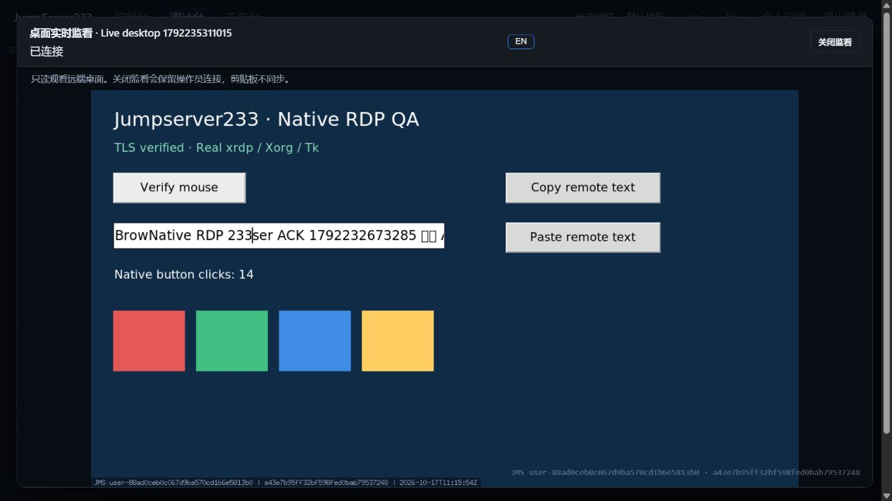
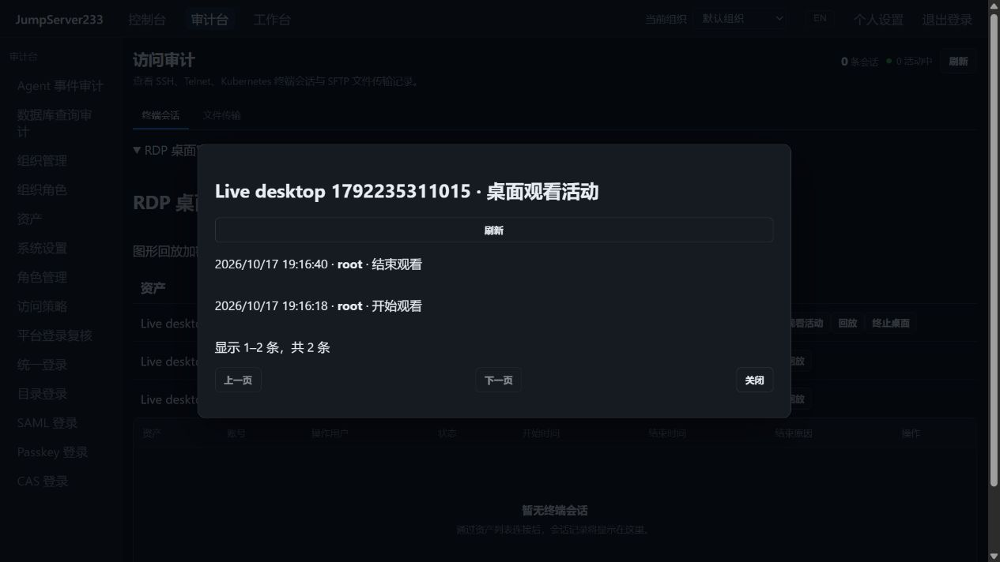

# RDP 实时只读监看

> 中文 | [English](./RDP-LIVE-MONITOR.en.md)

审计台的 RDP 桌面区域可只读观看当前操作员的真实桌面，关闭监看保留原连接。浏览器与 Agent CLI 共用平台身份，无需远端 SSH/RDP 凭据。竞品是 [JumpServer 企业版](https://www.jumpserver.org/enterprise.html)；其[官方白皮书](https://fit2cloud.com/whitepaper/jumpserver-whitepaper_202307.pdf)列出 RDP 在线会话审计。本切片交付实时观看与观看审计，完整企业版目标见 [PLAN](./PLAN.md)。

## 使用

1. 操作员通过资产页或 CLI 建立 RDP 桌面。
2. 在“审计台 → RDP 桌面审计”刷新，点击活动记录的“实时监看”。监看只有画面、连接状态、语言切换和关闭按钮。
3. “桌面观看活动”查看观看者及开始/结束时间，支持刷新和分页。关闭监看不会终止原桌面；原桌面结束时所有观看者断开。

CLI 使用既有 `JMS_SERVER_URL`、`JMS_TOKEN` 或 AccessKey 和可选 `JMS_ORG_ID`：

```powershell
cd server
go run ./cmd/jms rdp monitor <session-id> --capture C:\Temp\monitor-new.png --wait 2
```

`--capture` 必填，文件必须尚不存在，以排他方式创建；`--wait` 为 1–15 秒。命令只关闭自己的观看连接，不结束操作员桌面。监看拒绝 `--input`，不自动重试写操作。

## 权限和持续复查

- 操作员可以监看自己的活动桌面；观看他人的桌面需要独立 `audit.desktops.monitor_all`。系统管理员按现有管理员角色拥有该权限，既有终端监看、会话元数据或历史回放角色不会自动获得它。
- 监看权限不授予资产连接、远端键鼠、剪贴板、历史回放或终止他人会话的权限。桌面画面本身仍可能包含敏感信息。
- 申请及附加票据检查当前平台身份、组织成员、RDP 执行通道、平台/组织访问策略与最多三跳网关策略；来源必须可识别且与票据申请一致。活动期间持续复查当前观看权限以及原操作员连接授权、凭据修订和时间策略。
- 权限或组织成员撤销时只关闭观看者；原连接仍受其自身授权检查。监看不更新操作员的输入时间，不能延长空闲或最大时长。
- `audit.replays.view_all` 只允许读取已结束/中断的他人桌面画面；活动他人会话的帧接口返回 404，不能用循环读取历史帧绕过实时监看审计。原操作员的现有回放行为保留。

## 协议、审计与资源限制

- `POST /api/v1/desktop-sessions/{id}/monitor` 返回 30 秒一次性票据；不可见/已结束返回 404，容量已满返回 429。
- `GET /ws/desktop/{id}/monitor` 使用独立 `jms233-desktop-monitor-v1` 和 `jms233-desktop-monitor-ticket.` 子协议。票据不放入 URL，只在内存保留 SHA-256 摘要，不能作为原桌面票据使用。组织通过既有 `org` 参数选择。
- `ready` 明确 `read_only:true`、`clipboard:false`；二进制帧为 8 字节大端序号加 PNG。任何客户端应用消息均关闭该观看者，没有调用远端输入或剪贴板快照的路径。WebSocket 控制帧不转发远端。
- 每组织 Broker 最多 16 个观看者，每桌面最多 4 个，未消费票据也占容量并在过期时释放。观看最高每秒 5 帧；慢消费者不排队旧画面，写操作最多等 5 秒。
- 原操作员与观看者共用同序号的不可变 PNG 网络包；浏览器最多保留一个解码中的帧和一个最新待处理帧。解码前检查 PNG 头和最大 3840×2160 尺寸，断开/关闭后释放位图。
- 观看开始必须先追加并同步落盘到 `<data-dir>/desktop-sessions/<id>/monitors.jsonl`，失败即拒绝输出。日志为权限 0600 的明文身份/时间元数据，不存票据、凭据、剪贴板或画面；保管库加密只覆盖原图形录像。日志存在残缺尾行时拒绝继续追加。
- 每桌面观看日志达到 16 MiB 时拒绝新观看，已开始的观看仍可记录结束。断开先释放网络与容量，再尽力写结束事件；存储失败或进程崩溃可能缺少结束事件，不能据此认定观看仍在线。
- `GET /api/v1/desktop-sessions/{id}/monitor-events?offset=0&limit=20` 按最新事件优先分页，`limit` 为 1–100；原操作员或 `audit.sessions.view_all` 可读。两次扫描使用同一追加快照，内存只保留当前页。

## 部署与验收

默认单机。PostgreSQL 单活 HA 沿用共享权限配置、相同组织密钥与共享录像目录；观看元数据随目录持久化。在线桌面、票据与观看连接保留在当前进程，接管后重新建立，不能迁移或自动重放输入。多活路由、生产 RDP 故障演练仍待完成。

2026-10-17 本机生产 Docker、真实 Debian/xrdp/Xorg/Tk 桌面：内置浏览器确认操作员点击实时更新到观看页、中英文切换保持连接、关闭观看保留原连接及持久观看活动。自动化另检查无资产连接权限的观看者、来源/组织/角色撤销、只读注入拒绝、CLI 真实 PNG、容量/审计失败和解码队列。批次结果见 [自动化验证](./TESTING.md)。这不代表真实 Windows NLA 或全部企业高清桌面能力已经验收。





RDP 指定用户分享、协同控制、完整连续视频、其它图形协议和 Windows 兼容性仍在后续范围；原桌面能力见 [RDP](./RDP.md)，终端分享见 [会话协作](./SESSION-SHARING.md)。
