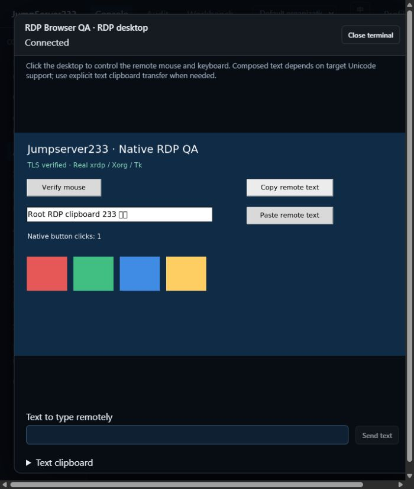
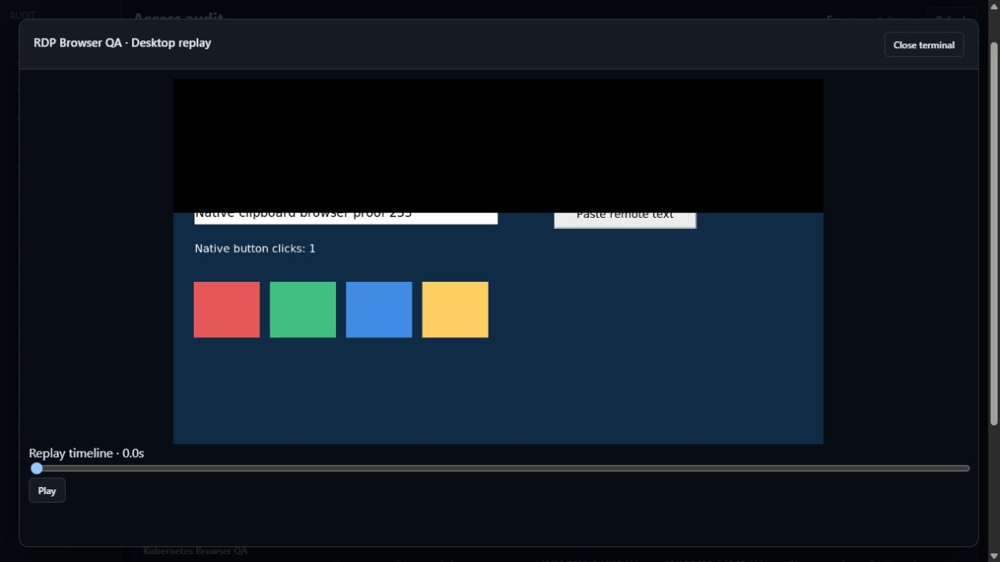

# RDP desktops

> [中文](./RDP.md) | English

Clipboard initialization advertises only formats actually available in this session; before explicit text submission, it sends an empty format list. Writes wait up to five seconds for the matching target Format List Response. Startup responses cannot acknowledge later writes. Unacknowledged, rejected or revoked data cannot answer target reads. A timeout disables further clipboard writes on that connection while the desktop may continue.

Ordering follows Microsoft's [initialization sequence](https://learn.microsoft.com/en-us/openspecs/windows_protocols/ms-rdpeclip/a5cae3c9-170c-4154-992d-9ac8a149cc7e) and [format synchronization/acknowledgement](https://learn.microsoft.com/en-us/openspecs/windows_protocols/ms-rdpeclip/887747ab-9bad-490f-8ddb-68c6365e58dd). The fixture records actual Copy/Paste counts and Tk paste failure state; success still requires exact remote text equality. Repeated fixture copies explicitly reclaim X11 CLIPBOARD ownership: [Tk](https://github.com/tcltk/tk/blob/core-8-6-branch/generic/tkClipboard.c) updates its own clipboard without another ownership event, while [xrdp observes XFixes ownership events](https://github.com/neutrinolabs/xrdp/blob/v0.9.21.1/sesman/chansrv/clipboard.c).

The server connects using a Go RDP protocol connector. A separate graphical channel delivers PNG desktops to the browser and accepts mouse and keyboard events. Agent CLI uses the same authorization path for input and capture. Remote credentials stay in the encrypted vault.

## Configuration and use

- Select RDP, normally port 3389 and 1280×720, up to 3840×2160.
- NLA/CredSSP is the default. Select TLS compatibility explicitly for targets that use TLS logon. Legacy unencrypted RDP and automatic NLA downgrade are prohibited.
- Certificate chain and server name verification are mandatory, with TLS 1.2 minimum. Import a private CA as PEM when needed; verification cannot be disabled.
- Supply a Windows domain separately or use `DOMAIN\user`. Up to three SSH gateway hops retain existing host fingerprint verification.
- Click the canvas to focus remote input. Send text uses RDP Unicode events; the target implementation determines supported characters. Targets without advertised Unicode support reject non-ASCII text while preserving the entry. Some system shortcuts may be intercepted locally by the browser.
- View only is enforced on the server for mouse, keyboard, text and clipboard writes. Clipboard defaults off. When enabled, transfers are explicit session text only; neither the server process nor operator computer system clipboard is read.
- An asset probe verifies negotiation and TLS, without proving account logon or desktop health.

Agent CLI retains `JMS_SERVER_URL`, `JMS_TOKEN`/AccessKey and optional `JMS_ORG_ID`; it needs no remote credential:

```powershell
go run ./cmd/jms rdp <asset-id> --capture C:\Temp\desktop-new.png --wait 2
go run ./cmd/jms rdp <asset-id> --capture C:\Temp\desktop-after.png --input C:\Temp\events.json
```

Capture files must not already exist. `--wait` is the settling period before input (1–15 seconds); another second is allowed after input. Operations are never automatically retried. Inspect the captured desktop and target state before deciding the next action. Input files are JSON arrays bounded to 1000 events and 128 KiB, supporting `key`, `text`, `pointer` and explicit clipboard actions.

## Authorization and audit

View permission cannot connect. A connection requires an asset connect grant or the existing global permission, with ongoing checks for identity, organization membership, source, time, target and gateway credential revisions. RDP login review is independent of SSH, Telnet, database and Kubernetes reviews.

Method policies add `rdp`, `rdp_input`, `rdp_clipboard_read` and `rdp_clipboard_write`. Checks run before/after connection, on attachment, before input and throughout the session. Terminal command expressions cannot inspect graphical actions. Use least-privileged remote accounts, view-only access and graphical recordings.

Desktops use `jms233-desktop-v1` with a 30-second single-use ticket carried in a subprotocol. Each binary frame contains an 8-byte big-endian sequence followed by PNG. Terminal frames and `replay.json.gz` remain compatible. Live output is capped at ten frames per second, recording at two: these are sampled images and do not preserve every instant.

Recordings live in `<data-dir>/desktop-sessions/<id>/`. Frames use a session-derived key and AES-GCM, authenticating index, time and dimensions. The index retains operator identity and input counts, without storing typed text, key contents or clipboard contents as input logs. Screen images may themselves contain sensitive information. Recording failure or limits close the connection. Sessions retain limits of 14400 frames and 256 MiB, with 16 live desktops per process. Idle time, maximum duration and server-rendered watermarks follow [interactive session security](./SESSION-SECURITY.en.md).

The audit page has a separate RDP section. Operators see only their own sessions and replays. Global session metadata, historical replay and termination permissions remain distinct. Another user's active screen requires independent `audit.desktops.monitor_all` through [live RDP monitoring](./RDP-LIVE-MONITOR.en.md); historical replay authority cannot read that active screen. Unauthorized IDs return 404. Ended recordings remain accessible to their owner after an asset grant is revoked, while platform identity must remain valid.

## Standalone and cluster boundaries

Standalone remains the default. Organization configuration uses existing scoped storage; desktops join per-organization and process shutdown. Single-active HA requires shared recordings and consistent organization keys for historical frames. Live desktops and tickets belong to their creating node and require reconnection after takeover. Input is never automatically replayed. Historical active records absent from the process appear interrupted.

RDP production failover drills, multi-active routing and session migration still await acceptance. This does not establish production RDP HA.

## Verification and remaining work

Native QA uses isolated Docker Debian xrdp/Xorg/Openbox/Tk. Target state files verify real clicks, focus and keyboard text, and captures come from protocol output. Fixtures bind loopback and use synthetic accounts.

Local xrdp 0.9.21.1 advertises Unicode input but ignores directly typed Chinese. Explicit text clipboard transfer of Chinese is verified. Capability declarations do not establish actual character delivery. The [upstream Unicode input issue](https://github.com/neutrinolabs/xrdp/issues/1990) documents this target compatibility class.

Testify, protocol boundaries, recording authentication, browser automation and CLI coverage are included. Consolidated results belong in [Testing](./TESTING.en.md). Local two-node tests verify live closure, old ticket rejection, shared encrypted history and a real desktop connection after takeover; production drills remain open.

Local browser acceptance, 2026-10-16: a real xrdp/Xorg desktop, with target state confirming mouse, Unicode text and explicit two-way text clipboard. Graphical replay comes from encrypted recordings.





Real Windows NLA, domain policies, Windows Server licensing and production display compatibility remain unverified. Drive/files, audio, printers, smart cards, RemoteApp, video/H.264, dynamic resolution, multiple monitors and full Enterprise high-definition parity remain open. The local mouse cursor does not represent every remote cursor shape. Linux xrdp acceptance does not establish Windows production acceptance.
