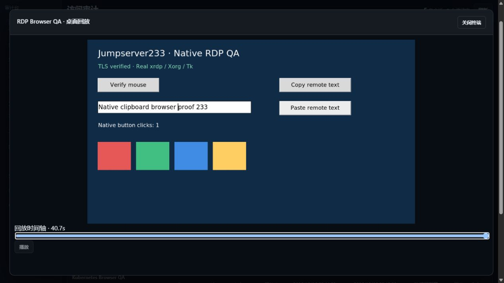

# RDP 远程桌面

> 中文 | [English](./RDP.en.md)

RDP 使用服务端 Go 协议连接器，浏览器通过独立图形通道接收 PNG 桌面和发送键鼠事件。Agent CLI 可以在同一授权链路下操作和截图。远端账号密码只从加密保管库读取。

## 配置与使用

- 资产协议选择 RDP，默认端口 3389、1280×720，最大 3840×2160。
- 默认 NLA/CredSSP；仅在目标明确使用 TLS 登录时选择 TLS 兼容模式。禁止传统明文 RDP，禁止 NLA 自动降级。
- 始终验证服务端证书链和名称，最低 TLS 1.2。私有 CA 可以通过 PEM 配置；不能关闭证书校验。
- Windows 域可单独填写，也可在账号中使用 `DOMAIN\user`。最多三跳 SSH 网关使用既有逐跳指纹校验。
- 点开桌面后点击画面获得键鼠焦点。“发送文字”使用 RDP Unicode 事件，实际文字范围依赖目标实现；未声明 Unicode 支持的目标会拒绝非 ASCII 文字并保留输入。系统快捷键是否被本机拦截取决于浏览器。
- “仅查看”在服务端禁止键鼠、文字及剪贴板写入。剪贴板默认关闭；启用后仅支持当前会话的显式文本传输，不读取服务端进程或操作者电脑的系统剪贴板。
- 剪贴板初始化仅声明当前实际存在的格式；用户尚未提交文本时发送空格式列表。写入需等待目标对应的 Format List Response（最多 5 秒）后才返回成功，启动响应不能误确认后续写入。未确认、拒绝或撤权的数据不能响应目标读取；超时后本次连接停止接受剪贴板写入，桌面仍可继续。
- 资产探测仅证明 RDP 安全模式和 TLS 证书可用，不证明远端账号登录或桌面正常。

Agent CLI 继续使用 `JMS_SERVER_URL`、`JMS_TOKEN`/AccessKey 和可选 `JMS_ORG_ID`，无需远端凭据：

```powershell
go run ./cmd/jms rdp <asset-id> --capture C:\Temp\desktop-new.png --wait 2
go run ./cmd/jms rdp <asset-id> --capture C:\Temp\desktop-after.png --input C:\Temp\events.json
```

截图文件必须尚不存在。`--wait` 为输入前的稳定等待秒数（1–15），输入后额外等待一秒采集结果。操作不会自动重试；应先检查画面和目标状态，再决定下一步。事件文件是最多 1000 项、128 KiB 的 JSON 数组，支持 `key`、`text`、`pointer`、显式剪贴板操作。

## 授权与审计

`view` 权限不能连接桌面。连接需要资产 `connect` 授权或现有全局连接权限，并持续检查身份、组织成员资格、来源、时段、目标及网关的凭据修订。独立 RDP 登录审批不能复用 SSH、Telnet、数据库或 Kubernetes 审批。

执行通道策略新增 `rdp`、`rdp_input`、`rdp_clipboard_read`、`rdp_clipboard_write`。连接前后、WebSocket 附加、输入前及会话期间都检查策略。图形操作无法通过终端命令正则检查；应使用最小权限远端账号、只读桌面和图形录像。

桌面使用 `jms233-desktop-v1`，30 秒一次性票据通过子协议传递。每帧为 8 字节大端序号加 PNG；不会改变终端帧和 `replay.json.gz` 的兼容性。在线图形流最高每秒十帧，录像最高每秒两帧；这是一组采样画面，不承诺保存每个瞬间。

录像写入 `<data-dir>/desktop-sessions/<id>/`，每帧通过会话派生密钥和 AES-GCM 加密，帧序号、时间和尺寸进入认证数据。索引保存操作者身份及输入事件数，不保存键入文本、按键内容或剪贴板内容；桌面画面本身仍可能包含敏感信息。录制失败或达到上限会关闭连接。每会话最多 14400 帧、256 MiB，每进程最多 16 个桌面会话；空闲、最大时长和服务端画面水印由[交互会话安全](./SESSION-SECURITY.md)配置。

桌面审计位于审计页的 RDP 区域。普通操作者只看到自己的记录和回放；现有会话元数据、历史录像及终止他人会话权限分别控制全局访问。活动他人画面必须走独立 `audit.desktops.monitor_all` 授权的[RDP 实时监看](./RDP-LIVE-MONITOR.md)，历史回放权限不能读取活动他人画面。未授权会话 ID 返回 404。已结束录像不受随后撤销资产授权影响，但平台身份仍需有效。

## 单机与集群边界

默认单机；组织配置使用既有存储隔离，图形会话接入各组织和进程的关闭流程。单活 HA 需要共享录像目录和一致的组织密钥，历史画面可以读取；在线桌面和一次性票据仅属于创建它们的节点，切换后必须重新连接。不会自动重放键鼠输入。进程中不存在的历史活动记录显示为中断。

RDP 专项生产故障演练、多活路由及会话迁移仍待验收；不能据此宣称生产 RDP HA 已完成。

## 验证范围与待完成项

原生 QA 使用独立 Docker Debian xrdp/Xorg/Openbox/Tk 桌面；目标程序状态文件用于核对真实鼠标点击、焦点和键盘文字，截图来自协议画面。测试资源只绑定回环地址，使用合成账号。

本机 xrdp 0.9.21.1 虽声明 Unicode 输入，仍会忽略直接键入的中文；中文通过显式文本剪贴板已验证。不能用能力声明代替实际文字输入验证。[上游 Unicode 输入问题](https://github.com/neutrinolabs/xrdp/issues/1990) 记录了这类目标兼容性问题。

剪贴板时序遵循 Microsoft 的 [初始化序列](https://learn.microsoft.com/en-us/openspecs/windows_protocols/ms-rdpeclip/a5cae3c9-170c-4154-992d-9ac8a149cc7e) 和 [格式同步及确认](https://learn.microsoft.com/en-us/openspecs/windows_protocols/ms-rdpeclip/887747ab-9bad-490f-8ddb-68c6365e58dd)。夹具另记录实际 Copy/Paste 按钮次数与 Tk 粘贴失败状态，仍以远端文字精确相等作为成功条件。重复复制前显式重新取得 X11 CLIPBOARD 选择所有权；[Tk 的实现](https://github.com/tcltk/tk/blob/core-8-6-branch/generic/tkClipboard.c)在已拥有剪贴板时只更新内容，不重新触发 [xrdp 所依赖的 XFixes 所有权事件](https://github.com/neutrinolabs/xrdp/blob/v0.9.21.1/sesman/chansrv/clipboard.c)。

已加入 Testify、协议边界与录像认证测试、浏览器自动化和 CLI 链路。统一测试结果记录在 [自动化验证](./TESTING.md)。本地双节点用例验证在线桌面在切换时关闭、旧票据失效、共享加密历史画面可读取，以及接管后重新建立真实桌面；生产故障演练仍待完成。

2026-10-16 本机浏览器实测：真实 xrdp/Xorg 桌面，鼠标、Unicode 文字与双向显式文本剪贴板均由远端程序状态确认，图形回放来自加密录像。




实际 Windows NLA、域策略、Windows Server 授权和生产显示兼容性尚未验收。驱动器、文件、音频、打印机、智能卡、RemoteApp、视频/H.264、动态分辨率、多显示器和完整企业版高清桌面能力仍待实现。当前本机鼠标指针不反映所有远端指针形状。不能把 Linux xrdp 验证等同 Windows 生产验证。
