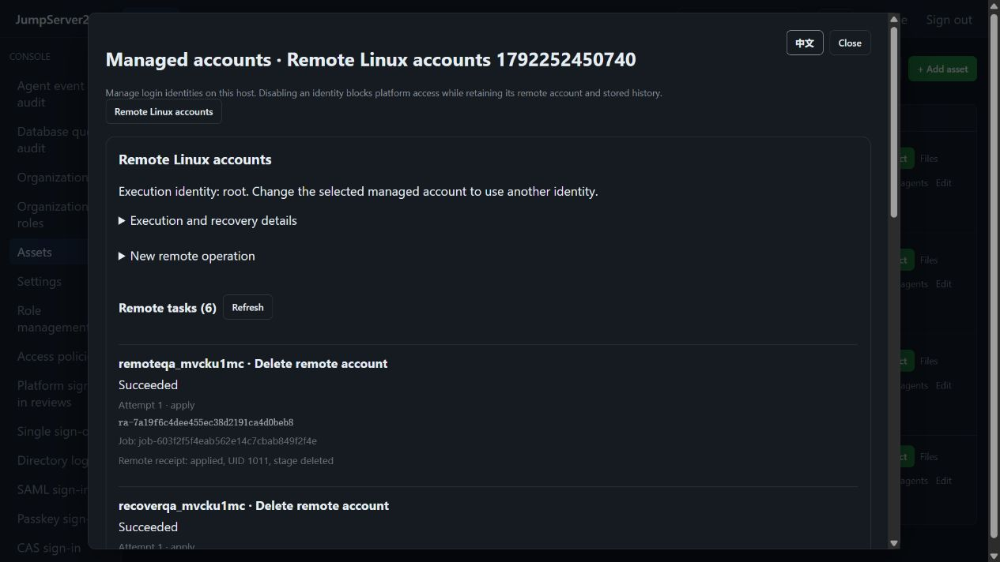

# Remote Linux account lifecycle

> [中文](./REMOTE-ACCOUNTS.md) | English

Create, disable, restore and delete regular Linux accounts through an existing SSH connection. In the Web UI, open Assets → Managed accounts → Remote Linux accounts. The selected managed account is the execution identity. A verified new account supports Web SSH, SFTP and the platform authenticated CLI.

## Permissions and prerequisites

- Requires `accounts.manage`, the matching `accounts.remote.create|disable|enable|delete` permission, and `view` / `connect` grants on the execution identity. Reading tasks requires `accounts.view` or `accounts.manage` and current asset access policies.
- Every attempt checks current identity status, roles, organization, source, time, asset and gateway bindings. Login approvals bind the task ID and attempt number. Command approvals retain the original source and full operation summary. An ordinary SSH approval cannot authorize account changes.
- Linux regular usernames and UIDs 1000–60000. Root, the primary credential, the execution identity itself and accounts referenced by another managed binding are excluded. Deletion also rejects gateway references. Matching host fingerprint and username references in other loaded organizations block changes.
- Root bootstraps a verified native Go helper. Delegated users require that same helper to be installed by an administrator and an existing `sudo -n` rule restricted to its `account-admin` subcommand. The platform does not grant sudo or sudoers editing rights.

## Credentials and effects

Creation first encrypts a generated Ed25519 private key in Vault and reserves an unavailable named account. The remote helper creates a task marked account, installs one public key and verifies SSH authentication with the new key. The credential becomes available only after verification and final authorization succeed atomically. API, CLI and audit output do not return private keys, passwords or shadow hashes. New keys rotate every seven days by default.

Disabling preserves the original shell and expiration field, applies expiration and nologin, and blocks platform connections. Enabling restores only a previously recorded helper owned disable operation. Deleting retains the home directory, changes ownership to root and applies mode 0700. It does not recursively delete data, kill processes or force deletion of busy users. Administrators must separately handle backups and other files owned by the UID.

## Interruption and recovery

The platform task and root owned host receipt are durable before effects. Authorization is checked before execution, during execution and before credential activation. Host receipts live in `/var/lib/jumpserver233/account-admin` and record each stage. Deletion also binds the inspected home directory device and inode so a replacement root directory cannot be used for a resumed operation.

Network, approval, credential verification, Vault persistence or HA takeover failures keep credentials unavailable. Restart and takeover never automatically replay remote writes. Stop the previous job before choosing:

- **Inspect remote state**: read and verify the receipt. Creation also revalidates the staged key and can commit an already confirmed effect.
- **Explicitly retry**: continue incomplete stages with the same task ID and key. Completed effects are not repeated. Each attempt requires current authorization and independent approval.
- **Cancel preparation**: persist a remote cancellation fence against delayed old requests, then release platform preparation. Cancellation is refused when remote effects exist or cannot be excluded. Stopping a job does not roll back changes.

Retain the native helper and root receipts together with Vault. Inventories containing remote tasks use format 2; jobs use authenticated encrypted format 3. Older programs refuse these files. Rollback requires a compatible complete backup from the same point in time.

## CLI and API

The CLI uses platform identity without exposing the target key:

```sh
jms --account root accounts remote-create ASSET --username deploy2
jms accounts remote-tasks ASSET --limit 20
jms --account root accounts remote-disable ASSET --username deploy2
jms --account root accounts remote-enable ASSET --username deploy2
jms --account root accounts remote-delete ASSET --username deploy2 --confirm deploy2
jms accounts remote-submit ASSET TASK_ID
jms accounts remote-attempt ASSET TASK_ID --mode inspect --revision REVISION
```

Commands return durable task, job and approval IDs. Inspect jobs with `jms accounts job JOB_ID`; after login approval, use `remote-submit` to continue the same submission. New attempts require the current task revision. Imported named accounts require an explicit `--uid` for the confirmed regular Linux UID. Platform created accounts reuse their verified UID.

`GET|POST /api/v1/assets/{collector}/remote-account-tasks` lists or creates tasks; `POST .../{task}/submit` continues submission; `POST .../{task}/attempts` accepts `revision` and `mode`. Creation uses a separate `request_id` idempotency key and account version. Public job requests cannot inject internal remote operation metadata.

Scope currently covers local regular Linux accounts and durable recovery under single active HA. Windows/LDAP/AD users, active active remote scheduling and complete enterprise account governance remain open. The competitor remains [JumpServer Enterprise](https://www.jumpserver.org/enterprise.html); full parity is still in progress.


## Verified interface

2026-10-17: six actual OpenSSH task receipts and recovery attempts remain readable after restarting the Docker API.


