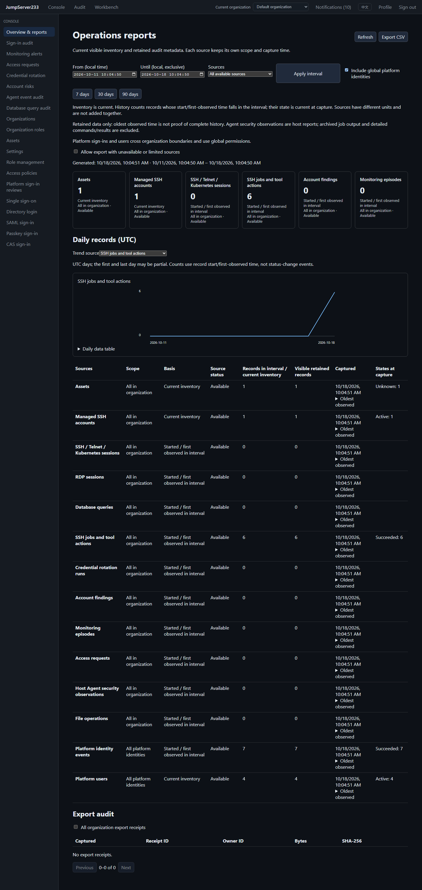
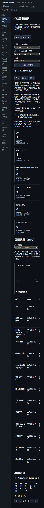

# Operations reports

> English | [中文](./REPORTS.md)

`/console/reports` shows currently visible inventory, retained audit statistics, UTC daily trends, and audited CSV exports. Web, `jms reports` and the Go SDK share source permissions. Standalone is the default; organization export receipts support PostgreSQL single-active takeover.

## Measurement

- Inventory counts currently visible assets and managed SSH accounts and ignores the time window. SSH status uses binding-checked real probes; samples older than three minutes are stale. Other protocols are marked not monitored.
- History selects start or first-observed timestamps in `[from, to)`, up to 366 days. State is current at capture. A successful job belongs to its creation day; the count is not a successful-state transition count.
- Each source shows its scope, capture time, visible retained count, selected count, oldest/newest observation and state distribution. Different record units are kept separate. The first and last UTC day can be partial.
- Only retained native indexes are available. The oldest observation does not establish complete history since that date; filters cannot restore pruned records.
- Sources are collected sequentially with separate capture times, rather than a database transaction across every module. A visible page refreshes every 30 seconds. Refresh preserves the fixed interval; the 7/30/90 day buttons reset its endpoint.
- `denied` means missing source permission with no counts. `unavailable` means a failed read with no invented zeros. `limited` means a capacity boundary and potentially partial counts. The latter two mark the report partial and require explicit consent before export.

## Sources and authorization

| API source | Native data and scope |
|---|---|
| `assets`, `accounts` | Currently visible assets/SSH accounts; `assets.view_all` or `assets.manage` sees the organization, otherwise existing asset/node/account/group grants apply |
| `terminal_sessions` | Own SSH/Telnet/Kubernetes sessions, or organization records with `audit.sessions.view_all` / `audit.sessions.monitor_all` |
| `rdp_sessions` | Own RDP sessions, or organization records with `audit.sessions.view_all` / `audit.desktops.monitor_all` |
| `database_queries` | Own query jobs; `database.audit.view_all` sees the organization |
| `ssh_jobs` | Own SSH/tool jobs; `jobs.view_all` sees the organization |
| `rotation_runs` | Rotation runs; requires `accounts.rotation.view` and `assets.view_all` |
| `account_risks` | `accounts.risks.view` and currently visible accounts; changed credential versions become `outdated` |
| `monitor_alerts` | `monitoring.view` / `monitoring.manage` and currently visible hosts |
| `access_tickets` | Native applicant, reviewer, copied-user and management visibility |
| `agent_alerts` | Host Agent observation index; `audit.agents.view_all` or plugin permissions with current connection grants |
| `file_transfers` | Native file audit actor scope; `audit.files.view_all` sees the organization |
| `platform_logins` | Explicit global identity inclusion only; own identity events or all platform events with `audit.logins.view_all` |
| `platform_users` | Explicit global identity inclusion only; own identity or all platform users with `users.manage` |

The last two use global permissions and are clearly labeled as platform scope. Organization roles cannot grant global identity authority. File operations retain the native username-based actor association. Agent statistics use the platform host-observation index (up to 20,000 records/30 days), without re-parsing command output or raw host events. Terminal sessions with no end record and no live session become `interrupted`. RDP also checks the live set.

`reports.export` allows export of data already visible to the caller and grants no source access. `reports.audit` allows all export receipts in the current organization. Receipt lists default to the owner, and both capabilities are organization scoped. Collection and export recheck identity and role snapshots, and use existing access locks against authorization writes. Revocation cannot retrieve files already downloaded.

## API, CLI and SDK

```text
GET /api/v1/reports/capabilities
GET /api/v1/reports/overview?from=RFC3339&to=RFC3339&sources=ssh_jobs,assets
GET /api/v1/reports/export.csv?sources=ssh_jobs&allow_partial=true
GET /api/v1/reports/exports?scope=mine&offset=0&limit=25

jms reports overview --sources ssh_jobs,assets
jms reports overview --include-platform --sources platform_logins
jms reports export --sources ssh_jobs
jms reports exports --all --offset 0 --limit 25
```

Authentication and `X-JMS-ORG` use the existing platform contract and CLI environment variables. SDK methods are `ReportOverview`, `ExportReport` and `ReportExportHistory`. CSV contains finite state codes, times, scopes and counts; credentials, commands, SQL, results, paths, host names and account names are excluded. Receipts contain the owner ID, interval, source scopes, digest and byte count.

Export builds and validates CSV, then persists an encrypted receipt before sending bytes. Audit failures return 503 with no CSV. `X-JMS-Report-ID` and `X-JMS-Report-SHA256` identify the receipt and CSV SHA-256. Web and SDK/CLI buffer and check the digest before saving/writing. This detects inconsistent transfer and does not replace HTTPS or a trusted server.

## Storage and performance limits

A receipt establishes report generation and audit before the response. Network interruption or a cancelled download can still leave a receipt; it does not prove that the client saved the file.

- Collection has a 15-second deadline, 100,000 records and 64 states per source; CSV is limited to 4 MiB. At most 20 sources can be selected.
- Legacy terminal/file indexes read at most 64 MiB each, with 1 MiB lines. RDP inspects at most 100,000 session directories, 64 MiB total indexes and 2 MiB per index. Limits are explicit source statuses; corrupt indexes become unavailable.
- AES-GCM receipts use organization `report-exports.json` or its Documents scope, with limits of 2,000 records/365 days and 4 MiB plaintext. Oldest receipts are pruned to fit. CSV files are not archived.
- Selecting non-inventory sources such as SSH jobs skips inventory scans. Agent visibility is cached by host/account within one collection. The route is lazy, with native SVG trends and an expandable data table.
- Login text uses the [Web Animations API](https://developer.mozilla.org/en-US/docs/Web/API/Element/animate), including reduced motion and a complete accessible title. The Motion runtime dependency is removed.

Scheduled generation, emailed reports, PDF, external BI, a complete historical warehouse and production multi-active acceptance remain open. Enterprise parity continues under [PLAN](./PLAN.en.md).

## Evidence

2026-10-18, isolated local Docker and real OpenSSH job data, English:



Chinese at 390px:



Testify covers source rights/revocation, explicit partial export, encryption/corruption, capacity/TTL, PostgreSQL scoped takeover, failed audit writes and digest validation. Browser checks cover real SSH ownership, cross-organization receipt isolation, Web/CLI exports, bilingual narrow layout, and login reduced motion. Results are recorded in [TESTING](./TESTING.en.md).
