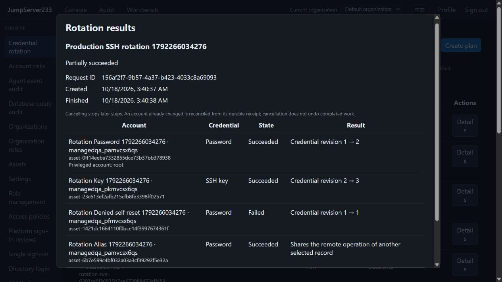

# SSH credential rotation plans

> [中文](./ROTATION-PLANS.md) | English

Select managed SSH accounts across hosts and rotate passwords or keys manually, once, or periodically. Web, `jms account rotation` and the Go SDK share the server executor. Target credentials remain in the encrypted Vault.

2026-10-18: per-account results from isolated Docker, real OpenSSH and the in-app browser:



The failed row deliberately omits a privileged account for an ordinary target, verifying partial failure and retention of the old credential.

The competitor is [JumpServer Enterprise](https://www.jumpserver.org/enterprise.html). This capability follows its [account change-secret plans](https://docs.fit2cloud.com/jumpserver/v3/guide/admin/account/account_change_secret/) using native Go SSH operations and durable receipts. Full Enterprise scope remains in progress under [PLAN](./PLAN.en.md).

## Usage

Console → Credential rotation → Create plan:

1. Search and select up to 500 managed SSH accounts in the current organization. Selection persists across pages.
2. Password accounts can use an SSH privileged account on the same host. It needs root or passwordless `chpasswd` permission; the target user may have no sudo access. The server rechecks host, port and pinned host key.
3. Choose manual, once, or periodic. Periodic defaults to 168 hours (seven days). Optionally rotate only credentials older than that interval.
4. Scheduling starts disabled. Saving a manual or disabled plan opens no remote connection. Confirming Rotate now rotates every selected account, including those not due.
5. Saving an enabled periodic plan can dispatch its first run immediately; later runs use an interval from dispatch time. One-time input uses browser local time and is stored as an absolute instant.

Passwords are generated strong values. SSH key accounts remain key accounts: the existing native engine generates Ed25519 keys, installs and verifies them, then revokes the old key. Privileged accounts apply only to password resets; key changes authenticate as the target account.

Duplicate managed records for one remote account share one operation and linked results. Password copies for that identity must agree; conflicting credentials reject rotation. Shared copies use the existing [password](./PASSWORD-ROTATION.en.md) and [key](./SSH-KEY-ROTATION.en.md) coordinators, without granting visibility across organizations.

## Results and recovery

- Batches execute per account; an individual failure does not stop unrelated accounts. Results distinguish success, partial success, failure, cancellation and recovery required.
- The same owner, plan and `request_id` return the existing run. Reusing that request for a different plan is rejected. CLI `--wait` exits nonzero for partial failure or recovery required while still returning queryable run JSON.
- Each step persists its intent before remote mutation. Password success/failure receipts are committed in the same Vault document as credential promotion; keys reuse existing stages and request receipts.
- After a result write failure, connection loss or takeover, inspect the Vault receipt and staged credentials first. Unknown results remain recovery required; a lost HTTP response never by itself triggers another password change.
- Recover existing operation checks staged credentials and completes that recorded operation using the recovery caller's current permissions, source and policies. It cannot borrow another pending operation. Changed source bindings require review.
- Cancel remaining steps stops queued work and cancels the current request. Completed remote changes remain effective. Uncertain outcomes remain until reconciled.
- Deleting a plan retains run history and audit. CSV includes metadata such as account, status, revision and timestamps, with spreadsheet formula protection.

Scheduled work uses the plan owner and server-derived source retained at save time. Current roles, organization, assets and method policies are rechecked for each account. Losing execution permission pauses the schedule; SSH/policy failures retain per-account results. Changes to host, username, credential kind or gateway route invalidate the old target binding; review and save the plan again. Normal credential rotation preserves that binding.

## Permissions and storage

| Permission | Purpose |
|---|---|
| `accounts.rotation.view` + `assets.view_all` | Read this organization's targets, plans, results and audit |
| `accounts.rotation.manage` | Create, edit and delete own plans; cancel own runs |
| `accounts.rotation.execute` + `assets.rotate` | Manual/scheduled execution and recovery |
| `accounts.rotation.manage_all` | Combine with operation permissions to manage other owners' plans/runs |
| `accounts.rotation.privileged` | Actually use a selected privileged SSH account |

The directory requires organization-wide asset visibility to avoid leaking hidden accounts through target counts or run history. View and plan management permissions do not automatically grant execution or privileged account access.

The `credential_rotation` channel covers plan steps, explicit recovery, existing single-account password/key rotation, and historical password restore. Administrators also follow access policies. This channel grants no terminal, job or file permissions.

Standalone is the default. Plans, internal bindings, intents, results and audit use organization-keyed AES-GCM encryption. PostgreSQL single-active HA reuses scoped documents and existing leadership contexts. Takeover reconciles executed receipts before continuing unstarted work. Live SSH sessions do not migrate.

Limits per organization: 256 plans, 512 runs, 10,000 audit entries and 64 MiB plaintext state. Terminal runs retain 90 days and audit retains 365 days, pruned on the next mutation. Unfinished operations are not automatically deleted. Capacity rejects new submissions and pauses affected schedules; review and re-enable after capacity is available.

Asset documents containing planned password receipts use format 4, preserving format 3 import receipts and remote lifecycle metadata. Older binaries reject format 4. Downgrades require the backup/restore process; do not edit the format number.

## CLI / SDK

Input files contain metadata only:

```json
{
  "name": "Weekly production SSH",
  "kind": "interval",
  "enabled": false,
  "interval_hours": 168,
  "only_due": true,
  "revision": 0,
  "targets": [
    {"account_id": "account-target", "collector_id": "account-root"},
    {"account_id": "account-key"}
  ]
}
```

```sh
jms account rotation targets --search production --limit 25
jms account rotation targets --collector-for account-target
jms account rotation create --file plan.json
jms account rotation plans
jms account rotation show-plan PLAN_ID
jms account rotation update PLAN_ID --file plan-update.json
jms account rotation run PLAN_ID --request-id UNIQUE_ID --wait --timeout-seconds 300
jms account rotation runs --plan PLAN_ID
jms account rotation show-run RUN_ID
jms account rotation cancel RUN_ID
jms account rotation recover RUN_ID
jms account rotation export RUN_ID --out new-rotation.csv
jms account rotation audit
jms account rotation delete PLAN_ID --revision CURRENT_REVISION
```

Updates and deletion require the current revision. `--file` strictly rejects unknown fields such as passwords and private keys. Exports create new files only. After a wait timeout, query the existing run and retain its request ID for retries.

`server/internal/sessionclient/rotation_plans.go` provides `RotationTargets`, `SaveRotationPlan`, `RunRotationPlan`, `RotationRun`, `CancelRotationRun`, `RecoverRotationRun` and metadata exports. It preserves platform Bearer / AccessKey authentication and `X-JMS-ORG` without importing Vault/database implementation DTOs.

## Validation and scope

Go/Testify covers idempotent and concurrent submissions, aliases, target binding, cancellation, permission revocation, explicit recovery, result write failures, encryption, format 4/import compatibility, PostgreSQL organization isolation and takeover. The real OpenSSH browser case is `web/e2e/rotation-plans.spec.ts`; commands and results are in [TESTING](./TESTING.en.md).

This slice supports Linux SSH passwords and existing key accounts. Specified password policies, Windows/database/network device rotation, notifications/external credential distribution, risk-driven automatic remediation, production HA failover acceptance and full Enterprise parity remain open. No CHANGELOG or release tag was generated.
