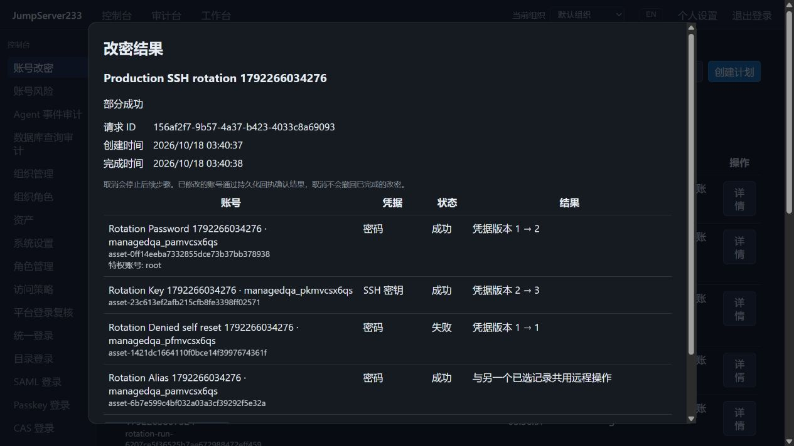

# SSH 账号改密计划

> 中文 | [English](./ROTATION-PLANS.en.md)

集中选择多台主机的托管 SSH 账号，按手动、单次或周期计划轮换密码和密钥。Web、`jms account rotation` 和 Go SDK 共用服务端执行器，目标凭据保留在加密 Vault。

2026-10-18，隔离 Docker、真实 OpenSSH 与内置浏览器逐项结果：



截图的失败行是普通账号未选择特权账号时的预期拒绝，用于验证部分失败和旧凭据保留。

竞品是 [JumpServer 企业版](https://www.jumpserver.org/enterprise.html)。本能力参考其[账号改密计划](https://docs.fit2cloud.com/jumpserver/v3/guide/admin/account/account_change_secret/)，采用 Go 原生 SSH 操作和持久化回执；完整企业版范围仍按 [PLAN](./PLAN.md) 推进。

固定密码及请求 ID 协议见[固定密码计划](./FIXED-PASSWORDS.md)。新 Web/CLI 保存携带请求 ID，精确重试保持计划身份。

## 计划密码约束

计划编辑器可选择增加长度、字符类别与排除字符约束。未设置或空规则继承组织策略。仅密码账号使用此规则；纯密钥计划拒绝密码约束。生成密码时与所有参与组织的当前策略取交集，不能降低任何一方要求。约束仅用于本计划；若要求所有手动/自动改密均遵守同一规则，应配置组织策略。账号七天自动轮换与计划独立调度，启用 only_due 时其他已完成的改密也会更新到期时间；冲突逐项返回 `password_policy_conflict`，不修改该账号的远端密码。混合计划的其他账号继续执行。

`PlanInput.password_policy`、公开运行记录与私有执行意图保存规则元数据；提交时固定计划修订及约束快照，后续编辑不改变已有运行。同一请求 ID 重放仍返回原运行。待确定操作继续使用加密日志中的已选密码；恢复核对原约束身份，不因组织或计划变化重新生成。运行详情可展开只读快照。组织默认规则见 [SSH 生成密码策略](./SSH-PASSWORD-POLICY.md)。

Web、`jms account rotation create/update --file` 和 Go SDK 共用可选 `password_policy` 字段；删除此字段后保存可恢复组织继承。该字段不包含密码，沿用计划管理和执行权限，无新增服务或依赖。计划/运行使用组织密钥加密；本地和共享改密日志中的凭据字段加密，资产回执只保存规则、修订及操作身份等元数据。整站备份包含上述数据。

## 使用

控制台 →「账号改密」→「创建计划」：

1. 搜索并选择当前组织的托管 SSH 账号，最多 500 个；支持跨页选择。
2. 密码账号可选择同一台主机上的 SSH 特权账号。该账号需要 root 或免密执行 `chpasswd` 的权限，目标普通账号可以没有 sudo。服务端重复检查主机、端口和固定主机密钥。
3. 选择手动、单次定时或周期执行。周期默认 168 小时，即七天；可勾选“仅轮换达到该凭据年龄的账号”。
4. 默认不启用定时执行。保存手动或未启用的计划不会连接远端；「立即改密」经确认后立即轮换全部所选账号，不受“尚未到期”限制。
5. 已启用的周期计划保存后可能立即执行第一轮；之后从该轮派发时间计算间隔。单次定时使用浏览器本地时间输入，服务端保存绝对时间。

密码为系统随机生成的强密码。SSH 密钥账号继续使用密钥凭据，由既有原生轮换器生成 Ed25519 密钥，先安装/验证，再撤销旧钥。指定特权账号仅用于密码重置，密钥变更认证目标账号自身。

随机密码使用组织级 [SSH 生成密码策略](./SSH-PASSWORD-POLICY.md)。该页支持有独立权限的用户配置长度、字符类别下限和排除字符；共享账号合并所有组织约束。计划支持附加生成约束和不可变运行快照；固定密码已接入独立只写输入与权限。

同一远程账号的重复托管记录合并为一次操作，关联行显示共享结果。执行者需确保同一远端身份的密码副本一致；凭据冲突会拒绝轮换。共享副本同步沿用[密码](./PASSWORD-ROTATION.md)和[密钥](./SSH-KEY-ROTATION.md)协调器，各组织不因此获得彼此的查看权限。

## 结果与恢复

- 批次逐账号执行并记录状态，单账号失败不阻止无关账号继续执行。全部成功、部分成功、失败、已取消和需要恢复分别显示。
- 同一负责人对同一计划重复提交相同 `request_id` 返回原批次；相同请求用于其他计划会被拒绝。CLI `--wait` 对部分失败或需要恢复返回非零退出码，仍输出可查询的批次 JSON。
- 每步先持久化操作意图，再修改远端。密码的成功/失败回执与 Vault 凭据提交在同一文档写入；密钥使用已有阶段和请求回执。
- 结果存储失败、连接中断或接管后，先检查 Vault 回执及暂存凭据。未知结果保留为“需要恢复”，不因丢失 HTTP 响应重新改一次。
- 「恢复已有操作」重新检查已有暂存凭据并完成原操作，按恢复请求者当前的权限、来源和访问策略执行。其他操作拥有的待处理凭据不能借用。来源变更需要先人工检查。
- 「取消剩余步骤」停止排队步骤并取消当前请求；已生效的远端变更不会回滚。未确认结果继续保留到完成核对。
- 删除计划会保留执行记录和审计。CSV 只导出账号、状态、修订号及时间等元数据，并防止表格公式注入。

定时执行使用计划负责人和保存时由服务端取得的来源，逐账号重新检查当前角色、组织、资产与方法策略。负责人失去执行权限后自动暂停；SSH/策略错误保留逐项结果。主机、用户名、凭据种类或网关路径变更后，旧目标绑定不能直接执行；应检查并重新保存计划。正常凭据轮换不改变绑定。

## 权限与存储

| 权限 | 用途 |
|---|---|
| `accounts.rotation.view` + `assets.view_all` | 查看当前组织目标、计划、结果和审计 |
| `accounts.rotation.manage` | 新建、编辑、删除自己的计划及取消自己的批次 |
| `accounts.rotation.execute` + `assets.rotate` | 手动/定时执行及恢复 |
| `accounts.rotation.manage_all` | 配合上述操作权限管理其他负责人的计划/批次 |
| `accounts.rotation.privileged` | 实际使用所选特权 SSH 账号 |

读取目录采用组织全资产权限，避免通过目标数量或批次记录泄露未授权账号。增加查看或计划管理权限不会自动授予执行和特权账号使用权限。

`credential_rotation` 通道同时覆盖计划逐步执行、显式恢复和既有单账号密码/密钥轮换、历史密码恢复接口。管理员也遵循访问策略。该通道不授予 SSH 会话、作业或文件操作权限。

单机优先，计划、内部目标绑定、操作意图、结果和审计以组织密钥 AES-GCM 加密保存。PostgreSQL 单活 HA 复用组织文档和现有领导权上下文；接管时先核对已执行回执，未开始步骤才继续执行。在线 SSH 会话不迁移。

每组织最多 256 个计划、512 个批次、10,000 条审计和 64 MiB 明文状态；终态批次保留 90 天，审计 365 天，下一次状态变更时清理。未终态操作不自动删除。容量不足拒绝新提交并暂停受影响的定时计划；容量恢复后需检查并重新启用。

包含计划密码回执的资产文档升级为格式 4，保留格式 3 的导入回执与远端账号元数据。旧二进制拒绝格式 4；升级后降级必须按备份/恢复流程处理，不手改格式号。

## CLI / SDK

以下 JSON 文件只含元数据：

```json
{
  "name": "Weekly production SSH",
  "kind": "interval",
  "enabled": false,
  "interval_hours": 168,
  "only_due": true,
  "revision": 0,
  "targets": [
    {"account_id": "account-target", "collector_id": "account-root"},
    {"account_id": "account-key"}
  ]
}
```

```sh
jms account rotation targets --search production --limit 25
jms account rotation targets --collector-for account-target
jms account rotation create --file plan.json
jms account rotation plans
jms account rotation show-plan PLAN_ID
jms account rotation update PLAN_ID --file plan-update.json
jms account rotation run PLAN_ID --request-id UNIQUE_ID --wait --timeout-seconds 300
jms account rotation runs --plan PLAN_ID
jms account rotation show-run RUN_ID
jms account rotation cancel RUN_ID
jms account rotation recover RUN_ID
jms account rotation export RUN_ID --out new-rotation.csv
jms account rotation audit
jms account rotation delete PLAN_ID --revision CURRENT_REVISION
```

更新 JSON 使用当前修订号；删除也要求修订号。`--file` 严格拒绝密码、私钥等未知字段；导出仅创建新文件，不覆盖已有内容。`--wait` 超时后查询原批次，保留原请求 ID 重试。

SDK 位于 `server/internal/sessionclient/rotation_plans.go`，提供 `RotationTargets`、`SaveRotationPlan`、`RunRotationPlan`、`RotationRun`、`CancelRotationRun`、`RecoverRotationRun` 和元数据导出等接口。沿用平台 Bearer / AccessKey 与 `X-JMS-ORG`；DTO 不依赖 Vault 或数据库实现。

## 验证与范围

Go/Testify 覆盖请求去重、并发提交、别名合并、目标绑定、取消、权限撤销、显式恢复、结果写入故障、加密、格式 4 与导入回执兼容、PostgreSQL 组织隔离及接管；真实 OpenSSH 浏览器用例见 `web/e2e/rotation-plans.spec.ts`，运行方式与结果见 [TESTING](./TESTING.md)。

本批支持 Linux SSH 密码和已有密钥账号。Windows/数据库/网络设备自动改密、通知/外部密码分发、风险驱动自动闭环修复、生产 HA 切换验收和完整企业版对齐仍待完成。未生成 CHANGELOG 或发布标签。
